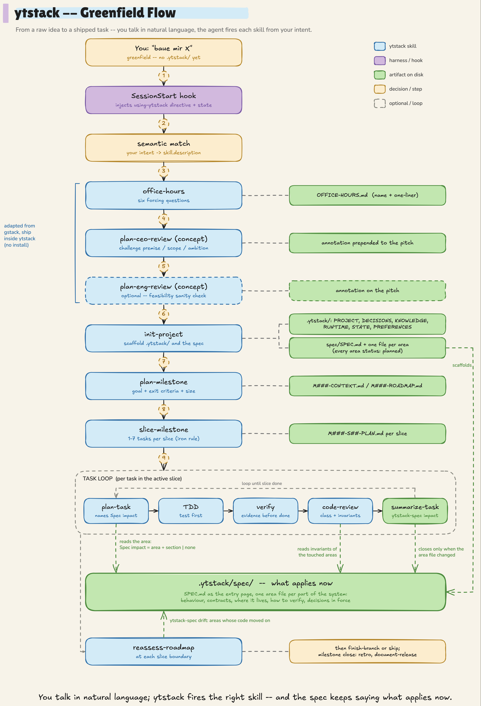

<div align="center">
  

  <h1>ytstack</h1>

  <p><em>An opinionated OS for AI coding agents. Plan like a PM, execute like a senior eng.</em></p>

  <p>
    A plugin for Claude Code and Codex that turns multi-session, multi-week projects into something your agent can actually hold onto. Project memory on disk, curated skill set, parallel execution via worktree-isolated subagents in Claude Code. One install, one namespace, no stack to maintain.
  </p>

  <p>
    <a href="./LICENSE"></a>
    <a href="https://github.com/Yesterday-AI/ytstack/actions/workflows/ci.yml"></a>
    
    
    
    
    
  </p>

  <table>
    <tr>
      <td align="center"><strong>1</strong><br/>install</td>
      <td align="center"><strong>0</strong><br/>separate runtimes</td>
      <td align="center"><strong>21</strong><br/>curated skills</td>
      <td align="center"><strong>MIT</strong><br/>open source</td>
    </tr>
  </table>
</div>

> Open Claude Code tomorrow. The agent already knows which milestone you're in, which task is open, what the last three tasks shipped, which decisions are locked. No "remind me what we were working on" ritual. You just start.

Enterprise-capable. Equally useful for solo dev.

---

## What a session feels like

Open a project that uses ytstack. Before your first message, a SessionStart hook has already injected two things into your agent's context: (1) a directive that tells the agent to reach for ytstack skills whenever your intent matches one, and (2) a state snapshot that tells it where you are:

```
[ytstack active -- scope: project]
Project: csv-importer
Current: M002 / S01 / T04
Last updated: 2026-04-23T19:30:00Z
Recent tasks: T01 (added CLI flag parsing), T02 (streaming CSV reader), T03 (row validation)
Next action: finish argon2 integration in src/auth/signup.ts:47
```

From there, you just talk to the agent. **You rarely type slash-commands.** The agent maps your natural-language requests to the right skill:

- Say "let's plan what's next" → agent fires `ytstack:plan-milestone` or `plan-task` based on where you are
- Say "this task is done" → agent fires `ytstack:summarize-task`, writes the outcome, flips the checkbox
- Say "something's broken, find it" → agent fires `ytstack:systematic-debugging` (root-cause required, no symptom patches)
- Say "where were we" → agent fires `ytstack:resume-session`, produces a 3-paragraph briefing
- Describe a feature you're not sure about → agent fires `ytstack:office-hours` for forcing questions

**Slash-commands are for steering**, not driving. Type `/ytstack:<name>` when you want to override the skill the agent would have picked, skip a step, or trigger an unusual workflow (e.g. running `ytstack:plan-ceo-review` on a milestone you already sliced, to challenge the premise again). For the happy path, natural language is enough.

Stepping away for a week? Say "let's do a handoff" -- agent fires `ytstack:handoff-session`, writes a rich handoff file. You or a teammate pick up from the file without re-explanation.

## Why it exists

AI coding agents are excellent inside a single session and fall apart between them. Long projects rot: context-window pressure makes the agent forget early decisions by the time it reaches late ones. You re-explain architecture every morning.

Three existing tools each solve it from a different angle and overlap in the middle:

- **[gstack](https://github.com/garrytan/gstack)** (Garry Tan) -- broad builder toolkit. Strongest on strategy and decision rigor: CEO / eng-manager / office-hours reviews that force real thinking before code. Also ships execution skills (`investigate` for systematic debugging, `qa`, `review`, `ship`) and session-level context save/restore. What it lacks: explicit TDD enforcement, and a structured milestone / slice / task artifact hierarchy that survives beyond "notes from the last session."
- **[superpowers](https://github.com/obra/superpowers)** (Jesse Vincent) -- methodology toolkit. Strongest on execution discipline: TDD, systematic debugging, verification-before-completion. Also ships planning skills (brainstorming, writing-plans, executing-plans). What it lacks: business-strategy reviews (no CEO / founder-mode diagnostics, no YC-office-hours forcing questions), and on-disk project memory that persists across sessions.
- **[GSD](https://github.com/gsd-build/gsd-2)** (get-shit-done) -- project management done right. Milestones, slices, tasks, artifact-as-memory, cross-session continuity. What it requires: a separate TypeScript runtime with its own CLI and TUI that fights Claude Code's native extension points.

gstack and superpowers overlap heavily in scope -- both ship planning, both ship debugging -- but each has a distinctive strength the other lacks. GSD has what neither has (structured artifact memory) but ships as a runtime. Combining all three by hand produces friction: skill conflicts, redundant planning flows, 50+ skill descriptions in every system prompt.

Install all three and you get friction: interactive prompts blocking each other, skill overlap, 50+ skills flooding every system prompt, a separate runtime to maintain. See the combining articles on [dev.to](https://dev.to/imaginex/a-claude-code-skills-stack-how-to-combine-superpowers-gstack-and-gsd-without-the-chaos-44b3) and [Medium](https://medium.com/@tentenco/superpowers-gsd-and-gstack-what-each-claude-code-framework-actually-constrains-12a1560960ad) for the full diagnosis.

**ytstack is the curation.** One plugin. We cherry-pick the _non-overlapping best_: gstack's strategy-review skills (CEO / eng / office-hours), superpowers' discipline skills (TDD / systematic-debugging / verification). We skip the overlap: gstack's `investigate` duplicates superpowers' `systematic-debugging`, superpowers' `writing-plans` conflicts with our milestone / slice / task flow, etc. GSD's project-memory discipline is re-implemented natively as skills + hooks -- no separate runtime. Claude Code's native Agent Teams handle parallel execution.

## What you get

**Agent-driven, not user-driven.** A SessionStart hook injects a "using ytstack" directive on every session start that tells the agent to map your natural-language intent to the right ytstack skill and invoke it before responding. You talk in plain language; the agent fires skills in the background. Slash-commands (`/ytstack:<name>`) exist for explicit steering -- they're the escape hatch, not the normal path.

**Never lose context across sessions.** Every ytstack project gets a `.ytstack/` directory with `PROJECT.md`, `DECISIONS.md`, `KNOWLEDGE.md`, `STATE.md`, and a milestone / slice / task hierarchy. Files are git-tracked Markdown. The same SessionStart hook injects the relevant state on every session start. The agent always knows where it is.

**Plan like a PM, execute like a senior eng.** Cherry-picked skills from gstack (CEO-review, office-hours, eng-review) lock the plan before code lands. Cherry-picked skills from superpowers (TDD, systematic-debugging, verification-before-completion) lock the code before it ships.

**Parallel execution without a custom runtime.** `ytstack:spawn-milestone-team` turns the main session into a thin orchestrator: one `ytstack:implementer` subagent per slice in its own git worktree (`isolation: worktree`, skills preloaded, fresh context), one `ytstack:verifier` per finished slice branch, then a merge the orchestrator owns. Claude Code Agent Teams remain an opt-in (`team: on`) for milestones where teammates must talk to each other. No separate CLI, no SQLite, no TUI to babysit.

**One namespace, upstreams consumed the way they want to be.** Skills appear as `/ytstack:<name>` -- no conflicts with other plugins. `vendor/superpowers/` is a read-only `git subtree` mirror pinned to an upstream tag (v7.0.2); we never modify it, we inline it. gstack is **not** vendored any more: it ships its skills as a Bun-powered install under `~/.claude/skills/gstack`, so ytstack's three planning wrappers check for that install (pinned v1.96.0.0) and invoke it through the Skill tool.

## Workflows

ytstack covers three workflows. The `SessionStart` hook injects the `using-ytstack` directive once per session; skill selection after that is semantic -- the agent matches user intent against each skill's `description:` field, not a phrase list.

### 1. Greenfield -- new project, no `.ytstack/` yet

From raw idea to shipped task. Each process step (orange) produces an artifact on disk (green) that the next step reads as a contract.

<details open>
<summary><strong>Greenfield flow diagram</strong> (click to collapse)</summary>



Source: [`docs/ytstack-greenfield-flow.excalidraw`](docs/ytstack-greenfield-flow.excalidraw) (single source of truth).

</details>

**Existing codebase, no `.ytstack/` yet? That is not greenfield.** A repo with its own README, `docs/`, CHANGELOG, ADRs and months of commits skips the pitch: say "set up ytstack here" / "adopt ytstack" and the agent fires `ytstack:adopt-brownfield`. The SessionStart hook already flags such a repo (>= 2 brownfield signals) and `init-project` routes there by itself when it finds a mature repo without a pitch. adopt-brownfield maps the existing files onto PROJECT.md / DECISIONS.md / KNOWLEDGE.md / RUNTIME.md **by reference** (your docs stay the source of truth), asks per file how to handle it (reference / extract / move / leave), writes a codebase map (`.ytstack/codebase/{stack,architecture,conventions,concerns}.md`) from four read-only subagents, and scaffolds only the gaps (STATE.md with a `tracker:` field for Linear / GitHub Projects / Paperclip / Jira). The shipped track record is the validation; `office-hours` is reserved for genuinely new scope.

### 2. Brownfield -- existing `.ytstack/`, continuing or starting new work

SessionStart hook injects `STATE.md` + the `using-ytstack` directive before your first message. Natural-language routing:

```
<session start: state injected>
  -> "where were we"           -> ytstack:resume-session    (3-paragraph briefing)
  -> "let's plan what's next"  -> ytstack:plan-milestone    (if no active milestone)
                                  ytstack:plan-task        (if milestone is active)
  -> "this task is done"       -> ytstack:summarize-task    (close + flip checkbox)
  -> "review my changes"       -> ytstack:code-review       (reviewer subagent on the task's commits)
  -> "let's do a handoff"      -> ytstack:handoff-session   (rich HANDOFF.md)
  -> "poke holes in this idea" -> ytstack:grill             (question it before plan-milestone)
  -> "finish the branch"       -> ytstack:finish-branch     (merge / PR / keep, after the slice is closed)
  -> "ship it"                 -> ytstack:ship              (gstack release flow: tests, review, PR)
  -> "retro"                   -> ytstack:retro             (after the milestone closed; gstack)
  -> "write the changelog"     -> ytstack:document-release  (release notes from the summaries; gstack)
```

Continuing an open task:

```
plan-task -> test-driven-development -> verification-before-completion -> code-review -> summarize-task
```

After the last task of a slice: `reassess-roadmap`, then `finish-branch` or `ship`. After the last slice of a milestone: `retro`, `document-release`, `plan-milestone`. The SessionStart hook prints these as hints when it sees a closed slice or milestone.

At each slice boundary: `ytstack:reassess-roadmap` to check the plan still fits reality.

**Parallel variant:** `ytstack:spawn-milestone-team` dispatches one worktree-isolated implementer subagent per slice (branch `ytstack/M###-S##`), verifies each slice branch with a fresh verifier subagent and merges what passed. PREFERENCES `team: on` (plus `CLAUDE_CODE_EXPERIMENTAL_AGENT_TEAMS=1`) switches to Claude Code Agent Teams instead.

<details>
<summary><strong>Brownfield flow diagram</strong> (click to expand)</summary>


Source: [`docs/ytstack-brownfield-flow.excalidraw`](docs/ytstack-brownfield-flow.excalidraw).

</details>

### 3. Brownfield debugging -- something is broken

```
"something's broken, find it"   -> ytstack:systematic-debugging
  Phase 1: root-cause investigation  (no fixes yet)
  Phase 2: pattern analysis
  Phase 3: hypothesis testing
  Phase 4: implementation
```

Iron rule: root cause required before any fix. Findings auto-log to `KNOWLEDGE.md` (pattern) and `DECISIONS.md` (architectural shift).

Fix path merges back into the brownfield task loop: regression test first (`test-driven-development`) -> `verification-before-completion` -> `summarize-task`. Same task skeleton as feature work, not a separate "debug mode".

<details>
<summary><strong>Debugging flow diagram</strong> (click to expand)</summary>


Source: [`docs/ytstack-debugging-flow.excalidraw`](docs/ytstack-debugging-flow.excalidraw).

</details>

## Compared to using each framework alone

| Need | gstack alone | superpowers alone | GSD alone | **ytstack** |
|---|---|---|---|---|
| CEO / founder-mode strategy review | ✅ | -- | -- | ✅ (via wrapper) |
| YC-office-hours forcing diagnostics | ✅ | -- | -- | ✅ (via wrapper) |
| Engineering plan / architecture review | ✅ | partial (brainstorming) | -- | ✅ (via wrapper) |
| TDD as enforced discipline | -- | ✅ | -- | ✅ (via wrapper) |
| Systematic debugging with root-cause gate | ✅ (`investigate`) | ✅ | -- | ✅ (superpowers wrapper) |
| Verification-before-completion gate | partial (via `ship`) | ✅ | ✅ | ✅ (via wrapper) |
| Structured milestone / slice / task artifacts | -- | -- | ✅ | ✅ (native) |
| Cross-session project memory | light (`context-save`) | -- | ✅ | ✅ (native) |
| Parallel fresh-context work (worktree subagents; Agent Teams opt-in) | -- | -- | via subprocess | ✅ (native) |
| SessionStart-hook state injection | -- | ✅ (for its own skills) | -- | ✅ (for project state) |
| No separate runtime to install | ✅ | ✅ | ❌ | ✅ |
| One namespace, one install | plugin-level | plugin-level | n/a | ✅ |
| Skill conflicts when combined with others | medium | medium | n/a | none |

## Install

### Prerequisites

- Claude Code >= 2.1.214.
- For the six gstack-backed skills (`office-hours`, `plan-ceo-review`, `plan-eng-review`, `retro`, `ship`, `document-release`): gstack installed at `~/.claude/skills/gstack` (tested against v1.96.0.0) with bun >= 1.4.2 -- `git clone --branch v1.96.0.0 https://github.com/garrytan/gstack ~/.claude/skills/gstack && (cd ~/.claude/skills/gstack && ./setup --no-browser)`. Those skills stop with this command when gstack is missing; the other 25 skills and all hooks need neither gstack nor bun.

### Codex

```bash
codex plugin marketplace add Yesterday-AI/ytstack
codex plugin add ytstack@ytstack
```

Start a new session. With trusted hooks, ytstack supplies its runtime context
automatically. Without hooks, first ask Codex to read the installed plugin's
`codex/adapter.md`, then select `$ytstack:using-ytstack` in the skill picker.
On local hosts with hook support, review and trust the plugin hooks for automatic
startup context, compaction handoff, and session journaling. Both hosts load the same 31 skill files. Worktree subagents, Claude Agent Teams and edit/commit hooks remain
Claude-only; Codex uses the sequential task flow and explicit verification.
See [Codex setup and compatibility](docs/codex.md) for local development,
hook-free usage, and validation.

The installation methods below are for Claude Code.

### Local dev (recommended for first try)

```bash
claude --plugin-dir /path/to/ytstack
```

Starts a fresh Claude Code session with ytstack loaded. Skills appear as `/ytstack:<skill-name>`. No marketplace registration needed. Reload after edits with `/reload-plugins`.

### Via marketplace (recommended for shared use)

ytstack ships in Yesterday's public plugin catalog, `yesterday-public-plugins` (repo [`Yesterday-AI/skills`](https://github.com/Yesterday-AI/skills)), which imports ytstack from its own repo.

```bash
/plugin marketplace add Yesterday-AI/skills
/plugin install ytstack@yesterday-public-plugins
```

ytstack declares no plugin dependencies (DECISIONS 2026-11-07 "No hard plugin dependencies"): `web-design` from the same catalog is recommended for frontend work and installs separately with `/plugin install web-design@yesterday-public-plugins`.

<details>
<summary><strong>Alternative: ytstack's own self-marketplace</strong></summary>

ytstack also self-marketplaces from its own repo, useful when you want to pin directly to it:

```bash
/plugin marketplace add Yesterday-AI/ytstack
/plugin install ytstack@ytstack
```

See [`.ytstack/DECISIONS.md`](./.ytstack/DECISIONS.md) for the marketplace history.

</details>

### Headless / CI

```bash
claude --plugin-dir /path/to/ytstack --permission-mode acceptEdits -p "<prompt>"
```

Without `--permission-mode acceptEdits`, Write operations stall on permission dialogs. The Agent Teams opt-in (`team: on`) additionally requires `CLAUDE_CODE_EXPERIMENTAL_AGENT_TEAMS=1`. See `.ytstack/KNOWLEDGE.md` for the full gotcha list.

## Quickstart

**You talk in natural language; the agent fires skills automatically.** Slash-commands exist as an override path when you want to skip a step or re-run one. For the happy path you never type them.

**Greenfield** (empty project dir, no `.ytstack/` yet). Say something like "baue mir eine cli die X macht" / "let's build a tool that Y" / "I have an idea for Z". The agent matches your intent against each skill's `description:` semantically and walks the chain:

| You say / what happens | Agent fires | Artifact produced |
|---|---|---|
| "build me X" / "I have an idea for Z" | `ytstack:office-hours` | `OFFICE-HOURS.md` (pitch with `name:` + `one-liner:` frontmatter) |
| (after pitch is written) | `ytstack:plan-ceo-review` (concept mode) | annotation block prepended to pitch |
| (optional, if architecture needs sanity-check) | `ytstack:plan-eng-review` (concept mode) | annotation block prepended to pitch |
| (once pitch is locked) | `ytstack:init-project` | `.ytstack/` with 6 core files, `PROJECT.md` populated from pitch frontmatter |
| (after scaffolding) | `ytstack:plan-milestone` | `M001-CONTEXT.md` + `M001-ROADMAP.md` |
| "break this into slices" | `ytstack:slice-milestone` | `M001-S##-PLAN.md` per slice |
| (per task in the slice) | `plan-task` -> TDD -> verify -> `summarize-task` | `T##-PLAN.md` -> code + tests -> `T##-SUMMARY.md` |

**Existing codebase** (README, `docs/`, commits, but no `.ytstack/` yet). Say "adopt ytstack here" / "set up ytstack for this project" -> `ytstack:adopt-brownfield` links your docs into `.ytstack/`, maps the codebase, and scaffolds only what is missing. No pitch. Then "plan the next milestone" -> `plan-milestone` scopes the delta.

**Brownfield** (ytstack already initialized). Say what you want in plain language:

- "where were we" -> `resume-session` produces a 3-paragraph briefing
- "let's plan what's next" -> `plan-milestone` (no active milestone) or `plan-task` (active milestone)
- "this task is done" -> `summarize-task` closes the task, flips the checkbox, updates `STATE.md`
- "something's broken, find it" -> `systematic-debugging` runs its 4-phase root-cause procedure (no symptom patches)
- "let's do a handoff" -> `handoff-session` writes `HANDOFF.md` for the next session
- "bump the SDK" / "rename the flag" (one sentence, known cause) -> `quick-task` ships it through the quick lane (`.ytstack/quick/Q###-*`), no milestone bookkeeping
- "clean up .ytstack" -> `reconcile` lists leftovers and asks per class; archives, never deletes

Type `/ytstack:<skill-name>` only when you want to override the auto-pick, skip a step, or explicitly re-run one (e.g. `/ytstack:plan-ceo-review` to re-challenge a milestone you already sliced). The using-ytstack directive loaded at session start enforces this model via the Skill tool.

See [QUICKSTART.md](./QUICKSTART.md) for the end-to-end worked example written in the same natural-language style.

## Dialing ceremony up or down

ytstack's milestone / slice / task loop is the default, not a mandate. Four keys in `.ytstack/PREFERENCES.md` (written by `init-project`, read by every lifecycle skill) size the ceremony to the project (DECISIONS 2026-11-07 "Ceremony scales with the change"):

| Key | Values (default first) | Effect |
| --- | --- | --- |
| `granularity` | `task`, `slice`, `milestone` | smallest unit that gets a PLAN/SUMMARY pair; `slice` collapses `T##` files into `M###-S##-*.md`, `milestone` into `M###-*.md` |
| `autonomy` | `loop`, `step` | `loop` chains plan-task -> TDD -> verify -> summarize inside a slice without asking (stops at slice boundaries and HARD-GATEs); `step` returns control after each skill |
| `quick_lane` | `on`, `off` | one-sentence changes ("rename X", "bump Y", "fix the off-by-one in Z") go through `ytstack:quick-task`: a `Q###-PLAN/SUMMARY` pair under `.ytstack/quick/`, TDD + verification, no pitch, no review, no pointer change |
| `minimal_code` | `on`, `off` | the SessionStart hook injects the `ytstack:minimal-code` guard (six-rung YAGNI ladder, never-cut list, `shortcut:` markers) |

Milestone states are data, not prose: `planned`, `in-progress`, `done`, `dropped`, `shipped-informally` (`reassess-roadmap` asks about stale milestones every 14 days). Leftovers (draft stubs, unfilled auto-drafts, planned-never-sliced milestones, untracked `.ytstack` files) are handled only by `ytstack:reconcile`, which asks per class and archives into `.ytstack/archive/<date>/` -- `.ytstack/` artifacts are user-owned and no agent deletes them on its own. The SessionStart hook also lints the STATE pointer (malformed fields, pointer behind the newest milestone, task already summarized, stale `last_updated`) and `plan-task` / `summarize-task` refuse a malformed pointer. Reading tolerates the layouts consumers already use (`milestones/M###/`, `decisions/`, `backlog/{,shipped,rejected}/`, `quick/`); writing stays flat.

## Where ytstack writes

Two kinds of state, two places (since 0.2.0; DECISIONS 2026-11-07):

| Kind | Where | Written by | In git? |
| --- | --- | --- | --- |
| Project memory: `PROJECT.md`, `DECISIONS.md`, `KNOWLEDGE.md`, `STATE.md`, `ROADMAP.md`, plans, summaries, the hand-written `HANDOFF.md` | `.ytstack/` in the checkout | you and the skills (`summarize-task`, `handoff-session`, ...) on purpose | yes |
| Volatile session state: automatic pre-compaction handoff (`HANDOFF.auto.md`), session journal (`session.jsonl`) | `${CLAUDE_PLUGIN_DATA}/repos/<repo-key>/worktrees/<worktree-key>/sessions/<session_id>/` with a `latest-handoff` symlink per worktree (fallback `.ytstack/.local/`, gitignored by `init-project`) | the `pre-compact` and `session-end` hooks | no |

Every hook and skill preamble resolves the checkout from where the agent actually works (the hook payload's `cwd`, via `hooks/lib/git-ctx.sh`), never from `CLAUDE_PROJECT_DIR`, which Claude Code pins to the session-start directory and does not move into a linked worktree. Consequences you can rely on: a session that works in a worktree never dirties the shared main checkout; `HANDOFF.md` is never overwritten by a hook; the draft `T##-SUMMARY.md` stub appears only in the checkout that committed and only when the commit subject carries the task ref (`commit_ref_pattern` in `PREFERENCES.md`, default `^M###-S##-T##:`); `resume-session` reads the automatic handoff first and the manual one second and tells you which it used. `tests/run-all.sh` (also `--linux`) proves all of this.

## Who this is for

**Good fit:**

- Projects that span more than one Claude Code session
- Teams where multiple people (or agents) touch the same codebase
- Any workflow where "what was decided and why" matters a week later
- People who already use superpowers or gstack and want the other's strengths without the friction

**Poor fit:**

- One-shot scripts that ship in a single session
- Teams that don't want opinionated process
- Workflows already deeply invested in GSD's TypeScript runtime (use GSD directly; ytstack solves a different layer)

## Status

**v0.4.0 -- shipping, actively dogfooded.** 0.2.0 made hooks and skills worktree-safe and moved volatile session state out of the repository (issues #24, #26, #27); 0.3.0 pulled superpowers to v7.0.2 and turned gstack into an installed, tag-pinned dependency (#25); 0.4.0 adds brownfield import (`adopt-brownfield`, #18), ceremony scaling (quick lane, reconcile, minimal-code guard, STATE lint), the 2026 skill bar (`metadata:` frontmatter, trigger-only descriptions measured by `evals/`, CI), six lifecycle skills (`code-review`, `finish-branch`, `grill`, `retro`, `ship`, `document-release`) and the worktree-subagent execution model. ytstack tracks its own development in `.ytstack/`; see `.ytstack/ROADMAP.md` for what is next.

Ships:

- 31 skills: project-OS lifecycle (`init-project`, `adopt-brownfield`, `plan-milestone`, `slice-milestone`, `plan-task`, `summarize-task`, `reassess-roadmap`, `quick-task`, `reconcile`), continuity (`resume-session`, `handoff-session`), gstack wrappers over the installed dependency (`office-hours`, `plan-ceo-review`, `plan-eng-review`, `retro`, `ship`, `document-release`), superpowers wrappers over the vendored subtree (`test-driven-development`, `systematic-debugging`, `verification-before-completion`, `code-review`, `finish-branch`, `grill`), orchestration (`spawn-milestone-team`), two directives (`using-ytstack`, `minimal-code`) and 5 engineering-OS references (`atomic-design`, `deutschland-stack-api`, `european-alternatives-api`, `oss-project`, `software-craftsmanship`).
- 9 hooks (SessionStart / PreCompact / SessionEnd / Stop / TeammateIdle / TaskCreated / TaskCompleted / PreToolUse-Edit / PostToolUse-Bash) on a shared resolver library (`hooks/lib/git-ctx.sh`); SessionStart injects the using-ytstack directive + project state + handoff pointers + STATE lint + lifecycle hints.
- Twelve shell test suites (`tests/run-all.sh`, macOS bash 3.2 + Linux bash 5), `bin/ytstack-check` (UX contracts, `metadata:` + description contract, resolver contract, vendor leaks) and an eval suite for `claude plugin eval` (`evals/`, 13 cases).
- Full docs (`AGENTS.md`, `CONTRIBUTING.md`, `QUICKSTART.md`, UX contracts, references, methodology)
- Plugin manifest + marketplace manifest, published via the `yesterday-public-plugins` catalog
- Codex manifest + self-marketplace, shared skills, and 3 lifecycle hooks; see [host support](docs/codex.md#supported-behavior)

See `.ytstack/ROADMAP.md` for the task list, `.ytstack/STATE.md` for progress, `.ytstack/REVIEW-NOTES.md` for deferred items.

## Repo layout

```
ytstack/
├── .claude-plugin/              plugin manifest + marketplace
├── .ytstack/                    dogfood: ytstack tracks itself
├── hooks/                       8 hook scripts + hooks.json + lib/git-ctx.sh (shared resolver)
├── skills/                      21 skill packages
├── tests/                       10 shell test suites + run-all.sh (--linux via Docker)
├── vendor/                      read-only subtree: superpowers v7.0.2 (gstack is an installed dependency, not vendored)
├── docs/
│   ├── ux/                      mandatory skill-authoring contracts
│   ├── references.md            research sources
│   └── methodology.md           what we adapted, from where, how
├── AGENTS.md                    contributor guide (for agents; CLAUDE.md symlinks to it)
├── CONTRIBUTING.md              contributor guide (for humans)
├── QUICKSTART.md                worked example
├── README.md                    this file
├── LICENSE, NOTICE              MIT + attributions
└── .gitignore
```

## Design principles

1. **Intelligence in the system, not the agent.** Skills, hooks, and artifacts carry the logic. The agent is replaceable.
2. **Context discipline.** Core context (`PROJECT.md`, `STATE.md`) always loaded. Task-context and background context on-demand.
3. **Evidence before assertion.** Nothing counts as "done" without verification.
4. **One fact, one place.** No duplicate documentation across files.
5. **User sovereignty.** Explicit user decision gates before destructive or scope-expanding actions.
6. **Skill selection via semantic descriptions, not keyword matching.** Claude Code's model matches user intent against each skill's `description:` field. Phrase-lists, trigger-maps, and secret-word tables are brittle by construction -- every new phrasing (language, paraphrase, dialect) breaks them. Skills self-identify through rich when-to-use descriptions; the agent selects semantically. If selection misbehaves, sharpen the description, never add a keyword list.

## Documentation

| Document | Purpose |
|---|---|
| [QUICKSTART.md](./QUICKSTART.md) | End-to-end worked example |
| [AGENTS.md](./AGENTS.md) | Contributor guide for AI coding agents (`CLAUDE.md` symlinks to it) |
| [CONTRIBUTING.md](./CONTRIBUTING.md) | Contributor guide for humans |
| [docs/concept.md](./docs/concept.md) | Condensed reference paper -- what ytstack wraps, skips, adds |
| [docs/methodology.md](./docs/methodology.md) | What we adapted from gstack / superpowers / GSD, and how |
| [docs/references.md](./docs/references.md) | Sources consulted while designing ytstack |
| [docs/ux/](./docs/ux/) | Skill-authoring UX contracts (frontmatter, format, writing style) |
| [.ytstack/DECISIONS.md](./.ytstack/DECISIONS.md) | Append-only architectural decision log |
| [.ytstack/KNOWLEDGE.md](./.ytstack/KNOWLEDGE.md) | Patterns + gotchas learned while building ytstack |
| [.ytstack/ROADMAP.md](./.ytstack/ROADMAP.md) | Milestone plan |
| [.ytstack/STATE.md](./.ytstack/STATE.md) | Current status dashboard |

## Issues and support

Found a bug, hit a rough edge, or want a skill that does not exist yet? Open an issue at [Yesterday-AI/ytstack/issues](https://github.com/Yesterday-AI/ytstack/issues).

- **Bug** -- use the bug-report template. Name the skill or hook, the session that triggered it, what you expected, and what happened.
- **Feature / new skill** -- use the feature-request template. Trace it to a real session (see [CONTRIBUTING.md](./CONTRIBUTING.md) "Speculative features"); "might be useful" is not a problem statement.

## Contributing

Read [AGENTS.md](./AGENTS.md) before modifying anything. See [CONTRIBUTING.md](./CONTRIBUTING.md) for PR rules and [docs/ux/](./docs/ux/) for the mandatory skill-authoring contracts.

Key rules:

- Never modify content in `vendor/**` (upstream superpowers / gstack trees -- wrap, don't edit)
- Never copy third-party methodology prose verbatim (concepts only)
- One logical change per commit
- Follow the AskUserQuestion 4-part format for any user-facing question

See [`docs/references.md`](./docs/references.md) for the full list of sources consulted while designing ytstack.

### Testing

Three layers, cheapest first:

- `bin/ytstack-check` -- static contracts (frontmatter, `metadata:`, description budget and trigger-only phrasing, resolver rules, vendor leaks). Free, runs in CI.
- `bash tests/run-all.sh` -- the shell suites in `tests/` (hooks, lib, preambles, checker) on macOS bash 3.2 and Linux (`--linux` via Docker). Free, runs in CI on ubuntu and macOS (`.github/workflows/ci.yml`).
- `claude plugin eval . --trust-plugin --scaffold --allow-tools Write Edit Bash --ablation none --no-publish --max-cost-usd 10` -- behavioural evals in [`evals/`](./evals/README.md): one case per lifecycle skill, each a user-phrased prompt plus a `skill-fired` grader and an outcome grader on the produced artifact. Real model calls on your account (about $0.30 per case); not in CI. The last recorded run is in `.ytstack/KNOWLEDGE.md`.

`/skill-doctor` in a session and `claude plugin details ytstack` show what the skill listing costs and which skills never fire.

## License

MIT. See [LICENSE](./LICENSE). Attributions in [NOTICE](./NOTICE).

Inspired by [gstack](https://github.com/garrytan/gstack), [superpowers](https://github.com/obra/superpowers), and [GSD](https://github.com/gsd-build/gsd-2). Built on Claude Code.

---

Maintained by [Yesterday](https://github.com/Yesterday-AI).
