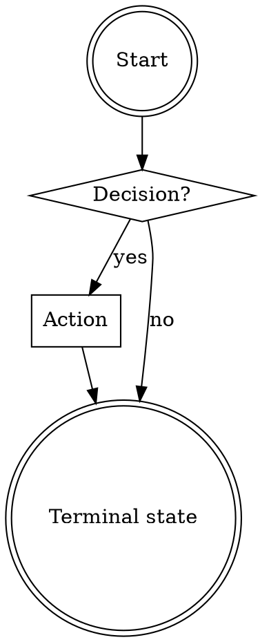

# ytstack Skill Structure

Every ytstack skill (`skills/*/SKILL.md`) MUST follow this structure. CI validates it. Skills that fail validation are not shipped.

## Required sections, in order

```
---
<frontmatter>
---

<HARD-GATE>         (optional but recommended)
<Anti-Pattern>       (optional but recommended)

## Checklist         (required)

## Process Flow      (required for non-trivial skills)

## Preamble          (required)

## The Procedure     (required -- main body)

## Terminal State    (required)
```

## Frontmatter

Required fields:

```yaml
---
name: <skill-name>              # kebab-case, matches folder name
description: <one-sentence>     # trigger description, see writing-style.md
tier: core|task|background      # Kontext-Pyramide tier
version: 1.0.0                  # semver
kind: directive|reference       # OPTIONAL, see "Skill classes" below
allowed-tools:                  # explicit allowlist
  - Bash
  - Read
  - Edit
  - AskUserQuestion
---
```

## Skill classes (`kind`)

Most skills are **procedure skills**: they run a numbered checklist and end in a terminal state. They MUST have `## Checklist` and `## Terminal State`. Omit `kind` for these (the default).

Two non-procedural classes are exempt from the structural-section requirements (they still get em-dash hygiene):

- `kind: directive` -- meta-primers that prime the agent rather than run a procedure (e.g. `using-ytstack`). The procedure lives in the skills the directive points at.
- `kind: reference` -- methodology or lookup references with no numbered procedure to run (e.g. `atomic-design`, `software-craftsmanship`, the `*-api` lookup skills, `oss-project`). They carry principles, rules, and patterns the agent applies in context.

`bin/ytstack-check` skips `## Checklist` / `## Terminal State` / `## Preamble` / `## Procedure` for both classes. Do not reach for `kind: reference` to dodge writing a checklist on a skill that really is a procedure -- if it has discrete steps with a terminal state, it is a procedure skill.

## HARD-GATE (pre-empt premature action)

Use when the skill must block downstream actions until a prerequisite is met:

```xml
<HARD-GATE>
Do NOT <action A>, <action B>, or <action C> until <prerequisite>.
This applies to EVERY <situation> regardless of perceived <quality>.
</HARD-GATE>
```

Example (from `init-project`):

```xml
<HARD-GATE>
Do NOT invoke any milestone-planning skill, create `.ytstack/M*-*.md` files,
or spawn an agent team until `.ytstack/PROJECT.md` exists and the user has
confirmed its content. This applies to EVERY project regardless of perceived
simplicity.
</HARD-GATE>
```

## Anti-Pattern Preemption (kill rationalization)

Use when there's a predictable "this is too simple to bother" pattern the agent might rationalize:

```markdown
## Anti-Pattern: "<the rationalization>"

<one paragraph explaining why the rationalization is wrong>

<what to do instead>
```

Example (from `plan-milestone`):

```markdown
## Anti-Pattern: "This feature is too small for a full milestone"

Every feature goes through this process. A CSS tweak, a single bugfix, a config
change -- all of them. "Small" features are where unexamined assumptions cause
the most wasted work. The milestone can be minimal (one slice, two tasks), but
you MUST create it and get approval.
```

## Checklist

Every skill has a numbered checklist. The skill MUST instruct the agent to create a TodoWrite task for each item and complete them in order.

Template:

```markdown
## Checklist

You MUST create a task for each of these items and complete them in order:

1. **<step name>** -- <one-line description>
2. **<step name>** -- <one-line description>
3. ...
```

Rules:
- Each item is an observable action (file written, tool called, user asked)
- No item is "think about X" -- observable outcomes only
- Items that are conditional (only run if Y) are explicit: "**<step>** (only if `FLAG=yes`)"

## Process Flow

For skills with non-trivial branching, include a `dot` graph. Use box for actions, diamond for decisions, doublecircle for terminal states.

Template:

````markdown
## Process Flow


````

Keep it under ~15 nodes. If it's more complex, decompose into sub-skills.

## Preamble (required, first executable step)

Every skill starts with a Bash preamble that detects project state. Output follows the Preamble Flag Contract (see [askuserquestion-format.md](askuserquestion-format.md#preamble-flag-contract)).

### Resolver contract (M016, DECISIONS 2026-11-07)

Every shell preamble (```bash or ```!) starts with the shared resolver and never re-implements it. The checkout is **where the shell runs**, resolved by `hooks/lib/git-ctx.sh`; `CLAUDE_PROJECT_DIR` is pinned to the session-start directory and does not follow the agent into a linked worktree, so it is never a starting point. `bin/ytstack-check` fails on these patterns in `skills/**/SKILL.md` and `hooks/*` (comment lines excluded):

| Banned | Why | Use instead |
| --- | --- | --- |
| `[ -d .git ]` | a linked worktree's `.git` is a FILE -> `IS_GIT: no` (issue #24) | `git rev-parse --is-inside-work-tree` via the lib (`YT_IS_GIT`) |
| `basename "$(git rev-parse --show-toplevel ...)"` as a key | folder names collide (`my-context-mcp` vs `meinkontext`) | `YT_REPO_KEY` (hash of the git common dir); basename only for display of a resolved path |
| `CLAUDE_PROJECT_DIR` in hooks | does not follow worktrees -> writes land in the wrong checkout (issues #26/#27) | payload `cwd` via `yt_read_stdin` + `yt_git_ctx` |
| `~/.ytstack/.<name>-prompted` sentinels | invisible, unversioned, slug-keyed | record the answer in the artifact (`PROJECT.md` frontmatter, CONTEXT.md) |

Required block (verbatim; `${CLAUDE_SKILL_DIR}` is substituted by Claude Code when the skill loads; the fallback branch covers hosts that do not substitute it):

```bash
# ytstack resolver (M016): checkout = where this shell runs, via the shared lib.
_LIB="${CLAUDE_SKILL_DIR}/../../hooks/lib/git-ctx.sh"
if [ -f "$_LIB" ]; then
  . "$_LIB"; yt_git_ctx "$PWD"; yt_resolve_yt_dir >/dev/null
  _PROJECT_DIR="$YT_TOPLEVEL"; _YT_DIR="$YT_DIR"; _YT_SCOPE="$YT_SCOPE"; _IS_GIT="$YT_IS_GIT"; _PROJECT_KEY="$YT_REPO_KEY"
else
  # Host did not substitute CLAUDE_SKILL_DIR (e.g. Codex adapter): project scope only.
  _IS_GIT=$([ "$(git rev-parse --is-inside-work-tree 2>/dev/null)" = true ] && echo yes || echo no)
  _PROJECT_DIR=$(git rev-parse --show-toplevel 2>/dev/null || pwd -P)
  _YT_DIR=""; _YT_SCOPE=none; _PROJECT_KEY=""
  [ -d "$_PROJECT_DIR/.ytstack" ] && { _YT_DIR="$_PROJECT_DIR/.ytstack"; _YT_SCOPE=project; }
fi
cd "$_PROJECT_DIR" 2>/dev/null || true
_PROJECT_SLUG=$(basename "$_PROJECT_DIR")   # display only
_HAS_YTSTACK=$([ -n "$_YT_DIR" ] && echo yes || echo no)
```

Required exports after the block (minimum):

```bash
echo "BRANCH: $(git branch --show-current 2>/dev/null || echo unknown)"
echo "PROJECT_SLUG: $_PROJECT_SLUG"
echo "HAS_YTSTACK: $_HAS_YTSTACK"
echo "YTSTACK_SCOPE: $_YT_SCOPE"
echo "YT_DIR: $_YT_DIR"

# Non-interactive detection
if [ -n "$YTSTACK_NON_INTERACTIVE" ] || [ -n "$OPENCLAW_SESSION" ] || [ -n "$CLAUDE_AGENT_TEAM_MEMBER" ]; then
  echo "YTSTACK_NON_INTERACTIVE: true"
else
  echo "YTSTACK_NON_INTERACTIVE: false"
fi

# Active work
if [ -f "$_YT_DIR/STATE.md" ]; then
  echo "CURRENT_MILESTONE: $(sed -n 's/^current_milestone: *//p' "$_YT_DIR/STATE.md" | head -1)"
  echo "ACTIVE_SLICE: $(sed -n 's/^active_slice: *//p' "$_YT_DIR/STATE.md" | head -1)"
fi
```

Library functions available after sourcing: `yt_read_stdin`, `yt_git_ctx`, `yt_resolve_yt_dir`, `yt_state_dir` / `yt_state_wt_dir` / `yt_state_base` (out-of-tree session state), `yt_commit_ref_pattern`, `yt_task_commits`, `yt_ensure_gitignore`, `yt_brownfield_signals <toplevel>` (sets `YT_BROWNFIELD_SIGNALS` + `YT_BROWNFIELD_HINTS`; shared by init-project, adopt-brownfield and session-start), `yt_gstack_ctx`, `yt_jq`, `yt_python`. Functions that set globals must be called directly (`yt_resolve_yt_dir >/dev/null`), not inside `$(...)`. Guard lib-only functions in the fallback branch with `command -v yt_brownfield_signals >/dev/null 2>&1`.

## The Procedure (main body)

Numbered steps. Each corresponds to one checklist item. Each step is:

1. **Bold step name** matching the checklist
2. One paragraph explaining what to do
3. If the step is conditional: explicit English gate (*"If `HAS_YTSTACK` is `no`, proceed. Otherwise skip to step 4."*)
4. If the step uses AskUserQuestion: inline the full question text following the format contract
5. If the step writes files: list exact file paths

Rules:
- Natural language for logic and state -- don't use shell variables to pass state between code blocks
- Each bash code block is self-contained (variables don't persist)
- Express conditionals as English: *"1. If X, do Y. 2. Otherwise, do Z."*
- Reference preamble flags by name in prose, not variable interpolation

## Terminal State Declaration (required)

End every skill with an explicit declaration of what happens next:

```markdown
## Terminal State

The terminal state is <one of>:

- Invoking ytstack:<next-skill-name> -- <one-line reason>
- Returning control to the user with <specific-artifact-path> committed
- Exiting without action (user declined at <gate-name>)

Do NOT invoke <list of forbidden next skills>. The ONLY skills you may invoke
after this one are: <allowlist>.
```

Explicit allowlisting prevents the agent from wandering into "helpful" adjacent actions. If an agent feels tempted to invoke something not on the allowlist, the correct action is to STOP and ask the user.

## Ask-once answers (sentinel files retired, M016)

Sentinel files under `~/.ytstack/.<name>-prompted` are retired (invisible, unversioned, keyed by folder name; `bin/ytstack-check` fails on the path). An ask-once answer is recorded in the artifact it concerns, AFTER the user answers:

- Storage scope of a project -> `PROJECT.md` frontmatter `scope:` (plus `init_completed:`)
- Milestone size -> `M###-CONTEXT.md` / `M###-ROADMAP.md` frontmatter `size:`
- Anything per-user and cross-project -> `~/.ytstack/config` (`key=value`)

The "to re-ask later" hint names the field to edit, never a file to delete.

## Spawned-Session Behavior

If `YTSTACK_NON_INTERACTIVE: true` appears in the preamble output, the skill MUST:

1. Skip all `AskUserQuestion` invocations. Auto-pick the `RECOMMENDATION` option.
2. Emit a one-line log per auto-pick: *"[ytstack:<skill>] auto-picked A (<option-label>) because YTSTACK_NON_INTERACTIVE=true"*
3. Never block on user input.
4. Complete or fail clearly -- no stalling.

## Writing Style

All skill prose follows [writing-style.md](writing-style.md). Jargon gloss, outcome framing, concreteness standard, em-dash punctuation rule. (An earlier banned-words list was rolled back 2026-04-24 as scope-creep; only the em-dash rule is mechanically enforced.)

## Validation (CI)

`ytstack-skill-check` runs on every commit and validates:

- [x] Frontmatter has all required fields with valid values
- [x] `HARD-GATE` tags are balanced (every `<HARD-GATE>` has `</HARD-GATE>`)
- [x] Checklist exists and uses numbered format
- [x] Process Flow is valid `dot` syntax (for skills above minimum complexity)
- [x] Preamble emits all required flags
- [x] Terminal State section exists and lists forbidden next-skills
- [x] Every `AskUserQuestion` body passes `askuserquestion-format.md` validation
- [x] No em-dashes (`—` U+2014) in prose per `writing-style.md` (autocorrect hazard)
- [x] Sentinel file paths match convention

Violations fail CI. No exceptions.

## Skill File Size

Target: each SKILL.md under **800 lines** (roughly 20K tokens). Warn at 1200 lines, fail CI above 1800 lines.

If a skill grows past the soft limit, decompose. Move rationale to `docs/ytstack/design/<skill-name>.md` and reference it from the SKILL.md header.

## Skill Dependencies

Skills that depend on other skills declare it in frontmatter:

```yaml
depends-on:
  - ytstack:init-project       # must have run before this skill is valid
  - ytstack:plan-milestone     # must have produced M###-ROADMAP.md
```

The preamble reads `depends-on` and emits a DEPS_OK flag based on whether required artifacts exist. If `DEPS_OK: no`, the skill MUST halt with a clear error pointing at the missing dependency.
