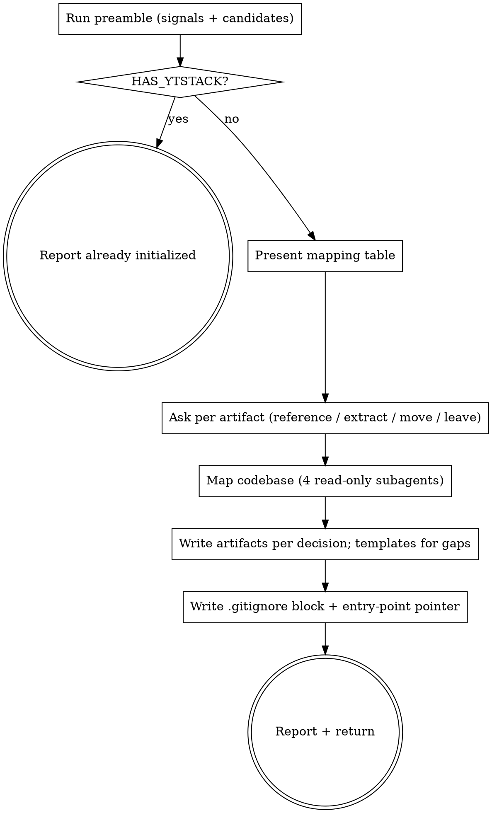

# adopt-brownfield

Give an existing codebase a first-class entry into ytstack. The repo already answers most of the questions a pitch would ask (what it is, what runs where, what was decided); this skill finds those answers, links to them, and writes only what is missing.

<HARD-GATE>
Do NOT delete, move, or rewrite any user file, and do NOT invoke `ytstack:office-hours`,
until the user has answered the per-artifact question for that file (Step 4). This applies
to EVERY repo regardless of how obvious the mapping looks. Reference-only is always the
safe default; moving a file is the exception the user picks.
</HARD-GATE>

## Anti-Pattern: "Let me validate the premise with office-hours first"

A product that has shipped, a repo with a CHANGELOG and a year of commits, a service in production: these have been validated by use, not by six forcing questions. Running the pitch interview on them is theater and makes ytstack worse than nothing for mature projects. Skip the pitch. Record "validated by track record" in PROJECT.md and reserve `office-hours` for genuinely new scope (a new feature or initiative that has no users yet).

## Anti-Pattern: "I'll copy the docs into .ytstack/ so everything is in one place"

Copies drift. The README, `docs/` and the ADRs stay the source of truth; `.ytstack/` is a distillation and navigation layer over them. Link, summarise in one line, point at the file. Only move a file when the user says so (Step 4, option C), and leave a pointer at the old path.

## Checklist

You MUST create a TodoWrite task for each of these items and complete them in order:

1. **Run preamble** -- resolve the checkout, count brownfield signals, list candidate sources
2. **HARD-GATE: already initialized** -- if `HAS_YTSTACK=yes`, report and stop
3. **Present the mapping table** -- found / target slot / proposed handling / conflicts / gaps
4. **Ask per artifact** -- one AskUserQuestion per candidate slot: reference / extract / move / leave
5. **Map the codebase** -- dispatch up to 4 read-only subagents, write `.ytstack/codebase/{stack,architecture,conventions,concerns}.md`
6. **Write the artifacts** -- PROJECT, DECISIONS, KNOWLEDGE, RUNTIME, STATE, PREFERENCES, each per its Step 4 decision; templates only for gaps
7. **Write the `.gitignore` block** -- `.ytstack/.local/` via `yt_ensure_gitignore`
8. **Update the entry-point doc** -- pointer section in AGENTS.md or CLAUDE.md (never a copy)
9. **Report** -- files written, handling per slot, next step
10. **Return control** -- do NOT auto-invoke any other skill

## Process Flow



## Preamble

Run this first. Output gets read by the procedure below.

```bash
# ytstack resolver (M016): checkout = where this shell runs, via the shared lib.
_LIB="${CLAUDE_SKILL_DIR}/../../hooks/lib/git-ctx.sh"
if [ -f "$_LIB" ]; then
  . "$_LIB"; yt_git_ctx "$PWD"; yt_resolve_yt_dir >/dev/null
  _PROJECT_DIR="$YT_TOPLEVEL"; _YT_DIR="$YT_DIR"; _YT_SCOPE="$YT_SCOPE"; _IS_GIT="$YT_IS_GIT"; _PROJECT_KEY="$YT_REPO_KEY"
else
  # Host did not substitute CLAUDE_SKILL_DIR (e.g. Codex adapter): project scope only.
  _IS_GIT=$([ "$(git rev-parse --is-inside-work-tree 2>/dev/null)" = true ] && echo yes || echo no)
  _PROJECT_DIR=$(git rev-parse --show-toplevel 2>/dev/null || pwd -P)
  _YT_DIR=""; _YT_SCOPE=none; _PROJECT_KEY=""
  [ -d "$_PROJECT_DIR/.ytstack" ] && { _YT_DIR="$_PROJECT_DIR/.ytstack"; _YT_SCOPE=project; }
fi
cd "$_PROJECT_DIR" 2>/dev/null || true
_PROJECT_SLUG=$(basename "$_PROJECT_DIR")   # display only
_HAS_YTSTACK=$([ -n "$_YT_DIR" ] && echo yes || echo no)

_NON_INTERACTIVE=false
if [ -n "$YTSTACK_NON_INTERACTIVE" ] || [ -n "$OPENCLAW_SESSION" ] || [ -n "$CLAUDE_AGENT_TEAM_MEMBER" ]; then
  _NON_INTERACTIVE=true
fi
_EXPLAIN_LEVEL="default"
[ -f "$HOME/.ytstack/config" ] && _EXPLAIN_LEVEL=$(grep -E '^explain_level=' "$HOME/.ytstack/config" 2>/dev/null | cut -d= -f2 || echo default)

# Brownfield signals + candidate mapping (shared detector; lib only).
_BF_SIGNALS="unknown"; _BF_HINTS=""
if command -v yt_brownfield_signals >/dev/null 2>&1; then
  yt_brownfield_signals "$_PROJECT_DIR"
  _BF_SIGNALS="$YT_BROWNFIELD_SIGNALS"; _BF_HINTS="$YT_BROWNFIELD_HINTS"
fi
_COMMITS=$(git rev-list --count HEAD 2>/dev/null || echo 0)
_FIRST_COMMIT=$(git log --reverse --format=%as 2>/dev/null | head -1)
_ENTRY_DOC=""
for f in AGENTS.md CLAUDE.md; do [ -f "$f" ] && { _ENTRY_DOC="$f"; break; }; done
[ "$_ENTRY_DOC" = CLAUDE.md ] && [ -L CLAUDE.md ] && [ -f AGENTS.md ] && _ENTRY_DOC="AGENTS.md"
_PITCH=""; [ -f ./OFFICE-HOURS.md ] && _PITCH="./OFFICE-HOURS.md"
_README_ONELINER=""
if [ -f README.md ]; then
  _README_ONELINER=$(awk 'NF==0{next} /^#/{next} /^[!<\[|`-]/{next} {print; exit}' README.md | cut -c1-200)
fi

echo "BRANCH: $(git branch --show-current 2>/dev/null || echo unknown)"
echo "PROJECT_SLUG: $_PROJECT_SLUG"
echo "HAS_YTSTACK: $_HAS_YTSTACK"
echo "YTSTACK_SCOPE: $_YT_SCOPE"
echo "YT_DIR: $_YT_DIR"
echo "YTSTACK_NON_INTERACTIVE: $_NON_INTERACTIVE"
echo "EXPLAIN_LEVEL: $_EXPLAIN_LEVEL"
echo "IS_GIT: $_IS_GIT"
echo "COMMITS: $_COMMITS"
echo "FIRST_COMMIT: ${_FIRST_COMMIT:-unknown}"
echo "ENTRY_DOC: ${_ENTRY_DOC:-none}"
echo "PITCH: ${_PITCH:-none}"
echo "README_ONELINER: ${_README_ONELINER:-none}"
echo "BROWNFIELD_SIGNALS: $_BF_SIGNALS"
echo "CANDIDATES:"
if [ -n "$_BF_HINTS" ]; then printf '%s\n' "$_BF_HINTS" | sed 's/^/  - /'; else echo "  (none detected)"; fi
```

## Procedure

### Step 2: HARD-GATE -- already initialized

If `HAS_YTSTACK` is `yes`, nothing is left to adopt. Report and stop:

> "ytstack is already initialized for `{PROJECT_SLUG}` at `{YT_DIR}` (scope: {YTSTACK_SCOPE}). To see where things stand, run `ytstack:resume-session`. To refresh the codebase map only, delete `{YT_DIR}/codebase/` and run this skill again."

If `BROWNFIELD_SIGNALS` is `0` or `1`, continue (the user asked for this skill), but say so in one line before the table: *"Only {N} brownfield signals. If this is really a new idea rather than an existing codebase, `ytstack:office-hours` then `ytstack:init-project` fit better; say stop and I will."* If it is `unknown` (lib not loaded), build the candidate list by hand in Step 3 from `README.md`, `docs/`, `CHANGELOG.md`, `docs/adr/`, `docs/decisions/`, manifest files and `AGENTS.md`/`CLAUDE.md`.

### Step 3: Present the mapping table

Read each candidate named under `CANDIDATES` (first 40 lines of each file is enough; for directories, `ls` plus the H1 of each file). Then show one table, in prose, no question yet:

> Adopting ytstack for **{PROJECT_SLUG}** on branch `{BRANCH}`: {COMMITS} commits since {FIRST_COMMIT}, {BROWNFIELD_SIGNALS} brownfield signals. No `.ytstack/` yet.
>
> | Slot | Found | Proposed handling | Note |
> |---|---|---|---|
> | PROJECT.md | `README.md` ({lines} lines){, `CHANGELOG.md`} | extract one-liner + Validated section | one-liner candidate: "{README_ONELINER}" |
> | DECISIONS.md | `docs/adr/` ({n} records) | reference: one entry per ADR, linked | {conflict if two decision sources exist} |
> | KNOWLEDGE.md | `docs/*.md` ({n} files) | reference: link index with H1 summaries | |
> | RUNTIME.md | `package.json` scripts, `.env.example`, `compose.yml`, `.github/workflows/` | extract: commands, services, env keys, deploy target | values never copied, keys only |
> | ROADMAP backlog | `docs/plans/` / `ROADMAP.md` / `BACKLOG.md` | reference | open items become backlog, not a milestone |
> | STATE.md | nothing | gap: scaffold | `tracker:` field for Linear / GitHub Projects / Paperclip / Jira |
> | Entry point | `{ENTRY_DOC}` | pointer section | never duplicated |
>
> Conflicts: {e.g. "docs/adr/ AND docs/design-decisions.md both record decisions; I will seed DECISIONS.md from both, by reference, and flag overlaps"} or "none".
> Gaps: {slots with no source, typically STATE.md and PREFERENCES.md}. These get templates.

Omit rows whose source does not exist, except STATE.md (always a gap) and the entry point (say "none found" when `ENTRY_DOC` is `none`).

If `PITCH` is not `none`: a pitch for new scope exists alongside the old codebase. Say so; in Step 6 move it to `{YT_DIR}/OFFICE-HOURS-<slug>.md` exactly as `init-project` does, so `plan-milestone` can draw the first milestone from it. The pitch does not change the handling of the existing docs.

### Step 4: Ask per artifact

One question per slot that has a source (PROJECT, DECISIONS, KNOWLEDGE, RUNTIME, backlog), in that order, one message each. Do not ask for gaps and do not ask for the entry point.

If `YTSTACK_NON_INTERACTIVE` is `true`, auto-pick the RECOMMENDATION for every slot and log one line each: `[ytstack:adopt-brownfield] auto-picked {X} for {SLOT} because YTSTACK_NON_INTERACTIVE=true`.

Otherwise use AskUserQuestion with this body, substituting the slot:

> Adopting ytstack for **{PROJECT_SLUG}** on branch `{BRANCH}`; deciding how `{SOURCE}` feeds `.ytstack/{SLOT}`.
>
> `{SOURCE}` already holds what ytstack would put into `{SLOT}`. ytstack's memory files are read at the start of every session, so Claude never forgets what this project is and what was decided. The question is whether that memory links to your existing doc, distills a part of it, or takes it over. Linking keeps one source of truth; moving breaks any external link to the old path.
>
> RECOMMENDATION: Choose {A for DECISIONS, KNOWLEDGE, backlog; B for PROJECT, RUNTIME} because {A: "your docs stay the source of truth and ytstack only navigates them" / B: "these facts are short, change rarely and every skill reads them; distilling them avoids a second lookup"}.
>
> A) Reference -- `{SLOT}` gets a pointer plus a one-line-per-item index; `{SOURCE}` is not touched
>    Completeness: 9/10, effort: human: 0 / CC: ~1 min, tier: core
>
> B) Extract -- distill the project-memory parts into `{SLOT}`, keep `{SOURCE}` as the public long-form doc
>    Completeness: 10/10, effort: human: review 2 min / CC: ~3 min, tier: core
>
> C) Move -- `git mv {SOURCE}` into `.ytstack/` and leave a one-line pointer at the old path
>    Completeness: 8/10, effort: human: fix external links / CC: ~1 min, tier: core
>
> D) Leave -- `{SOURCE}` is public documentation, not project memory; `{SLOT}` gets the empty template
>    Completeness: 5/10, effort: human: 0 / CC: 0, tier: core
>
> (to change later: edit the Adoption table in `.ytstack/PROJECT.md` and move files by hand)

Remember each answer; the Adoption table in PROJECT.md (Step 6) records them. If the user cancels a question: stop, report *"You cancelled the question for {SLOT}. Nothing was written. Run `ytstack:adopt-brownfield` again to resume."*

### Step 5: Map the codebase

Dispatch four read-only subagents in ONE message (Agent tool, `general-purpose`), each with this frame plus its focus:

> Read-only task in `{PROJECT_DIR}`. Do not create, modify or delete files; do not run build or test commands. Read code and config, then report at most 60 lines of markdown (no preamble, no closing summary). Name real paths (`src/auth.ts:47`), real versions, real commands. If something is unknown, write "unknown" rather than guessing.

| Agent | Focus | Target file |
|---|---|---|
| Stack & runtime | languages, frameworks, versions, package manager, build/test/run commands, services, ports, env keys, deploy target | `codebase/stack.md` |
| Architecture & boundaries | top-level layout, modules and their responsibilities, data flow, external integrations, where the boundaries are and which ones leak | `codebase/architecture.md` |
| Conventions & testing | naming, file layout, lint/format config, error handling, logging, test framework, what is tested and what is not, how CI runs them | `codebase/conventions.md` |
| Concerns & debt | TODO/FIXME clusters, known fragile areas, outdated deps, missing tests, security smells, performance hot spots; each with a path | `codebase/concerns.md` |

When the results return, write each to `{YT_DIR}/codebase/<name>.md` with this header, then the agent's text unchanged:

```markdown
---
generated: {ISO_TIMESTAMP}
by: ytstack:adopt-brownfield
refresh: delete this file and run ytstack:adopt-brownfield again
---
```

If the Agent tool is not available (foreign host), do the four reads yourself in sequence with the same 60-line cap per file. Never skip the map: `plan-milestone` and `plan-task` read `codebase/` to scope the delta instead of re-discovering the stack.

### Step 6: Write the artifacts

Create `{PROJECT_DIR}/.ytstack/` (project scope; brownfield memory lives beside the docs it links to. To use user scope instead, run `ytstack:init-project` and answer its scope question). Substitutions: `{PROJECT_NAME}` = `name` from `package.json` / `pyproject.toml` / the README H1, else `{PROJECT_SLUG}`; `{ISO_TIMESTAMP}` = current UTC `YYYY-MM-DDTHH:MM:SSZ`; `{TODAY}` = `YYYY-MM-DD`.

Apply the Step 4 decision per slot:

- **Reference (A):** write the artifact from the template below with a `## Sources` line pointing at the file(s) plus a one-line-per-item index (H1 or title of each item, relative link such as `../docs/adr/0001-x.md`).
- **Extract (B):** read the source and write distilled content into the template sections; add the same `## Sources` line. No paragraph copied verbatim.
- **Move (C):** `git mv {SOURCE} {YT_DIR}/<name>` (keep the original file name; if the source is a directory, keep it as a directory), then write a one-line pointer at the old path: `Moved to .ytstack/<name> by ytstack:adopt-brownfield on {TODAY}.` The artifact gets a `## Sources` line pointing at the new location.
- **Leave (D):** write the plain template with no `## Sources` line.

Gaps always get the template. Never overwrite a file that already exists under `.ytstack/`.

#### PROJECT.md

```markdown
---
name: {PROJECT_NAME}
slug: {PROJECT_SLUG}
created: {ISO_TIMESTAMP}
updated: {ISO_TIMESTAMP}
init_completed: {ISO_TIMESTAMP}
scope: project
origin: brownfield-import
brownfield_signals: {BROWNFIELD_SIGNALS}
---

# {PROJECT_NAME}

**One-liner:** {README_ONELINER, tightened to one sentence}

## What this project is

{2-4 sentences distilled from README.md. Link to sections, do not copy them.}

## Validated

Already shipped, therefore already validated. No office-hours was run; the track record is the pitch.

- {capability} -- source: `README.md#{section}` / `CHANGELOG.md` {version}
- ...

## Why it exists

{one paragraph, or "see README.md#{section}"}

## Success criteria

{what "working" means today; from README, CHANGELOG or "unknown -- define with the next milestone"}

## Current status

Adopted into ytstack on {TODAY}: {COMMITS} commits since {FIRST_COMMIT}. No ytstack milestone yet.

## Adoption

| Slot | Source | Handling | Where |
|---|---|---|---|
| PROJECT.md | README.md | {A/B/C/D} | .ytstack/PROJECT.md |
| DECISIONS.md | docs/adr/ | {A/B/C/D} | ... |
| KNOWLEDGE.md | docs/*.md | {A/B/C/D} | ... |
| RUNTIME.md | package.json, .env.example | {A/B/C/D} | ... |
| ROADMAP backlog | docs/plans/ | {A/B/C/D} | ... |
| Codebase map | source tree | mapped | .ytstack/codebase/ |
```

#### DECISIONS.md

```markdown
# Decisions

Append-only architectural and product decisions for {PROJECT_NAME}. Never rewrite past entries; a reversal is a new entry that supersedes.

## Sources

Decisions made before ytstack live in `{SOURCE}`; they are listed here by reference, not copied.

## Inherited (before ytstack)

- {date or "n/a"}: [{title}](../{path}) -- {one-line gist}
- ...

## {TODAY}: Adopted ytstack on an existing codebase (brownfield import)

**Context:** the repo had {BROWNFIELD_SIGNALS} brownfield signals ({list}); a greenfield pitch would re-ask what the repo already answers.
**Options considered:** A) pretend greenfield (office-hours + init-project); B) skip ytstack; C) brownfield import.
**Chose:** C.
**Reason:** pitch validation on a shipped codebase is theater; existing docs stay the source of truth and `.ytstack/` links to them.
**Supersedes:** none.
```

Entry format for future decisions: `## YYYY-MM-DD: <title>` with Context / Options considered / Chose / Reason / Supersedes.

#### KNOWLEDGE.md

```markdown
# Knowledge

Distillation and navigation layer over the existing docs of {PROJECT_NAME}. Sources stay where they are; this file links, it does not copy. Keep it short. Keep it actionable.

## Docs index

- [docs/{file}.md](../docs/{file}.md) -- {H1 or first heading, one line}
- ...

## Conventions

{3-6 bullets distilled from codebase/conventions.md, each naming a file or config}

## Lessons learned

(Non-obvious things discovered during development. One-line lesson + short context.)

## Gotchas

{bullets from codebase/concerns.md that a new contributor or agent would trip over}
```

#### RUNTIME.md

```markdown
# Runtime

Derived on {TODAY} from {package.json scripts | pyproject | go.mod}, `.env.example`, {compose file}, `.github/workflows/`. Those files stay the source of truth; re-derive when they change.

## Commands

- `{script name}` -- `{command}` ({what it does})

## Services

- {service} -- {image/port/purpose from compose or code}

## Environment variables

- `{KEY}` -- {purpose; value never recorded}

## Deploy target

{from workflows: platform, trigger branch, workflow file} or "unknown"
```

#### STATE.md

```markdown
---
project: {PROJECT_NAME}
slug: {PROJECT_SLUG}
last_updated: {ISO_TIMESTAMP}
current_milestone: none
active_slice: none
active_task: none
tracker: none
---

# State

**Status:** adopted from an existing codebase on {TODAY} ({BROWNFIELD_SIGNALS} signals). No ytstack milestone yet.

## Next action

Run `ytstack:plan-milestone` for the next discrete initiative. If day-to-day issues live in Linear, GitHub Projects, Paperclip or Jira, set `tracker:` above (`linear | github-projects | paperclip | jira`); plan-milestone and reassess-roadmap then leave that work alone.

## Open decisions

(Pending decisions the user needs to make. Updated by skills when they hit a gate.)

## Recent summaries

(Latest 3 T##-SUMMARY.md entries will appear here.)
```

#### PREFERENCES.md

```markdown
# Preferences

Local preferences for {PROJECT_NAME}. Apply to every ytstack session for this project.

explain_level: default

- Never duplicate `docs/` content into `.ytstack/`; link out instead.
- `commit_ref_pattern:` (optional) -- see `ytstack:summarize-task`; default `^M###-S##-T##:`.
```

#### Backlog (only when a backlog source exists)

Write `{YT_DIR}/backlog/README.md`: one line per open item found in the source with a relative link; heading `# Backlog (inherited from {SOURCE})`. Items become milestones only when `ytstack:plan-milestone` picks them up.

### Step 7: Write the `.gitignore` block

With the lib loaded by the preamble:

```bash
yt_ensure_gitignore "$_PROJECT_DIR"
echo "GITIGNORE: $YT_GITIGNORE"   # written | unchanged | skipped
```

Ignores only `.ytstack/.local/` (in-tree fallback for volatile session state). Everything else under `.ytstack/` is committable.

### Step 8: Update the entry-point doc

If `ENTRY_DOC` is not `none`, append this section to it with the Edit tool (if `CLAUDE.md` is a symlink to `AGENTS.md`, edit `AGENTS.md`). If a `## ytstack` heading already exists there, replace that section instead of adding a second one.

```markdown
## ytstack project memory

`.ytstack/` holds this project's memory: `PROJECT.md` (what it is, what is validated), `DECISIONS.md` (append-only), `KNOWLEDGE.md` (link index over `docs/` + gotchas), `RUNTIME.md` (derived from the manifests), `STATE.md` (milestone position) and a codebase map under `.ytstack/codebase/`. `README.md`, `docs/` and the ADRs stay the source of truth; `.ytstack/` links to them. Adopted via `ytstack:adopt-brownfield` on {TODAY}.
```

If `ENTRY_DOC` is `none`, write nothing and include the block in the report so the user can paste it into a new `AGENTS.md`.

### Step 9: Report

> Adopted **{PROJECT_NAME}** into ytstack (brownfield import, {BROWNFIELD_SIGNALS} signals, no office-hours):
>
> | Slot | Handling | File |
> |---|---|---|
> | PROJECT.md | {A/B/C/D} from README.md{, CHANGELOG.md} | `.ytstack/PROJECT.md` (Validated: {n} items) |
> | DECISIONS.md | {A/B/C/D} from {source} | `.ytstack/DECISIONS.md` ({n} inherited entries) |
> | KNOWLEDGE.md | {A/B/C/D} from docs/ | `.ytstack/KNOWLEDGE.md` ({n} linked docs) |
> | RUNTIME.md | {A/B/C/D} from {sources} | `.ytstack/RUNTIME.md` |
> | STATE.md | scaffolded | `.ytstack/STATE.md` (`tracker: none`) |
> | Codebase map | 4 subagents | `.ytstack/codebase/{stack,architecture,conventions,concerns}.md` |
> | Entry point | pointer section | `{ENTRY_DOC}` |
>
> Moved files: {list with old -> new, or "none"}. `.gitignore`: {GITIGNORE}.
>
> Next step: `ytstack:plan-milestone` for the next discrete initiative; it reads `codebase/` and PROJECT.md "Validated" and scopes only the delta. If issue-level work lives in Linear / GitHub Projects / Paperclip / Jira, set `tracker:` in `STATE.md` first.
>
> If you're in a git repo (`IS_GIT: yes`): these files are unstaged. `git status` will show them. Commit when ready.

### Step 10: Return control

STOP here. Do NOT invoke `ytstack:plan-milestone`, `ytstack:office-hours` or `ytstack:init-project`. The user decides the next step.

## Terminal State

The terminal state is one of:

- Returning control to the user after writing `.ytstack/` (artifacts + `codebase/`), the `.gitignore` block and the entry-point pointer, with the report above
- Exiting immediately after reporting "already initialized" (when `HAS_YTSTACK=yes`)
- Exiting without writes because the user cancelled a per-artifact question

Do NOT invoke `ytstack:office-hours`, `ytstack:init-project`, `ytstack:plan-milestone`, `ytstack:spawn-milestone-team` or any other ytstack skill from here. The ONLY valid next actions are:

- User reviews `.ytstack/PROJECT.md` (Validated section, Adoption table) and commits
- User sets `tracker:` in `.ytstack/STATE.md` if issue-level work lives elsewhere
- User runs `ytstack:plan-milestone` when the next discrete initiative is ready
