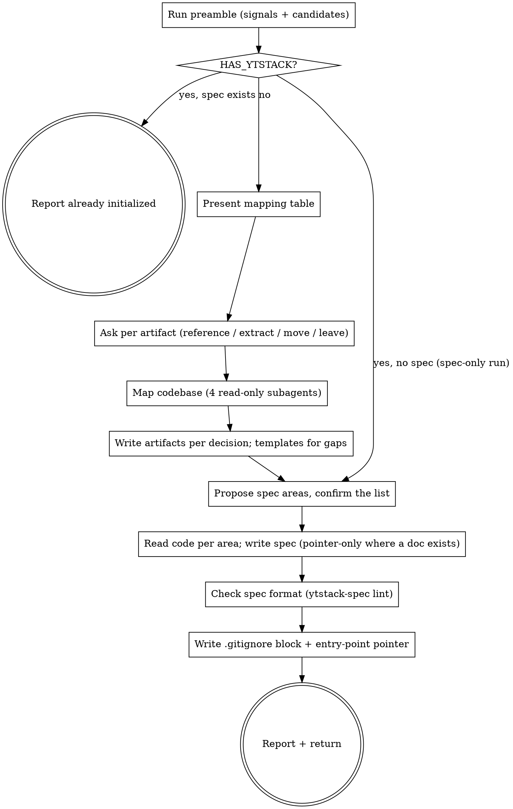

# adopt-brownfield

Give an existing codebase a first-class entry into ytstack. The repo already answers most of the questions a pitch would ask (what it is, what runs where, what was decided); this skill finds those answers, links to them, and writes only what is missing.

<HARD-GATE>
Do NOT delete, move, or rewrite any user file, and do NOT invoke `ytstack:office-hours`,
until the user has answered the per-artifact question for that file (Step 4). This applies
to EVERY repo regardless of how obvious the mapping looks. Reference-only is always the
safe default; moving a file is the exception the user picks.
</HARD-GATE>

## Anti-Pattern: "Let me validate the premise with office-hours first"

A product that has shipped, a repo with a CHANGELOG and a year of commits, a service in production: these have been validated by use, not by six forcing questions. Running the pitch interview on them is theater and makes ytstack worse than nothing for mature projects. Skip the pitch. Record "validated by track record" in PROJECT.md and reserve `office-hours` for genuinely new scope (a new feature or initiative that has no users yet).

## Anti-Pattern: "I'll copy the docs into .ytstack/ so everything is in one place"

Copies drift. The README, `docs/` and the ADRs stay the source of truth; `.ytstack/` is a distillation and navigation layer over them. Link, summarise in one line, point at the file. Only move a file when the user says so (Step 4, option C), and leave a pointer at the old path.

The technical spec (Step 7) is the place where this temptation is strongest, and the rule is the same: an area that already has an authoritative document gets a pointer to it, not a retelling.

## Anti-Pattern: "The docs say it works, so the area is implemented"

A document is a claim. `status: implemented` and a `verified_at` commit mean somebody read the code under the area's `paths` against the description, in this run. An area nobody read stays `planned` with `verified_at: none`, and a fact nobody established is written as `Unknown -- <what is missing>`. A spec with three honest `planned` rows beats one with eight green rows nobody checked: the next session acts on what the spec says.

## Checklist

You MUST create a TodoWrite task for each of these items and complete them in order:

1. **Run preamble** -- resolve the checkout, count brownfield signals, list candidate sources
2. **HARD-GATE: already initialized** -- if `HAS_YTSTACK=yes` and the technical spec exists, report and stop; if the spec is missing, do the spec-only run (Steps 5, 7, 8, 10, 11 in their reduced form)
3. **Present the mapping table** -- found / target slot / proposed handling / conflicts / gaps
4. **Ask per artifact** -- one AskUserQuestion per candidate slot: reference / extract / move / leave
5. **Map the codebase** -- dispatch up to 4 read-only subagents, write `.ytstack/codebase/{stack,architecture,conventions,concerns}.md`
6. **Write the artifacts** -- PROJECT, DECISIONS, KNOWLEDGE, RUNTIME, STATE, PREFERENCES, each per its Step 4 decision; templates only for gaps
7. **Write the technical spec** -- propose areas from `codebase/architecture.md` and the docs index, confirm them with one AskUserQuestion, read the code per area, write `.ytstack/spec/SPEC.md` + `.ytstack/spec/<area>.md` (pointer-only where a document exists)
8. **Check the spec format** -- run `ytstack-spec lint` and fix what it reports; by hand against `docs/ux/spec-format.md` when the script is not reachable
9. **Write the `.gitignore` block** -- `.ytstack/.local/` via `yt_ensure_gitignore`
10. **Update the entry-point doc** -- pointer section in AGENTS.md or CLAUDE.md (never a copy)
11. **Report** -- files written, handling per slot, spec status per area, next step
12. **Return control** -- do NOT auto-invoke any other skill

## Process Flow



## Preamble

Run this first. Output gets read by the procedure below.

```bash
# ytstack resolver (M016): checkout = where this shell runs, via the shared lib.
_LIB="${CLAUDE_SKILL_DIR}/../../hooks/lib/git-ctx.sh"
if [ -f "$_LIB" ]; then
  . "$_LIB"; yt_git_ctx "$PWD"; yt_resolve_yt_dir >/dev/null
  _PROJECT_DIR="$YT_TOPLEVEL"; _YT_DIR="$YT_DIR"; _YT_SCOPE="$YT_SCOPE"; _IS_GIT="$YT_IS_GIT"; _PROJECT_KEY="$YT_REPO_KEY"
else
  # Host did not substitute CLAUDE_SKILL_DIR (e.g. Codex adapter): project scope only.
  _IS_GIT=$([ "$(git rev-parse --is-inside-work-tree 2>/dev/null)" = true ] && echo yes || echo no)
  _PROJECT_DIR=$(git rev-parse --show-toplevel 2>/dev/null || pwd -P)
  _YT_DIR=""; _YT_SCOPE=none; _PROJECT_KEY=""
  [ -d "$_PROJECT_DIR/.ytstack" ] && { _YT_DIR="$_PROJECT_DIR/.ytstack"; _YT_SCOPE=project; }
fi
cd "$_PROJECT_DIR" 2>/dev/null || true
_PROJECT_SLUG=$(basename "$_PROJECT_DIR")   # display only
_HAS_YTSTACK=$([ -n "$_YT_DIR" ] && echo yes || echo no)

_NON_INTERACTIVE=false
if [ -n "$YTSTACK_NON_INTERACTIVE" ] || [ -n "$OPENCLAW_SESSION" ] || [ -n "$CLAUDE_AGENT_TEAM_MEMBER" ]; then
  _NON_INTERACTIVE=true
fi
_EXPLAIN_LEVEL="default"
[ -f "$HOME/.ytstack/config" ] && _EXPLAIN_LEVEL=$(grep -E '^explain_level=' "$HOME/.ytstack/config" 2>/dev/null | cut -d= -f2 || echo default)

# Brownfield signals + candidate mapping (shared detector; lib only).
_BF_SIGNALS="unknown"; _BF_HINTS=""
if command -v yt_brownfield_signals >/dev/null 2>&1; then
  yt_brownfield_signals "$_PROJECT_DIR"
  _BF_SIGNALS="$YT_BROWNFIELD_SIGNALS"; _BF_HINTS="$YT_BROWNFIELD_HINTS"
fi
_COMMITS=$(git rev-list --count HEAD 2>/dev/null || echo 0)
_FIRST_COMMIT=$(git log --reverse --format=%as 2>/dev/null | head -1)
_ENTRY_DOC=""
for f in AGENTS.md CLAUDE.md; do [ -f "$f" ] && { _ENTRY_DOC="$f"; break; }; done
[ "$_ENTRY_DOC" = CLAUDE.md ] && [ -L CLAUDE.md ] && [ -f AGENTS.md ] && _ENTRY_DOC="AGENTS.md"
_PITCH=""; [ -f ./OFFICE-HOURS.md ] && _PITCH="./OFFICE-HOURS.md"
_README_ONELINER=""
if [ -f README.md ]; then
  _README_ONELINER=$(awk 'NF==0{next} /^#/{next} /^[!<\[|`-]/{next} {print; exit}' README.md | cut -c1-200)
fi

echo "BRANCH: $(git branch --show-current 2>/dev/null || echo unknown)"
echo "PROJECT_SLUG: $_PROJECT_SLUG"
echo "HAS_YTSTACK: $_HAS_YTSTACK"
echo "HAS_SPEC: $([ -n "$_YT_DIR" ] && [ -f "$_YT_DIR/spec/SPEC.md" ] && echo yes || echo no)"
echo "YTSTACK_SCOPE: $_YT_SCOPE"
echo "YT_DIR: $_YT_DIR"
echo "YTSTACK_NON_INTERACTIVE: $_NON_INTERACTIVE"
echo "EXPLAIN_LEVEL: $_EXPLAIN_LEVEL"
echo "IS_GIT: $_IS_GIT"
echo "COMMITS: $_COMMITS"
echo "FIRST_COMMIT: ${_FIRST_COMMIT:-unknown}"
echo "ENTRY_DOC: ${_ENTRY_DOC:-none}"
echo "PITCH: ${_PITCH:-none}"
echo "README_ONELINER: ${_README_ONELINER:-none}"
echo "BROWNFIELD_SIGNALS: $_BF_SIGNALS"
echo "CANDIDATES:"
if [ -n "$_BF_HINTS" ]; then printf '%s\n' "$_BF_HINTS" | sed 's/^/  - /'; else echo "  (none detected)"; fi
```

## Procedure

### Step 2: HARD-GATE -- already initialized

If `HAS_YTSTACK` is `yes` and `HAS_SPEC` is `yes`, nothing is left to adopt. Report and stop:

> "ytstack is already initialized for `{PROJECT_SLUG}` at `{YT_DIR}` (scope: {YTSTACK_SCOPE}), including the technical spec. To see where things stand, run `ytstack:resume-session`."

If `HAS_YTSTACK` is `yes` and `HAS_SPEC` is `no`: **spec-only run.** The project was set up before ytstack had a technical spec, or its spec question was cancelled. Say so in one line (*"`.ytstack/` exists, the technical spec does not. I add only the spec; no other artifact is touched."*) and run a reduced procedure:

- Skip Steps 3, 4, 6 and 9. No existing artifact under `{YT_DIR}` is rewritten, moved or deleted.
- Step 5 only for what is missing: Step 7 needs `codebase/architecture.md` and `codebase/stack.md`. A map file that exists is used as it is; name its `generated:` date in the area question so the user can judge its age. A missing one is written by its mapping subagent.
- Step 7 and Step 8 in full. For the areas and their `sources`, read the project's own index as well: `KNOWLEDGE.md` (docs index), `DECISIONS.md` or a `decisions/` folder, and the documents they link.
- Step 10: if the entry-point doc already has a ytstack section, add only the sentence that starts with "For what applies now"; otherwise append the block.
- Step 11: report the "Technical spec" row, the "Spec, not established" line, the format check and the reading order. Leave out the other rows.

If `BROWNFIELD_SIGNALS` is `0` or `1`, continue (the user asked for this skill), but say so in one line before the table: *"Only {N} brownfield signals. If this is really a new idea rather than an existing codebase, `ytstack:office-hours` then `ytstack:init-project` fit better; say stop and I will."* If it is `unknown` (lib not loaded), build the candidate list by hand in Step 3 from `README.md`, `docs/`, `CHANGELOG.md`, `docs/adr/`, `docs/decisions/`, manifest files and `AGENTS.md`/`CLAUDE.md`.

### Step 3: Present the mapping table

Read each candidate named under `CANDIDATES` (first 40 lines of each file is enough; for directories, `ls` plus the H1 of each file). Then show one table, in prose, no question yet:

> Adopting ytstack for **{PROJECT_SLUG}** on branch `{BRANCH}`: {COMMITS} commits since {FIRST_COMMIT}, {BROWNFIELD_SIGNALS} brownfield signals. No `.ytstack/` yet.
>
> | Slot | Found | Proposed handling | Note |
> |---|---|---|---|
> | PROJECT.md | `README.md` ({lines} lines){, `CHANGELOG.md`} | extract one-liner + Validated section | one-liner candidate: "{README_ONELINER}" |
> | DECISIONS.md | `docs/adr/` ({n} records) | reference: one entry per ADR, linked | {conflict if two decision sources exist} |
> | KNOWLEDGE.md | `docs/*.md` ({n} files) | reference: link index with H1 summaries | |
> | RUNTIME.md | `package.json` scripts, `.env.example`, `compose.yml`, `.github/workflows/` | extract: commands, services, env keys, deploy target | values never copied, keys only |
> | ROADMAP backlog | `docs/plans/` / `ROADMAP.md` / `BACKLOG.md` | reference | open items become backlog, not a milestone |
> | STATE.md | nothing | gap: scaffold | `tracker:` field for Linear / GitHub Projects / Paperclip / Jira |
> | Technical spec | {documents that describe a part of the system: `docs/architecture.md`, `docs/adr/`, an API reference, feature docs} + the codebase map | one file per system area under `.ytstack/spec/`, pointer-only where a document exists | you confirm the area list after the codebase is mapped; an area is marked implemented only after its code was read |
> | Entry point | `{ENTRY_DOC}` | pointer section | never duplicated |
>
> Conflicts: {e.g. "docs/adr/ AND docs/design-decisions.md both record decisions; I will seed DECISIONS.md from both, by reference, and flag overlaps"} or "none".
> Gaps: {slots with no source, typically STATE.md and PREFERENCES.md}. These get templates.

Omit rows whose source does not exist, except STATE.md (always a gap), the technical spec (always written; say "codebase map only" under Found when no document describes a part of the system) and the entry point (say "none found" when `ENTRY_DOC` is `none`).

If `PITCH` is not `none`: a pitch for new scope exists alongside the old codebase. Say so; in Step 6 move it to `{YT_DIR}/OFFICE-HOURS-<slug>.md` exactly as `init-project` does, so `plan-milestone` can draw the first milestone from it. The pitch does not change the handling of the existing docs.

### Step 4: Ask per artifact

One question per slot that has a source (PROJECT, DECISIONS, KNOWLEDGE, RUNTIME, backlog), in that order, one message each. Do not ask for gaps and do not ask for the entry point. The technical spec has its own question in Step 7, once the codebase map exists.

If `YTSTACK_NON_INTERACTIVE` is `true`, auto-pick the RECOMMENDATION for every slot and log one line each: `[ytstack:adopt-brownfield] auto-picked {X} for {SLOT} because YTSTACK_NON_INTERACTIVE=true`.

Otherwise use AskUserQuestion with this body, substituting the slot:

> Adopting ytstack for **{PROJECT_SLUG}** on branch `{BRANCH}`; deciding how `{SOURCE}` feeds `.ytstack/{SLOT}`.
>
> `{SOURCE}` already holds what ytstack would put into `{SLOT}`. ytstack's memory files are read at the start of every session, so Claude never forgets what this project is and what was decided. The question is whether that memory links to your existing doc, distills a part of it, or takes it over. Linking keeps one source of truth; moving breaks any external link to the old path.
>
> RECOMMENDATION: Choose {A for DECISIONS, KNOWLEDGE, backlog; B for PROJECT, RUNTIME} because {A: "your docs stay the source of truth and ytstack only navigates them" / B: "these facts are short, change rarely and every skill reads them; distilling them avoids a second lookup"}.
>
> A) Reference -- `{SLOT}` gets a pointer plus a one-line-per-item index; `{SOURCE}` is not touched
>    Completeness: 9/10, effort: human: 0 / CC: ~1 min, tier: core
>
> B) Extract -- distill the project-memory parts into `{SLOT}`, keep `{SOURCE}` as the public long-form doc
>    Completeness: 10/10, effort: human: review 2 min / CC: ~3 min, tier: core
>
> C) Move -- `git mv {SOURCE}` into `.ytstack/` and leave a one-line pointer at the old path
>    Completeness: 8/10, effort: human: fix external links / CC: ~1 min, tier: core
>
> D) Leave -- `{SOURCE}` is public documentation, not project memory; `{SLOT}` gets the empty template
>    Completeness: 5/10, effort: human: 0 / CC: 0, tier: core
>
> (to change later: edit the Adoption table in `.ytstack/PROJECT.md` and move files by hand)

Remember each answer; the Adoption table in PROJECT.md (Step 6) records them. If the user cancels a question: stop, report *"You cancelled the question for {SLOT}. Nothing was written. Run `ytstack:adopt-brownfield` again to resume."*

### Step 5: Map the codebase

Dispatch four read-only subagents in ONE message (Agent tool, `general-purpose`), each with this frame plus its focus:

> Read-only task in `{PROJECT_DIR}`. Do not create, modify or delete files; do not run build or test commands. Read code and config, then report at most 60 lines of markdown (no preamble, no closing summary). Name real paths (`src/auth.ts:47`), real versions, real commands. If something is unknown, write "unknown" rather than guessing.

| Agent | Focus | Target file |
|---|---|---|
| Stack & runtime | languages, frameworks, versions, package manager, build/test/run commands, services, ports, env keys, deploy target | `codebase/stack.md` |
| Architecture & boundaries | top-level layout, modules and their responsibilities, data flow, external integrations, where the boundaries are and which ones leak | `codebase/architecture.md` |
| Conventions & testing | naming, file layout, lint/format config, error handling, logging, test framework, what is tested and what is not, how CI runs them | `codebase/conventions.md` |
| Concerns & debt | TODO/FIXME clusters, known fragile areas, outdated deps, missing tests, security smells, performance hot spots; each with a path | `codebase/concerns.md` |

When the results return, write each to `{YT_DIR}/codebase/<name>.md` with this header, then the agent's text unchanged:

```markdown
---
generated: {ISO_TIMESTAMP}
by: ytstack:adopt-brownfield
refresh: delete this file and run ytstack:adopt-brownfield again
---
```

If the Agent tool is not available (foreign host), do the four reads yourself in sequence with the same 60-line cap per file. Never skip the map: `plan-milestone` and `plan-task` read `codebase/` to scope the delta instead of re-discovering the stack.

### Step 6: Write the artifacts

Create `{PROJECT_DIR}/.ytstack/` (project scope; brownfield memory lives beside the docs it links to. To use user scope instead, run `ytstack:init-project` and answer its scope question). Substitutions: `{PROJECT_NAME}` = `name` from `package.json` / `pyproject.toml` / the README H1, else `{PROJECT_SLUG}`; `{ISO_TIMESTAMP}` = current UTC `YYYY-MM-DDTHH:MM:SSZ`; `{TODAY}` = `YYYY-MM-DD`.

Apply the Step 4 decision per slot:

- **Reference (A):** write the artifact from the template below with a `## Sources` line pointing at the file(s) plus a one-line-per-item index (H1 or title of each item, relative link such as `../docs/adr/0001-x.md`).
- **Extract (B):** read the source and write distilled content into the template sections; add the same `## Sources` line. No paragraph copied verbatim.
- **Move (C):** `git mv {SOURCE} {YT_DIR}/<name>` (keep the original file name; if the source is a directory, keep it as a directory), then write a one-line pointer at the old path: `Moved to .ytstack/<name> by ytstack:adopt-brownfield on {TODAY}.` The artifact gets a `## Sources` line pointing at the new location.
- **Leave (D):** write the plain template with no `## Sources` line.

Gaps always get the template. Never overwrite a file that already exists under `.ytstack/`.

#### PROJECT.md

```markdown
---
name: {PROJECT_NAME}
slug: {PROJECT_SLUG}
created: {ISO_TIMESTAMP}
updated: {ISO_TIMESTAMP}
init_completed: {ISO_TIMESTAMP}
scope: project
origin: brownfield-import
brownfield_signals: {BROWNFIELD_SIGNALS}
---

# {PROJECT_NAME}

**One-liner:** {README_ONELINER, tightened to one sentence}

## What this project is

{2-4 sentences distilled from README.md. Link to sections, do not copy them.}

## Validated

Already shipped, therefore already validated. No office-hours was run; the track record is the pitch.

- {capability} -- source: `README.md#{section}` / `CHANGELOG.md` {version}
- ...

## Why it exists

{one paragraph, or "see README.md#{section}"}

## Success criteria

{what "working" means today; from README, CHANGELOG or "unknown -- define with the next milestone"}

## Current status

Adopted into ytstack on {TODAY}: {COMMITS} commits since {FIRST_COMMIT}. No ytstack milestone yet.

## Adoption

| Slot | Source | Handling | Where |
|---|---|---|---|
| PROJECT.md | README.md | {A/B/C/D} | .ytstack/PROJECT.md |
| DECISIONS.md | docs/adr/ | {A/B/C/D} | ... |
| KNOWLEDGE.md | docs/*.md | {A/B/C/D} | ... |
| RUNTIME.md | package.json, .env.example | {A/B/C/D} | ... |
| ROADMAP backlog | docs/plans/ | {A/B/C/D} | ... |
| Codebase map | source tree | mapped | .ytstack/codebase/ |
```

#### DECISIONS.md

```markdown
# Decisions

Append-only architectural and product decisions for {PROJECT_NAME}. Never rewrite past entries; a reversal is a new entry that supersedes.

## Sources

Decisions made before ytstack live in `{SOURCE}`; they are listed here by reference, not copied.

## Inherited (before ytstack)

- {date or "n/a"}: [{title}](../{path}) -- {one-line gist}
- ...

## {TODAY}: Adopted ytstack on an existing codebase (brownfield import)

**Context:** the repo had {BROWNFIELD_SIGNALS} brownfield signals ({list}); a greenfield pitch would re-ask what the repo already answers.
**Options considered:** A) pretend greenfield (office-hours + init-project); B) skip ytstack; C) brownfield import.
**Chose:** C.
**Reason:** pitch validation on a shipped codebase is theater; existing docs stay the source of truth and `.ytstack/` links to them.
**Supersedes:** none.
```

Entry format for future decisions: `## YYYY-MM-DD: <title>` with Context / Options considered / Chose / Reason / Supersedes.

#### KNOWLEDGE.md

```markdown
# Knowledge

Distillation and navigation layer over the existing docs of {PROJECT_NAME}. Sources stay where they are; this file links, it does not copy. Keep it short. Keep it actionable.

## Docs index

- [docs/{file}.md](../docs/{file}.md) -- {H1 or first heading, one line}
- ...

## Conventions

{3-6 bullets distilled from codebase/conventions.md, each naming a file or config}

## Lessons learned

(Non-obvious things discovered during development. One-line lesson + short context.)

## Gotchas

{bullets from codebase/concerns.md that a new contributor or agent would trip over}
```

#### RUNTIME.md

```markdown
# Runtime

Derived on {TODAY} from {package.json scripts | pyproject | go.mod}, `.env.example`, {compose file}, `.github/workflows/`. Those files stay the source of truth; re-derive when they change.

## Commands

- `{script name}` -- `{command}` ({what it does})

## Services

- {service} -- {image/port/purpose from compose or code}

## Environment variables

- `{KEY}` -- {purpose; value never recorded}

## Deploy target

{from workflows: platform, trigger branch, workflow file} or "unknown"
```

#### STATE.md

```markdown
---
project: {PROJECT_NAME}
slug: {PROJECT_SLUG}
last_updated: {ISO_TIMESTAMP}
current_milestone: none
active_slice: none
active_task: none
tracker: none
---

# State

**Status:** adopted from an existing codebase on {TODAY} ({BROWNFIELD_SIGNALS} signals). No ytstack milestone yet.

## Next action

Run `ytstack:plan-milestone` for the next discrete initiative. If day-to-day issues live in Linear, GitHub Projects, Paperclip or Jira, set `tracker:` above (`linear | github-projects | paperclip | jira`); plan-milestone and reassess-roadmap then leave that work alone.

## Open decisions

(Pending decisions the user needs to make. Updated by skills when they hit a gate.)

## Recent summaries

(Latest 3 T##-SUMMARY.md entries will appear here.)
```

#### PREFERENCES.md

```markdown
# Preferences

Local preferences for {PROJECT_NAME}. Apply to every ytstack session for this project.

explain_level: default

- Never duplicate `docs/` content into `.ytstack/`; link out instead.
- `commit_ref_pattern:` (optional) -- see `ytstack:summarize-task`; default `^M###-S##-T##:`.
```

#### Backlog (only when a backlog source exists)

Write `{YT_DIR}/backlog/README.md`: one line per open item found in the source with a relative link; heading `# Backlog (inherited from {SOURCE})`. Items become milestones only when `ytstack:plan-milestone` picks them up.

### Step 7: Write the technical spec

The artifacts say what the project is and where work stands. The technical spec says what applies now, per part of the system: `.ytstack/spec/SPEC.md` (the entry point, one page) and one `.ytstack/spec/<area>.md` per area. The binding format is `docs/ux/spec-format.md` in the ytstack plugin (`${CLAUDE_SKILL_DIR}/../../docs/ux/spec-format.md`). Read it before writing; the templates below are that format filled in for an existing codebase.

The codebase map from Step 5 stays where it is and as it is. The map is a dated snapshot of what four readers found; the spec is the description that gets maintained. `SPEC.md` links to the map, nothing is merged into it.

**7a. Propose the areas.** An area is a part of the system that somebody could be handed a bug in. Take the modules and boundaries from `codebase/architecture.md` and the docs index (`KNOWLEDGE.md`, or the candidates read in Step 3) and list three to eight areas. Per area: a lowercase slug (`auth`, `billing-export`), one line on what it covers, the `paths` globs of its code as the architecture map names them, and the authoritative document for it when the project has one (architecture guide, ADR folder, API reference, feature doc). More than eight modules: merge the ones that share a boundary. Fewer than three: take what the map shows and do not split a module to reach three.

**7b. Confirm the list.** If `YTSTACK_NON_INTERACTIVE` is `true`, take the proposal and log:

> `[ytstack:adopt-brownfield] auto-picked A (proposed spec areas: {comma-separated slugs}) because YTSTACK_NON_INTERACTIVE=true`

Otherwise use AskUserQuestion with this body:

> Adopting ytstack for **{PROJECT_SLUG}** on branch `{BRANCH}`. The memory files and the codebase map are written; the technical spec is next.
>
> The spec is where a fresh session reads how each part of the system behaves right now, where its code is and how a change to it is checked. It is split into areas: parts you could hand somebody a bug in, one short file each. Where one of your documents already describes a part, the file only points at that document. These are the parts I read in the codebase map and your docs:
>
> {one line per proposed area: `{slug}` -- {what it covers}; code: `{paths}`; described in: `{document}` or "no document yet"}
>
> RECOMMENDATION: Choose A because the list follows the module boundaries found in your code, and an area is cheap to rename, split or merge later.
>
> A) Use this list -- {N} area files
>    Completeness: 10/10, effort: human: 0 / CC: ~5 min, tier: core
>
> B) Edit the list -- tell me what to add, drop, rename or merge; I write the list you give
>    Completeness: 10/10, effort: human: ~2 min / CC: ~5 min, tier: core
>
> (to change later: add, rename or remove a file under `.ytstack/spec/` and its row in `.ytstack/spec/SPEC.md`)

On B, take the edited list from the user's answer, turn every name into a lowercase slug and continue with that list. Do not ask a second time. If the user cancels the question: write no spec files, skip Step 8, keep the artifacts and the map, and continue with Step 9. The pointer block (Step 10) and the report (Step 11) then say that the spec is missing.

**7c. Read the code per area.** Status is established by reading, never taken from a document. For each confirmed area somebody reads the code under its `paths` against its description: the area's document where one exists, otherwise what `codebase/architecture.md` says about the module. When an area is a handful of files, read them yourself. Otherwise dispatch one read-only subagent per area in ONE message (Agent tool, `general-purpose`), with the Step 5 frame (read-only, no build or test commands, at most 60 lines) plus:

> Area `{area}`: code under `{paths}`, described in `{document, or the section of .ytstack/codebase/architecture.md}`. Read the description, then the code. Report: every behavior the description states, each with `found at <path:line>`, `not found` or `not read`; the entry points and the tests that pin the behavior, as paths; the command that checks this area if the repository names one; anything the code does that the description does not mention.

`{HEAD_SHORT}` is `git rev-parse --short HEAD`. The read decides status and `verified_at`:

| What the read established | `status` | `verified_at` |
|---|---|---|
| Every behavior the description states was found in the code | `implemented` | `{HEAD_SHORT}` |
| Some were found, others were not found or not read | `partial` | `{HEAD_SHORT}` |
| Nobody read the code: no reader, no `paths`, `IS_GIT: no`, or uncommitted changes under `paths` (the files read are then not the files at HEAD) | `planned` | `none` |

`planned` after an honest attempt is a correct result. Raising a status to make the table look finished is not.

`verified_at` has to name a commit that stays in the history (format document, "Drift"). On a branch that will be squash-merged, stamp the commit the branch started from when the area's `paths` are unchanged since then (`git diff --quiet <start> HEAD -- <paths>` exits 0). When they changed, keep `{HEAD_SHORT}` and name the area in the report as one to stamp again after the merge.

**7d. Write `.ytstack/spec/SPEC.md`.** At most 80 lines. The section "Keeping this true" is copied verbatim; it is what a session without hooks finds in the repository.

```markdown
---
project: {PROJECT_NAME}
updated: {TODAY}
---

# {PROJECT_NAME} -- technical spec

## What this is

{Three to six lines: what the system does, for whom, and its main parts. Distilled from PROJECT.md and codebase/architecture.md; link to README sections, do not copy them.}

## Areas

| Area | Covers | Status | File |
|---|---|---|---|
| {area} | {one line} | {planned / partial / implemented, per 7c} | [{area}.md]({area}.md) |

## Invariants that hold everywhere

- {A rule every area obeys, with a link to the ADR, the decision or the check that enforces it.} or: `Unknown -- no project-wide rule found in the docs or the codebase map`

## Build and test

The commands are in [codebase/stack.md](../codebase/stack.md); [RUNTIME.md](../RUNTIME.md) holds the distilled list.

## Keeping this true

- A task plan names its **Spec impact**: the area and section it changes, or `none`.
- A task that changes behaviour updates the area file, or the source the area file names, in the same commits. A task that restores the described behaviour, a refactoring and a trivial edit close with `none`.
- A decision that changes what applies in an area is linked under that area's "Decisions that apply now" in the same commits; the entry it replaces leaves the list.
- Which area describes a path: the `paths` in each area file. Which areas need a look: `bin/ytstack-spec drift`.
- The format: `docs/ux/spec-format.md` in the ytstack plugin.
```

**7e. Write one `.ytstack/spec/{area}.md` per area.** At most 200 lines each. An area with an authoritative document is pointer-only (the copy anti-pattern above applies here in full): the file holds the frontmatter with the document under `sources`, the four required sections, and only what the document lacks.

```markdown
---
area: {area}
status: {implemented | partial | planned, per 7c}
paths:
  - {glob from codebase/architecture.md, e.g. src/auth/**}
sources:
  - {the authoritative document, relative to the repository root, e.g. docs/architecture.md}
verified_at: {HEAD_SHORT | none, per 7c}
---

## Purpose

The description of this area lives in [{document}](../../{document}). {One line on where the area ends, only when the document does not say.}

## Where implemented

- `{entry point}` -- {what starts here}
- Tests: `{test path}` or: `Unknown -- no test found that pins this area`

## How to verify

`{command, from codebase/stack.md}` -- {what a pass looks like}. Not run during adoption.

## Decisions that apply now

- [{ADR or decision title}](../../{path}) -- {one line}
```

Rules for every area file:

- `paths` come from `codebase/architecture.md`, as git pathspec globs relative to the repository root. `sources` are paths relative to the repository root too; a document that Step 4 moved (option C) is named at its new place under `.ytstack/`.
- No document for the area: leave `sources` out, and write "Purpose" in two to four lines from the architecture map. Add "Behavior" with the rules the reader saw in the code, each with the path that shows it.
- `status: partial`: add "Behavior" (it sits between "Purpose" and "Where implemented") and list each behavior the description states that was not found, marked `(planned)`, and each one that was not read as `Unknown -- <behavior> not checked against the code`.
- The other sections of the format (interfaces, data flow, invariants, error behavior, runtime assumptions, known limits) are written only for what the read established and the document does not say, under the exact names and in the order the format document fixes. Otherwise leave them out. Never fill a section by retelling the document.
- "How to verify": the command as the repository names it. Say `passed at {HEAD_SHORT}` only if it ran in this session; otherwise `Not run during adoption`. No command found: `Unknown -- no check found for this area`.
- "Decisions that apply now": the ADRs or decision entries in force for the area, linked. None found: `Unknown -- no decision record names this area`.
- Anything nobody established is `Unknown -- <what is missing>`. Never set `verified_at` from a document alone, and never write a status the read in 7c did not establish.

### Step 8: Check the spec format

Skip when Step 7 wrote no spec files. Otherwise run the format check from the project root:

```bash
_SPEC_BIN="${CLAUDE_SKILL_DIR}/../../bin/ytstack-spec"
if [ -x "$_SPEC_BIN" ]; then
  "$_SPEC_BIN" lint; echo "SPEC_LINT_EXIT: $?"   # 0 clean | 2 warnings only | 1 failures
else
  echo "SPEC_LINT: unavailable"
fi
```

- `SPEC_LINT_EXIT: 0` -- done.
- `SPEC_LINT_EXIT: 1` or `2` -- every `FAIL` and `warn` line names the file and the rule. Fix the file and run the check again until it exits 0. Fix a finding in the direction of the truth: correct a `paths` glob that matches no file, a `sources` path, a section name or a link; shorten a file that is too long. If a status cannot be backed (no commit for `verified_at`, no `paths`), lower it to `planned`. Never invent a `verified_at` to make a finding go away.
- `SPEC_LINT: unavailable` (a host that does not substitute `CLAUDE_SKILL_DIR`) -- read each file you wrote against the section "Checked mechanically" of `docs/ux/spec-format.md` by hand and fix what differs. If that document is not reachable either, compare against the templates in Step 7. Say in the report that the check was done by hand.

### Step 9: Write the `.gitignore` block

With the lib loaded by the preamble:

```bash
yt_ensure_gitignore "$_PROJECT_DIR"
echo "GITIGNORE: $YT_GITIGNORE"   # written | unchanged | skipped
```

Ignores only `.ytstack/.local/` (in-tree fallback for volatile session state). Everything else under `.ytstack/` is committable.

### Step 10: Update the entry-point doc

If `ENTRY_DOC` is not `none`, append this section to it with the Edit tool (if `CLAUDE.md` is a symlink to `AGENTS.md`, edit `AGENTS.md`). If a `## ytstack` heading already exists there, replace that section instead of adding a second one.

```markdown
## ytstack project memory

`.ytstack/` holds this project's memory: `PROJECT.md` (what it is, what is validated), `DECISIONS.md` (append-only), `KNOWLEDGE.md` (link index over `docs/` + gotchas), `RUNTIME.md` (derived from the manifests), `STATE.md` (milestone position), a codebase map under `.ytstack/codebase/` and the technical spec under `.ytstack/spec/`. For what applies now (how a part of the system behaves, where it is implemented, how a change is verified), start at `.ytstack/spec/SPEC.md`. `README.md`, `docs/` and the ADRs stay the source of truth; `.ytstack/` links to them. Adopted via `ytstack:adopt-brownfield` on {TODAY}.
```

If Step 7 wrote no spec (the area question was cancelled), leave out "and the technical spec under `.ytstack/spec/`" and the sentence that starts with "For what applies now".

If `ENTRY_DOC` is `none`, write nothing and include the block in the report so the user can paste it into a new `AGENTS.md`.

### Step 11: Report

> Adopted **{PROJECT_NAME}** into ytstack (brownfield import, {BROWNFIELD_SIGNALS} signals, no office-hours):
>
> | Slot | Handling | File |
> |---|---|---|
> | PROJECT.md | {A/B/C/D} from README.md{, CHANGELOG.md} | `.ytstack/PROJECT.md` (Validated: {n} items) |
> | DECISIONS.md | {A/B/C/D} from {source} | `.ytstack/DECISIONS.md` ({n} inherited entries) |
> | KNOWLEDGE.md | {A/B/C/D} from docs/ | `.ytstack/KNOWLEDGE.md` ({n} linked docs) |
> | RUNTIME.md | {A/B/C/D} from {sources} | `.ytstack/RUNTIME.md` |
> | STATE.md | scaffolded | `.ytstack/STATE.md` (`tracker: none`) |
> | Codebase map | 4 subagents | `.ytstack/codebase/{stack,architecture,conventions,concerns}.md` |
> | Technical spec | {n} areas: {i} implemented, {p} partial, {q} planned; {k} pointer-only | `.ytstack/spec/SPEC.md` + `.ytstack/spec/{area}.md` |
> | Entry point | pointer section | `{ENTRY_DOC}` |
>
> Spec, not established: {one line per area that is `planned` or `partial`, carries an `Unknown` or needs a new `verified_at` after a squash merge: `{area}` -- {what is missing}; or "nothing open"}. Spec format check: {clean | fixed: {what} | done by hand, `ytstack-spec` not reachable}.
>
> Moved files: {list with old -> new, or "none"}. `.gitignore`: {GITIGNORE}.
>
> Reading order for a new session: `.ytstack/STATE.md` (where work stands), then `.ytstack/spec/SPEC.md` (what applies now), then the area file for the part being touched.
>
> Next step: `ytstack:plan-milestone` for the next discrete initiative; it reads `codebase/` and PROJECT.md "Validated" and scopes only the delta. If issue-level work lives in Linear / GitHub Projects / Paperclip / Jira, set `tracker:` in `STATE.md` first.
>
> If you're in a git repo (`IS_GIT: yes`): these files are unstaged. `git status` will show them. Commit when ready.

If the area question was cancelled in Step 7: the "Technical spec" row reads `not written (area question cancelled)`, the line that starts with "Spec, not established" is replaced by *"`.ytstack/spec/` was not written. Tell me the areas (or say "use the proposal") and I write it."*, and the reading order names `.ytstack/STATE.md` only.

### Step 12: Return control

STOP here. Do NOT invoke `ytstack:plan-milestone`, `ytstack:office-hours` or `ytstack:init-project`. The user decides the next step.

## Terminal State

The terminal state is one of:

- Returning control to the user after writing `.ytstack/` (artifacts + `codebase/` + `spec/`), the `.gitignore` block and the entry-point pointer, with the report above
- Exiting immediately after reporting "already initialized" (when `HAS_YTSTACK=yes` and `HAS_SPEC=yes`)
- Returning control after a spec-only run (`HAS_YTSTACK=yes`, `HAS_SPEC=no`): `spec/` written, the map completed where it was missing, nothing else touched
- Exiting without writes because the user cancelled a per-artifact question

Do NOT invoke `ytstack:office-hours`, `ytstack:init-project`, `ytstack:plan-milestone`, `ytstack:spawn-milestone-team` or any other ytstack skill from here. The ONLY valid next actions are:

- User reviews `.ytstack/PROJECT.md` (Validated section, Adoption table) and `.ytstack/spec/SPEC.md` (area list, status per area) and commits
- User sets `tracker:` in `.ytstack/STATE.md` if issue-level work lives elsewhere
- User runs `ytstack:plan-milestone` when the next discrete initiative is ready
