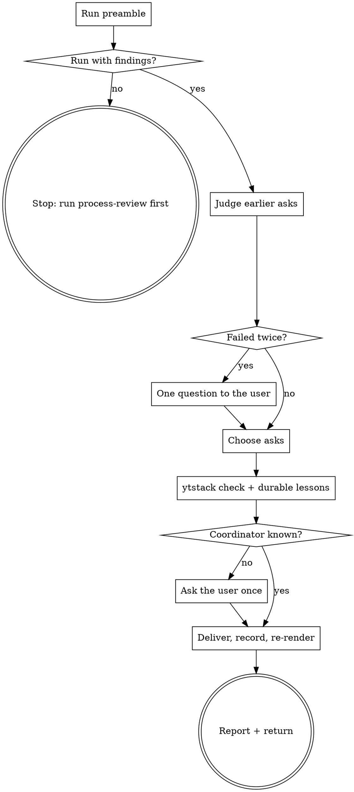

# coach-process

A process review finds that second rounds keep rising, that a review sample falls back, that main is red more often. Nothing changes until the agent that runs the work hears it, in its own session, in a form it can act on. And nothing is learned unless somebody checks, a week later, whether the ask was followed and whether it worked. This skill closes that loop: it turns findings into at most five asks, each a fact with its denominator and one action that rests on an existing rule or an order of the user, delivers them to the coordinator, records each ask with the metric it should move, and judges the earlier asks on every run. An ask that did not take after being asked twice goes to the user, not a third time to the coordinator. Each run also asks what ytstack itself could do better, because a finding that keeps coming back is often an instruction that never reached the agent.

Observed in the repository this skill was built on (November 2026): a review rule merged into the rule files reached none of the sessions that were already running; four of the first six pull requests the rule covered went the old way, until the coordinator was told directly. A rule in a file is not delivered.

<HARD-GATE>
Do NOT send a message, write `asks.json` or draft an upstream issue until a process-review run of this repository exists in the working directory (`METRICS: present`) and its `findings.json` holds findings from that run. Do NOT put an ask into a message that rests on neither an existing rule (file and section) nor a statement of the user: this skill relays, it does not make rules. Do NOT ask the coordinator for a merge, a release or an approval, and do NOT answer a question or approval dialog in another session.
This applies to EVERY run regardless of how urgent a finding looks.
</HARD-GATE>

## Anti-Pattern: "I told the coordinator, so it is fixed"

A message is delivered, not followed. The coordinator may be mid-task, may have loaded its rules before the rule changed, may disagree for a reason the numbers do not show. So every ask carries the metric it should move, the next run judges it, and only the judgement counts. The same applies to this skill's own advice: an ask that keeps failing is a sign that the ask, the rule or the tooling is wrong, which is why it goes to the user and, where ytstack is involved, upstream.

## Checklist

You MUST create a TodoWrite task for each of these items and complete them in order:

1. **Run preamble** -- the working directory, the last run, the earlier asks, herdr, the upstream mode
2. **HARD-GATE** -- a process-review run with findings, or stop
3. **Judge the earlier asks** -- `asks` in `metrics.json`: followed, not followed, too early; escalate what failed twice
4. **Choose the asks** -- at most five, each a fact, one action, its rule, its metric
5. **Check what ytstack could do better** -- per finding: an instruction, a check or a skill step that would have prevented it
6. **Make lessons durable** -- what was confirmed or keeps coming back becomes proposed work in the owning file, never an edit from here
7. **Find the coordinator** -- the session that dispatches and merges; ask once when it is unclear
8. **Deliver** -- the text as a file first, then the channel of that session
9. **Record** -- `asks.json`, then `analyze.mjs` and `report.mjs` again
10. **Report + return** -- what went to whom, the verdicts, the escalations, the upstream drafts, the proposed work

## Process Flow



## Preamble

```bash
# ytstack resolver (M016): checkout = where this shell runs, via the shared lib.
_LIB="${CLAUDE_SKILL_DIR}/../../hooks/lib/git-ctx.sh"
if [ -f "$_LIB" ]; then
  . "$_LIB"; yt_git_ctx "$PWD"; yt_resolve_yt_dir >/dev/null
  _PROJECT_DIR="$YT_TOPLEVEL"; _YT_DIR="$YT_DIR"; _YT_SCOPE="$YT_SCOPE"; _IS_GIT="$YT_IS_GIT"; _PROJECT_KEY="$YT_REPO_KEY"
else
  # Host did not substitute CLAUDE_SKILL_DIR (e.g. Codex adapter): project scope only.
  _IS_GIT=$([ "$(git rev-parse --is-inside-work-tree 2>/dev/null)" = true ] && echo yes || echo no)
  _PROJECT_DIR=$(git rev-parse --show-toplevel 2>/dev/null || pwd -P)
  _YT_DIR=""; _YT_SCOPE=none; _PROJECT_KEY=""
  [ -d "$_PROJECT_DIR/.ytstack" ] && { _YT_DIR="$_PROJECT_DIR/.ytstack"; _YT_SCOPE=project; }
fi
cd "$_PROJECT_DIR" 2>/dev/null || true
_PROJECT_SLUG=$(basename "$_PROJECT_DIR")   # display only
echo "BRANCH: $(git branch --show-current 2>/dev/null || echo unknown)"
echo "PROJECT_SLUG: $_PROJECT_SLUG"
echo "HAS_YTSTACK: $([ -n "$_YT_DIR" ] && echo yes || echo no)"
echo "YTSTACK_SCOPE: $_YT_SCOPE"
# YTSTACK_NON_INTERACTIVE=ask restores the questions, also in a spawned session (docs/ux/askuserquestion-format.md).
_NI="${YTSTACK_NON_INTERACTIVE:-}"
if [ "$_NI" != ask ] && { [ -n "$_NI" ] || [ -n "${OPENCLAW_SESSION:-}" ] || [ -n "${CLAUDE_AGENT_TEAM_MEMBER:-}" ]; }; then
  echo "YTSTACK_NON_INTERACTIVE: true"
else
  echo "YTSTACK_NON_INTERACTIVE: false"
fi
_EXPLAIN_LEVEL=""
[ -f "$HOME/.ytstack/config" ] && _EXPLAIN_LEVEL=$(grep -E '^explain_level=' "$HOME/.ytstack/config" 2>/dev/null | cut -d= -f2)
echo "EXPLAIN_LEVEL: ${_EXPLAIN_LEVEL:-default}"
_state() { [ -f "$_YT_DIR/STATE.md" ] && sed -n "s/^$1: *//p" "$_YT_DIR/STATE.md" | head -1; }
_M=$(_state current_milestone); _S=$(_state active_slice)
echo "CURRENT_MILESTONE: ${_M:-none}"
echo "ACTIVE_SLICE: ${_S:-none}"
echo "SENTINELS: $([ -n "$_YT_DIR" ] && ls -a "$_YT_DIR" 2>/dev/null | grep -- '-prompted$' | paste -sd, -)"
_TOOLS="${CLAUDE_SKILL_DIR}/../../tools/process-review"
if [ -f "$_TOOLS/analyze.mjs" ]; then echo "TOOL_DIR: $_TOOLS"; else echo "TOOL_DIR: unavailable"; fi
# The same working directory as process-review: one per measured repository, outside every checkout.
_REPO=$(git remote get-url origin 2>/dev/null | sed -E 's#^(git@|ssh://git@|https://)([^/:@]*@)?[^/:]+[:/]##; s#\.git$##; s#/$##')
case "$_REPO" in */*/*|'') _REPO=unknown ;; */*) : ;; *) _REPO=unknown ;; esac
echo "REPO_GUESS: $_REPO"
_WDIR="${XDG_STATE_HOME:-$HOME/.local/state}/ytstack/process-review/$(printf '%s' "$_REPO" | tr '/' '_')"
echo "WORKDIR: $_WDIR"
echo "METRICS: $([ -f "$_WDIR/metrics.json" ] && echo present || echo none)"
echo "FINDINGS: $([ -f "$_WDIR/findings.json" ] && echo present || echo none)"
if [ -f "$_WDIR/asks.json" ]; then echo "ASKS: $(grep -o '"key"' "$_WDIR/asks.json" | wc -l | tr -d ' ') recorded"; else echo "ASKS: none"; fi
# Channels to another agent session: herdr panes when this session runs inside herdr.
echo "HERDR: $([ "${HERDR_ENV:-}" = 1 ] && command -v herdr >/dev/null 2>&1 && echo yes || echo no)"
_UP="${CLAUDE_SKILL_DIR}/../../bin/ytstack-upstream"
if [ -f "$_UP" ]; then echo "UPSTREAM_MODE: $(bash "$_UP" -C "$_PROJECT_DIR" mode 2>/dev/null | sed -n 's/^mode: //p' | head -1)"; else echo "UPSTREAM_MODE: unavailable"; fi
echo "TODAY: $(date -u +%Y-%m-%d)"
```

## Procedure

`TOOL_DIR` and `WORKDIR` stand for the values the preamble printed; write them out in each command. When the user names another working directory (process-review allows one), use that one.

**Step 2 -- HARD-GATE.** `METRICS: none` or `FINDINGS: none`: stop with one sentence, "coach-process needs a process-review run of this repository with findings; run `ytstack:process-review` first." A `findings.json` older than the `metrics.json` it sits beside is from an earlier run: say so and stop. `TOOL_DIR: unavailable`: the asks can be delivered, but not judged; say so in the report.

**Step 3 -- Judge the earlier asks.** `asks` in `WORKDIR/metrics.json` holds one row per recorded ask: its key, the day, the recipient, the metric with its value before and after, the verdict (`confirmed`, `refuted`, `too early`, `unknown metric`), `times`, how often the same key was ever asked (also before the analysed period), and the user's decision about the key, recorded in Step 9: `dropped` (option B below) or `escalated` (option A). `askDecisions` in the same file lists every decided key with its latest ask, also when that ask lies before the analysed period: read the decisions from there. A dropped row is not escalated and not asked again; it only appears in the report. An escalated row is not asked again and not put to the user a second time; list it in every report under "Escalated to you" until the user drops it or says the ask stands. Read the others as:

- `confirmed`: the metric moved as asked. The ask is done; Step 6 decides whether it becomes durable.
- `too early`: leave it; do not ask again before its window closed.
- `refuted` or no clear change after the window: the ask did not take. Asked once: it may be asked again, with what the numbers show since. Asked twice (`times` 2 or more and the latest refuted): it goes to the user, not to the coordinator. With `YTSTACK_NON_INTERACTIVE: true`, list it in the report as an escalation and ask nothing. Otherwise ONE AskUserQuestion for all such asks together:

> Coaching of the coordinator in **{repository}** (from `{PROJECT_SLUG}` on `{BRANCH}`): {k} asks did not take after being asked twice: {key: the ask, the metric before and after, ...}.
>
> Asking a third time does not help: either the coordinator cannot follow the ask (its tooling or its rules stop it), it decided otherwise for a reason, or the ask is wrong. Which of these it is decides whether the rule, the tooling or the ask changes.
>
> RECOMMENDATION: Choose A because only you can tell the coordinator that an ask stands, or drop it.
>
> A) You take it up with the coordinator -- I stop asking these and list them in every report until you decide
>    Completeness: 10/10, effort: human: ~10 min / CC: ~1 min, tier: task
> B) Drop these asks -- I record them as dropped and do not ask them again
>    Completeness: 7/10, effort: human: 0 / CC: ~1 min, tier: task

**Step 4 -- Choose the asks.** At most five, ranked like the findings (by cost). Each ask is three parts:

- **the fact**, with its denominator and the comparison it rests on ("41 of 68 reviewed pull requests had a second round on 21 and 22 November, 60 %; 43 % in the week before"), taken from `findings.json` or `metrics.json`, never rounded into a different claim;
- **one action**, in the imperative, that an existing rule already asks for (name the file and section) or that the user stated (say so). An action the rules do not contain is not an ask; it is proposed work for Step 6 or a question for the user;
- **the metric** it should move and the direction, one of the metric keys of `references/config.md` in the process-review skill (`rounds`, `multiRound`, `mainFailed`, `lead`, `firstPass`, ...), or none when no metric fits; an ask without a metric is delivered but never judged, so prefer one.

Give each ask a stable `key` (kebab case, the thing asked, not the day: `round-rules-followed`). An ask asked again keeps its key; that is how `times` counts. Leave out an ask whose key is `too early`, and every key the user decided: the ones in `askDecisions` of `metrics.json` and the ones decided in Step 3 of this run.

**Step 5 -- Check what ytstack could do better.** For each finding, one question: would a ytstack skill, hook, script or instruction, as it is or with a change, have prevented it? Typical answers:

- the rule exists but reached no running session: a hook or a preamble could print it (the session-start notices, a lane brief);
- a skill step was skipped: the step needs a check in code or a clearer instruction in the skill;
- a mechanical rule is followed by instruction only: a script or a guard could do it (the review sample started by the author instead of a workflow);
- the finding has nothing to do with ytstack: say so and move on.

For each answer that names ytstack, draft one entry with `bin/ytstack-upstream draft --kind proposal|gap|bug --title "<one line>" --out <file>` (the format and the duplicate search: `docs/ux/upstream-feedback.md`). `UPSTREAM_MODE` decides what happens with it: `suggest` shows the draft to the user and asks; `file` searches and files or comments; `off` keeps it in the report only; a non-interactive session never posts. Never work around a ytstack gap silently.

**Step 6 -- Make lessons durable.** A coaching message is forgotten with the session that read it. What should outlast it becomes proposed work in the file that owns it:

- an ask that was `confirmed`: the behaviour it asked for should not depend on the next message. Propose the check or the rule line that keeps it (a check first, a rule only where no check can see it, as `ytstack:lesson` orders it), in the project's owning file, named in the report;
- a finding that appears in two runs in a row: the same proposal, whether or not it was asked;
- what you learned about coaching itself (which wording was followed, which channel worked, how long a coordinator took to change): one line each in `WORKDIR/coaching-notes.md`, dated, which the next run reads before Step 4.

This skill edits no rule file, no instruction file and no workflow of the measured repository. It names the work; the user or the coordinator commissions it.

**Step 7 -- Find the coordinator.** The coordinator is the session that dispatches lanes, commissions reviews and merges. Where it runs decides the channel:

- **herdr** (`HERDR: yes`): `herdr agent list` shows every agent pane with its kind, state, working directory and title; the coordinator's title usually names the coordination. Read its last lines first (`herdr agent read <pane> --source recent-unwrapped --lines 30`) to confirm it is the coordinator and to see how other sessions address it.
- **another Claude Code session on this machine**: the cross-session list of the host (`ListAgents`) and its message tool.
- **neither**: a comment on the coordinator's tracking pull request or issue, if the user names one.

When it is not clear which session coordinates, ask the user once in one sentence and name the candidates you see. Never message a session you are not sure about; a coordinator's inbox is not a broadcast channel.

**Step 8 -- Deliver.** Write the message to `WORKDIR/coach-<TODAY>.txt` first, so the report can point at it and the next run can read it. The message:

- starts with one line saying who sends it and why: `[<host> process-coach / <this session>] Process review of <day> for you as coordinator, on the user's request; report: <path>`;
- one numbered item per ask: the fact, then `Ask:` and the action with its rule;
- ends with `No answer needed; reply only if something here is wrong.`

Send it through the channel of Step 7. On herdr: `herdr agent prompt <pane> "$(cat WORKDIR/coach-<TODAY>.txt)"`, without `--wait`: a working coordinator gets it as its next input, and this session does not block on it. If the agent is `blocked` (an approval or question dialog), do not answer the dialog; wait or tell the user. Read the pane once afterwards to see that the text arrived.

**Step 9 -- Record.** Append one object per ask to `WORKDIR/asks.json` (a JSON array; create it when missing):

```json
{ "key": "round-rules-followed", "at": "2026-11-22", "to": "v2 coordinator (herdr w3:pS1)", "ask": "Hold later rounds to the round rules", "metric": "multiRound", "direction": "down", "ref": "coach-2026-11-22.txt" }
```

For every key the user decided in Step 3, append one object that records the decision; it is no ask, and it is what keeps the key out of the question of Step 3 and out of Step 4 in every later run. Option B writes `dropped`, option A `escalated`:

```json
{ "key": "round-rules-followed", "at": "2026-11-29", "dropped": true, "by": "user" }
{ "key": "main-red-fixed-first", "at": "2026-11-29", "escalated": true, "by": "user" }
```

When the user later says an escalated ask stands and should be asked again, remove its `escalated` object; when they drop it, append the `dropped` one.

Then `node TOOL_DIR/analyze.mjs WORKDIR --since <period.from> --until <period.to>` (the period of the `metrics.json` this run read, so that the analysis keeps the window of the process review) and `node TOOL_DIR/report.mjs WORKDIR/metrics.json WORKDIR/report.html --findings WORKDIR/findings.json`: the report's section "Coaching asks" lists every ask with its verdict, and the next run judges today's.

**Step 10 -- Report + return.**

> Coached {recipient} in {repository}: {n} asks ({keys}), message at `{WORKDIR}/coach-{TODAY}.txt`, delivered via {channel} ({arrived / waiting as next input}). Earlier asks: {key: verdict, ...}. Escalated to you: {keys, or none}. ytstack: {drafts and their state, or "nothing that ytstack could have prevented"}. Proposed durable work: {item and owning file, ...}. Not verified: {what}.

## Limits

- An ask is judged by one metric over one window. Other changes in the same window can move it too; the report names them, and a confirmed ask is evidence, not proof.
- The coordinator's own reasons are not visible in the numbers. A refuted ask may have been right to ignore.
- Only sessions this machine can reach are coached: herdr panes, local sessions of the host, or a comment the user points at.

## Terminal State

The terminal state is one of:

- Returning control to the user with the message delivered, `asks.json` and the report updated in the working directory, and the escalations, upstream drafts and proposed work listed
- Exiting at the HARD-GATE without a message (no process-review run with findings)

Do NOT edit a rule file, an instruction file, a workflow or `.ytstack/` of the measured repository, do not merge or approve anything, and do not invoke another skill from here. Proposed work is named, not done. There is no skill you may invoke after this one.
