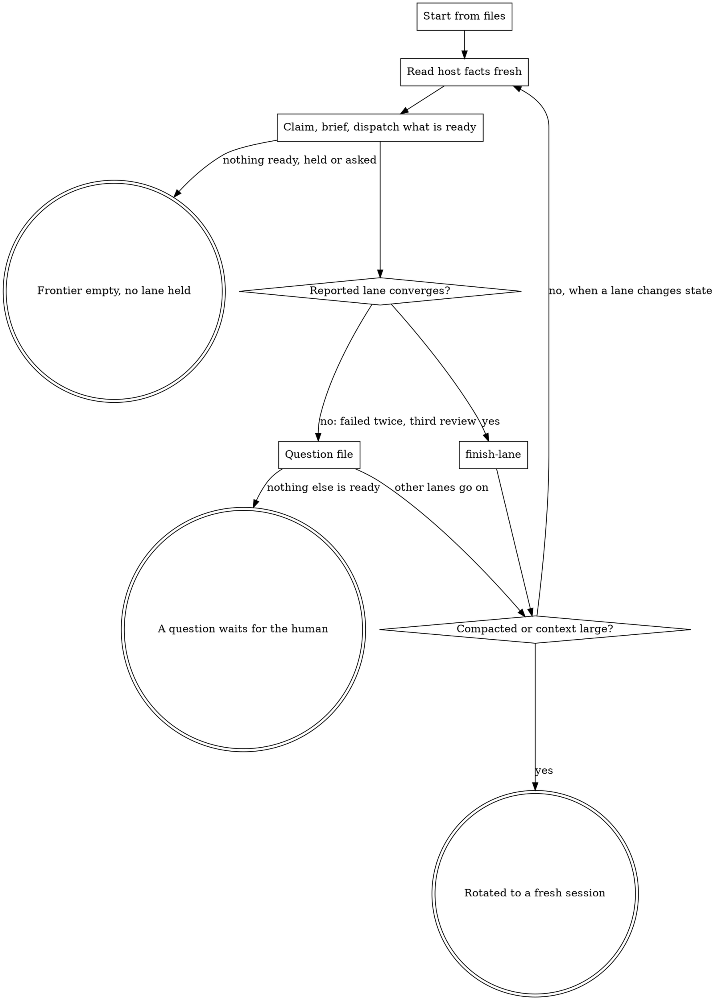

# coordinate

One session owns the plan and hands out all of the work. Its state lives in four files (`LANES.md`, the frontier, `questions/`, `STANDING.md`; formats in `docs/ux/coordinator-format.md`), so it can lose its context, or be replaced by another session, person or host, and continue. It edits `.ytstack/` and pull request bodies. Nothing else.

<HARD-GATE>
Do NOT edit product code, tests or configuration, do NOT review a diff yourself, and do NOT state anything about a pull request, its checks or a deployed build that you did not read from the host for this statement. This applies to EVERY lane regardless of how small the change looks.
</HARD-GATE>

## Anti-Pattern: "I know where the lanes stand"

After the first compaction you know a summary. In a long run a coordinator reported a production build that had been replaced and a pull request as open that had merged, and it lost instructions the human had given once. Who holds what comes from `LANES.md`. What the host says is read when it is needed and carries its read time. What the human asked for once and for all is in `STANDING.md`.

## Anti-Pattern: "I'll add a rule so that this does not happen again"

A mechanical mistake that is answered with one more sentence comes back, and the instruction file grows until nobody follows it: reviews keep finding violations of rules that are written down. What a machine can check becomes a check, and the sentence goes. Do not append rules to briefs or to `AGENTS.md` during the run; `ytstack:lane-retro` turns the mistakes of finished lanes into checks and pointers.

## Checklist

You MUST create a TodoWrite task for each of these items. Items 4 to 13 are one loop in this order; go round until a terminal state holds:

1. **Run preamble** -- lanes, frontier, questions, standing instructions, handoffs, all from files
2. **HARD-GATE** -- `.ytstack` and a sliced plan exist; this is the right skill
3. **Start from files** -- at the first start and after every compaction or resume
4. **Read host facts fresh** -- `ytstack-watch --once`, every fact with its read time
5. **Delegate what is ready** -- claim, render the brief, dispatch, check the report
6. **Finish reported lanes** -- `ytstack:finish-lane`, one lane at a time per pull request
7. **Keep the watcher running** -- `ytstack-watch` in the background for the open pull requests
8. **Queue and ask questions** -- look up, write the file, ask one, late
9. **Record standing instructions** -- into `STANDING.md` when they are given
10. **Stop loops that do not converge** -- a diagnosis to the human instead of another dispatch
11. **Report status** -- only on a change the human acts on, or at a boundary he set
12. **Rotate** -- after one compaction or with a large context: handoff, files current, fresh session
13. **Sample finished lanes** -- `ytstack:lane-retro` about every fifth lane

## Process Flow



## Preamble

```bash
# ytstack resolver (M016): checkout = where this shell runs, via the shared lib.
_LIB="${CLAUDE_SKILL_DIR}/../../hooks/lib/git-ctx.sh"
if [ -f "$_LIB" ]; then
  . "$_LIB"; yt_git_ctx "$PWD"; yt_resolve_yt_dir >/dev/null
  _PROJECT_DIR="$YT_TOPLEVEL"; _YT_DIR="$YT_DIR"; _YT_SCOPE="$YT_SCOPE"; _IS_GIT="$YT_IS_GIT"; _PROJECT_KEY="$YT_REPO_KEY"
else
  # Host did not substitute CLAUDE_SKILL_DIR (e.g. Codex adapter): project scope only.
  _IS_GIT=$([ "$(git rev-parse --is-inside-work-tree 2>/dev/null)" = true ] && echo yes || echo no)
  _PROJECT_DIR=$(git rev-parse --show-toplevel 2>/dev/null || pwd -P)
  _YT_DIR=""; _YT_SCOPE=none; _PROJECT_KEY=""
  [ -d "$_PROJECT_DIR/.ytstack" ] && { _YT_DIR="$_PROJECT_DIR/.ytstack"; _YT_SCOPE=project; }
fi
cd "$_PROJECT_DIR" 2>/dev/null || true
_PROJECT_SLUG=$(basename "$_PROJECT_DIR")
_HAS_YTSTACK=$([ -n "$_YT_DIR" ] && echo yes || echo no)

_M=none
[ -f "$_YT_DIR/STATE.md" ] && _M=$(sed -n 's/^current_milestone: *//p' "$_YT_DIR/STATE.md" | head -1)
_NI=false
if [ -n "${YTSTACK_NON_INTERACTIVE:-}" ] || [ -n "${OPENCLAW_SESSION:-}" ] || [ -n "${CLAUDE_AGENT_TEAM_MEMBER:-}" ]; then _NI=true; fi
echo "HAS_YTSTACK: $_HAS_YTSTACK"
echo "BRANCH: $(git branch --show-current 2>/dev/null || echo unknown)"
echo "CURRENT_MILESTONE: ${_M:-none}"
echo "SLICE_PLANS: $(ls "$_YT_DIR"/"$_M"-S[0-9][0-9]-PLAN.md 2>/dev/null | grep -c .)"
echo "YTSTACK_NON_INTERACTIVE: $_NI"
# A pull request host is reachable only with a remote and gh; no network call here.
_PR_HOST=none
[ -n "$(git remote 2>/dev/null | head -1)" ] && command -v gh >/dev/null 2>&1 && _PR_HOST=gh
echo "PR_HOST: $_PR_HOST"
echo "STANDING: $([ -n "$_YT_DIR" ] && [ -f "$_YT_DIR/STANDING.md" ] && echo yes || echo no)"

echo "LANES_BEGIN"
_ROWS=""
[ -f "$_YT_DIR/LANES.md" ] && _ROWS=$(awk '/^\|/ { n++; if (n > 2) print }' "$_YT_DIR/LANES.md")
echo "${_ROWS:-no lanes}"
echo "LANES_END"

echo "FRONTIER_BEGIN"
_FRONTIER="${CLAUDE_SKILL_DIR}/../../bin/ytstack-frontier"
if [ -n "$_YT_DIR" ] && [ -f "$_FRONTIER" ]; then
  bash "$_FRONTIER" list 2>&1 | head -80
else
  echo "ytstack-frontier not reachable: read the Blocked by lines of the slice plans"
fi
echo "FRONTIER_END"

echo "QUESTIONS_BEGIN"
_QN=0
for _f in "$_YT_DIR"/questions/Q[0-9]*.md; do
  [ -n "$_YT_DIR" ] && [ -f "$_f" ] || continue
  _st=$(sed -n 's/^state: *//p' "$_f" | head -1)
  case "$_st" in open|asked) ;; *) continue ;; esac
  _QN=$((_QN + 1))
  echo "$(basename "$_f") | $_st | asked: $(sed -n 's/^asked: *//p' "$_f" | head -1) | blocks: $(sed -n 's/^blocks: *//p' "$_f" | head -1)"
done
[ "$_QN" -gt 0 ] || echo "no open questions"
echo "QUESTIONS_END"

# Newest handoff: the hand-written one in the tree, the automatic one out of tree (pre-compact hook).
_MANUAL_TS=none
[ -f "$_YT_DIR/HANDOFF.md" ] && _MANUAL_TS=$(sed -n 's/^timestamp: *//p' "$_YT_DIR/HANDOFF.md" | head -1)
_AUTO=none; _AUTO_TS=none
if command -v yt_state_base >/dev/null 2>&1 && [ -n "${YT_REPO_KEY:-}" ]; then
  _LINK="$(yt_state_base)/repos/$YT_REPO_KEY/worktrees/${YT_WT_KEY:-}/latest-handoff"
  if [ -L "$_LINK" ] && [ -f "$_LINK" ]; then
    _AUTO=$(readlink "$_LINK"); _AUTO_TS=$(sed -n 's/^timestamp: *//p' "$_AUTO" 2>/dev/null | head -1)
  fi
fi
echo "HANDOFF_MANUAL: ${_MANUAL_TS:-none}"
echo "HANDOFF_AUTO: ${_AUTO_TS:-none} ($_AUTO)"
```

## Procedure

The scripts live in `${CLAUDE_SKILL_DIR}/../../bin/`; the commands below are written without that path. The work contract (`ytstack:minimal-code`) holds for orchestration as it does for code: no review round, verifier or check that the plan does not name, and evidence for the same commit in the same environment stands.

**Step 2 -- HARD-GATE.** `HAS_YTSTACK: no`: stop, "run `ytstack:init-project` or `ytstack:adopt-brownfield` first". `SLICE_PLANS: 0` and `no lanes`: stop, "nothing to coordinate; run `ytstack:slice-milestone`". One milestone with a handful of independent slices and no lane yet: `ytstack:spawn-milestone-team` does that with less ceremony; say so and stop unless the user asked for coordinator mode.

**Step 3 -- Start from files.** At the first start, after every compaction and after every resume, before anything else: read `STANDING.md` in full, the rows between `LANES_BEGIN` and `LANES_END`, the frontier, every file listed between `QUESTIONS_BEGIN` and `QUESTIONS_END`, and the newer of the two handoffs. Do not rebuild who holds what from a conversation summary. Where a summary and a file disagree, the file is the claim, and Step 4 checks it against the host before anybody acts on it. A `running` row whose worker no longer exists in this session is not dispatched again blindly: read its branch (`git log <base>..<branch>`), then `ytstack-frontier release <lane>` and claim it for a new worker that continues on that branch, or write a question.

**Step 4 -- Read host facts fresh.** Before a status, and before an action that depends on the state of a pull request, its checks, a review or a deployed build, read now:

```bash
ytstack-watch --pr <the numbers of the PR column> --once
```

One line per pull request (state, head, checks, newest review and its commit, mergeable or conflict) ending in `read <UTC>`. That stamp travels with the fact wherever it is used. A deployed build is read with the command `RUNTIME.md` names, with its time. None of this is written into `.ytstack/` as current: `LANES.md` records what you did (dispatched, reviewed commit X) and identifiers (a branch, a number). `PR_HOST: none`: there is no host to read. Say that the picture rests on the files and on local git, and state nothing about pull requests.

**Step 5 -- Delegate what is ready.** Product code, reviews and research run in fresh-context workers. For each lane that `ytstack-frontier list --ready` prints:

1. `ytstack-frontier claim <lane> --by <worker> --kind <implement|review|prepare> --branch <branch>`. Claim before dispatch. A refused claim names the holder: do not dispatch.
2. `ytstack-brief render --slice <lane> --kind <kind> --branch <branch> --base <base>` (`--task` for a task lane, `--head <sha>` for a review lane). The output is the worker's prompt, with the work contract and the report shape. Never write a brief by hand.
3. Dispatch as `ytstack:spawn-milestone-team` Step 5 does (an `Agent` call with `isolation: worktree`, or another host's command-line agent that reads the brief from stdin in a worktree of its own), then `ytstack-frontier set <lane> --status running --next "wait for the report"`.
4. When the report arrives: `ytstack-brief check`. An incomplete report goes back once with the checker's lines. Keep the labelled lines of the report, not the transcript, and `ytstack-frontier set <lane> --status reported --next "<the report's Next line>"`.

A lane named in the `blocks:` of an open or asked question is not ready, whatever the frontier prints. Look at the frontier again whenever a lane changes state: a merge unblocks lanes. Lanes that need nothing from each other go out in one message.

**Step 6 -- Finish reported lanes.** A `reported` lane goes through `ytstack:finish-lane`: the review at a pinned head, the gates read from the host, the merge at the reviewed commit or not at all. One lane at a time per pull request. `finish-lane` writes the reviewed head and the round into the lane's row; a row that lacks them after a review is repaired before anything else (`ytstack-frontier set <lane> --head <sha> --round <n> --pr <number>`). Never merge around it. A cap on open pull requests, when the project or `STANDING.md` sets one, is a gate of `finish-lane`: a lane that waits for it stays where it is.

**Step 7 -- Keep the watcher running.** Polling happens outside the model:

```bash
ytstack-watch --pr <the open numbers> --interval 60
```

Start it as a background process; on a host with a monitor tool, through that tool, so that each new line reaches you as an event. It prints a line only when a head moved, the checks changed, a review arrived, mergeability changed or a pull request closed, and it ends when all are merged or closed. Act on the line: red checks go back to the lane's worker with the name of the check; a review on a commit that is not the head is no review of the head. Start it again with the new list when a pull request opens. Never read status in a loop from the conversation, with or without a sleep. The single read of Step 4 before an action is not polling.

**Step 8 -- Queue and ask questions.** First look the question up: the plan, `DECISIONS.md`, the answered files in `questions/`. What they answer is not asked. Otherwise `ytstack-questions new --question "<text>" --decides "<who>" --blocks "<lane or gate>"` and fill Context, Options and Recommendation until the human can answer from the file alone. The state is `open` and the lanes that do not depend on it go on. Ask as late as the work allows: when nothing ready is left that is independent of it, or at a boundary from `STANDING.md`. Ask one (`ytstack-questions next`), mark it (`ytstack-questions ask <id>`), and use AskUserQuestion:

> **{Q### -- the title}** in **{project}** on `{BRANCH}`. It blocks {blocks}; {n} lanes go on without it.
>
> {The Context section in plain words: what exists, what is undecided, which file to open.}
>
> RECOMMENDATION: Choose {letter} because {the one reason from the file}
>
> A) {option} -- {consequence}
>    Completeness: {n}/10, effort: human: ~{t} / CC: ~{t}, tier: task
> B) {option} -- {consequence}
>    Completeness: {n}/10, effort: human: ~{t} / CC: ~{t}, tier: task

An `asked` question is never asked again: name it as waiting since its time. When the human answers, write what he said under `## Answer`, run `ytstack-questions answer <id>`, and add a `DECISIONS.md` entry when it decides something that lasts. Never record an answer the human did not give, and never take a verdict a plan reserves for a person. At a slice boundary the open gates go out together through `ytstack:reassess-roadmap` (its Step 3b). A step only the human may perform (a secret, a production switch, a merge he reserved) goes through `ytstack:handover-step` as one staged script. `YTSTACK_NON_INTERACTIVE: true`: ask nothing; the files stay `open` and are listed in the status under "Waiting on a person".

**Step 9 -- Record standing instructions.** When the human gives an instruction that holds beyond the task at hand (when to report, what never to merge, what not to touch), append it to `STANDING.md` at once, before the next dispatch: `- <UTC> -- <the instruction in your own words>. Scope: <where it applies>`. Never a quotation. An instruction that replaces an older one strikes the old line (`~~...~~ Superseded <UTC>: ...`); nothing is deleted.

**Step 10 -- Stop loops that do not converge.** A lane gets the rounds `ytstack:code-review` allows ("Bounded review": round 1 complete, round 2 the fix, no third). A lane that failed verification twice, or that would need a third review, is not dispatched again: `ytstack-frontier set <lane> --status blocked --next "Q### with the human"`, and a question file with the diagnosis (the plan never decided the point, two rules conflict, or each fix moved the problem).

**Step 11 -- Report status.** Only when something changed that the human acts on (a question, a blocker, a finished plan), or at a boundary he set in `STANDING.md`. No interim reports that work is running. A status is two to four full sentences with pointers (files, commits, pull request numbers). When the plan has gates it carries two numbers side by side, closed by work and accepted, as `ytstack:reassess-roadmap` counts them. Every host fact in it comes from a read made for this status and carries `read <UTC>`. When the human asks where the lanes stand, answer per lane instead: the status and the next action of its row as written, then the open and asked questions with what they block.

**Step 12 -- Rotate.** When the session has been compacted once (a summary stands where the conversation was, or `HANDOFF_AUTO` is from this session), or its context is large by the host's indicator, do not wait for the next compaction. After Step 3: bring the rows' next actions up to date, run `ytstack-frontier check` and `ytstack-questions check`, make sure `STANDING.md` holds every instruction given so far, write a handoff with `ytstack:handoff-session` (pointers only), and tell the user that a fresh session continues from the files with `ytstack:coordinate`. The watcher and running workers do not depend on this session's context. The same files let another person or another host take over.

**Step 13 -- Sample finished lanes.** About every fifth finished lane, run `ytstack:lane-retro`, the lanes that went wrong first.

## Terminal State

This skill does not end by itself. It returns control to the user in exactly three states:

- The frontier is empty and no lane is held: report per Step 11 and name `ytstack:reassess-roadmap` as the next step.
- A question waits for the human and nothing ready is independent of it.
- It rotated (Step 12): the handoff path and the sentence that a fresh session continues from the files.

Do NOT invoke `ytstack:plan-task`, `ytstack:test-driven-development`, `ytstack:code-review` or `ytstack:ship` from this session: that work belongs to a worker or to `finish-lane`. The ONLY skills you may invoke are `ytstack:finish-lane`, `ytstack:handover-step`, `ytstack:reassess-roadmap`, `ytstack:handoff-session` and `ytstack:lane-retro`.
