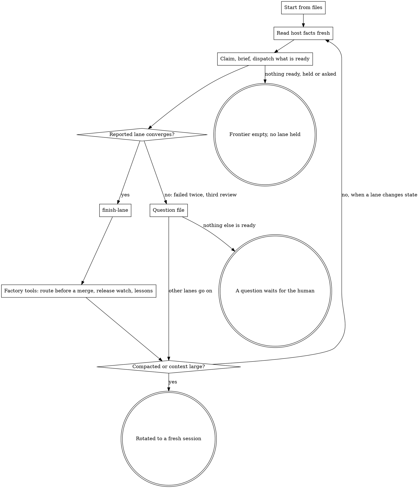

# coordinate

One session owns the plan and hands out all of the work. Its state lives in four places (`LANES.md`, the frontier, `questions/`, the standing instructions in `standing/` or `STANDING.md`; formats in `docs/ux/coordinator-format.md`), so it can lose its context, or be replaced by another session, person or host, and continue. It edits `.ytstack/` and pull request bodies. Nothing else.

<HARD-GATE>
Do NOT edit product code, tests or configuration, do NOT review a diff yourself, and do NOT state anything about a pull request, its checks or a deployed build that you did not read from the host for this statement. Do NOT close a lane's pull request, reopen it to retrigger checks or delete its branch: a lane that waits for a cap is `parked` with its pull request open, a check reruns with `gh run rerun`, and only the person closes open work. This applies to EVERY lane regardless of how small the change looks.
</HARD-GATE>

## Anti-Pattern: "I know where the lanes stand"

After the first compaction you know a summary. In a long run a coordinator reported a production build that had been replaced and a pull request as open that had merged, and it lost instructions the human had given once. Who holds what comes from `LANES.md`. What the host says is read when it is needed and carries its read time. What the human asked for once and for all is in the standing instructions (`standing/`, `STANDING.md`).

## Anti-Pattern: "I'll add a rule so that this does not happen again"

A mechanical mistake that is answered with one more sentence comes back, and the instruction file grows until nobody follows it: reviews keep finding violations of rules that are written down. What a machine can check becomes a check, and the sentence goes. Do not append rules to briefs or to `AGENTS.md` during the run: every incident, also a slip of yours, goes through `ytstack:lesson`, which records its class and puts the lesson into a check first; `ytstack:lane-retro` samples finished lanes for what no incident showed.

## Checklist

You MUST create a TodoWrite task for each of these items. Items 4 to 13 are one loop in this order; go round until a terminal state holds:

1. **Run preamble** -- lanes, frontier, questions, standing instructions, handoffs, all from files
2. **HARD-GATE** -- `.ytstack` and a sliced plan exist; this is the right skill
3. **Start from files** -- at the first start and after every compaction or resume
4. **Read host facts fresh** -- `ytstack-watch --once`, every fact with its read time
5. **Delegate what is ready** -- `ytstack-frontier check` and an action for every `stale:` line first, then claim, render the brief, dispatch, check the report
6. **Finish reported lanes** -- `ytstack:finish-lane`, one lane at a time per pull request
7. **Run the factory tools** -- the route before every merge (also your own), the PR watch or `ytstack-watch`, `ytstack-watch release` after every merge to production, signals, review lessons, the lesson of every incident (a red `main`, a slip); each skipped only by its condition
8. **Queue and ask questions** -- look up, write the file, ask one, late
9. **Record standing instructions** -- `ytstack-standing add` when they are given, before the next dispatch; never only in agent memory
10. **Stop loops that do not converge** -- a diagnosis to the human instead of another dispatch
11. **Report status** -- only on a change the human acts on, or at a boundary he set
12. **Rotate** -- after one compaction or with a large context, in one step while lanes run: files current, handoff with the PR watch session, the watches and the workers' addresses, fresh session; this one stays open only as a relay
13. **Sample finished lanes** -- `ytstack:lane-retro` about every fifth lane

## Process Flow



## Preamble

```bash
# ytstack resolver (M016): checkout = where this shell runs, via the shared lib.
_LIB="${CLAUDE_SKILL_DIR}/../../hooks/lib/git-ctx.sh"
if [ -f "$_LIB" ]; then
  . "$_LIB"; yt_git_ctx "$PWD"; yt_resolve_yt_dir >/dev/null
  _PROJECT_DIR="$YT_TOPLEVEL"; _YT_DIR="$YT_DIR"; _YT_SCOPE="$YT_SCOPE"; _IS_GIT="$YT_IS_GIT"; _PROJECT_KEY="$YT_REPO_KEY"
else
  # Host did not substitute CLAUDE_SKILL_DIR (e.g. Codex adapter): project scope only.
  _IS_GIT=$([ "$(git rev-parse --is-inside-work-tree 2>/dev/null)" = true ] && echo yes || echo no)
  _PROJECT_DIR=$(git rev-parse --show-toplevel 2>/dev/null || pwd -P)
  _YT_DIR=""; _YT_SCOPE=none; _PROJECT_KEY=""
  [ -d "$_PROJECT_DIR/.ytstack" ] && { _YT_DIR="$_PROJECT_DIR/.ytstack"; _YT_SCOPE=project; }
fi
cd "$_PROJECT_DIR" 2>/dev/null || true
_PROJECT_SLUG=$(basename "$_PROJECT_DIR")
_HAS_YTSTACK=$([ -n "$_YT_DIR" ] && echo yes || echo no)

_M=none
[ -f "$_YT_DIR/STATE.md" ] && _M=$(sed -n 's/^current_milestone: *//p' "$_YT_DIR/STATE.md" | head -1)
_NI=false
if [ -n "${YTSTACK_NON_INTERACTIVE:-}" ] || [ -n "${OPENCLAW_SESSION:-}" ] || [ -n "${CLAUDE_AGENT_TEAM_MEMBER:-}" ]; then _NI=true; fi
echo "HAS_YTSTACK: $_HAS_YTSTACK"
echo "BRANCH: $(git branch --show-current 2>/dev/null || echo unknown)"
echo "CURRENT_MILESTONE: ${_M:-none}"
echo "SLICE_PLANS: $(ls "$_YT_DIR"/"$_M"-S[0-9][0-9]-PLAN.md 2>/dev/null | grep -c .)"
echo "YTSTACK_NON_INTERACTIVE: $_NI"
# A pull request host is reachable only with a remote and gh; no network call here.
_PR_HOST=none
[ -n "$(git remote 2>/dev/null | head -1)" ] && command -v gh >/dev/null 2>&1 && _PR_HOST=gh
echo "PR_HOST: $_PR_HOST"
# Factory tools (M031): what the project switched on; Step 7 skips a tool by these lines.
_BIN=$(cd "${CLAUDE_SKILL_DIR}/../../bin" 2>/dev/null && pwd -P || echo "${CLAUDE_SKILL_DIR}/../../bin")
echo "YT_BIN=$_BIN"
_MERGE_BY=human
command -v yt_prefs >/dev/null 2>&1 && { yt_prefs "$_YT_DIR" >/dev/null; _MERGE_BY="$YT_PREF_MERGE_BY"; }
echo "MERGE_BY: $_MERGE_BY"
echo "REVIEW_POLICY: $([ -n "$_YT_DIR" ] && [ -f "$_YT_DIR/spec/REVIEW.md" ] && echo yes || echo no)"
echo "OWN_REVIEWERS: $([ -f "$_BIN/ytstack-risk" ] && [ -n "$(bash "$_BIN/ytstack-risk" -C "$_PROJECT_DIR" reviewers 2>/dev/null)" ] && echo yes || echo no)"
_PRW=off
if grep -Eq '^[[:space:]]*pr_watch[[:space:]]*=[[:space:]]*on[[:space:]]*$' "${HOME:-/nonexistent}/.ytstack/config" 2>/dev/null; then
  # Local state only, no GitHub call: the age of the worker's last finished tick.
  if _ST=$(bash "$_BIN/ytstack-pr-watch" status 2>/dev/null); then
    _HB=$(printf '%s\n' "$_ST" | sed -n 's/^ *"heartbeat": *"\([0-9]*\).*/\1/p' | head -1)
    _PRW="on, $([ -n "$_HB" ] && echo "heartbeat $(( $(date +%s) - _HB )) s ago" || echo "no heartbeat")"
  else
    _PRW="on, status not readable (run ytstack-pr-watch status)"
  fi
fi
echo "PR_WATCH: $_PRW"
_RT="$_BIN/ytstack-runtime"; _SIGNALS=0
echo "RELEASE: $([ -f "$_RT" ] && bash "$_RT" -C "$_PROJECT_DIR" get release deployed >/dev/null 2>&1 && echo yes || echo no)"
[ -f "$_RT" ] && _SIGNALS=$(bash "$_RT" -C "$_PROJECT_DIR" signals 2>/dev/null | awk 'NF { n++ } END { print n + 0 }')
echo "SIGNALS: $_SIGNALS"
# Lessons (M032): the open ones; a proposal waits for the person, a check to build is a lesson lane.
_SIG="$_BIN/ytstack-signals"; _LS=""
[ -n "$_YT_DIR" ] && [ -f "$_SIG" ] && _LS=$(bash "$_SIG" -C "$_PROJECT_DIR" lesson list 2>/dev/null)
echo "LESSONS: $(printf '%s\n' "$_LS" | awk -F'\t' 'NF { n++; if ($7 ~ /^proposal:/) p++; else if ($7 ~ /^check:/) c++ } END { printf "%d open (%d proposals, %d checks to build)", n, p, c }')"
echo "LESSONS_BEGIN"
[ -z "$_LS" ] || printf '%s\n' "$_LS" | head -30
echo "LESSONS_END"
echo "STANDING: $([ -n "$_YT_DIR" ] && [ -f "$_YT_DIR/STANDING.md" ] && echo yes || echo no)"
# The operating checklist (issue #76): one place, docs/ux/coordinator-format.md.
echo "OPERATING_CHECKLIST_BEGIN"
awk '/<!-- operating-checklist:end -->/ { f = 0 } f { print } /<!-- operating-checklist:begin -->/ { f = 1 }' "${CLAUDE_SKILL_DIR}/../../docs/ux/coordinator-format.md" 2>/dev/null \
  | grep . || echo "read the Operating checklist in docs/ux/coordinator-format.md of the plugin"
echo "OPERATING_CHECKLIST_END"
# Coordinate mode (issue #72): the session marker hooks/standing-prompt, hooks/pre-tool-use-agent and hooks/stop act on.
_SID="${CLAUDE_CODE_SESSION_ID:-}"
case "$_SID" in
  ''|*[!A-Za-z0-9._-]*) echo "COORDINATE_MARKER: none (no session id on this host: the standing hooks stay off)" ;;
  *) if [ -n "$_YT_DIR" ] && command -v yt_session_home >/dev/null 2>&1 && mkdir -p "$(yt_session_home)/$_SID" 2>/dev/null \
        && printf '%s\n%s\n' "$_YT_DIR" "$_PROJECT_KEY" > "$(yt_session_home)/$_SID/coordinate" 2>/dev/null; then
       echo "COORDINATE_MARKER: written"
     else
       echo "COORDINATE_MARKER: not written (the standing hooks stay off)"
     fi ;;
esac
# One file per standing instruction (.ytstack/standing/): the newest entry's age and the
# human prompts since, the active ones, then ended, conditions to check and failed checks.
echo "STANDING_ENTRIES_BEGIN"
if [ -n "$_YT_DIR" ] && [ -f "$_BIN/ytstack-standing" ]; then
  bash "$_BIN/ytstack-standing" -C "$_PROJECT_DIR" list 2>&1 | head -80
elif [ -n "$_YT_DIR" ] && [ -d "$_YT_DIR/standing" ]; then
  command -v yt_standing >/dev/null 2>&1 && yt_standing "$_YT_DIR" || echo "list $_YT_DIR/standing/ yourself: newest first, skip superseded and ended"
else
  echo "no standing directory"
fi
echo "STANDING_ENTRIES_END"

echo "LANES_BEGIN"
_ROWS=""
[ -f "$_YT_DIR/LANES.md" ] && _ROWS=$(awk '/^\|/ { n++; if (n > 2) print }' "$_YT_DIR/LANES.md")
echo "${_ROWS:-no lanes}"
echo "LANES_END"

echo "FRONTIER_BEGIN"
_FRONTIER="${CLAUDE_SKILL_DIR}/../../bin/ytstack-frontier"
if [ -n "$_YT_DIR" ] && [ -f "$_FRONTIER" ]; then
  bash "$_FRONTIER" list 2>&1 | head -80
else
  echo "ytstack-frontier not reachable: read the Blocked by lines of the slice plans"
fi
echo "FRONTIER_END"

# Sessions in other repositories (LANES.md "## Peers"): write only to these addresses, `ytstack-frontier peer set` after each contact.
echo "PEERS_BEGIN"
_PEERS=""
[ -n "$_YT_DIR" ] && [ -f "$_FRONTIER" ] && _PEERS=$(bash "$_FRONTIER" peer list 2>/dev/null)
echo "${_PEERS:-no peers}"
echo "PEERS_END"

echo "QUESTIONS_BEGIN"
_QN=0
for _f in "$_YT_DIR"/questions/Q[0-9]*.md; do
  [ -n "$_YT_DIR" ] && [ -f "$_f" ] || continue
  _st=$(sed -n 's/^state: *//p' "$_f" | head -1)
  case "$_st" in open|asked) ;; *) continue ;; esac
  _QN=$((_QN + 1))
  echo "$(basename "$_f") | $_st | asked: $(sed -n 's/^asked: *//p' "$_f" | head -1) | blocks: $(sed -n 's/^blocks: *//p' "$_f" | head -1)"
done
[ "$_QN" -gt 0 ] || echo "no open questions"
echo "QUESTIONS_END"

# Newest handoff: the hand-written one in the tree, the automatic one out of tree (pre-compact hook).
_MANUAL_TS=none
[ -f "$_YT_DIR/HANDOFF.md" ] && _MANUAL_TS=$(sed -n 's/^timestamp: *//p' "$_YT_DIR/HANDOFF.md" | head -1)
_AUTO=none; _AUTO_TS=none
# yt_latest_handoff also looks where the hook wrote it (CLAUDE_PLUGIN_DATA is not set in this shell).
if command -v yt_latest_handoff >/dev/null 2>&1 && [ -n "${YT_REPO_KEY:-}" ]; then
  _AUTO=$(yt_latest_handoff)
  if [ -n "$_AUTO" ]; then _AUTO_TS=$(sed -n 's/^timestamp: *//p' "$_AUTO" 2>/dev/null | head -1); else _AUTO=none; fi
fi
echo "HANDOFF_MANUAL: ${_MANUAL_TS:-none}"
echo "HANDOFF_AUTO: ${_AUTO_TS:-none} ($_AUTO)"
```

## Procedure

The scripts live in the directory the preamble prints as `YT_BIN=<dir>` (also in the SessionStart context); the commands below are written without that path. Run each as `"$YT_BIN/ytstack-<name>"` with the newest printed value set in the same command (`YT_BIN=<dir>; "$YT_BIN/ytstack-frontier" list`): a shell variable does not survive a tool call, and a versioned path from before an update or a compaction can name a removed version. The work contract (`ytstack:minimal-code`) holds for orchestration as it does for code: no review round, verifier or check that the plan does not name, and evidence for the same commit in the same environment stands.

**Step 2 -- HARD-GATE.** `HAS_YTSTACK: no`: stop, "run `ytstack:init-project` or `ytstack:adopt-brownfield` first". `SLICE_PLANS: 0` and `no lanes`: stop, "nothing to coordinate; run `ytstack:slice-milestone`". One milestone with a handful of independent slices and no lane yet: `ytstack:spawn-milestone-team` does that with less ceremony; say so and stop unless the user asked for coordinator mode.

**Step 3 -- Start from files.** At the first start, after every compaction and after every resume, before anything else: read the standing instructions in full (every entry listed as active between `STANDING_ENTRIES_BEGIN` and `STANDING_ENTRIES_END`, newest first, its file in `standing/`, and `STANDING.md` when `STANDING: yes`; an entry that another entry supersedes, or that ended, is not listed as active and no longer holds). Then act on the rest of that block: an entry under `ended` gets its closing entry now (`ytstack-standing end <entry> --reason "<what ended it>"`), an entry under `condition to check now` is checked against the host now and closed the same way when it is met, a line under `check failed` is an instruction you are not keeping: fix that first. Its first line counts the human prompts since the newest entry: more than a few after a compaction means instructions may be missing, so read the conversation summary for instructions and record them (Step 9) before you dispatch. Then the rows between `LANES_BEGIN` and `LANES_END`, the frontier, every file listed between `QUESTIONS_BEGIN` and `QUESTIONS_END`, and the newer of the two handoffs. Do not rebuild who holds what from a conversation summary. Where a summary and a file disagree, the file is the claim, and Step 4 checks it against the host before anybody acts on it. A `running` row whose worker no longer exists in this session is not dispatched again blindly: read its branch (`git log <base>..<branch>`), then `ytstack-frontier release <lane>` and claim it for a new worker that continues on that branch, or write a question.

When the newer handoff carries a "Rotation" block (Step 12 of the session before, `docs/ux/coordinator-format.md`), this session is its successor. Before Step 4: `ytstack-pr-watch handover --from <the PR watch session it names>` (skip with `PR watch session: none`; check that the output names the moved pull requests), start the background watches it lists again, and leave the rows of its running workers alone: those workers report to the old session, which stays open as a relay and appends each report under "Reports after the rotation" in `HANDOFF.md` and sets the row to `reported`. Read the handoff again when such a row turns `reported`, and send a worker a message at its address only where the host lets this session reach it. Only when the person says the old session is closed before a worker reported does the rule above for a lost worker apply.

**Step 4 -- Read host facts fresh.** Before a status, and before an action that depends on the state of a pull request, its checks, a review or a deployed build, read now:

```bash
ytstack-watch --pr <the numbers of the PR column> --once
```

One line per pull request (state, head, checks, newest review and its commit, mergeable or conflict) ending in `read <UTC>`. That stamp travels with the fact wherever it is used. A deployed build is read with the command `RUNTIME.md` names, with its time. None of this is written into `.ytstack/` as current: `LANES.md` records what you did (dispatched, reviewed commit X) and identifiers (a branch, a number). `PR_HOST: none`: there is no host to read. Say that the picture rests on the files and on local git, and state nothing about pull requests.

**Step 5 -- Delegate what is ready.** Product code, reviews and research run in fresh-context workers. The order is the one of the operating checklist the preamble prints between `OPERATING_CHECKLIST_BEGIN` and `OPERATING_CHECKLIST_END`; in this session `hooks/pre-tool-use-agent` says so when an `Agent` prompt is no rendered brief, and the Stop hook says when `LANES.md` lags the dispatches and reports or the `STATE.md` pointer is behind, and holds the stop once when that came three sessions in a row; it also says when a dispatch has no `isolation`.

Every round of this loop starts here, before `list --ready`: run `ytstack-frontier check`. Exit 0 prints `lanes ok`, exit 1 names the broken lines of `LANES.md` (repair them first), exit 2 prints one `stale:` line per lane that stalls. Each `stale:` line gets its action in this round, before any new dispatch: a running lane whose worktree is gone ended, so read its branch (`git log <base>..<branch>`) and set the row (`reported` when its report is in, else release it and claim it for a new worker on that branch); a lane without a commit or a report for too long gets one message at its worker's address asking for its state, and on the next `stale:` line for it the release and a new claim; a ready lane nobody claimed is claimed and dispatched now. A `stale:` line never releases a lane by itself, and it is never a reason to close a pull request. For each lane that `ytstack-frontier list --ready` prints:

1. `ytstack-frontier claim <lane> --by <worker> --kind <implement|review|prepare> --branch <branch>`. Claim before dispatch. A refused claim names the holder: do not dispatch.
2. `ytstack-brief render --slice <lane> --kind <kind> --branch <branch> --base <base>` (`--task` for a task lane, `--lesson F###` for a lesson lane `lesson-F###`, `--head <sha>` for a review lane). The output is the worker's prompt, with the work contract and the report shape. Never write a brief by hand.
3. Dispatch as `ytstack:spawn-milestone-team` Step 5 does (an `Agent` call with `isolation: worktree`, or another host's command-line agent that reads the brief from stdin in a worktree of its own), then `ytstack-frontier set <lane> --status running --next "wait for the report"`.
4. When the report arrives: `ytstack-brief check`. An incomplete report goes back once with the checker's lines. Keep the labelled lines of the report, not the transcript, and `ytstack-frontier set <lane> --status reported --next "<the report's Next line>"`.

A lane named in the `blocks:` of an open or asked question is not ready, whatever the frontier prints. Look at the frontier again whenever a lane changes state: a merge unblocks lanes. Lanes that need nothing from each other go out in one message.

**Lesson lanes.** The frontier lists a lesson whose check is still to be built as `lesson-F###` after the slices (`docs/ux/coordinator-format.md`, "Lesson lanes"). It is dispatched like any lane, with `ytstack-signals set F### --state planned --ref lesson-F###` at the claim. A lesson lane listed as `blocked` with "unplanned" needs its `## Files` and `## Verification` first: write them into the lesson from what it says (the check, where it lives, the command that fails on what happened), as you write any file under `.ytstack/`.

**Step 6 -- Finish reported lanes.** A `reported` lane goes through `ytstack:finish-lane`: the review at a pinned head with the class its reviewer states, the route of the change, the gates read from the host, the merge at the reviewed commit or not at all. Who merges follows `merge_by` in `PREFERENCES.md`. With `risk`, the default, `finish-lane` merges a lane itself when `bin/ytstack-finish-lane route` printed `route: unattended` and the host's gates hold; every other lane stops at `ready` with its merge command and the reasons, and waits for a person. You state no class and you change no ceiling: the class is the reviewer's, the ceiling stands in the area file of the technical spec (`docs/ux/review-policy-format.md`). A change that requires lenses (`.ytstack/spec/REVIEW.md`) gets one more fresh reviewer per lens from `finish-lane`. A lens reviewer is a lane of kind `review` and never the lane's worker; a lens with visual evidence needs a session that can start the product and has a browser tool. One lane at a time per pull request. `finish-lane` writes the reviewed head and the round into the lane's row; a row that lacks them after a review is repaired before anything else (`ytstack-frontier set <lane> --head <sha> --round <n> --pr <number>`). Never merge around it. A cap on open pull requests, when the project or a standing instruction sets one, is a gate of `finish-lane` and counts the pull requests that are ready for review; drafts do not count. A lane that waits for it is set to `parked` (`ytstack-frontier set <lane> --status parked --next "wait for the cap"`) and its pull request stays open. A pull request is never closed to get under the cap, and never closed and reopened to retrigger a check: `gh run rerun <run id> --failed` does that.

**Step 7 -- Run the factory tools.** The plugin already ships what a coordinator under load starts to build by hand: a pull request babysitter, a review tiering, a release check. Use these tools and build none of your own. `ytstack:finish-lane` runs the route, the release watch and the escape check for the merges it makes (its Steps 9, 12 and 13), and the lesson of a blocked review or a red check of its lane (its Step 14); this step holds for everything else too: a merge you make yourself, a merge a person made, a release, a signal. A tool is skipped only for the reason in its row; the preamble prints the lines that decide it (`MERGE_BY`, `REVIEW_POLICY`, `OWN_REVIEWERS`, `PR_WATCH`, `RELEASE`, `SIGNALS`).

| Tool | Command | When | Skipped when |
|---|---|---|---|
| Route | `ytstack-finish-lane route --lane <lane> --base <sha> --head <reviewed head>`; for a pull request without a lane row `ytstack-risk route --plan <plan with the round line> --base <sha> --head <reviewed head> --author <who wrote it>` | before every merge, also one you make yourself outside `finish-lane` | never before a merge. `REVIEW_POLICY: no` does not skip it: the route is then `person` for every change, and the status says that risk routing is not set up |
| PR watch | `ytstack-pr-watch register --repo <owner/name> --all-open`, without `--session` | at the start of coordination, after every restart and rotation (Step 12), and again after a worker opened a pull request | `PR_WATCH` is `off` or names no heartbeat under 10 minutes (600 s): then `ytstack-watch --pr <the open numbers> --interval 60` in the background, and tell the person once to run `ytstack-pr-watch install-worker --yes` or to check the worker |
| Release watch | `ytstack-watch release --commit <merge commit>` in the background (`gh pr view <N> --json mergeCommit --jq .mergeCommit.oid`; after a squash it is not the reviewed head) | after every merge that goes to production, by anyone | `finish-lane` already watched that commit; `RELEASE: no` (one line in the next status: nobody watched the release) |
| Signals | `ytstack:signal-intake`; for an outage `ytstack:incident` | the intake at a slice boundary, after a release receipt, and when the person asks; the incident when a receipt says `unhealthy` or `not arrived` and users are hurt, or the person reports production down | the intake when `SIGNALS: 0` or a schedule or another session already runs it; the incident never on a guess: what hurts no running user is a finding for the intake |
| Review lessons | `ytstack:review-lessons` for the pull request | after a merge with a bot finding: the PR watch's merge notice names the pull request; without the PR watch, `ytstack-review-escapes --pr <N>` prints a line | `OWN_REVIEWERS: no`; `finish-lane` ran it for that merge (its Step 13) |
| Lesson | `ytstack:lesson` with what happened, the area and "this session changes no code" | a red `main` (a check on the base branch failed: a PR watch notice, or `gh run list --branch <base> --limit 5` read after a merge and before a status), and every slip of a lane or of yours that you notice or the person points out (a foreign process killed, a lane without a watcher, a settled question asked again, a receipt that claimed too much) | never; `finish-lane` ran it for its own blocked review or red check (its Step 14) |

**A red `main`.** A failed check on the base branch blocks every lane that merges after it. Read which check and since which commit (with its read time), dispatch the repair as a lane like any other (or name the lane that broke it, which gets it back), and invoke `ytstack:lesson` before the next dispatch: area `ci`, the check, the commit, the lane that merged it. You fix nothing yourself; a lesson that needs a check becomes a lesson lane.

**The route, also when you merge yourself.** A merge you make outside `finish-lane` (a pull request outside the lanes, a project rule that the coordinator merges) reads the route for the reviewed head first and follows `finish-lane` Step 11: `MERGE_BY: risk` merges only after `route: unattended`; `coordinator` merges and names the route in the status; `human`, or a standing instruction that reserves the merge, leaves the merge to a person with the `reason:` lines. The merge itself is `ytstack-finish-lane -C <worktree> merge --pr <N> --at <reviewed head> --verdict-pattern '^Verdict: approved'`, never `gh pr merge` by hand. Exit 0 of the route means `unattended`; everything else, an error included, means a person.

**Watching pull requests.** Polling happens outside the model. The PR watch counts as on only when `pr_watch=on` is set in `~/.ytstack/config` (`docs/pr-watch.md`) and the worker runs (`PR_WATCH: on, heartbeat <n> s ago`, under 600). The flag alone enables only the hooks; without a fresh heartbeat nothing polls. With the PR watch on, the worker reports red checks, unresolved bot threads, conflicts and merges to this session with the next prompt, also for pull requests the lanes' subagents opened. The `register` call defaults to this session; check that its output says `registered to claude:<id>` in Claude Code. `--all-open` takes only open pull requests by your GitHub login (the lanes' workers open them under it) and skips drafts, a `do-not-merge` label and the ones another session owns, each by name; `--author <login>[,<login>]`, `--include-drafts` and `--include-labelled` widen it only where this coordination owns such a pull request. Only the coordinator runs it; a session that works in the same repository outside this coordination keeps its own PRs (`register --pr N`). Without the PR watch, start `ytstack-watch` as a background process; on a host with a monitor tool, through that tool, so that each new line reaches you as an event. It prints a line only when a head moved, the checks changed, a review arrived, mergeability changed or a pull request closed, and it ends when all are merged or closed; start it again with the new list when a pull request opens. Act on a line or a notice: red checks go back to the lane's worker with the name of the check; a review on a commit that is not the head is no review of the head. Never read status in a loop from the conversation, with or without a sleep. The single read of Step 4 before an action is not polling.

**After a merge.** A pull request that merged, also when a person merged it: set its lane to `merged`, then the release watch and the review lessons of the table. A merged lesson lane also closes its lesson: `ytstack-signals set F### --state fixed` once this checkout has the merged check (the script refuses while the file is missing). The receipt goes into the next status; `not arrived` or `unhealthy` is a status at once. You deploy nothing and roll nothing back: a countermeasure on the target is a step for the human (`ytstack:handover-step`).

**Step 8 -- Queue and ask questions.** First look the question up: the plan, `DECISIONS.md`, the answered files in `questions/`. What they answer is not asked. Otherwise `ytstack-questions new --question "<text>" --decides "<who>" --blocks "<lane or gate>"` and fill Context, Options and Recommendation until the human can answer from the file alone. The state is `open` and the lanes that do not depend on it go on. Ask as late as the work allows: when nothing ready is left that is independent of it, or at a boundary from a standing instruction. Ask one (`ytstack-questions next`), mark it (`ytstack-questions ask <id>`), and use AskUserQuestion:

> **{Q### -- the title}** in **{project}** on `{BRANCH}`. It blocks {blocks}; {n} lanes go on without it.
>
> {The Context section in plain words: what exists, what is undecided, which file to open.}
>
> RECOMMENDATION: Choose {letter} because {the one reason from the file}
>
> A) {option} -- {consequence}
>    Completeness: {n}/10, effort: human: ~{t} / CC: ~{t}, tier: task
> B) {option} -- {consequence}
>    Completeness: {n}/10, effort: human: ~{t} / CC: ~{t}, tier: task

**Lesson proposals.** A lesson that is only a proposal (`proposal:Q###` between `LESSONS_BEGIN` and `LESSONS_END`) has its question file and waits for the person. It goes with the daily question: at most once a UTC day, the next time you ask (by the rules above, or at the boundary a standing instruction sets), the oldest open lesson proposal is the question you ask, unless a question that blocks a lane is open; then it is the one after. A day without any question asks it alone at the next status that is due. It counts as the one question of that turn.

An `asked` question is never asked again: name it as waiting since its time. When the human answers, write what he said under `## Answer`, run `ytstack-questions answer <id>`, and add a `DECISIONS.md` entry when it decides something that lasts. Never record an answer the human did not give, and never take a verdict a plan reserves for a person. At a slice boundary the open gates go out together through `ytstack:reassess-roadmap` (its Step 3b). A step only the human may perform (a secret, a production switch, a merge he reserved) goes through `ytstack:handover-step` as one staged script. `YTSTACK_NON_INTERACTIVE: true`: ask nothing; the files stay `open` and are listed in the status under "Waiting on a person".

**Step 9 -- Record standing instructions.** When the human gives an instruction that holds beyond the task at hand (when to report, what never to merge, what not to touch, a priority, an approval that covers later cases), record it at once, before the next dispatch, with one command: `ytstack-standing add "<the instruction in your own words>" --scope "<where it applies>"` (the script is `bin/ytstack-standing` of the plugin, beside `ytstack-frontier`). Add `--supersedes <entry>` when it replaces an older entry, `--until <ISO UTC>` when it ends at a time, `--until-condition "<sentence>"` when it ends with an event, `--until-check "<command>"` when that event can be checked by a command that exits 0 once it happened, and `--check "<command>"` when keeping it can be checked (a command that fails while the instruction is not kept, such as a `LANES.md` older than the last lane change). Name the role in the scope when it applies to one (`the coordinator`, `every lane`, `every reviewer`; `docs/ux/coordinator-format.md`, "Scope and roles"): the SessionStart injection and the lane briefs filter by it. The command writes the entry in a worktree of its own outside the checkout, commits it and opens or updates the one standing pull request of the UTC day; `--here` writes into the resolved `.ytstack/standing/` only, for user scope (always) or a project where you may write in the checkout. It runs `ytstack-check --standing` itself. When `hooks/standing-prompt` says a prompt reads like a standing instruction, decide: record it, or go on when it is not one. The Stop hook blocks once when such prompts got no entry. An instruction that ended is closed with `ytstack-standing end <entry> --reason "<what ended it>"`; nothing is edited or deleted.

Agent-private memory (a memory file, a note in your own context) is no substitute: a successor session, another host and the human read only the repository. An instruction that lives only in your memory is lost at the next rotation. Never a quotation; the body is the instruction in your own words. One file per instruction keeps two pull requests that each add one from touching the same line. `STANDING.md` is not edited per entry; only a project that has `STANDING.md` and no `standing/` directory yet keeps its form: append `- <UTC> -- <the instruction>. Scope: <where it applies>` and strike a replaced line (`~~...~~ Superseded <UTC>: ...`).

**Step 10 -- Stop loops that do not converge.** A lane gets the rounds `ytstack:code-review` allows ("Bounded review": round 1 complete, round 2 the fix, no third). A lane that failed verification twice, or that would need a third review, is not dispatched again: `ytstack-frontier set <lane> --status blocked --next "Q### with the human"`, and a question file with the diagnosis (the plan never decided the point, two rules conflict, or each fix moved the problem).

**Step 11 -- Report status.** Only when something changed that the human acts on (a question, a blocker, a finished plan, a lane that waits for his merge), or at a boundary he set in a standing instruction. No interim reports that work is running. A lane that merged without a person is no reason for a status of its own: the next status that is due names it in one line, with its class and the ceiling it merged under. A status is two to four full sentences with pointers (files, commits, pull request numbers). When the plan has gates it carries two numbers side by side, closed by work and accepted, as `ytstack:reassess-roadmap` counts them. Progress per phase comes from `ytstack-status --phases` (`--json` for a chart), never from a count by hand: it names every change of a total since the last report with its cause, so a grown total is not read as lost progress. When `LESSONS` counts open lessons, the status names them in one line as the preamble prints them (`lessons: 3 open (1 proposals, 2 checks to build)`), with the class of each one that counts 2 or more. Every host fact in it comes from a read made for this status and carries `read <UTC>`. When the human asks where the lanes stand, answer per lane instead: the status and the next action of its row as written, then the open and asked questions with what they block.

**Step 12 -- Rotate.** When the session has been compacted once (a summary stands where the conversation was, or `HANDOFF_AUTO` is from this session), or its context is large by the host's indicator, rotate now. Do not wait for a quiet moment, for workers to report or for checks to finish: under load there is none, and a second compaction costs more than a rotation. In a coordinate session the SessionStart context after a compaction says `Compaction N of this coordinator: ytstack:coordinate Step 12, rotate now`, and from the second compaction on the Stop hook says it too: that line is this step, now. It is one step, done in this order without dispatching anything in between:

1. Bring the rows' next actions up to date, run `ytstack-frontier check` and `ytstack-questions check`, and make sure the standing instructions hold every instruction given so far.
2. Write `$_YT_DIR/HANDOFF.md` yourself in the format of `ytstack:handoff-session` (its Step 7), without its questions: the answers are in the files, and the handoff points at them. Its "In-flight work" carries the "Rotation" block of `docs/ux/coordinator-format.md`: `PR watch session:` with this session's id as the PR watch stores it (`echo "${CODEX_THREAD_ID:-claude:$CLAUDE_CODE_SESSION_ID}"`; `none` when `PR_WATCH` is `off`), `Background watches:` with the command of every `ytstack-watch` that runs in this session, and under `Running workers:` one line per worker that has not reported: lane, name, address (what the host gave you to reach it: the agent's id or name in Claude Code, another host's process id and log file), worktree, branch, dispatch time, and under `Peers:` the lines between `PEERS_BEGIN` and `PEERS_END` (`ytstack-frontier peer list`), so the successor writes to the right session of another repository. Its "Next action": start `ytstack:coordinate` in a fresh session; its Step 3 runs `ytstack-pr-watch handover --from <PR watch session>`.
3. Tell the user in one line: start a fresh session with `ytstack:coordinate`, and leave this one open until the workers listed in the handoff have reported (a closed session ends its background workers on most hosts).
4. From then on this session is a relay and nothing else. When one of its workers reports: `ytstack-brief check`, `ytstack-frontier set <lane> --status reported --next "<the report's Next line>"`, and append the report's labelled lines with the UTC time under `## Reports after the rotation` at the end of `HANDOFF.md`. It dispatches nothing, merges nothing, asks nothing and acts on no watch line or PR watch notice; the PR watch delivers to the successor after the handover anyway. When the last listed worker has reported, it says so in one line: the session can be closed.

The same files let another person or another host take over.

**Step 13 -- Sample finished lanes.** About every fifth finished lane, run `ytstack:lane-retro`, the lanes that went wrong first.

## Terminal State

This skill does not end by itself. It returns control to the user in exactly three states:

- The frontier is empty and no lane is held: report per Step 11 and name `ytstack:reassess-roadmap` as the next step.
- A question waits for the human and nothing ready is independent of it.
- It rotated (Step 12): the handoff path and the sentence that a fresh session continues from the files; until its listed workers reported, it only relays their reports.

Do NOT invoke `ytstack:plan-task`, `ytstack:test-driven-development`, `ytstack:code-review` or `ytstack:ship` from this session: that work belongs to a worker or to `finish-lane`. The ONLY skills you may invoke are `ytstack:finish-lane`, `ytstack:handover-step`, `ytstack:reassess-roadmap`, `ytstack:handoff-session`, `ytstack:lane-retro`, and from Step 7 `ytstack:signal-intake`, `ytstack:incident`, `ytstack:review-lessons` and `ytstack:lesson`.
