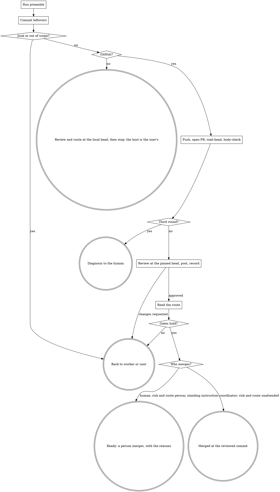

# finish-lane

A lane is finished when its pull request is merged at the commit an independent review looked at. Between the worker's report and that merge lie a handful of steps. Each is one call of `bin/ytstack-finish-lane`, which prints what it did or what it read and refuses instead of assuming. This skill is for the session that dispatched the lane, not for the worker.

<HARD-GATE>
Do NOT commission a review before `wait-head` passed. Do NOT call a lane ready on anything but a `gates` read made in this run. Do NOT merge unless `MERGE_BY` is `coordinator`, or it is `risk` and a `route` call of this run printed `route: unattended` for the reviewed commit. Do NOT merge at all when a standing instruction reserves the merge.
This applies to EVERY lane regardless of how small the diff is.
</HARD-GATE>

## Anti-Pattern: "The checks were green a minute ago"

A minute ago is history. Between a read and a merge the worker pushes a fix, a bot opens a thread, the base moves and a conflict appears. A review of one commit says nothing about the next one, and a body written for the first version can still praise a test the fix deleted. So nothing about the pull request is carried in memory or in `.ytstack/`: `gates` reads the host every time and prints when, and the merge is pinned to the reviewed commit, so the host refuses it if the head moved.

## Anti-Pattern: "I'll delete the stray files and commit the rest"

A file outside the lane's scope is somebody's work or somebody's mistake, and from here you cannot tell which. `commit` refuses and lists. The list goes back to the worker or to the user. Deleting, moving or ignoring files is not a step of this skill.

## Checklist

You MUST create a TodoWrite task for each of these items and complete them in order:

1. **Run preamble** -- host, the script, `merge_by`, standing instructions, the lanes table
2. **HARD-GATE** -- `.ytstack`, git, the script; on a host other than GitHub only the steps that need no host (3, 6, 7 without the posting, 8), then stop
3. **Read the report, commit leftovers** -- `leftovers`, then `commit` with the brief's scope (only for a `prepare` lane or `Uncommitted:` other than `none`)
4. **Push and open the pull request** -- `push`, a body file, `open-pr`
5. **Wait for the head, check the body** -- `wait-head`, `body-check`, one read of the body against the diff
6. **Commission the review** -- a `review` lane pinned to that commit, in a fresh context; at most two rounds
7. **Post the review, record head and round** -- on the pull request, then `ytstack-frontier set`, then the round line with the reviewer's class in the lane's plan
8. **Read the route** -- `route`: `unattended`, or `person` with its reasons
9. **Read the gates** -- `gates`; a failing gate is handled by what it is
10. **Merge or hand over** -- `MERGE_BY: risk` with route `unattended`, or `coordinator`: `merge`; every other case: stop with the command and the reasons
11. **Report + return** -- one line per step, the route, the read time of the gates, what was not checked

## Process Flow



## Preamble

```bash
# ytstack resolver (M016): checkout = where this shell runs, via the shared lib.
_LIB="${CLAUDE_SKILL_DIR}/../../hooks/lib/git-ctx.sh"
if [ -f "$_LIB" ]; then
  . "$_LIB"; yt_git_ctx "$PWD"; yt_resolve_yt_dir >/dev/null
  _PROJECT_DIR="$YT_TOPLEVEL"; _YT_DIR="$YT_DIR"; _YT_SCOPE="$YT_SCOPE"; _IS_GIT="$YT_IS_GIT"; _PROJECT_KEY="$YT_REPO_KEY"
else
  # Host did not substitute CLAUDE_SKILL_DIR (e.g. Codex adapter): project scope only.
  _IS_GIT=$([ "$(git rev-parse --is-inside-work-tree 2>/dev/null)" = true ] && echo yes || echo no)
  _PROJECT_DIR=$(git rev-parse --show-toplevel 2>/dev/null || pwd -P)
  _YT_DIR=""; _YT_SCOPE=none; _PROJECT_KEY=""
  [ -d "$_PROJECT_DIR/.ytstack" ] && { _YT_DIR="$_PROJECT_DIR/.ytstack"; _YT_SCOPE=project; }
fi
cd "$_PROJECT_DIR" 2>/dev/null || true
_PROJECT_SLUG=$(basename "$_PROJECT_DIR")
_HAS_YTSTACK=$([ -n "$_YT_DIR" ] && echo yes || echo no)

# Who merges (M025): PREFERENCES merge_by risk (default) | human | coordinator.
# A value outside the three reads as human: a typo never merges without a person.
_MERGE_BY=human; _MERGE_BY_NOTE=""
if command -v yt_prefs >/dev/null 2>&1; then
  yt_prefs "$_YT_DIR" >/dev/null; _MERGE_BY="$YT_PREF_MERGE_BY"
  _MERGE_BY_NOTE=$(printf '%s\n' "$YT_PREF_WARNINGS" | grep '^merge_by:' | head -1)
else _MERGE_BY_NOTE="the resolver library is not reachable, merge_by was not read (using human)"; fi

# The host of origin, without credentials. The script reaches GitHub only.
_ORIGIN_HOST=$(git remote get-url origin 2>/dev/null | sed -E 's|^[a-z+]+://||; s|^[^@/]*@||; s|[:/].*$||')
case "$_ORIGIN_HOST" in
  "") _HOST=none ;;
  github.com|"${GH_HOST:-github.com}") _HOST=github ;;
  *) _HOST=other ;;
esac
_TOOL=""; _BIN="${CLAUDE_SKILL_DIR}/../../bin"
[ -f "$_BIN/ytstack-finish-lane" ] && _TOOL="$(cd "$_BIN" 2>/dev/null && pwd -P)/ytstack-finish-lane"
[ -n "$_TOOL" ] || _TOOL=$(command -v ytstack-finish-lane 2>/dev/null)

echo "BRANCH: $(git branch --show-current 2>/dev/null || echo unknown)"
echo "PROJECT_SLUG: $_PROJECT_SLUG"
echo "HAS_YTSTACK: $_HAS_YTSTACK"
echo "YTSTACK_SCOPE: $_YT_SCOPE"
echo "YT_DIR: $_YT_DIR"
echo "IS_GIT: $_IS_GIT"
echo "HOST: $_HOST${_ORIGIN_HOST:+ ($_ORIGIN_HOST)}"
echo "GH_CLI: $(command -v gh >/dev/null 2>&1 && echo yes || echo no)"
echo "FINISH_TOOL: ${_TOOL:-missing}"
echo "MERGE_BY: $_MERGE_BY"
[ -n "$_MERGE_BY_NOTE" ] && echo "MERGE_BY_NOTE: $_MERGE_BY_NOTE"
echo "STANDING: $([ -n "$_YT_DIR" ] && [ -f "$_YT_DIR/STANDING.md" ] && echo "$_YT_DIR/STANDING.md" || echo none)"
if [ -n "$YTSTACK_NON_INTERACTIVE" ] || [ -n "$OPENCLAW_SESSION" ] || [ -n "$CLAUDE_AGENT_TEAM_MEMBER" ]; then
  echo "YTSTACK_NON_INTERACTIVE: true"
else
  echo "YTSTACK_NON_INTERACTIVE: false"
fi
echo "LANES_BEGIN"
[ -n "$_YT_DIR" ] && [ -f "$_YT_DIR/LANES.md" ] && grep '^|' "$_YT_DIR/LANES.md" | head -60
echo "LANES_END"
exit 0
```

## Procedure

In the calls below `{WT}` is the lane's worktree: the `Worktree` cell of its row between `LANES_BEGIN` and `LANES_END`, or the path the worker's report names. `{REF}` is the lane, `{N}` the pull request, `{SHA}` the commit under review, `{BASE}` the branch the pull request goes into and `{BASE_SHA}` the commit the lane started from (`git merge-base origin/{BASE} {SHA}`; without a remote, `git merge-base {BASE} {SHA}`). The script works in a checkout of the lane's branch. If the worktree is gone and the branch exists, add one (`git worktree add <path> <branch>`); do not switch the branch of this checkout.

### Step 2: HARD-GATE

- `IS_GIT: no`: abort "not a git checkout".
- `HAS_YTSTACK: no`: abort "no `.ytstack/` here; a lane comes from a ytstack plan".
- `FINISH_TOOL: missing`: abort "`bin/ytstack-finish-lane` is not reachable". Do not replay its steps by hand: the refusals are the point.
- `HOST` is not `github`, or `GH_CLI: no`: the script reaches GitHub through `gh` and supports no other host. Do the steps that need only git: Step 3, then Step 6 with the local head of the lane's branch as `{SHA}`, Step 7 without the posting (the row and the round line are still recorded), and Step 8. Then stop and tell the user the branch, the commit, the review's verdict and the route with its reasons, and that push, pull request, the host's gates and the merge are theirs on this host. A GitHub Enterprise host counts as GitHub once `GH_HOST` names it.
- `MERGE_BY_NOTE` present: show it to the user once. The value in use is `human`.

`MERGE_BY` is the project's `merge_by:` in `PREFERENCES.md`: `risk` (the default), `human` or `coordinator`. Step 10 says what each means.

If `STANDING` names a file, read it in full now, before anything is pushed. Its lines are what the human asked for once and for all; they override the defaults of this skill: who merges, when a status is due, a cap on open pull requests.

### Step 3: Read the report, commit leftovers

Read the worker's report by its labels (`docs/ux/coordinator-format.md`, "The report"). A report that has not passed `bin/ytstack-brief check` yet is checked first. `Status:` other than `complete` is not finished work: the lane goes back to whoever dispatched it, with the `Blockers:` value.

A `prepare` lane commits nothing by design, and any lane can leave files behind. If the lane's kind is `prepare` or `Uncommitted:` is not `none`:

```bash
"${CLAUDE_SKILL_DIR}/../../bin/ytstack-finish-lane" -C {WT} leftovers --scope {the paths of the brief's Scope section}
"${CLAUDE_SKILL_DIR}/../../bin/ytstack-finish-lane" -C {WT} commit --message "{REF}: {what the lane did}" --scope {the same paths}
```

The scope is what the brief named under "Scope" (the plan's `## Files`), as paths without line ranges. `leftovers` lists three groups: in scope, out of scope, junk (`.env*`, `*.log`, `.DS_Store`, `node_modules/`, an untracked file above 1 MB).

What a refusal of `commit` means:

- **Junk or out-of-scope files are listed**: nothing was staged. Send the list to the worker once: it removes what is junk and says which path belongs to the scope and why. If the worker is gone, or a file outside the scope is needed, that is a scope decision: it goes to the user. You do not delete, move or ignore files, and you do not widen `--scope` on your own.
- **"nothing to commit"** while the report lists uncommitted files: report and worktree disagree. Back to the worker.
- **"unmerged paths"**: the worker left a merge or rebase unfinished. Back to the worker.

A lane whose `Commits:` is `none` and that has nothing to commit has nothing to land. Stop and say so.

On a host other than GitHub go on with Step 6 at the local head (Step 2).

### Step 4: Push and open the pull request

```bash
"${CLAUDE_SKILL_DIR}/../../bin/ytstack-finish-lane" -C {WT} push
```

A refused push means origin holds commits the lane does not have, or the worktree is not on a branch. The script cannot overwrite the remote. Give git's message to the worker (it integrates origin's commits) or to the user.

A lane whose row already carries a pull request number is in a fix round: skip the rest of this step.

Write the body to a file outside the worktree (inside it the file would be a leftover), from the report and nothing else:

```markdown
## What changed

<the report's Outcome and its commits, in your words; a path in backticks only when the file exists at the head>

## How it was verified

<the report's `Checks run:` lines, unchanged: command, exit code, commit, environment>

## Not checked

<the report's `Not checked:` value>

Lane: {REF}
```

```bash
"${CLAUDE_SKILL_DIR}/../../bin/ytstack-finish-lane" -C {WT} open-pr --title "{REF}: {the outcome in a few words}" --body-file {BODY_FILE} --base {BASE}
"${CLAUDE_SKILL_DIR}/../../bin/ytstack-frontier" set {REF} --pr {N}
```

`open-pr` prints the number. When it fails, `gh` said why above the last line: not signed in is the user's to fix; a pull request that already exists for the branch is the one to use.

### Step 5: Wait for the head, check the body

```bash
"${CLAUDE_SKILL_DIR}/../../bin/ytstack-finish-lane" -C {WT} wait-head --pr {N}
```

It passes when the host shows the local tip as the pull request's head, and prints that commit: this is `{SHA}`. A failure prints both commits. Then the host does not show what you are about to have reviewed: push again if the local head is newer, wait again, and after a second failure stop and report both commits. No review starts on a head the host does not show.

The pre-review checklist has a mechanical half and a reading half.

```bash
"${CLAUDE_SKILL_DIR}/../../bin/ytstack-finish-lane" -C {WT} body-check --pr {N}
```

Each line is a backticked path of the body that is not at the head. "removed by the diff" means the body still names something this change deleted, typically a test. Correct the body file, update the pull request (`gh pr edit {N} --body-file {BODY_FILE}`) and run it again. A file the body names on purpose as removed stands without backticks.

Then read the body once against `git diff {BASE}...{SHA} --stat` and the tests in the diff: does it still describe what the diff and its tests do? A claim without a `Checks run:` line behind it comes out.

### Step 6: Commission the review

The round is the lane's `Round` cell plus one.

| Round | What is reviewed | The brief |
|---|---|---|
| 1 | The whole change. Meant to be complete. | `ytstack-brief render --slice {REF} --kind review --head {SHA}` (`--task` for a task lane) |
| 2 | Only the fix, with the findings of round 1 appended. | the same with `--base {REVIEWED_HEAD} --head {SHA}` |
| 3 | Nothing. No reviewer is dispatched. | a diagnosis for the human |

The rules of `ytstack:code-review`, section "Bounded review", apply as written there: what a finding needs, what round 2 may report, whose severity counts. Do not invoke that skill; it reviews the session's own active task.

The rendered brief is the prompt of one `Agent` call in a fresh context, named `review-{REF}`: no transcript of the lane, no summary of yours beyond the brief. The reviewer is never the lane's worker. The reviewer reads only. Its report's `Outcome:` carries the verdict (`approved` or `changes requested`) and the reviewed commit. Check the report with `bin/ytstack-brief check`. A review whose commit is not `{SHA}` is a review of something else: dispatch again.

The report ends with the class of the change, which the brief asks for: `Risk:`, `Severity:`, `Reach:` and `Invariants touched:` (`docs/ux/review-policy-format.md`, "Records"). The reviewer states them, never the worker and never you. A report without them goes back to the reviewer once, with the checker's lines. In round 2 append the four labels of round 1 to the brief, beside the findings: the newest round speaks for the whole change, and the reviewer changes a label only when the fix changes the answer.

**Third round.** Two rounds are recorded and the change is still not accepted. Diagnose as `ytstack:code-review` describes under "Third round" (scope the plan never decided, two rules in conflict, a fix that moves the problem) and put it to the human as one question. The lane becomes `blocked` on that question.

**A finding about the body alone.** The body claims something the diff does not do, and no code is in question. Correct the body (Step 5), then send the reviewer a delta brief with one question: does the body now describe the diff at `{SHA}`? Same head, no new round, `Round` stays.

### Step 7: Post the review, record head and round

Write the review to a file: first line `Verdict: approved` or `Verdict: changes requested`, then `Reviewed commit: {SHA}` and `Round: {n}`, then the findings as the reviewer reported them. Post it as a review, not as a comment, so that the host ties it to the head it was submitted on:

```bash
gh pr review {N} --comment --body-file {REVIEW_FILE}
"${CLAUDE_SKILL_DIR}/../../bin/ytstack-frontier" set {REF} --head {SHA} --round {n} --status in-review
```

Then append the round to the lane's plan in this checkout: the slice plan `{REF}-PLAN.md` for a slice lane, the task plan for a task lane. It goes under `## Review` (add the heading on the first round), with seven-character commits:

```
- Round {n}: {base}..{SHA} -- {approved | changes requested}; blocking: {n}; follow-ups: {n}; risk: {low | normal | high}; invariants: {none | area: the rule}; by: review-{REF}
```

`{base}` is `{BASE_SHA}` in round 1 and the reviewed head of round 1 afterwards. `risk` and `invariants` are the reviewer's `Risk:` and `Invariants touched:` values, unchanged, on this one line: no `;` inside a value, several rules joined with commas. You state no class and you correct none. A lane without a plan file has no place for the line: say so in the report.

`changes requested`: the findings go to the worker through whoever dispatches (same branch, same pull request). When the fix is reported, start again at Step 3; that is round 2. Do not read the route or the gates on a head with open findings.

### Step 8: Read the route

Whether a person has to look at this change is decided per change, from its risk (`docs/ux/review-policy-format.md`, "The route"). Run this in the checkout of this session, without `-C {WT}`: it reads `LANES.md` and the lane's plan here.

```bash
"${CLAUDE_SKILL_DIR}/../../bin/ytstack-finish-lane" route --lane {REF} --base {BASE_SHA} --head {SHA}
```

The first line says what it read: the lane, the worker of its row as the author, the plan. Then come the lines of `bin/ytstack-risk route`: `route: unattended` or `route: person`, `class:`, `ceiling:`, `floor:`, `areas:`, `lenses:`, and one `reason:` per condition that failed. Exit 0 means `unattended`. Everything else, an error included, means "not unattended". Keep the lines for the report.

`unattended` needs all of this: a floor from the diff that is not `person`; a newest round line that approves, is valid for `{SHA}`, states `risk` and `invariants: none`, and names a reviewer other than the lane's worker; a class within the ceiling (`auto_merge`) of every area the change touches. A project that declared nothing gets `person` for every change, which is what `merge_by: human` does.

The route speaks about the change, not about the host: the checks, the threads and the head are Step 9. Do not turn a `person` into an `unattended` by editing the plan, the policy or the lanes table. The reasons go to the person who merges. One reason is yours to repair: "the plan has no round line" means Step 7 did not record the round.

### Step 9: Read the gates

```bash
"${CLAUDE_SKILL_DIR}/../../bin/ytstack-finish-lane" -C {WT} gates --pr {N} --reviewed-head {SHA} --verdict-pattern '^Verdict: approved'
```

Add `--max-open {n}` when a standing instruction or the plan caps the open pull requests, and `--allow-no-checks` only when the project states that this repository runs no checks. The output is one line per gate (`ok` or `FAIL`) and a last line `read <UTC time>`. Keep both for the report.

All hold: `ytstack-frontier set {REF} --status ready --next "merge at {SHA}"`. Otherwise the failing gate says what happens next:

| Gate | It failed because | What happens |
|---|---|---|
| `head` | commits arrived after the review | Review the new commits before anything else: Step 5 with the new head, as the fix round. |
| `checks` | a check is pending, failed, or there is none | Pending: read again later. Failed: back to the worker with the check's name. None: `--allow-no-checks` is a statement about the project, not a way through. |
| `review` | changes are requested on this head, or the posted verdict is missing | Open findings go to the worker. A missing verdict means Step 7 did not happen on this head. |
| `threads` | a review thread is unresolved | It is answered and resolved by whoever owns it: the worker for a finding in its code, the human for a question to them. You resolve no thread you did not open. |
| `mergeable` | a conflict with the base, or the host has not decided | Conflict: the worker integrates the base; the head moves, so the fix round follows. Undecided: read again. |
| `open-prs` | more pull requests are open than the cap | Finish others first. The lane stays where it is. |

### Step 10: Merge or hand over

Who merges is the project's decision, not this session's. It is read from `MERGE_BY` and from the route of Step 8, once the gates of Step 9 hold:

| `MERGE_BY` | Route | What happens |
|---|---|---|
| `risk` (the default) | `unattended` | You merge at `{SHA}`. The person gets one line in the report: what merged without them, at which class, under which ceiling. |
| `risk` | `person`, or no answer | Stop. A person merges; they get the command and the `reason:` lines. |
| `human` | any | Stop. A person merges; the route lines go along for information. |
| `coordinator` | any | You merge at `{SHA}`. The route is printed in the report and not applied. |

A standing instruction that reserves the merge wins over every row: a person merges.

**A person merges.** Stop. Tell the user that the lane is ready, with the gate lines and their read time, the `reason:` lines of the route, and the command:

```
{FINISH_TOOL} -C {WT} merge --pr {N} --at {SHA} --verdict-pattern '^Verdict: approved'
```

Never merge in these cases, also not on a second request to hurry. The preference changes in `PREFERENCES.md` and the ceiling in the area file of the technical spec, not in a conversation.

**You merge.**

```bash
"${CLAUDE_SKILL_DIR}/../../bin/ytstack-finish-lane" -C {WT} merge --pr {N} --at {SHA} --verdict-pattern '^Verdict: approved'
```

with the gate options of Step 9. It reads the gates again and merges pinned to `{SHA}`. `merged #{N} at <sha>`: `ytstack-frontier set {REF} --status merged`. A gate line with `FAIL`: Step 9. "gh pr merge failed": the head moved in that moment, or the host's own rules refuse; report `gh`'s message. "not merged yet": the host queued it; the lane stays `ready` and is read again later.

Under `risk` the route you act on is one you read in this run for `{SHA}`. A head that moved needs a new review and a new route.

In every case the merge happens at the reviewed commit or not at all. No `gh pr merge` by hand, no other commit than the recorded reviewed head.

### Step 11: Report + return

> Lane {REF}, pull request #{N}
> - leftovers: {committed <sha>, n files | none}
> - pushed: {branch} at {SHA}; host head confirmed
> - body: {body ok, n paths | corrected: what}
> - review: round {n}, {verdict}, at {SHA}; risk {the reviewer's class}, invariants {none | what it named}
> - route: {unattended | person}, class {class}, ceiling {ceiling}; {the `reason:` lines, or "no reason"}
> - gates: {the gate lines}, read {UTC time}
> - merge: {merged unattended at <sha>: class <class>, ceiling <ceiling> | merged at <sha> (merge_by: coordinator, the route said <route>) | ready, a person merges: <command>; because: <reasons> | not ready: <gate>}
>
> Not checked: {what this run did not read or run, and the reviewer's own `Not checked:` value}

## What is written down, and what is not

`.ytstack/` receives what this session did and the identifiers it needs to continue: the pull request number, the reviewed commit, the round, the lane's status, and in the lane's plan one line per review round with the class its reviewer stated. It never receives the state of the pull request as if it were current. Checks, threads, mergeability and the head live on the host and change without you, so they are read when they matter, and every status that mentions one says when: `read 2026-11-13T10:42Z`. A gate line from an earlier read is quoted with its time or not at all.

## Terminal State

The terminal state is one of:

- Returning control with the lane merged at the reviewed commit and its row `merged` (`MERGE_BY: risk` with route `unattended`, or `MERGE_BY: coordinator`), and the line that says what merged without a person
- Returning control with the lane `ready`, the one-line merge command for the person and the reasons of the route
- Returning control with the lane back at the worker or the user: leftovers, findings, a failing gate, a third round; the row's next action says what it waits for
- Exiting after Step 8 on a host other than GitHub, with the review's verdict and the route

Do NOT invoke `ytstack:finish-branch`, `ytstack:ship`, `ytstack:code-review` or `ytstack:summarize-task`. This skill invokes no other skill: control returns to the session that called it (`ytstack:coordinate`, when it runs the plan).
