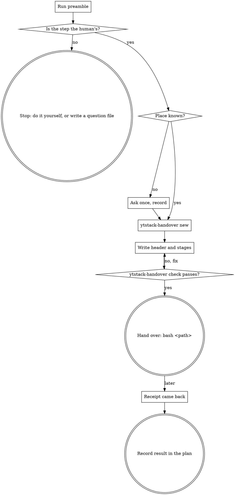

# handover-step

Some steps are not yours: the production deploy, the click in a console, the look at a real screen. This skill turns such a step into one script in stages. The human starts it with one short command, it asks before every change, and it leaves a receipt that says what ran. You write it and verify it without running it.

<HARD-GATE>
Do NOT execute the script, a part of it, a copy of it or a command taken from it: not with a dry-run flag, not with `bash -x`, not by sourcing it, not "only the read-only checks".
The only contact is `ytstack-handover check`, which reads the file. This applies to EVERY handover regardless of how harmless the step looks.
</HARD-GATE>

## Anti-Pattern: "A quick dry run first, to be sure it works"

A dry-run flag is a promise of the tool being called, not of this script, and the checks in front of it already talk to the real system with whatever access your session happens to have. A step the plan reserved for the human and that you ran "just to test" is no longer a step only the human ran. The static check is your substitute for running it. What it cannot tell you, the receipt will.

The cousin of this mistake: "it is two commands, I will paste them into the chat". Pasted commands have no confirmation, no order and no receipt, and long ones do not survive copying. One script, one command line.

## Checklist

You MUST create a TodoWrite task for each of these items and complete them in order:

1. **Run preamble** -- resolver, the tool, where handover scripts live, what lies there
2. **Establish the step** -- from the plan: what it is and why it is the human's; otherwise route and stop
3. **Pick the place** (only if `HANDOVER_DIR_SOURCE` is `default`) -- ask once, record the answer
4. **Create the script** -- `ytstack-handover new <path> --title "<title>"`
5. **Write header and stages** -- checks first, the smallest change per stage, the undo in the header
6. **Verify without running** -- `ytstack-handover check <path>` until it prints `handover ok`
7. **Hand over** -- one command line, two sentences, the request for the receipt; note it in the plan
8. **Read the receipt and record it** (when it comes back) -- where the plan tracks the step

## Process Flow



## Preamble

```bash
# ytstack resolver (M016): checkout = where this shell runs, via the shared lib.
_LIB="${CLAUDE_SKILL_DIR}/../../hooks/lib/git-ctx.sh"
if [ -f "$_LIB" ]; then
  . "$_LIB"; yt_git_ctx "$PWD"; yt_resolve_yt_dir >/dev/null
  _PROJECT_DIR="$YT_TOPLEVEL"; _YT_DIR="$YT_DIR"; _YT_SCOPE="$YT_SCOPE"; _IS_GIT="$YT_IS_GIT"; _PROJECT_KEY="$YT_REPO_KEY"
else
  # Host did not substitute CLAUDE_SKILL_DIR (e.g. Codex adapter): project scope only.
  _IS_GIT=$([ "$(git rev-parse --is-inside-work-tree 2>/dev/null)" = true ] && echo yes || echo no)
  _PROJECT_DIR=$(git rev-parse --show-toplevel 2>/dev/null || pwd -P)
  _YT_DIR=""; _YT_SCOPE=none; _PROJECT_KEY=""
  [ -d "$_PROJECT_DIR/.ytstack" ] && { _YT_DIR="$_PROJECT_DIR/.ytstack"; _YT_SCOPE=project; }
fi
cd "$_PROJECT_DIR" 2>/dev/null || true
_PROJECT_SLUG=$(basename "$_PROJECT_DIR")   # display only
_HAS_YTSTACK=$([ -n "$_YT_DIR" ] && echo yes || echo no)

# The tool, and the place this project keeps handover scripts in.
_BIN="${CLAUDE_SKILL_DIR}/../../bin/ytstack-handover"
_DIR=""; _DIR_SOURCE=default
if command -v yt_pref >/dev/null 2>&1; then _DIR=$(yt_pref "$_YT_DIR" handover_dir ""); fi
if [ -n "$_DIR" ]; then _DIR_SOURCE=preferences
elif [ -n "$_YT_DIR" ] && [ -d "$_YT_DIR/handover" ]; then _DIR="$_YT_DIR/handover"; _DIR_SOURCE=existing
elif [ -n "$_YT_DIR" ]; then _DIR="$_YT_DIR/handover"
else _DIR="$_PROJECT_DIR/handover"; fi
# Shown relative to the repository root: the command the human gets stays short.
case "$_DIR" in "$_PROJECT_DIR"/*) _DIR="${_DIR#"$_PROJECT_DIR"/}" ;; esac

echo "BRANCH: $(git branch --show-current 2>/dev/null || echo unknown)"
echo "PROJECT_DIR: $_PROJECT_DIR"
echo "PROJECT_SLUG: $_PROJECT_SLUG"
echo "HAS_YTSTACK: $_HAS_YTSTACK"
echo "YTSTACK_SCOPE: $_YT_SCOPE"
echo "YT_DIR: $_YT_DIR"
if [ -n "$YTSTACK_NON_INTERACTIVE" ] || [ -n "$OPENCLAW_SESSION" ] || [ -n "$CLAUDE_AGENT_TEAM_MEMBER" ]; then
  echo "YTSTACK_NON_INTERACTIVE: true"
else
  echo "YTSTACK_NON_INTERACTIVE: false"
fi
if [ -f "$_YT_DIR/STATE.md" ]; then
  echo "CURRENT_MILESTONE: $(sed -n 's/^current_milestone: *//p' "$_YT_DIR/STATE.md" | head -1)"
  echo "ACTIVE_SLICE: $(sed -n 's/^active_slice: *//p' "$_YT_DIR/STATE.md" | head -1)"
  echo "ACTIVE_TASK: $(sed -n 's/^active_task: *//p' "$_YT_DIR/STATE.md" | head -1)"
fi
echo "HANDOVER_TOOL: $([ -f "$_BIN" ] && echo "$_BIN" || echo missing)"
echo "HANDOVER_DIR: $_DIR"
echo "HANDOVER_DIR_SOURCE: $_DIR_SOURCE"
echo "TODAY: $(date -u +%Y-%m-%d)"
echo "HANDOVER_FILES_BEGIN"
if [ -d "$_DIR" ]; then ls -1 "$_DIR" 2>/dev/null | tail -20; fi
echo "HANDOVER_FILES_END"
```

## Procedure

`HANDOVER_TOOL: missing`: say that `bin/ytstack-handover` of the plugin is not reachable from this session, and STOP. Do not write a script without the template.

### Step 2: Establish the step

Read the plan that names the step (the task plan, the slice plan with its `## Gates`, `DECISIONS.md`, `.ytstack/STANDING.md` when it exists). Write down, in one sentence each, what the step is and why it is the human's. It is the human's when one of these holds:

- the plan, a gate or a standing instruction reserves it ("never deploy without me");
- it needs credentials you do not hold and must not be given;
- it needs eyes or hands: a GUI, a device, a real screen.

If none holds, the step is yours: say so in one line, do it the normal way, and STOP this skill. If the open point is a decision and not an action ("which of the two regions?"), it is a question, not a handover: write a question file with `bin/ytstack-questions new` (format: `docs/ux/coordinator-format.md`) and STOP.

A file under `HANDOVER_FILES_BEGIN..END` that already covers this step is not written a second time. If its receipt lies next to it, go to step 8.

### Step 3: Pick the place (ask once)

If `HANDOVER_DIR_SOURCE` is `preferences` or `existing`, use `HANDOVER_DIR` and go on. If it is `default` and `YTSTACK_NON_INTERACTIVE` is `true`, use `HANDOVER_DIR` and log: *"[ytstack:handover-step] auto-picked A (.ytstack/handover/) because YTSTACK_NON_INTERACTIVE=true"*. Otherwise ask once with AskUserQuestion:

> I am preparing a step for you to run yourself in **{PROJECT_SLUG}** on branch `{BRANCH}`: {the step, one sentence}.
>
> The step becomes one script file that you start. Next to it lands a receipt: a short text file that says what ran. Both should live where you find them again and where they are reviewed like the rest of the work.
>
> RECOMMENDATION: Choose A because script and receipt then sit beside the plan they belong to and are committed with it.
>
> A) `.ytstack/handover/` -- beside the plans
>    Completeness: 10/10, effort: human: 0 / CC: 0, tier: core
>
> B) Another directory of this repository -- you name it, for example `ops/handover/`
>    Completeness: 9/10, effort: human: one path / CC: 0, tier: core
>
> (to re-ask later: edit `handover_dir:` in `.ytstack/PREFERENCES.md`)

Record the answer as one line `handover_dir: <path>` in `{YT_DIR}/PREFERENCES.md` (Edit; create the file with that line if it does not exist). With `HAS_YTSTACK: no` nothing is recorded and the place is asked again next time.

### Step 4: Create the script

The path is `{HANDOVER_DIR}/{TODAY}-{slug}.sh`, the slug two to five words in kebab-case (`2026-11-13-restart-checkout.sh`). One step, one file. `HANDOVER_DIR` is relative to the repository root (`PROJECT_DIR`): the human starts the script from there, so run the tool from there too, and write file paths inside the script relative to it or absolute.

```bash
cd "{PROJECT_DIR}" && "{HANDOVER_TOOL}" new "{HANDOVER_DIR}/{TODAY}-{slug}.sh" --title "{what the step does, a few words}"
```

`new` copies the template, sets the title and the time of preparation and never overwrites. Everything between the two marker comments is the helpers. Do not edit a character there: the check compares that block with the template.

### Step 5: Write header and stages

Use Edit on the new file.

**Header.** Fill the four empty fields; a longer value continues on comment lines indented under it.

- `Purpose:` what is true when the script has run, one sentence.
- `Prepared by:` you and the plan step it belongs to (`M004-S02-T03`, a gate id).
- `Changes:` every system and object the script changes, or `nothing` for a script of steps by hand.
- `Undo:` one line per change, in order: the exact command or click path. Where there is none, write `cannot be undone`, and say the same in the `confirm` text of that stage.

**Stages.** Below the helpers, one call per line and nothing else: `stage`, `check`, `confirm`, `mutate`, `manual`, plain assignments, comments.

```bash
NS="shop-prod"
DEPLOY="checkout"
CONTEXT="prod-eu1"

stage "Prove the target" "Reads the cluster and the deployment; changes nothing."
check "kubectl points at $CONTEXT" bash -c 'test "$(kubectl config current-context)" = "$1"' _ "$CONTEXT"
check "the deployment exists" kubectl -n "$NS" get deployment "$DEPLOY"

stage "Restart the deployment" "Restarts the pods of one deployment, one after the other."
confirm "Restart deployment $DEPLOY in namespace $NS on $CONTEXT"
mutate "rollout restart" kubectl -n "$NS" rollout restart deployment "$DEPLOY"
check "the rollout finished" kubectl -n "$NS" rollout status deployment "$DEPLOY" --timeout=180s

stage "Look at the shop" "A check by eye in the browser."
manual "Open https://shop.example.com, put one article into the basket, and type done only when the basket shows it"
```

- **Read-only checks first.** The first stage proves the target: the right account, cluster or project, the object exists, the precondition holds. A check that cannot fail proves nothing. A failing check stops the script.
- **The smallest change per stage.** One `mutate` that can stand alone, behind one `confirm` whose text names with real values what changes and where. A `confirm` counts for its own stage only. After the `mutate`, a `check` that proves the effect.
- **Names at the top, no secret in the file.** Namespaces, versions and hosts are plain assignments. Credentials come from the tools the human is logged in to, or from their environment. A commit or an image digest is written on the call that uses it.
- **A pipe, a redirection or a command substitution goes inside the command**, as `bash -c '...'` with the values passed as arguments. At top level the check rejects them, because they would run outside the helpers and outside the receipt.
- **`sudo` is announced**: the line of its stage says so.
- **What the script cannot do is a `manual` line**: the exact place to click and what must be visible before the human types `done`. A step with nothing to automate (a pure GUI check) still gets a script, made of `manual` stages, so that there is a receipt.

The receipt records each call as it is written in the file, with variable names and exit codes, never values or output.

### Step 6: Verify without running

```bash
cd "{PROJECT_DIR}" && "{HANDOVER_TOOL}" check "{path}"
```

It prints one line per problem and exits 1, or `handover ok: N stages, M mutations, K manual steps`. Fix the file and repeat until it passes. Then read the script once from top to bottom as the human will meet it: is every `confirm` text true for the `mutate` behind it, does the header list every change? The check reads syntax and structure; whether the commands are the right ones is your work. The HARD-GATE holds: you do not run it.

### Step 7: Hand over

The message to the human has exactly three parts:

> From the repository root: `bash {path}`
>
> {What the script will change, and where, in two sentences. The second one says what it asks before and how to undo it, or that it cannot be undone.}
>
> At the end it prints a receipt and writes it to `{path}.receipt-<time>.txt`. Please send me that file or its path.

One command line, never a block of commands. Then note the handover where the plan tracks the step (the task plan, or the slice plan for a gate), as history:

```markdown
## Handover

- {UTC time} -- prepared `{path}` for {step}; check passed ({N} stages, {M} mutations, {K} manual steps); not run by the agent.
```

If `YTSTACK_NON_INTERACTIVE` is `true`, you cannot reach the human: the command line and the two sentences go into your report under `Next:`, the script under `Uncommitted:` or into your commit, and the task is `Status: partial`. Return control here. The step is not done; it is handed over.

### Step 8: Read the receipt and record it

When the receipt comes back, Read the file. Do not take a summary in the chat for it. The line `Result:` says `completed`, `completed, N step(s) by hand skipped`, `stopped in stage ...` or `interrupted ...`; above it stands per stage what ran with its exit code, and under `Did not run:` every call that was not reached.

Append to the `## Handover` section of the plan:

```markdown
- {UTC time} -- receipt `{receipt path}`: {Result line}. Ran {Started} to {Ended}. {Skipped or not run: the calls, or "everything ran".}
```

- `completed`: the step is done. Say so in one line with the receipt path.
- A skipped step by hand, `stopped` or `interrupted`: the step is NOT done. Report what ran and what did not, in the words of the receipt. The repair is a new script (`{TODAY}-{slug}-2.sh`) that starts from the state the receipt shows. A script that was run is not edited afterwards: its receipt points at its lines.
- **A receipt never closes a gate.** If the step belongs to a gate under `## Gates`, leave the gate line as it is. The receipt is the evidence; the gate changes when the person it names gives the verdict, and that is collected at the slice boundary. You do not mark it and you do not start that collection from here.

## Terminal State

The terminal state is one of:

- Returning control to the user with the script handed over (`bash {path}`), waiting for the receipt
- Returning control to the user with the receipt recorded in the plan's `## Handover` section
- Exiting without a script: the step is the agent's own, or it is a decision and became a question file

Do NOT run the script at any point. Do NOT invoke `ytstack:reassess-roadmap`, `ytstack:summarize-task` or any other skill from here, and do NOT mark a gate as given. The ONLY thing you may suggest after a `completed` receipt is `ytstack:summarize-task`, when the handed-over step was the last open part of the active task.
