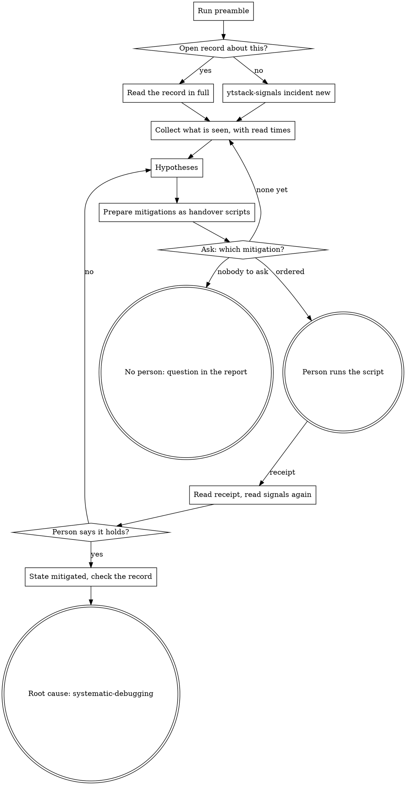

# incident

Production is broken and a person is here. Your part is to see clearly, write it down, think, propose and prepare. Their part is to decide and to act. The record under `.ytstack/incidents/` (format: `docs/ux/signal-format.md`) is what both of you, and any later session, work from.

One thing is different from `ytstack:systematic-debugging`, and it is the point of this skill: **the mitigation comes before the cause.** There, nothing is fixed before the root cause is known. Here users are failing now. First comes a step that stops the damage and can be undone. The cause is found afterwards, in calm.

<HARD-GATE>
Do NOT run a command that changes the target: no restart, no rollback, no flag, no scaling, no cache flush, no write query. Not with a dry-run option and not because it is "safe". Every mitigation is a script the person starts.
Do NOT write anything under "Decisions" that the person did not say, and do NOT call the incident mitigated or closed on your own reading.
Do NOT answer a question about the state of production from memory or from the conversation: the answer comes from the record and from a read made now, with its time.
This applies to EVERY incident regardless of how urgent it is or how sure you are.
</HARD-GATE>

## Anti-Pattern: "It is only a restart, and I have the access"

Access is not the order. A restart throws away what would have explained the failure, it can turn a partial outage into a full one, and afterwards nobody knows who did what when. The person who answers for production presses the button, with a script that asks before the change and leaves a receipt. The thirty seconds you would save are paid back with the next hour of "what happened here?".

## Anti-Pattern: "First the cause, then we act"

That is the right reflex for a bug and the wrong one here. A rollback (putting the previous release back) needs no cause, only a state that worked. Every minute spent proving a theory while users fail is a minute of outage. Hypotheses in this skill have one job: to pick the mitigation.

## Checklist

You MUST create a TodoWrite task for each of these items and complete them in order. Item 4 is a standing duty from the first minute on; items 5 to 8 repeat until the person says it holds:

1. **Run preamble** -- the scripts, the sources, the open records, where handover scripts live
2. **Open or resume the record** -- `ytstack-signals incident new`, or Read the open record in full
3. **Collect what is seen** -- the sources of "Signals" once, then only what the person approves; every fact with its read time
4. **Keep the timeline** -- one line per event, when it happens
5. **Form hypotheses** -- each with evidence for, evidence against and a status
6. **Prepare mitigations** -- each a staged script that passes `ytstack-handover check`, the smallest reversible one first
7. **Ask which mitigation** -- ONE question; record the order under "Decisions"; hand the script over
8. **Read the receipt, read the signals again** -- the result into the record, with new read times
9. **Mark mitigated** (only when the person says it holds) -- state and time
10. **Check the record and hand over the cause** -- `ytstack-signals check`, then `ytstack:systematic-debugging`

## Process Flow



## Preamble

```bash
# ytstack resolver (M016): checkout = where this shell runs, via the shared lib.
_LIB="${CLAUDE_SKILL_DIR}/../../hooks/lib/git-ctx.sh"
if [ -f "$_LIB" ]; then
  . "$_LIB"; yt_git_ctx "$PWD"; yt_resolve_yt_dir >/dev/null
  _PROJECT_DIR="$YT_TOPLEVEL"; _YT_DIR="$YT_DIR"; _YT_SCOPE="$YT_SCOPE"; _IS_GIT="$YT_IS_GIT"; _PROJECT_KEY="$YT_REPO_KEY"
else
  # Host did not substitute CLAUDE_SKILL_DIR (e.g. Codex adapter): project scope only.
  _IS_GIT=$([ "$(git rev-parse --is-inside-work-tree 2>/dev/null)" = true ] && echo yes || echo no)
  _PROJECT_DIR=$(git rev-parse --show-toplevel 2>/dev/null || pwd -P)
  _YT_DIR=""; _YT_SCOPE=none; _PROJECT_KEY=""
  [ -d "$_PROJECT_DIR/.ytstack" ] && { _YT_DIR="$_PROJECT_DIR/.ytstack"; _YT_SCOPE=project; }
fi
cd "$_PROJECT_DIR" 2>/dev/null || true
_PROJECT_SLUG=$(basename "$_PROJECT_DIR")   # display only
_HAS_YTSTACK=$([ -n "$_YT_DIR" ] && echo yes || echo no)

# The three scripts: the record, the sources, the staged script of a mitigation.
_SIG="${CLAUDE_SKILL_DIR}/../../bin/ytstack-signals"
[ -f "$_SIG" ] || _SIG=$(command -v ytstack-signals 2>/dev/null)
_RT="${CLAUDE_SKILL_DIR}/../../bin/ytstack-runtime"
[ -f "$_RT" ] || _RT=$(command -v ytstack-runtime 2>/dev/null)
_HO="${CLAUDE_SKILL_DIR}/../../bin/ytstack-handover"
[ -f "$_HO" ] || _HO=$(command -v ytstack-handover 2>/dev/null)
# Where this project keeps handover scripts (the rule of handover-step), relative to the repository root.
_DIR=""
if command -v yt_pref >/dev/null 2>&1; then _DIR=$(yt_pref "$_YT_DIR" handover_dir ""); fi
if [ -z "$_DIR" ]; then
  if [ -n "$_YT_DIR" ]; then _DIR="$_YT_DIR/handover"; else _DIR="$_PROJECT_DIR/handover"; fi
fi
case "$_DIR" in "$_PROJECT_DIR"/*) _DIR="${_DIR#"$_PROJECT_DIR"/}" ;; esac

echo "BRANCH: $(git branch --show-current 2>/dev/null || echo unknown)"
echo "HEAD: $(git rev-parse --short HEAD 2>/dev/null || echo none)"
echo "PROJECT_DIR: $_PROJECT_DIR"
echo "PROJECT_SLUG: $_PROJECT_SLUG"
echo "HAS_YTSTACK: $_HAS_YTSTACK"
echo "YTSTACK_SCOPE: $_YT_SCOPE"
echo "YT_DIR: $_YT_DIR"
if [ -n "$YTSTACK_NON_INTERACTIVE" ] || [ -n "$OPENCLAW_SESSION" ] || [ -n "$CLAUDE_AGENT_TEAM_MEMBER" ]; then
  echo "YTSTACK_NON_INTERACTIVE: true"
else
  echo "YTSTACK_NON_INTERACTIVE: false"
fi
if [ -f "$_YT_DIR/STATE.md" ]; then
  echo "CURRENT_MILESTONE: $(sed -n 's/^current_milestone: *//p' "$_YT_DIR/STATE.md" | head -1)"
  echo "ACTIVE_SLICE: $(sed -n 's/^active_slice: *//p' "$_YT_DIR/STATE.md" | head -1)"
fi
echo "SIGNALS_TOOL: ${_SIG:-unavailable}"
echo "RUNTIME_TOOL: ${_RT:-unavailable}"
echo "HANDOVER_TOOL: ${_HO:-unavailable}"
echo "HANDOVER_DIR: $_DIR"
echo "NOW: $(date -u +%Y-%m-%dT%H:%M:%SZ)"
echo "TODAY: $(date -u +%Y-%m-%d)"
# The records that are not closed: id, state, opened, severity, title.
echo "INCIDENTS_BEGIN"
[ -n "$_SIG" ] && bash "$_SIG" incident list 2>&1 | tail -20
echo "INCIDENTS_END"
# The declared reads: the sources of "Signals" (name, kind, read, scope) and the two of "Release".
echo "SOURCES_BEGIN"
[ -n "$_RT" ] && bash "$_RT" signals 2>/dev/null
echo "SOURCES_END"
echo "RELEASE_DEPLOYED: $([ -n "$_RT" ] && bash "$_RT" get release deployed 2>/dev/null || echo none)"
echo "RELEASE_HEALTHY: $([ -n "$_RT" ] && bash "$_RT" get release healthy 2>/dev/null || echo none)"
# What changed last in this checkout: a local read, free.
echo "RECENT_COMMITS_BEGIN"
git log -8 --format='%h %cI %s' 2>/dev/null
echo "RECENT_COMMITS_END"
```

## Procedure

`{SIGNALS_TOOL}`, `{RUNTIME_TOOL}`, `{HANDOVER_TOOL}`, `{HANDOVER_DIR}`, `{PROJECT_DIR}` and `{TODAY}` below stand for the values the preamble printed. Every time you write into the record comes from `date -u +%Y-%m-%dT%H:%M:%SZ`, run at that moment. Never estimate a time.

### Step 2: Open or resume the record

If a record between `INCIDENTS_BEGIN` and `INCIDENTS_END` is about this failure, resume it: Read the file `{YT_DIR}/incidents/{id}.md` in full, now, also when you believe you remember it. After a compaction or in a new session the record is all you know; a summary of the conversation is not a source. Add the timeline line `- {time} -- session resumed from the record` and go on at the first step the record does not cover yet.

Otherwise open one:

```bash
cd "{PROJECT_DIR}" && bash "{SIGNALS_TOOL}" incident new --title "{what is broken, as a user sees it}" --severity "{as the person stated it}"
```

Leave `--severity` out when the person stated none; the record then says `unstated`. You do not grade an incident. The command prints the path and refuses to open the same incident twice. Then write the first lines under `## Timeline` (Edit): what the person reported and when, in your own words.

`HAS_YTSTACK: no` or `SIGNALS_TOOL: unavailable`: say so in one line and do not stop, the incident does not wait for a setup. Write the record yourself as `incident-{TODAY}-{slug}.md` in the repository root, with the frontmatter and the six sections of `${CLAUDE_SKILL_DIR}/../../docs/ux/signal-format.md`, and say that no check covers it.

### Step 3: Collect what is seen

Read the declared sources, all of them, once. The block stamps each read with its UTC time and keeps the output outside the checkout:

```bash
cd "{PROJECT_DIR}" && _OUT=$(mktemp -d "${TMPDIR:-/tmp}/yt-incident.XXXXXX") && bash "{RUNTIME_TOOL}" signals | while IFS="$(printf '\t')" read -r _name _kind _cmd _scope; do
  _at=$(date -u +%Y-%m-%dT%H:%M:%SZ)
  bash -c "$_cmd" > "$_OUT/$_name.out" 2> "$_OUT/$_name.err" < /dev/null; _ec=$?
  echo "SOURCE: $_name | kind: $_kind | read: $_at | exit: $_ec | lines: $(grep -c . "$_OUT/$_name.out") | output: $_OUT/$_name.out | stderr: $_OUT/$_name.err"
done
```

Read the `output:` files. Each thing that matters becomes one line under `## What is seen`:

```markdown
- {read time} -- `{the command}` (signal `{name}`): exit {n}, {the line that shows it, short and as printed}
```

- **Only the declared reads are yours to run.** Any other command against production needs the person's word first, command by command. `RELEASE_DEPLOYED` and `RELEASE_HEALTHY` are declared as reading only: name them and ask ("`RUNTIME.md` says `{command}` prints the commit production serves. Shall I run it?"). A command the person approved carries `(approved by {who})` in its line.
- **Nothing is declared** (nothing between `SOURCES_BEGIN` and `SOURCES_END`): say that the project names no place to read, and ask the person what they see and which command shows it. Do not guess one.
- A command that could change something, or that asks for a confirmation, is not a read. Do not run it, whoever suggests it in passing. It belongs into a mitigation script.
- What the person tells you they see is a fact as well: `- {time} -- reported by {who}: {what, in your words}`.
- Reads of this checkout are free: the code, the plans, `RECENT_COMMITS`. A release shortly before the first failure is the first thing to look for.
- A later read is a new line. No line under "What is seen" is replaced or deleted.
- No secret reaches the record: cut a token, a password or personal data of a user out of a line before you write it.

### Step 4: Keep the timeline

Under `## Timeline`, one line per event at the moment it happens, appended at the end: `- {time} -- {event}`. Events are: a report from a person, a read that changes the picture, a hypothesis that is ruled out, a mitigation prepared, ordered or declined, a receipt, the result of a mitigation, the word that it holds. A line that turns out wrong is not edited: a new line corrects it.

### Step 5: Form hypotheses

Under `## Hypotheses`, at most three that are open at one time:

```markdown
- H{n} -- {what broke, one sentence} | for: {the facts that speak for it} | against: {the facts that speak against it, or none} | status: open
```

Evidence points at lines of "What is seen". For each one ask: what would I see if this were true, and is there a read that shows it? When a fact decides, the status becomes `supported` or `ruled out`. Do not prove a hypothesis further than the choice of a mitigation needs.

A change of code is not a mitigation here: it needs the cause, a review and a release. If going forward is the only way out, say so. That is a normal task the person orders, and its release is still a script for them.

### Step 6: Prepare mitigations

Propose at most three, the smallest step that can be undone first:

1. undo the last change: put the release back that worked, switch off what was switched on
2. take the broken part out of the way: disable one feature, route around it, add capacity
3. restart
4. anything that touches data: last, and never the recommendation while a step that can be undone is open

Each mitigation is a staged script before it is offered. Create it:

```bash
cd "{PROJECT_DIR}" && bash "{HANDOVER_TOOL}" new "{HANDOVER_DIR}/{TODAY}-{slug}.sh" --title "{what it does, a few words}"
```

Write its header and its stages by the rules of `ytstack:handover-step`: Read `${CLAUDE_SKILL_DIR}/../handover-step/SKILL.md`, "Step 5: Write header and stages", once in this session before your first script. The core of it: the first stage proves the target with checks that only read; one `confirm` and one `mutate` per stage, then a `check` that shows the effect; names at the top, no secret in the file; the helper block stays untouched. `Prepared by:` names the incident record. `Undo:` is the exact command, or `cannot be undone`. If the project already has a script for the step (`ops/rollback.sh`), the `mutate` line calls it; you do not.

If you do not know how this project does the step, do not invent the commands. Ask the person, or write the stage as a `manual` line that says where to click and what must be visible afterwards.

Verify without running:

```bash
cd "{PROJECT_DIR}" && bash "{HANDOVER_TOOL}" check "{path}"
```

Repeat until it prints `handover ok`. You never run the script, a part of it or a command taken from it.

Then one line per mitigation under `## Proposed mitigations` (one line, the fields separated by ` | `), and a timeline line:

```markdown
- M{n} -- {what it is} | changes: {what it changes, where} | effect: {what should be seen afterwards, and how soon} | risk: {what can go wrong} | undo: {how, or "cannot be undone"} | script: {path} | status: proposed
```

### Step 7: Ask which mitigation

One question, with AskUserQuestion:

> **{PROJECT_SLUG}** on `{BRANCH}`, incident `{id}`: {what is broken, one sentence}. Read at {time}: {the fact that shows it is still broken}.
>
> {What you think is going on and what each option would do for the users, in plain words. Two or three sentences, no command.}
>
> RECOMMENDATION: Choose A because {it is the smallest step that can be undone, and it fits what we see}
>
> A) M1 -- {what it is}: {effect}. Risk: {risk}. Undo: {undo}. Script: `{path}`
>    Completeness: {n}/10, effort: human: ~{t} / CC: 0, tier: task
>
> B) M2 -- {what it is}: {effect}. Risk: {risk}. Undo: {undo}. Script: `{path}`
>    Completeness: {n}/10, effort: human: ~{t} / CC: 0, tier: task
>
> C) None of these yet -- {what you would read next, and how long that takes}
>    Completeness: 3/10, effort: human: 0 / CC: ~{t}, tier: task

The recommendation is the smallest mitigation that can be undone and that fits the best supported hypothesis. Completeness says how fully the option stops the damage for users.

**Nobody to ask.** If `YTSTACK_NON_INTERACTIVE` is `true`, or no person can answer in this run: this question is never picked for them. The rule that a spawned session takes the RECOMMENDATION does not hold for an order to change production. Every mitigation stays `proposed`. Your final message is the question in full, with `bash {path}` for each option, and `Status: partial`. Stop there.

After the answer:

- under `## Decisions`: `- {time} -- {who} ordered M{n} ({what it is})`, and what they declined. Your words, never a quotation, and nothing they did not say. `{who}` is the name they use, or `the operator`.
- the mitigation line: `status: ordered by {who} at {time}`; a declined one: `status: declined`.
- a timeline line.
- the script, handed over in three parts and nothing else:

  > From the repository root: `bash {path}`
  >
  > {What it changes and where, in two sentences. The second says what it asks before and how to undo it.}
  >
  > At the end it prints a receipt and writes it to `{path}.receipt-<time>.txt`. Please send me that file or its path.

With "none of these yet", go back to Step 3 with the read you named.

### Step 8: Read the receipt, read the signals again

When the receipt comes back, Read the file. A sentence in the chat is not the receipt.

- `Result: completed`: the mitigation line becomes `status: carried out, receipt {receipt path}`, and the timeline gets the result line.
- `stopped`, `interrupted` or a skipped step: the status stays `ordered by ...`. The timeline says, in the words of the receipt, what ran and what did not. The repair is a new mitigation `M{n+1}` with a new script that starts from the state the receipt shows. A script that was run is never edited.

Then read the sources again with the block of Step 3, once. The results are new lines under "What is seen" with their new read times. Tell the person what the read shows next to the effect the mitigation promised, with the time, and ask whether it holds for them. A green read is your observation. That it holds is their call.

If it did not help: a timeline line, the evidence against on the hypothesis it rested on, and back to Step 5. After two mitigations without effect, do not offer a third of the same kind. Say what the two results rule out and ask whom else to bring in.

### Step 9: Mark mitigated

Only when the person says it holds:

- under `## Decisions`: `- {time} -- {who} declared the incident mitigated`
- in the frontmatter (Edit, these two lines): `state: mitigated` and `mitigated: {time}`
- a timeline line

If the person says it is over without a mitigation (the provider recovered, the load went away), that goes under "Decisions" the same way; the state stays `open` until the record is closed.

### Step 10: Check the record and hand over the cause

```bash
cd "{PROJECT_DIR}" && bash "{SIGNALS_TOOL}" check
```

Fix what it names in this record. Then write `## After`: `- Root cause: not found yet. Next: ytstack:systematic-debugging with this record as its input.` and one line per follow-up you saw on the way (a signal source that was missing, a check that would have caught it, a mitigation script worth keeping). Tell the person in two to four sentences where things stand: the state, what was done with its receipt path, what is open. Commit the record and the scripts when the person says so, and nothing else with them.

### When the person asks something

"Is it still down?": read the source now and answer with the read time. "What did we try?", "when did it start?": Read the record and answer from it. If you cannot read, say since when nothing was read. Never answer from what you remember of the conversation.

## Terminal State

The terminal state is one of:

- Returning control to the user with a mitigation handed over (`bash {path}`), waiting for the receipt
- Returning control to the user with the incident `mitigated` and the record checked; the next step is the root cause
- Returning control with the question in the final message, every mitigation `proposed` (nobody to ask)

The root cause is found with `ytstack:systematic-debugging`, the record as its input. There its own rule holds again: no fix before the cause is known. What closes the incident: `root_cause:` names the task that found the cause, or the person says it is not pursued (`root_cause: not pursued -- {reason}`); then `state: closed` and `closed: {time}`, "After" lists the follow-ups, and `ytstack-signals check` passes. Whoever finishes that task does it, on the person's word.

Do NOT run a mitigation script at any point. Do NOT invoke `ytstack:plan-task`, `ytstack:quick-task`, `ytstack:ship`, `ytstack:finish-lane` or `ytstack:signal-intake` from here. The ONLY skill you may invoke after this one is `ytstack:systematic-debugging`, once the incident is mitigated or the person asks for the cause.
