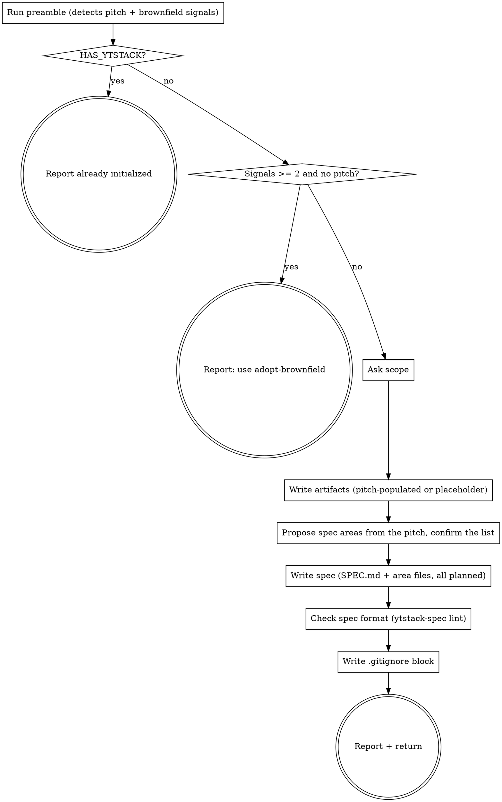

# init-project

Initialize a `.ytstack/` directory with the core project-memory artifacts that every other ytstack skill depends on, plus a technical spec scaffold (`spec/SPEC.md` and one file per system area) that records the approved design as planned.

## Anti-Pattern: "This project is too small for formal init"

Every project goes through this. A CSS tweak, a weekend script, a prototype -- all of them. "Small" projects are where unexamined assumptions cause the most wasted work. The init can be minimal (one scope question), but you MUST run it before any other ytstack skill except `office-hours`.

If the user insists the project is too small for ytstack, don't force it. Tell them ytstack is optional. But if they've asked for it, run init properly.

**Infra-only scope (DECISIONS 2026-04-24 "Greenfield-flow reorder"):** init-project does NOT ask for project name or one-liner. Those come from a pitch artifact produced by `ytstack:office-hours` (and optionally stress-tested by `plan-ceo-review` / `plan-eng-review`). If no pitch exists when init-project runs, PROJECT.md is scaffolded with explicit placeholders pointing the user at `office-hours`.

## Anti-Pattern: "This project is too mature for greenfield ceremony, so I'll scaffold placeholders and move on"

A repo with a 100-line README, a `docs/` folder, a CHANGELOG and a year of commits is not an unvalidated idea. Writing a placeholder one-liner that points at `office-hours` is wrong twice: the pitch interview on a shipped product is theater, and the placeholders duplicate or contradict docs that already exist. When the preamble reports `BROWNFIELD_SIGNALS` of 2 or more and no pitch, this skill stops and points at `ytstack:adopt-brownfield`, which links the existing docs instead of re-asking for them (Step 3).

## Anti-Pattern: "The pitch describes it, so the spec can say it works"

A pitch is a plan. The technical spec this skill writes (Step 7) is a scaffold of that plan: every area is `planned`, `verified_at` is `none`, "Where implemented" says "Not built yet." Write what the pitch and its reviews decided as the approved design, and write `Unknown` for everything they left open. One sentence that reads as if code existed, or as if anything had been checked, makes the next session trust a system that is not there.

## Checklist

You MUST create a TodoWrite task for each of these items and complete them in order:

1. **Run preamble** -- emit state flags about current project, ytstack status, pitch-artifact presence and brownfield signals
2. **Handle already-initialized case** -- if HAS_YTSTACK=yes, report and exit cleanly
3. **Route brownfield** (only if `BROWNFIELD_SIGNALS >= 2` and `PITCH = none`) -- report the signals, point at `ytstack:adopt-brownfield`, stop
4. **Ask scope question** -- project-level vs user-level storage (core tier)
5. **Create artifact directory** -- `.ytstack/` or `~/.ytstack/projects/<slug>/` based on scope
6. **Write all 6 artifact files** -- PROJECT, DECISIONS, KNOWLEDGE, RUNTIME, STATE, PREFERENCES. PROJECT.md pre-populated from pitch artifact if present; otherwise placeholders.
7. **Write the technical spec** -- propose areas from the pitch and its reviews, confirm them with one AskUserQuestion, write `spec/SPEC.md` + one `spec/<area>.md` per area, all `status: planned`
8. **Check the spec format** -- run `ytstack-spec lint` and fix what it reports; by hand against `docs/ux/spec-format.md` when the script is not reachable
9. **Write `.gitignore` block** -- `.ytstack/.local/` (fallback session-state dir) via `yt_ensure_gitignore`; completion + scope are recorded in `PROJECT.md` frontmatter, no sentinels
10. **Report what was created** -- file list (artifacts + spec files) + pitch-status + reading order + next-step suggestion
11. **Return control** -- do NOT auto-invoke any other skill

## Process Flow



## Preamble

Run this first. Output gets read by the procedure below.

```bash
_BRANCH=$(git branch --show-current 2>/dev/null || echo unknown)
# ytstack resolver (M016): checkout = where this shell runs, via the shared lib.
_LIB="${CLAUDE_SKILL_DIR}/../../hooks/lib/git-ctx.sh"
if [ -f "$_LIB" ]; then
  . "$_LIB"; yt_git_ctx "$PWD"; yt_resolve_yt_dir >/dev/null
  _PROJECT_DIR="$YT_TOPLEVEL"; _YT_DIR="$YT_DIR"; _YT_SCOPE="$YT_SCOPE"; _IS_GIT="$YT_IS_GIT"; _PROJECT_KEY="$YT_REPO_KEY"
else
  # Host did not substitute CLAUDE_SKILL_DIR (e.g. Codex adapter): project scope only.
  _IS_GIT=$([ "$(git rev-parse --is-inside-work-tree 2>/dev/null)" = true ] && echo yes || echo no)
  _PROJECT_DIR=$(git rev-parse --show-toplevel 2>/dev/null || pwd -P)
  _YT_DIR=""; _YT_SCOPE=none; _PROJECT_KEY=""
  [ -d "$_PROJECT_DIR/.ytstack" ] && { _YT_DIR="$_PROJECT_DIR/.ytstack"; _YT_SCOPE=project; }
fi
cd "$_PROJECT_DIR" 2>/dev/null || true
_PROJECT_SLUG=$(basename "$_PROJECT_DIR")
_HAS_YTSTACK=$([ -n "$_YT_DIR" ] && echo yes || echo no)
_YTSTACK_SCOPE="$_YT_SCOPE"
# User-scope dir is keyed by the repo key (hash of the git common dir), never by basename (collisions: my-context-mcp vs meinkontext).
_USER_YT_DIR="$HOME/.ytstack/projects/${_PROJECT_KEY:-$_PROJECT_SLUG}"
_NON_INTERACTIVE=false
if [ -n "$YTSTACK_NON_INTERACTIVE" ] || [ -n "$OPENCLAW_SESSION" ] || [ -n "$CLAUDE_AGENT_TEAM_MEMBER" ]; then
  _NON_INTERACTIVE=true
fi
_EXPLAIN_LEVEL="default"
[ -f "$HOME/.ytstack/config" ] && _EXPLAIN_LEVEL=$(grep -E '^explain_level=' "$HOME/.ytstack/config" 2>/dev/null | cut -d= -f2 || echo default)
# Pitch-artifact discovery (produced by ytstack:office-hours)
_PITCH=""
if [ -f "./OFFICE-HOURS.md" ]; then
  _PITCH="./OFFICE-HOURS.md"
fi
_PITCH_NAME=""
_PITCH_ONELINER=""
if [ -n "$_PITCH" ]; then
  _PITCH_NAME=$(sed -n 's/^name: *//p' "$_PITCH" | head -1)
  _PITCH_ONELINER=$(sed -n 's/^one-liner: *//p' "$_PITCH" | head -1)
fi
# Brownfield signals (shared detector in the lib; 0 when the lib is not loaded)
_BF_SIGNALS=0; _BF_HINTS=""
if command -v yt_brownfield_signals >/dev/null 2>&1; then
  yt_brownfield_signals "$_PROJECT_DIR"
  _BF_SIGNALS="$YT_BROWNFIELD_SIGNALS"; _BF_HINTS="$YT_BROWNFIELD_HINTS"
fi
echo "BRANCH: $_BRANCH"
echo "PROJECT_SLUG: $_PROJECT_SLUG"
echo "HAS_YTSTACK: $_HAS_YTSTACK"
echo "YTSTACK_SCOPE: $_YTSTACK_SCOPE"
echo "YTSTACK_NON_INTERACTIVE: $_NON_INTERACTIVE"
echo "EXPLAIN_LEVEL: $_EXPLAIN_LEVEL"
echo "IS_GIT: $_IS_GIT"
echo "PITCH: ${_PITCH:-none}"
echo "PITCH_NAME: ${_PITCH_NAME:-<placeholder>}"
echo "PITCH_ONELINER: ${_PITCH_ONELINER:-<placeholder>}"
echo "BROWNFIELD_SIGNALS: $_BF_SIGNALS"
if [ -n "$_BF_HINTS" ]; then echo "CANDIDATES:"; printf '%s\n' "$_BF_HINTS" | sed 's/^/  - /'; fi
```

## Procedure

### Step 2: Handle already-initialized case

If `HAS_YTSTACK` is `yes`, do NOT re-initialize. Report and exit:

> "ytstack is already initialized for `{PROJECT_SLUG}` at {location based on YTSTACK_SCOPE}. To see current state, read `STATE.md` in that directory, then `spec/SPEC.md` (what applies now) when it exists. To re-init from scratch, delete that directory first and run this skill again."

Do not invoke any other skill. Return control.

### Step 3: Route brownfield

Only if `BROWNFIELD_SIGNALS` is 2 or more AND `PITCH` is `none`. Otherwise skip to Step 4.

Do NOT write placeholder artifacts. Report and stop:

> "`{PROJECT_SLUG}` looks like an existing codebase ({BROWNFIELD_SIGNALS} brownfield signals: {CANDIDATES, one per line}). Scaffolding placeholders here would duplicate docs you already have, and running `office-hours` on a shipped project is theater.
>
> Run `ytstack:adopt-brownfield` instead: it maps those files onto PROJECT.md / DECISIONS.md / KNOWLEDGE.md / RUNTIME.md by reference, asks you per file how to handle it, writes a codebase map, and scaffolds only what is missing.
>
> If this really is a fresh idea that happens to live in a documented repo, run `ytstack:office-hours` first; with a pitch present this skill proceeds normally."

Do not invoke `ytstack:adopt-brownfield` yourself. Return control; the user decides.

### Step 4: Ask scope question

If `YTSTACK_NON_INTERACTIVE` is `true`, auto-pick option A (project-level) and log:

> `[ytstack:init-project] auto-picked A (project-level) because YTSTACK_NON_INTERACTIVE=true`

Otherwise, use AskUserQuestion with this exact body:

> I'm initializing ytstack project tracking for `{PROJECT_SLUG}` on branch `{BRANCH}`. No `.ytstack/` exists yet.
>
> ytstack stores project memory (what you're building, decisions you make, patterns you learn) in a set of files. Every future session reads them first, so Claude doesn't forget context between sessions. Two places this can live:
>
> **Project-level** (`./.ytstack/` in your repo): committed to git, shared with team, survives machine migration. Everyone working on this project sees the same memory.
>
> **User-level** (`~/.ytstack/projects/<repo-key>/`, keyed by a hash of the repo's git dir): private, follows you across machines if you sync `~/.ytstack/`, not shared.
>
> RECOMMENDATION: Choose A. Project-level is the only safe default. You never lose state to a laptop failure, and teammates see the same history. User-level is only right for secret side projects or when you can't commit to the repo.
>
> A) Project-level (./.ytstack/) -- committed to git, team-shared
>    Completeness: 10/10, effort: 0 setup / 0 ongoing, tier: core
>
> B) User-level (~/.ytstack/projects/<repo-key>/) -- private, machine-local
>    Completeness: 7/10, effort: 0 setup / 0 ongoing (risk of loss on hardware failure), tier: core
>
> C) Both (project for team facts, user for private notes) -- hybrid
>    Completeness: 9/10, effort: low setup / slight ongoing discipline, tier: core
>
> (to change later: edit `scope:` in `PROJECT.md` and move the directory by hand)

Remember the answer as `_SCOPE_CHOICE` (value: `project`, `user`, or `both`). `{SCOPE_CHOICE}` in the templates below is this value.

### Step 5: Create artifact directory

Based on `_SCOPE_CHOICE`:

- If `project` or `both`: `mkdir -p .ytstack`
- If `user` or `both`: `mkdir -p "$_USER_YT_DIR"` (keyed by the repo key from the preamble, so two repos with the same folder name never collide)

For `both`, write all files to both locations for v0.1. Later skills can split.

If a pitch artifact exists (`PITCH != none` from preamble), also move it into the ytstack dir: `mv ./OFFICE-HOURS.md "$_YT_DIR/OFFICE-HOURS-$_PITCH_SLUG.md"` (slug is a 2-4 word kebab-case summary from the pitch headline; if none available, use `initial`). The pitch is now a ytstack artifact that downstream skills (plan-milestone, plan-ceo-review milestone-mode) can read.

### Step 6: Write 6 artifact files

Use the Write tool. Substitutions:

- `{PROJECT_NAME}` = `$_PITCH_NAME` if non-empty, else `$_PROJECT_SLUG`.
- `{PROJECT_ONELINER}` = `$_PITCH_ONELINER` if non-empty, else the placeholder string `(run /ytstack:office-hours to validate the premise and populate this one-liner; until then the project has no validated pitch)`.
- `{PROJECT_SLUG}` = `$_PROJECT_SLUG`.
- `{ISO_TIMESTAMP}` = current UTC timestamp in `YYYY-MM-DDTHH:MM:SSZ` format.

Location: the directory chosen in Step 5. For `both`, write each file to both locations with identical content.

#### PROJECT.md

```markdown
---
name: {PROJECT_NAME}
slug: {PROJECT_SLUG}
created: {ISO_TIMESTAMP}
updated: {ISO_TIMESTAMP}
init_completed: {ISO_TIMESTAMP}
scope: {SCOPE_CHOICE}
---

# {PROJECT_NAME}

**One-liner:** {PROJECT_ONELINER}

## What this project is

(Expand the one-liner. What does it do? What problem does it solve? Who is it for?)

## Why it exists

(What motivated this project? What was broken before?)

## Success criteria

(When will we know this is working? Concrete signals, not abstract goals.)

## Current status

(Short status line. Updated by ytstack:plan-milestone and ytstack:summarize-task.)
```

#### DECISIONS.md

```markdown
# Decisions

Append-only architectural and product decisions for {PROJECT_NAME}. Never rewrite past entries. If a decision is reversed, add a new entry that supersedes.

Format for each entry:

## YYYY-MM-DD: <Short title>

**Context:** <what forced the decision>
**Options considered:** <A, B, C>
**Chose:** <selected option>
**Reason:** <why>
**Supersedes:** <link to earlier entry if this reverses a prior decision>
```

#### KNOWLEDGE.md

```markdown
# Knowledge

Patterns, rules, and lessons learned while building {PROJECT_NAME}. This file is read by every future session. Keep it short. Keep it actionable.

## Conventions

(Code style, file layout, naming rules that apply across the project.)

## Lessons learned

(Non-obvious things discovered during development. Each entry: one-line lesson + short context.)

## Gotchas

(Things that would surprise a new contributor or agent.)
```

#### RUNTIME.md

```markdown
# Runtime

Services, APIs, env vars, and ports used by {PROJECT_NAME}.

## Services

(External services this project depends on. Name, URL, purpose.)

## Environment variables

(Required env vars. Name, purpose, example value.)

## Ports

(Ports this project listens on or connects to.)

## Deploy target

(Where this deploys to, if applicable.)

## Run

(How the product starts in a worktree. Replace this line with `- start:`, `- ports:` and `- ready:` lines once it can be started.)

## Release

(Where the deployed commit can be read after a merge: a `- deployed:` line, a command that only reads.)

## Signals

(Where production reports errors: one `- <name> | read: <command> | kind: errors` line per source. Names of credentials, never values.)
```

The sections "Run", "Release" and "Signals" have a fixed line format (`docs/ux/runtime-format.md` in the ytstack plugin). Write them exactly as above: a section without a list line counts as absent, so the file passes `bin/ytstack-runtime check` as it is. Do not fill in a command the pitch does not state.

#### STATE.md

```markdown
---
project: {PROJECT_NAME}
slug: {PROJECT_SLUG}
last_updated: {ISO_TIMESTAMP}
current_milestone: none
active_slice: none
active_task: none
tracker: none
---

# State

**Status:** initialized, no milestone yet

## Next action

Run `ytstack:plan-milestone` to define the first milestone. If day-to-day issues live in Linear, GitHub Projects, Paperclip or Jira, set `tracker:` above (`linear | github-projects | paperclip | jira`); plan-milestone and reassess-roadmap then leave that work alone.

## Open decisions

(Pending decisions the user needs to make. Updated by skills when they hit a gate.)

## Recent summaries

(Latest 3 T##-SUMMARY.md entries will appear here.)
```

#### PREFERENCES.md

```markdown
# Preferences

Local preferences for {PROJECT_NAME}. These apply to every ytstack session for this project.

## Explain level

explain_level: default

Options: default | terse | brutal

## Ceremony

granularity: task        # task | slice | milestone -- smallest unit that gets a PLAN/SUMMARY pair
autonomy: loop           # loop = chain plan-task -> TDD -> verify -> summarize inside a slice without asking; step = ask before each step
quick_lane: on           # one-sentence changes go through ytstack:quick-task (Q### artifacts), no pitch, no review
minimal_code: on         # inject the minimal-code guard (YAGNI ladder, never-cut list) at session start
team: off                # off = spawn-milestone-team dispatches worktree subagents (default); on = Claude Code Agent Teams (experimental)

## Model preferences

(Fill in preferred model for each skill type if non-default.)

## Timeouts

(Override defaults here.)

## Custom

(Project-specific preferences that don't fit elsewhere.)
```

### Step 7: Write the technical spec

The six files say what the project is and where work stands. The technical spec says what applies now, per part of the system: `spec/SPEC.md` (the entry point, one page) and one `spec/<area>.md` per area. The binding format is `docs/ux/spec-format.md` in the ytstack plugin (`${CLAUDE_SKILL_DIR}/../../docs/ux/spec-format.md`). Read it before writing; the templates below are that format filled in for a project without code.

Location: `spec/` inside the directory chosen in Step 5 (for `both`, in both locations with identical content). Additional substitution: `{TODAY}` = the date part of `{ISO_TIMESTAMP}` (`YYYY-MM-DD`).

**7a. Propose the areas.** An area is a part of the system that somebody could be handed a bug in. If `PITCH` is not `none`, read the pitch (moved in Step 5 to `{location}/OFFICE-HOURS-{PITCH_SLUG}.md`), including the review blocks that `plan-ceo-review` and `plan-eng-review` put at its top when they ran. List the main parts of the system the pitch names: three to eight, each with a lowercase slug (`auth`, `billing-export`) and one line on what it covers. More than eight: merge the smallest ones. Fewer than three: take the parts the pitch names and do not invent one to reach three.

If `PITCH` is `none`, or the pitch names no parts at all: use a single area named after the project (`{PROJECT_NAME}` as a lowercase slug of letters, digits and hyphens), skip 7b, and say so in the report (Step 10).

**7b. Confirm the list.** If `YTSTACK_NON_INTERACTIVE` is `true`, take the proposal and log:

> `[ytstack:init-project] auto-picked A (proposed spec areas: {comma-separated slugs}) because YTSTACK_NON_INTERACTIVE=true`

Otherwise, use AskUserQuestion with this body:

> I'm setting up ytstack for `{PROJECT_NAME}` on branch `{BRANCH}`. The six memory files are written; the technical spec is next.
>
> The spec is where a fresh session reads how the system behaves right now, without digging through plans and history. It is split into areas: parts of the system you could hand somebody a bug in, one file each. Nothing is built yet, so every file starts as "planned" and records only what your pitch decided. These are the parts I read in the pitch:
>
> {one line per proposed area: `{slug}` -- {what it covers}}
>
> RECOMMENDATION: Choose A because the list follows the parts your pitch names, and an area is cheap to rename, split or merge once code exists.
>
> A) Use this list -- {N} area files, all marked planned
>    Completeness: 10/10, effort: human: 0 / CC: ~2 min, tier: core
>
> B) Edit the list -- tell me what to add, drop, rename or merge; I write the list you give
>    Completeness: 10/10, effort: human: ~2 min / CC: ~2 min, tier: core
>
> (to change later: add, rename or remove a file under `spec/` and its row in `spec/SPEC.md`)

On B, take the edited list from the user's answer, turn every name into a lowercase slug and write that list. Do not ask a second time. If the user cancels the question: write no spec files, skip Step 8, and say in the report that `spec/` is missing and that answering the area question closes the gap.

**7c. Write `spec/SPEC.md`.** At most 80 lines. The section "Keeping this true" is copied verbatim; it is what a session without hooks finds in the repository.

```markdown
---
project: {PROJECT_NAME}
updated: {TODAY}
---

# {PROJECT_NAME} -- technical spec

## What this is

{Three to six lines from the pitch: what the system is meant to do, for whom, and its main parts. If there is no pitch: `Unknown -- no validated pitch yet; run ytstack:office-hours`.}

Nothing is built yet. Every area below is the approved design, not a description of running code.

## Areas

| Area | Covers | Status | File |
|---|---|---|---|
| {area} | {one line} | planned | [{area}.md]({area}.md) |

## Invariants that hold everywhere

- {A rule the pitch or a review fixed for every area, with a link to the pitch.} or: `Unknown -- no project-wide rule decided yet`

## Build and test

The commands belong in [RUNTIME.md](../RUNTIME.md). Unknown -- none defined yet.

## Keeping this true

- A task plan names its **Spec impact**: the area and section it changes, or `none`.
- A task that changes behaviour updates the area file, or the source the area file names, in the same commits. A task that restores the described behaviour, a refactoring and a trivial edit close with `none`.
- A decision that changes what applies in an area is linked under that area's "Decisions that apply now" in the same commits; the entry it replaces leaves the list.
- Which area describes a path: the `paths` in each area file. Which areas need a look: `bin/ytstack-spec drift`.
- The format: `docs/ux/spec-format.md` in the ytstack plugin.
```

**7d. Write one `spec/{area}.md` per area.** At most 200 lines each.

```markdown
---
area: {area}
status: planned
paths: []
verified_at: none
---

## Purpose

Approved design, not built yet. {Two to four lines from the pitch and its reviews: what this part is for and where it ends.}

## Behavior

Approved design from [the pitch](../OFFICE-HOURS-{PITCH_SLUG}.md); no code exists for it.

- {A rule the pitch or a review decided, as something a user or a caller can observe.}
- Unknown -- {a question the pitch leaves open for this area}

## Where implemented

Not built yet.

## How to verify

Planned check, from the pitch: {the pitch's success criterion for this area}.

## Decisions that apply now

None recorded in [DECISIONS.md](../DECISIONS.md) yet. The approved design is the pitch linked under "Behavior".
```

Rules for every area file:

- `status: planned` and `verified_at: none`, always. This skill never writes another status: a scaffold has read no code.
- `paths` is `[]`, or a list of the globs the pitch or a review already fixes (`src/export/**`). Do not guess a directory layout.
- No `sources` entry. The pitch is a plan, not a description of the system; it is linked in the body.
- "Purpose" and "Behavior" carry what the pitch and its reviews decided, worded as the approved design. Whatever they leave open is `Unknown -- <what is missing>`.
- "How to verify" carries the pitch's success criterion for the area. If the pitch has none: `Unknown -- no check defined yet`.
- The other sections of the format (interfaces, data flow, invariants, error behavior, runtime assumptions, known limits) are written only when the pitch or a review decided something there, under the exact names and in the order the format document fixes. Otherwise leave them out.
- Without a pitch (single-area fallback): "Purpose" is `Unknown -- no validated pitch yet; run ytstack:office-hours`, "Behavior" is left out, "How to verify" is `Unknown -- no check defined yet`, and "Decisions that apply now" keeps only its first sentence.

### Step 8: Check the spec format

Skip when Step 7 wrote no spec files. Otherwise run the format check from the project root:

```bash
_SPEC_BIN="${CLAUDE_SKILL_DIR}/../../bin/ytstack-spec"
if [ -x "$_SPEC_BIN" ]; then
  "$_SPEC_BIN" lint; echo "SPEC_LINT_EXIT: $?"   # 0 clean | 2 warnings only | 1 failures
else
  echo "SPEC_LINT: unavailable"
fi
```

- `SPEC_LINT_EXIT: 0` -- done.
- `SPEC_LINT_EXIT: 1` or `2` -- every `FAIL` and `warn` line names the file and the rule. Fix the file and run the check again until it exits 0. Fix a finding in the direction of the truth: shorten a file that is too long, correct a section name or a link. Never raise a `status` or fill in a `verified_at` to make a finding go away.
- `SPEC_LINT: unavailable` (a host that does not substitute `CLAUDE_SKILL_DIR`) -- read each file you wrote against the section "Checked mechanically" of `docs/ux/spec-format.md` by hand and fix what differs. If that document is not reachable either, compare against the templates in Step 7. Say in the report that the check was done by hand.

### Step 9: Write the `.gitignore` block

Skip when `_SCOPE_CHOICE` is `user` (nothing lives in the tree). Otherwise, with the lib loaded by the preamble:

```bash
yt_ensure_gitignore "$_PROJECT_DIR"
echo "GITIGNORE: $YT_GITIGNORE"   # written | unchanged | skipped
```

This ignores only `.ytstack/.local/` -- the in-tree fallback for volatile session state (auto handoffs, journal) when no plugin data dir is writable. `.ytstack/HANDOFF.md` and every other artifact stay committable. Completion and scope are already recorded in `PROJECT.md` frontmatter (`init_completed`, `scope`); no `~/.ytstack` sentinels are written.

### Step 10: Report what was created

Write this prose summary (substitute the real paths based on `_SCOPE_CHOICE`, and branch on whether a pitch was consumed):

**If `PITCH != none`** (pitch was consumed + moved to ytstack dir):

> Created ytstack tracking for **{PROJECT_NAME}**:
>
> - {location}/PROJECT.md -- populated from `OFFICE-HOURS-{PITCH_SLUG}.md`
> - {location}/OFFICE-HOURS-{PITCH_SLUG}.md -- the validated pitch (moved from `./OFFICE-HOURS.md`)
> - {location}/DECISIONS.md -- empty decision register (append as you decide)
> - {location}/KNOWLEDGE.md -- empty patterns and lessons file
> - {location}/RUNTIME.md -- empty services and env-vars file
> - {location}/STATE.md -- dashboard, current status
> - {location}/PREFERENCES.md -- your local settings
> - {location}/spec/SPEC.md -- technical spec entry point: {N} areas, all `planned`
> - {location}/spec/{area}.md, one per area ({comma-separated slugs}) -- the approved design from the pitch; nothing is built and nothing was verified
>
> {Only if the pitch named no parts:} The pitch names no parts of the system, so the spec has a single area `{area}`. Split it when the first milestone shows the parts.
>
> Spec format check: {clean | fixed: {what} | done by hand, `ytstack-spec` not reachable}.
>
> Reading order for a new session: `STATE.md` (where work stands), then `spec/SPEC.md` (what applies now), then the area file for the part being touched.
>
> Next step: run `ytstack:plan-milestone` to define the first milestone. The pitch gives plan-milestone a goal and exit criteria to draw from.
>
> If you're in a git repo (`IS_GIT: yes`): these files are unstaged. `git status` will show them. Commit when ready.

**If `PITCH = none`** (no pitch, placeholders were written):

> Created ytstack tracking for **{PROJECT_NAME}** (scaffolded without a validated pitch):
>
> - {location}/PROJECT.md -- one-liner is a placeholder pointing to office-hours
> - {location}/DECISIONS.md, KNOWLEDGE.md, RUNTIME.md, STATE.md, PREFERENCES.md -- empty
> - {location}/spec/SPEC.md and {location}/spec/{area}.md -- technical spec with a single area named after the project, because no pitch names the parts of the system; `planned`, contents `Unknown`
>
> Spec format check: {clean | fixed: {what} | done by hand, `ytstack-spec` not reachable}.
>
> Reading order for a new session: `STATE.md` (where work stands), then `spec/SPEC.md` (what applies now).
>
> **Recommended next step: run `ytstack:office-hours`** to validate the project premise, then the outcome will populate PROJECT.md. Running `ytstack:plan-milestone` directly without a pitch works but the milestone goal will not be grounded in a validated premise.
>
> If you're in a git repo (`IS_GIT: yes`): these files are unstaged. `git status` will show them. Commit when ready.

If the area question was cancelled in Step 7, replace the spec lines and the format-check line with: *"`spec/` was not written: you cancelled the area question. Tell me the areas (or say "use the proposal") and I write it."*

### Step 11: Return control

STOP here. Do NOT invoke `ytstack:plan-milestone`, `ytstack:office-hours` or `ytstack:adopt-brownfield` automatically. The user decides the next step.

## Terminal State

The terminal state is one of:

- Returning control to the user after writing the 6 artifacts and the technical spec (`spec/SPEC.md` + one area file per area, all `planned`) and reporting file paths
- Exiting immediately after reporting "already initialized" (when HAS_YTSTACK=yes)
- Exiting immediately after pointing at `ytstack:adopt-brownfield` (when BROWNFIELD_SIGNALS >= 2 and no pitch)

Do NOT invoke `ytstack:plan-milestone`, `ytstack:office-hours`, `ytstack:adopt-brownfield`, `ytstack:spawn-milestone-team`, or any other ytstack skill from here. The ONLY valid next actions are:

- User runs `ytstack:adopt-brownfield` if the brownfield route fired
- User reviews and edits PROJECT.md manually
- User runs `ytstack:office-hours` if no pitch was consumed (PROJECT.md has placeholder one-liner)
- User runs `ytstack:plan-milestone` when ready for the first milestone
