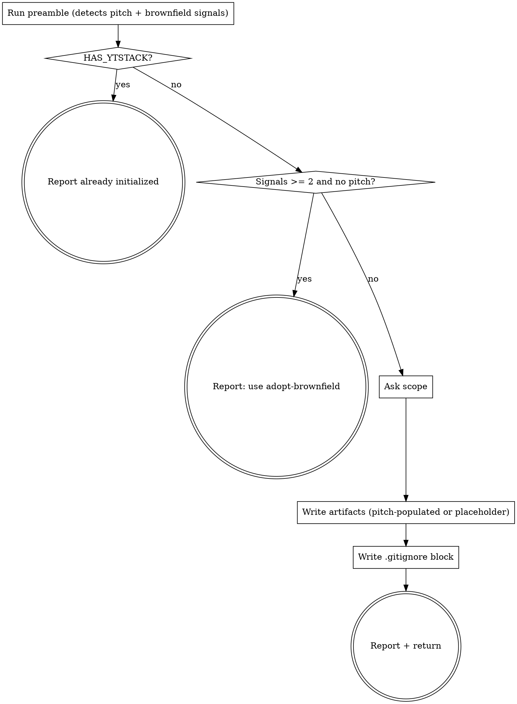

# init-project

Initialize a `.ytstack/` directory with the core project-memory artifacts that every other ytstack skill depends on.

## Anti-Pattern: "This project is too small for formal init"

Every project goes through this. A CSS tweak, a weekend script, a prototype -- all of them. "Small" projects are where unexamined assumptions cause the most wasted work. The init can be minimal (one scope question), but you MUST run it before any other ytstack skill except `office-hours`.

If the user insists the project is too small for ytstack, don't force it. Tell them ytstack is optional. But if they've asked for it, run init properly.

**Infra-only scope (DECISIONS 2026-04-24 "Greenfield-flow reorder"):** init-project does NOT ask for project name or one-liner. Those come from a pitch artifact produced by `ytstack:office-hours` (and optionally stress-tested by `plan-ceo-review` / `plan-eng-review`). If no pitch exists when init-project runs, PROJECT.md is scaffolded with explicit placeholders pointing the user at `office-hours`.

## Anti-Pattern: "This project is too mature for greenfield ceremony, so I'll scaffold placeholders and move on"

A repo with a 100-line README, a `docs/` folder, a CHANGELOG and a year of commits is not an unvalidated idea. Writing a placeholder one-liner that points at `office-hours` is wrong twice: the pitch interview on a shipped product is theater, and the placeholders duplicate or contradict docs that already exist. When the preamble reports `BROWNFIELD_SIGNALS` of 2 or more and no pitch, this skill stops and points at `ytstack:adopt-brownfield`, which links the existing docs instead of re-asking for them (Step 3).

## Checklist

You MUST create a TodoWrite task for each of these items and complete them in order:

1. **Run preamble** -- emit state flags about current project, ytstack status, pitch-artifact presence and brownfield signals
2. **Handle already-initialized case** -- if HAS_YTSTACK=yes, report and exit cleanly
3. **Route brownfield** (only if `BROWNFIELD_SIGNALS >= 2` and `PITCH = none`) -- report the signals, point at `ytstack:adopt-brownfield`, stop
4. **Ask scope question** -- project-level vs user-level storage (core tier)
5. **Create artifact directory** -- `.ytstack/` or `~/.ytstack/projects/<slug>/` based on scope
6. **Write all 6 artifact files** -- PROJECT, DECISIONS, KNOWLEDGE, RUNTIME, STATE, PREFERENCES. PROJECT.md pre-populated from pitch artifact if present; otherwise placeholders.
7. **Write `.gitignore` block** -- `.ytstack/.local/` (fallback session-state dir) via `yt_ensure_gitignore`; completion + scope are recorded in `PROJECT.md` frontmatter, no sentinels
8. **Report what was created** -- file list + pitch-status + next-step suggestion
9. **Return control** -- do NOT auto-invoke any other skill

## Process Flow



## Preamble

Run this first. Output gets read by the procedure below.

```bash
_BRANCH=$(git branch --show-current 2>/dev/null || echo unknown)
# ytstack resolver (M016): checkout = where this shell runs, via the shared lib.
_LIB="${CLAUDE_SKILL_DIR}/../../hooks/lib/git-ctx.sh"
if [ -f "$_LIB" ]; then
  . "$_LIB"; yt_git_ctx "$PWD"; yt_resolve_yt_dir >/dev/null
  _PROJECT_DIR="$YT_TOPLEVEL"; _YT_DIR="$YT_DIR"; _YT_SCOPE="$YT_SCOPE"; _IS_GIT="$YT_IS_GIT"; _PROJECT_KEY="$YT_REPO_KEY"
else
  # Host did not substitute CLAUDE_SKILL_DIR (e.g. Codex adapter): project scope only.
  _IS_GIT=$([ "$(git rev-parse --is-inside-work-tree 2>/dev/null)" = true ] && echo yes || echo no)
  _PROJECT_DIR=$(git rev-parse --show-toplevel 2>/dev/null || pwd -P)
  _YT_DIR=""; _YT_SCOPE=none; _PROJECT_KEY=""
  [ -d "$_PROJECT_DIR/.ytstack" ] && { _YT_DIR="$_PROJECT_DIR/.ytstack"; _YT_SCOPE=project; }
fi
cd "$_PROJECT_DIR" 2>/dev/null || true
_PROJECT_SLUG=$(basename "$_PROJECT_DIR")
_HAS_YTSTACK=$([ -n "$_YT_DIR" ] && echo yes || echo no)
_YTSTACK_SCOPE="$_YT_SCOPE"
# User-scope dir is keyed by the repo key (hash of the git common dir), never by basename (collisions: my-context-mcp vs meinkontext).
_USER_YT_DIR="$HOME/.ytstack/projects/${_PROJECT_KEY:-$_PROJECT_SLUG}"
_NON_INTERACTIVE=false
if [ -n "$YTSTACK_NON_INTERACTIVE" ] || [ -n "$OPENCLAW_SESSION" ] || [ -n "$CLAUDE_AGENT_TEAM_MEMBER" ]; then
  _NON_INTERACTIVE=true
fi
_EXPLAIN_LEVEL="default"
[ -f "$HOME/.ytstack/config" ] && _EXPLAIN_LEVEL=$(grep -E '^explain_level=' "$HOME/.ytstack/config" 2>/dev/null | cut -d= -f2 || echo default)
# Pitch-artifact discovery (produced by ytstack:office-hours)
_PITCH=""
if [ -f "./OFFICE-HOURS.md" ]; then
  _PITCH="./OFFICE-HOURS.md"
fi
_PITCH_NAME=""
_PITCH_ONELINER=""
if [ -n "$_PITCH" ]; then
  _PITCH_NAME=$(sed -n 's/^name: *//p' "$_PITCH" | head -1)
  _PITCH_ONELINER=$(sed -n 's/^one-liner: *//p' "$_PITCH" | head -1)
fi
# Brownfield signals (shared detector in the lib; 0 when the lib is not loaded)
_BF_SIGNALS=0; _BF_HINTS=""
if command -v yt_brownfield_signals >/dev/null 2>&1; then
  yt_brownfield_signals "$_PROJECT_DIR"
  _BF_SIGNALS="$YT_BROWNFIELD_SIGNALS"; _BF_HINTS="$YT_BROWNFIELD_HINTS"
fi
echo "BRANCH: $_BRANCH"
echo "PROJECT_SLUG: $_PROJECT_SLUG"
echo "HAS_YTSTACK: $_HAS_YTSTACK"
echo "YTSTACK_SCOPE: $_YTSTACK_SCOPE"
echo "YTSTACK_NON_INTERACTIVE: $_NON_INTERACTIVE"
echo "EXPLAIN_LEVEL: $_EXPLAIN_LEVEL"
echo "IS_GIT: $_IS_GIT"
echo "PITCH: ${_PITCH:-none}"
echo "PITCH_NAME: ${_PITCH_NAME:-<placeholder>}"
echo "PITCH_ONELINER: ${_PITCH_ONELINER:-<placeholder>}"
echo "BROWNFIELD_SIGNALS: $_BF_SIGNALS"
if [ -n "$_BF_HINTS" ]; then echo "CANDIDATES:"; printf '%s\n' "$_BF_HINTS" | sed 's/^/  - /'; fi
```

## Procedure

### Step 2: Handle already-initialized case

If `HAS_YTSTACK` is `yes`, do NOT re-initialize. Report and exit:

> "ytstack is already initialized for `{PROJECT_SLUG}` at {location based on YTSTACK_SCOPE}. To see current state, read `STATE.md` in that directory. To re-init from scratch, delete that directory first and run this skill again."

Do not invoke any other skill. Return control.

### Step 3: Route brownfield

Only if `BROWNFIELD_SIGNALS` is 2 or more AND `PITCH` is `none`. Otherwise skip to Step 4.

Do NOT write placeholder artifacts. Report and stop:

> "`{PROJECT_SLUG}` looks like an existing codebase ({BROWNFIELD_SIGNALS} brownfield signals: {CANDIDATES, one per line}). Scaffolding placeholders here would duplicate docs you already have, and running `office-hours` on a shipped project is theater.
>
> Run `ytstack:adopt-brownfield` instead: it maps those files onto PROJECT.md / DECISIONS.md / KNOWLEDGE.md / RUNTIME.md by reference, asks you per file how to handle it, writes a codebase map, and scaffolds only what is missing.
>
> If this really is a fresh idea that happens to live in a documented repo, run `ytstack:office-hours` first; with a pitch present this skill proceeds normally."

Do not invoke `ytstack:adopt-brownfield` yourself. Return control; the user decides.

### Step 4: Ask scope question

If `YTSTACK_NON_INTERACTIVE` is `true`, auto-pick option A (project-level) and log:

> `[ytstack:init-project] auto-picked A (project-level) because YTSTACK_NON_INTERACTIVE=true`

Otherwise, use AskUserQuestion with this exact body:

> I'm initializing ytstack project tracking for `{PROJECT_SLUG}` on branch `{BRANCH}`. No `.ytstack/` exists yet.
>
> ytstack stores project memory (what you're building, decisions you make, patterns you learn) in a set of files. Every future session reads them first, so Claude doesn't forget context between sessions. Two places this can live:
>
> **Project-level** (`./.ytstack/` in your repo): committed to git, shared with team, survives machine migration. Everyone working on this project sees the same memory.
>
> **User-level** (`~/.ytstack/projects/<repo-key>/`, keyed by a hash of the repo's git dir): private, follows you across machines if you sync `~/.ytstack/`, not shared.
>
> RECOMMENDATION: Choose A. Project-level is the only safe default. You never lose state to a laptop failure, and teammates see the same history. User-level is only right for secret side projects or when you can't commit to the repo.
>
> A) Project-level (./.ytstack/) -- committed to git, team-shared
>    Completeness: 10/10, effort: 0 setup / 0 ongoing, tier: core
>
> B) User-level (~/.ytstack/projects/<repo-key>/) -- private, machine-local
>    Completeness: 7/10, effort: 0 setup / 0 ongoing (risk of loss on hardware failure), tier: core
>
> C) Both (project for team facts, user for private notes) -- hybrid
>    Completeness: 9/10, effort: low setup / slight ongoing discipline, tier: core
>
> (to change later: edit `scope:` in `PROJECT.md` and move the directory by hand)

Remember the answer as `_SCOPE_CHOICE` (value: `project`, `user`, or `both`). `{SCOPE_CHOICE}` in the templates below is this value.

### Step 5: Create artifact directory

Based on `_SCOPE_CHOICE`:

- If `project` or `both`: `mkdir -p .ytstack`
- If `user` or `both`: `mkdir -p "$_USER_YT_DIR"` (keyed by the repo key from the preamble, so two repos with the same folder name never collide)

For `both`, write all files to both locations for v0.1. Later skills can split.

If a pitch artifact exists (`PITCH != none` from preamble), also move it into the ytstack dir: `mv ./OFFICE-HOURS.md "$_YT_DIR/OFFICE-HOURS-$_PITCH_SLUG.md"` (slug is a 2-4 word kebab-case summary from the pitch headline; if none available, use `initial`). The pitch is now a ytstack artifact that downstream skills (plan-milestone, plan-ceo-review milestone-mode) can read.

### Step 6: Write 6 artifact files

Use the Write tool. Substitutions:

- `{PROJECT_NAME}` = `$_PITCH_NAME` if non-empty, else `$_PROJECT_SLUG`.
- `{PROJECT_ONELINER}` = `$_PITCH_ONELINER` if non-empty, else the placeholder string `(run /ytstack:office-hours to validate the premise and populate this one-liner; until then the project has no validated pitch)`.
- `{PROJECT_SLUG}` = `$_PROJECT_SLUG`.
- `{ISO_TIMESTAMP}` = current UTC timestamp in `YYYY-MM-DDTHH:MM:SSZ` format.

Location: the directory chosen in Step 5. For `both`, write each file to both locations with identical content.

#### PROJECT.md

```markdown
---
name: {PROJECT_NAME}
slug: {PROJECT_SLUG}
created: {ISO_TIMESTAMP}
updated: {ISO_TIMESTAMP}
init_completed: {ISO_TIMESTAMP}
scope: {SCOPE_CHOICE}
---

# {PROJECT_NAME}

**One-liner:** {PROJECT_ONELINER}

## What this project is

(Expand the one-liner. What does it do? What problem does it solve? Who is it for?)

## Why it exists

(What motivated this project? What was broken before?)

## Success criteria

(When will we know this is working? Concrete signals, not abstract goals.)

## Current status

(Short status line. Updated by ytstack:plan-milestone and ytstack:summarize-task.)
```

#### DECISIONS.md

```markdown
# Decisions

Append-only architectural and product decisions for {PROJECT_NAME}. Never rewrite past entries. If a decision is reversed, add a new entry that supersedes.

Format for each entry:

## YYYY-MM-DD: <Short title>

**Context:** <what forced the decision>
**Options considered:** <A, B, C>
**Chose:** <selected option>
**Reason:** <why>
**Supersedes:** <link to earlier entry if this reverses a prior decision>
```

#### KNOWLEDGE.md

```markdown
# Knowledge

Patterns, rules, and lessons learned while building {PROJECT_NAME}. This file is read by every future session. Keep it short. Keep it actionable.

## Conventions

(Code style, file layout, naming rules that apply across the project.)

## Lessons learned

(Non-obvious things discovered during development. Each entry: one-line lesson + short context.)

## Gotchas

(Things that would surprise a new contributor or agent.)
```

#### RUNTIME.md

```markdown
# Runtime

Services, APIs, env vars, and ports used by {PROJECT_NAME}.

## Services

(External services this project depends on. Name, URL, purpose.)

## Environment variables

(Required env vars. Name, purpose, example value.)

## Ports

(Ports this project listens on or connects to.)

## Deploy target

(Where this deploys to, if applicable.)
```

#### STATE.md

```markdown
---
project: {PROJECT_NAME}
slug: {PROJECT_SLUG}
last_updated: {ISO_TIMESTAMP}
current_milestone: none
active_slice: none
active_task: none
tracker: none
---

# State

**Status:** initialized, no milestone yet

## Next action

Run `ytstack:plan-milestone` to define the first milestone. If day-to-day issues live in Linear, GitHub Projects, Paperclip or Jira, set `tracker:` above (`linear | github-projects | paperclip | jira`); plan-milestone and reassess-roadmap then leave that work alone.

## Open decisions

(Pending decisions the user needs to make. Updated by skills when they hit a gate.)

## Recent summaries

(Latest 3 T##-SUMMARY.md entries will appear here.)
```

#### PREFERENCES.md

```markdown
# Preferences

Local preferences for {PROJECT_NAME}. These apply to every ytstack session for this project.

## Explain level

explain_level: default

Options: default | terse | brutal

## Model preferences

(Fill in preferred model for each skill type if non-default.)

## Timeouts

(Override defaults here.)

## Custom

(Project-specific preferences that don't fit elsewhere.)
```

### Step 7: Write the `.gitignore` block

Skip when `_SCOPE_CHOICE` is `user` (nothing lives in the tree). Otherwise, with the lib loaded by the preamble:

```bash
yt_ensure_gitignore "$_PROJECT_DIR"
echo "GITIGNORE: $YT_GITIGNORE"   # written | unchanged | skipped
```

This ignores only `.ytstack/.local/` -- the in-tree fallback for volatile session state (auto handoffs, journal) when no plugin data dir is writable. `.ytstack/HANDOFF.md` and every other artifact stay committable. Completion and scope are already recorded in `PROJECT.md` frontmatter (`init_completed`, `scope`); no `~/.ytstack` sentinels are written.

### Step 8: Report what was created

Write this prose summary (substitute the real paths based on `_SCOPE_CHOICE`, and branch on whether a pitch was consumed):

**If `PITCH != none`** (pitch was consumed + moved to ytstack dir):

> Created ytstack tracking for **{PROJECT_NAME}**:
>
> - {location}/PROJECT.md -- populated from `OFFICE-HOURS-{PITCH_SLUG}.md`
> - {location}/OFFICE-HOURS-{PITCH_SLUG}.md -- the validated pitch (moved from `./OFFICE-HOURS.md`)
> - {location}/DECISIONS.md -- empty decision register (append as you decide)
> - {location}/KNOWLEDGE.md -- empty patterns and lessons file
> - {location}/RUNTIME.md -- empty services and env-vars file
> - {location}/STATE.md -- dashboard, current status
> - {location}/PREFERENCES.md -- your local settings
>
> Next step: run `ytstack:plan-milestone` to define the first milestone. The pitch gives plan-milestone a goal and exit criteria to draw from.
>
> If you're in a git repo (`IS_GIT: yes`): these files are unstaged. `git status` will show them. Commit when ready.

**If `PITCH = none`** (no pitch, placeholders were written):

> Created ytstack tracking for **{PROJECT_NAME}** (scaffolded without a validated pitch):
>
> - {location}/PROJECT.md -- one-liner is a placeholder pointing to office-hours
> - {location}/DECISIONS.md, KNOWLEDGE.md, RUNTIME.md, STATE.md, PREFERENCES.md -- empty
>
> **Recommended next step: run `ytstack:office-hours`** to validate the project premise, then the outcome will populate PROJECT.md. Running `ytstack:plan-milestone` directly without a pitch works but the milestone goal will not be grounded in a validated premise.
>
> If you're in a git repo (`IS_GIT: yes`): these files are unstaged. `git status` will show them. Commit when ready.

### Step 9: Return control

STOP here. Do NOT invoke `ytstack:plan-milestone`, `ytstack:office-hours` or `ytstack:adopt-brownfield` automatically. The user decides the next step.

## Terminal State

The terminal state is one of:

- Returning control to the user after writing the 6 artifacts and reporting file paths
- Exiting immediately after reporting "already initialized" (when HAS_YTSTACK=yes)
- Exiting immediately after pointing at `ytstack:adopt-brownfield` (when BROWNFIELD_SIGNALS >= 2 and no pitch)

Do NOT invoke `ytstack:plan-milestone`, `ytstack:office-hours`, `ytstack:adopt-brownfield`, `ytstack:spawn-milestone-team`, or any other ytstack skill from here. The ONLY valid next actions are:

- User runs `ytstack:adopt-brownfield` if the brownfield route fired
- User reviews and edits PROJECT.md manually
- User runs `ytstack:office-hours` if no pitch was consumed (PROJECT.md has placeholder one-liner)
- User runs `ytstack:plan-milestone` when ready for the first milestone
