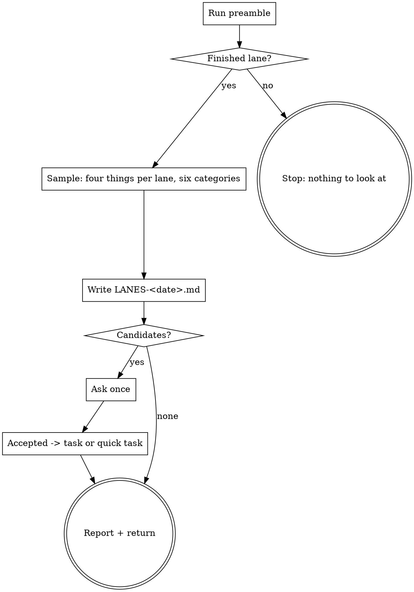

# lane-retro

A coordinator sees the same mistake in the third lane and is about to write a fourth sentence about it. This skill looks at a few finished lanes instead, in six fixed categories, and ends in a list of candidates: each one a check or a pointer, never a new rule in prose. The human accepts or skips them in one reply. Accepted ones become tasks. Nothing is implemented here.

## Anti-Pattern: "I'll put it into the brief so that the next worker knows"

The next worker gets a longer brief and makes the same mistake, because the sentence competes with everything else it has to hold. A mistake a machine can detect gets a check, and the sentence it replaces is deleted. A search the worker had to make gets a link. A rule that was written down and violated anyway is the strongest case for a check, not for bold type.

## Checklist

You MUST create a TodoWrite task for each of these items and complete them in order:

1. **Run preamble** -- finished lanes, which went wrong, which were sampled before
2. **HARD-GATE** -- `.ytstack` and at least one finished lane
3. **Pick the sample** -- about one finished lane in five, the ones that went wrong first
4. **Read four things per lane** -- brief, report, review findings, row; nothing else
5. **Examine in six categories** -- one line per lane and category, with evidence
6. **Form candidates** -- each a check or a pointer that replaces a named line or a search
7. **Write `.ytstack/retro/LANES-<date>.md`**
8. **Ask once** -- all candidates numbered, a recommendation each (only if there are candidates)
9. **Turn accepted candidates into tasks** -- a task line or a quick task; implement nothing
10. **Report + return**

## Process Flow



## Preamble

```bash
# ytstack resolver (M016): checkout = where this shell runs, via the shared lib.
_LIB="${CLAUDE_SKILL_DIR}/../../hooks/lib/git-ctx.sh"
if [ -f "$_LIB" ]; then
  . "$_LIB"; yt_git_ctx "$PWD"; yt_resolve_yt_dir >/dev/null
  _PROJECT_DIR="$YT_TOPLEVEL"; _YT_DIR="$YT_DIR"; _YT_SCOPE="$YT_SCOPE"; _IS_GIT="$YT_IS_GIT"; _PROJECT_KEY="$YT_REPO_KEY"
else
  # Host did not substitute CLAUDE_SKILL_DIR (e.g. Codex adapter): project scope only.
  _IS_GIT=$([ "$(git rev-parse --is-inside-work-tree 2>/dev/null)" = true ] && echo yes || echo no)
  _PROJECT_DIR=$(git rev-parse --show-toplevel 2>/dev/null || pwd -P)
  _YT_DIR=""; _YT_SCOPE=none; _PROJECT_KEY=""
  [ -d "$_PROJECT_DIR/.ytstack" ] && { _YT_DIR="$_PROJECT_DIR/.ytstack"; _YT_SCOPE=project; }
fi
cd "$_PROJECT_DIR" 2>/dev/null || true
_PROJECT_SLUG=$(basename "$_PROJECT_DIR")
_HAS_YTSTACK=$([ -n "$_YT_DIR" ] && echo yes || echo no)

_NI=false
if [ -n "${YTSTACK_NON_INTERACTIVE:-}" ] || [ -n "${OPENCLAW_SESSION:-}" ] || [ -n "${CLAUDE_AGENT_TEAM_MEMBER:-}" ]; then _NI=true; fi
_NL='
'
# Lanes an earlier lane retro looked at: the "sampled:" line of its frontmatter.
_SAMPLED=""
for _p in "$_YT_DIR"/retro/LANES-*.md; do
  [ -n "$_YT_DIR" ] && [ -f "$_p" ] || continue
  _SAMPLED="$_SAMPLED$_NL$(sed -n 's/^sampled: *//p' "$_p" | tr ',' '\n' | sed 's/^ *//; s/ *$//')"
done
# Finished lanes: merged ones, and blocked ones (those went wrong).
_FIN=""
[ -f "$_YT_DIR/LANES.md" ] && _FIN=$(awk -F'|' '/^\|/ { n++; if (n <= 2) next
    for (i = 2; i <= 11; i++) gsub(/^[ \t]+|[ \t]+$/, "", $i)
    if ($4 == "merged" || $4 == "blocked") print $2 "\t" $4 "\t" $10 "\t" $8 }' "$_YT_DIR/LANES.md")

echo "HAS_YTSTACK: $_HAS_YTSTACK"
echo "PROJECT_SLUG: $_PROJECT_SLUG"
echo "BRANCH: $(git branch --show-current 2>/dev/null || echo unknown)"
echo "YTSTACK_NON_INTERACTIVE: $_NI"
_NFIN=0; _NNEW=0
echo "FINISHED_BEGIN"
while IFS="$(printf '\t')" read -r _lane _st _round _pr; do
  [ -n "$_lane" ] || continue
  _NFIN=$((_NFIN + 1)); _mark=""
  case "$_round" in ''|*[!0-9]*) _round=0 ;; esac
  if [ "$_st" = blocked ] || [ "$_round" -ge 3 ]; then _mark="went-wrong"; fi
  case "$_NL$_SAMPLED$_NL" in
    *"$_NL$_lane$_NL"*) _mark="${_mark:+$_mark, }sampled" ;;
    *) _NNEW=$((_NNEW + 1)) ;;
  esac
  echo "$_lane | $_st | round $_round | PR $_pr | ${_mark:--}"
done <<EOF
$_FIN
EOF
[ "$_NFIN" -gt 0 ] || echo "no finished lanes"
echo "FINISHED_END"
echo "FINISHED: $_NFIN"
echo "SAMPLE_SIZE: $(( (_NNEW + 4) / 5 ))"
_TODAY=$(date -u +%Y-%m-%d)
echo "RETRO_FILE: $_YT_DIR/retro/LANES-$_TODAY.md"
echo "RETRO_FILE_EXISTS: $([ -f "$_YT_DIR/retro/LANES-$_TODAY.md" ] && echo yes || echo no)"
```

## Procedure

**Step 2 -- HARD-GATE.** `HAS_YTSTACK: no`: stop, "no `.ytstack/` here". `FINISHED: 0` and the user named no lane: stop, "no finished lane to look at yet".

**Step 3 -- Pick the sample.** Take `SAMPLE_SIZE` lanes from the list between `FINISHED_BEGIN` and `FINISHED_END` (about one finished lane in five), in this order: lanes marked `went-wrong` (blocked, or a third review round); lanes whose report said `Status: partial` or `Status: blocked`, or whose verification failed; then the most recently merged. Skip lanes marked `sampled`. A lane the user names is always in the sample.

**Step 4 -- Read four things per lane.** Only these; not the transcript, not the diff, not the rest of the repository. If one of the four does not exist for a lane, say so in the file: that is itself evidence for "access to information".

- its **brief**: `"${CLAUDE_SKILL_DIR}/../../bin/ytstack-brief" render --slice <lane>` (`--task` for a task lane) prints what the worker was given;
- its **report**: the labelled lines the coordinator kept, or the lane's `M###-S##-T##-SUMMARY.md` files;
- its **review findings**: the `## Review` lines in its task plans and the findings of its review (in the pull request, read from the host for this purpose; say when);
- its **row** in `LANES.md`.

**Step 5 -- Examine in six categories.** The same six for every lane, in this order:

| Category | The question | Where the evidence is |
|---|---|---|
| navigation pointers | Did the worker find what it needed, or did it search? | `Deviations:` and `Not checked:` of the report; a file the diff needed and the brief did not name |
| automated checks | Was a mistake caught by a machine, by a reviewer, or by nobody? | `Checks run:` against the review findings |
| review standards | Was the finding a rule that exists, a rule that is missing, or taste? | the finding against `AGENTS.md`, `CONTRIBUTING.md`, the project's review policy |
| instruction lines that change nothing | Which rule was written down and violated anyway? | the finding and the line of the instruction file it repeats |
| tool economy | Which calls only polled or read the same thing again? | repeated `Checks run:` on one commit; a status that was fetched in a loop |
| access to information | What could the worker not reach? | `Blockers:` and `Not checked:` |

A category without evidence in a lane gets "nothing found", not a guess.

**Step 6 -- Form candidates.** A candidate needs evidence: the lane, the file and the line of the report or the review. Its proposal is exactly one of two kinds: a **check** (a lint rule, a hook, a test, a CI job) that replaces a named instruction line, which is deleted when the check exists; or a **pointer** (a link in the plan's `## Files` or the brief's reading list, or in the area file of the technical spec) that replaces a search. What decides between them:

- A mechanical mistake never gets new prose as its answer.
- A rule that exists and was violated is a candidate for a check and for deleting the line.
- Reviewers enforce standards, because the implementer carries the most context pressure: a standards candidate goes to the review brief (what a `review` lane is told), not to the implementer's.
- A finding that is taste, or that no check and no pointer would have prevented, is no candidate. It is listed under "Looked at, no candidate".
- What a worker could not reach at all is a question for the human (`.ytstack/questions/`), not a candidate.

**Step 7 -- Write the file.** Path: `RETRO_FILE`, candidates in the order of the six categories. `RETRO_FILE_EXISTS: yes`: append a second `# Lane retro` block with its time and add the lanes to `sampled:`; never rewrite the earlier one.

```markdown
---
kind: lane-retro
written: {UTC}
sampled: {lane}, {lane}
of_finished: {FINISHED}
---

# Lane retro {UTC}

## Candidates

### C1 -- {category}: {the mistake in one sentence}

- Evidence: {lane}, `{file}:{line}` -- {what the report or the review says there}
- Proposal: {check | pointer} -- {what exactly, and where it lives: CI, a hook, the test suite, the review brief, the plan's Files, spec/{area}.md}
- Replaces: `{instruction file}:{line}` | the search for {what}
- Recommendation: {accept | skip} -- {one reason}
- Decision: open

## Looked at, no candidate

- {lane} / {category}: {what was seen and why nothing follows}
```

**Step 8 -- Ask once.** No candidates: skip to Step 10. Otherwise ONE AskUserQuestion with all of them, never one question per candidate:

> Lane retro for **{PROJECT_SLUG}** on `{BRANCH}`: I looked at {n} of {FINISHED} finished lanes ({the lane references}) and found {k} mistakes that a machine or a link would have prevented. Details: `{RETRO_FILE}`.
>
> Each proposal swaps a sentence somebody has to remember for something that works without being remembered: a check that fails when the mistake is made, or a link that saves the search.
>
> {Numbered, one block per candidate:}
> {n}. **{category}** -- {the mistake in one plain sentence} ({lane}, `{file}:{line}`).
>    Proposal: {check | pointer}: {what}. Replaces: {the line or the search}.
>    My recommendation: {accept | skip}, because {one reason}.
>
> RECOMMENDATION: Choose A because one reply settles all {k}, and each accepted check removes a rule from the instruction text.
>
> A) Decide them in one reply ("1 yes, 2 no, 3 yes") -- I record each answer and plan the accepted ones
>    Completeness: 10/10, effort: human: ~{k} min / CC: ~5 min, tier: task
> B) Leave them open -- the file stays, nothing is planned, the lanes are not sampled again
>    Completeness: 4/10, effort: human: 0 / CC: 0, tier: task

Record each answer in its candidate: `Decision: accepted {UTC}` or `Decision: skipped {UTC} -- {the human's reason, in your words}`. Record only what the human answered. `YTSTACK_NON_INTERACTIVE: true`: do not ask and accept nothing; every decision stays `open` and the report lists the file under "Waiting on a person".

**Step 9 -- Turn accepted candidates into tasks.** Implement nothing: the instruction line a check replaces is deleted by the task that adds the check, in the same commits, not here. For each accepted candidate, add `- Planned as: ...` to it:

- It fits one sentence and about three files, and the project's quick lane is on: a quick task. Write the sentence into the candidate; `ytstack:quick-task` takes it as it is, in a worker when a coordinator runs the plan.
- Otherwise a task: append `- [ ] T## -- {text} (lane retro {date} C#)` under `## Tasks` of the open, unclaimed slice plan whose files it touches, with the next free number, and raise `task_count` in its frontmatter. No such slice: leave it for `ytstack:reassess-roadmap` to place, and say so.

**Step 10 -- Report + return.**

> Lane retro: {n} of {FINISHED} finished lanes sampled, {k} candidates ({a} accepted, {s} skipped, {o} open). File: `{RETRO_FILE}`. Planned: {the task lines and quick-task sentences, or "nothing"}.

## Terminal State

Return control after the report: to the coordinator's loop when `ytstack:coordinate` invoked this skill, otherwise to the user. Exit without a file at the HARD-GATE.

Do NOT invoke `ytstack:quick-task`, `ytstack:plan-task` or `ytstack:test-driven-development` from here, and do not edit `AGENTS.md`, a brief template or a CI file: this skill plans, others implement. The ONLY skill you may name as a next step is `ytstack:reassess-roadmap` (for a task that no open slice takes).
