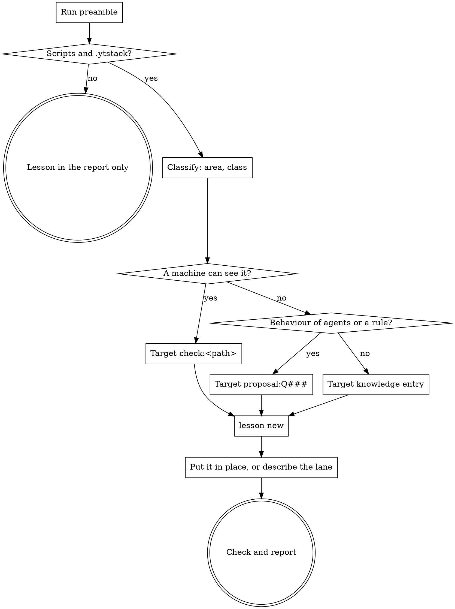

# lesson

Every incident ends here, whatever its class: production went down, `main` went red, a receipt claimed a run that had not finished, a defect got through to a review, a lane killed a process that was not its own, the coordinator asked a question that was already settled. This skill turns what happened into a lesson that lives somewhere a future session runs into it, and records it once per class in `.ytstack/signals/` (format: `docs/ux/signal-format.md`, "Lessons"). A class that comes back raises a count; a class that comes back after its lesson was in place reopens it. The skills `incident`, `systematic-debugging`, `finish-lane` and `coordinate` call this one at their end, so no path skips it.

<HARD-GATE>
Do NOT write the lesson as a sentence in `AGENTS.md`, `CLAUDE.md` or any other always-loaded instruction file. Do NOT record a lesson without a target, and do NOT set a lesson `fixed` before its target exists. Do NOT change the lane contract or a rule file yourself: that is a proposal for a person. Do NOT dismiss a class: only a person does.
This applies to EVERY incident regardless of how small it was or how obvious the lesson looks.
</HARD-GATE>

## Anti-Pattern: "I'll add a rule so that this does not happen again"

A sentence in an instruction file is read when the file is read, and an instruction file that grows a rule per incident is read less every week. A mistake a machine can see comes back as a red test, a refused script or an alert, also after a compaction and in a session that never read the rule. So the lesson becomes a check wherever a machine can tell right from wrong, and only what no machine can see becomes a knowledge entry. The script refuses `AGENTS.md` and `CLAUDE.md` as a target.

## Anti-Pattern: "Small thing, not worth a record"

The issue that asked for this skill counted eight incidents in one coordinator day, several of them the same class. Each looked small on its own. A record per class costs one command and turns the third repeat into a count of 3 that the coordinator and the retro see. Unrecorded, the third repeat looks like the first.

## Checklist

You MUST create a TodoWrite task for each of these items and complete them in order:

1. **Run preamble** -- resolver, the two scripts, the open lessons, `KNOWLEDGE.md`, the incident records
2. **HARD-GATE** -- `.ytstack` and the scripts; without them the lesson goes into the report and nothing is recorded
3. **Classify** -- one line: what happened, the area, the class (an existing key first)
4. **Route** -- the target by the first rule that applies: check, knowledge entry, proposal
5. **Record** -- `ytstack-signals lesson new` (with `--incident` when there is a record); act on the case it prints
6. **Put the lesson in place** -- write the knowledge entry, build the check where the caller may, or describe the check for a lane; set `fixed` only when the target exists
7. **Ask the person** (only for a proposal, in an interactive session that is not a coordinator's) -- ONE question
8. **Check and report** -- `ytstack-signals check`, then the report in the fixed shape

## Process Flow



## Preamble

```bash
# ytstack resolver (M016): checkout = where this shell runs, via the shared lib.
_LIB="${CLAUDE_SKILL_DIR}/../../hooks/lib/git-ctx.sh"
if [ -f "$_LIB" ]; then
  . "$_LIB"; yt_git_ctx "$PWD"; yt_resolve_yt_dir >/dev/null
  _PROJECT_DIR="$YT_TOPLEVEL"; _YT_DIR="$YT_DIR"; _YT_SCOPE="$YT_SCOPE"; _IS_GIT="$YT_IS_GIT"; _PROJECT_KEY="$YT_REPO_KEY"
else
  # Host did not substitute CLAUDE_SKILL_DIR (e.g. Codex adapter): project scope only.
  _IS_GIT=$([ "$(git rev-parse --is-inside-work-tree 2>/dev/null)" = true ] && echo yes || echo no)
  _PROJECT_DIR=$(git rev-parse --show-toplevel 2>/dev/null || pwd -P)
  _YT_DIR=""; _YT_SCOPE=none; _PROJECT_KEY=""
  [ -d "$_PROJECT_DIR/.ytstack" ] && { _YT_DIR="$_PROJECT_DIR/.ytstack"; _YT_SCOPE=project; }
fi
cd "$_PROJECT_DIR" 2>/dev/null || true
_PROJECT_SLUG=$(basename "$_PROJECT_DIR")   # display only
_HAS_YTSTACK=$([ -n "$_YT_DIR" ] && echo yes || echo no)

# The two scripts: the ledger and the questions for a person.
_tool() { local t="${CLAUDE_SKILL_DIR}/../../bin/$1"; if [ -f "$t" ]; then (cd "$(dirname "$t")" && echo "$(pwd -P)/$1"); else command -v "$1" 2>/dev/null; fi; }
_SIG=$(_tool ytstack-signals); _QS=$(_tool ytstack-questions)

echo "BRANCH: $(git branch --show-current 2>/dev/null || echo unknown)"
echo "HEAD: $(git rev-parse --short HEAD 2>/dev/null || echo none)"
echo "PROJECT_DIR: $_PROJECT_DIR"
echo "PROJECT_SLUG: $_PROJECT_SLUG"
echo "HAS_YTSTACK: $_HAS_YTSTACK"
echo "YTSTACK_SCOPE: $_YT_SCOPE"
echo "YT_DIR: $_YT_DIR"
if [ -n "$YTSTACK_NON_INTERACTIVE" ] || [ -n "$OPENCLAW_SESSION" ] || [ -n "$CLAUDE_AGENT_TEAM_MEMBER" ]; then
  echo "YTSTACK_NON_INTERACTIVE: true"
else
  echo "YTSTACK_NON_INTERACTIVE: false"
fi
if [ -f "$_YT_DIR/STATE.md" ]; then
  echo "CURRENT_MILESTONE: $(sed -n 's/^current_milestone: *//p' "$_YT_DIR/STATE.md" | head -1)"
  echo "ACTIVE_TASK: $(sed -n 's/^active_task: *//p' "$_YT_DIR/STATE.md" | head -1)"
fi
echo "SIGNALS_TOOL: ${_SIG:-unavailable}"
echo "QUESTIONS_TOOL: ${_QS:-unavailable}"
echo "KNOWLEDGE: $([ -n "$_YT_DIR" ] && [ -f "$_YT_DIR/KNOWLEDGE.md" ] && echo "$_YT_DIR/KNOWLEDGE.md" || echo none)"
echo "NOW: $(date -u +%Y-%m-%dT%H:%M:%SZ)"
# Every lesson so far, whatever its state: id, state, area, class, count, -, target, ref, reopens, title.
echo "LESSONS_BEGIN"
[ -n "$_SIG" ] && [ -n "$_YT_DIR" ] && bash "$_SIG" lesson list --state all 2>/dev/null | tail -100
echo "LESSONS_END"
# The incident records that are not closed: id, state, opened, severity, title.
echo "INCIDENTS_BEGIN"
[ -n "$_SIG" ] && [ -n "$_YT_DIR" ] && bash "$_SIG" incident list 2>/dev/null | tail -20
echo "INCIDENTS_END"
```

## Procedure

`{SIGNALS_TOOL}`, `{QUESTIONS_TOOL}` and `{PROJECT_DIR}` below stand for the values the preamble printed.

**What the caller hands over.** The skill that called this one passes, in its own words: what happened, with the commit, the check, the pull request or the incident record it concerns; the area; and whether this session may change code for it. `incident` and `coordinate` may not (a lesson that needs code becomes work for somebody else); `systematic-debugging` inside a task may, within the task's files; `finish-lane` may not. Invoked by the user, ask nothing about it: read the conversation and the files, and treat code as not yours to change unless the user said so.

### Step 2: HARD-GATE

- `HAS_YTSTACK: no`, or `SIGNALS_TOOL: unavailable`: say so in one line and do not stop. Do Steps 3 and 4, write the lesson into the report as `Lesson (not recorded): <class line> -> <target>`, and end there. Nothing is written.

### Step 3: Classify

One line, in this form:

```
<what happened, one sentence> | area: <area> | class: <class-slug>
```

- **The area** says where it happened: `production` (users were hurt), `ci` (a check went red, on `main` or on a pull request), `evidence` (a receipt, a measurement or a "done" that claimed more than ran: a ticked row before the run finished, a wrong denominator), `review` (a defect that only a review caught), `process` (a slip of an agent or of the coordinator: a foreign process killed, a lane without a watcher, a settled question asked again).
- **The class** is a lowercase slug of two to five words for the kind of mistake, not for the place: `flaky-order`, `receipt-before-run`, `missing-watcher`, `settled-question-asked`. No file names, ids or dates. First look between `LESSONS_BEGIN` and `LESSONS_END`, by class and by title, in every state: the same kind of mistake in the same area keeps the class it has, even if you would word it differently today. That is how a repeat is counted.

### Step 4: Route

The target is where the lesson will live. Take the first rule that applies:

1. **A machine can see it next time.** A test that fails on what happened, a guard that makes a script refuse, a step in CI, an alert or a signal source that would have shown it. Target `check:<path>`: the file that holds or will hold it (`tests/export-order.test.sh`, `.github/workflows/ci.yml`, `ops/alerts.yml`). Prefer the smallest check at the place the mistake was made.
2. **It is how agents or the coordinator work, and no script can see it.** That is the lane contract or a rule file (a role file of `REVIEW.md`, the file a project's briefs name as the workers' rules): every future worker follows it. A change there is a person's decision. Target `proposal:<Q###>` (Step 6 writes the question).
3. **Otherwise** it is project knowledge a session has to find: a gotcha of the environment, a command that misleads. Target `knowledge:.ytstack/KNOWLEDGE.md#<anchor>`, where the anchor is a short slug of the entry.

Never `AGENTS.md`, `CLAUDE.md` or another file every session loads: one more sentence there is the anti-pattern above, and the script refuses it. A lesson that would only say "be more careful" has not found its class yet: go back to Step 3 and name what a machine or a person could look at.

### Step 5: Record

One call, with what happened on stdin in one to three lines (your words, with the commit, check or pull request; no secret, no token, no personal data):

```bash
cd "{PROJECT_DIR}" && printf '%s\n' "{what happened}" | bash "{SIGNALS_TOOL}" lesson new --area {area} --class {class} --title "{the mistake, in a few words}" --target {target}
```

Add `--incident {id}` when there is an incident record (the caller names it, or it stands between `INCIDENTS_BEGIN` and `INCIDENTS_END`): the record's `lesson:` line gets the id, and a closed record needs it. For a proposal, write the question first (Step 6, first half) so that the target can name it.

| First word | What it means | What you do |
|---|---|---|
| `new F###` | The class is new. | Edit the file: under `## Assessment` the class line of Step 3 and why the target is the right place; under `## Next` one line: what puts the lesson in place, and who. |
| `seen-again F###` | The class happened before and its lesson is not in place yet. The count rose. | Read the file. A target that is still a proposal or an unbuilt check is now more urgent: say the count in the report. When the new incident shows a better target, change it: `ytstack-signals set F### --target <target>`. |
| `regression F###` | The lesson was in place and the class came back: it did not hold. | Edit the file like a new one and name the lesson it reopens. The new target has to be stronger: a knowledge entry becomes a check, a check that missed it gets the case it missed. |
| `dismissed F###` | A person decided this class needs no lesson. | Nothing more; the count rose. Name it in the report. |

### Step 6: Put the lesson in place

By target:

- **`knowledge:`** Append the entry to `KNOWLEDGE.md` under the section that fits (`## Gotchas`, `## Lessons learned`; create the file with a `# Knowledge` heading when `KNOWLEDGE: none`): a bold lead, one or two sentences, the concrete file or command. Then `bash "{SIGNALS_TOOL}" set F### --state fixed`.
- **`check:`, and this session may change code for it.** Write the check within the task's files, run it on the state that shows the mistake where you can (it fails), then on the fix (it passes), and commit it with the task. Then `set F### --state fixed`. The script refuses `fixed` while the file does not exist.
- **`check:`, and this session may not.** The lesson stays `open` and becomes work for somebody else. Append two sections to the finding, after `## Next`, in the form of a task plan:

  ~~~markdown
  ## Files

  - Create: `tests/export-order.test.sh`

  ## Verification

      bash tests/export-order.test.sh

  Fails on the state of {commit} (the incident), passes on the fix.
  ~~~

  A coordinator dispatches it as a lane `lesson-F###`; in a session without one it is a task for `ytstack:plan-task` or `ytstack:quick-task`. Whoever finishes it sets `fixed`.
- **`proposal:`** One question file, written before Step 5:

  ```bash
  cd "{PROJECT_DIR}" && bash "{QUESTIONS_TOOL}" new --question "Add a lesson for the class {class} to {file}?" --decides "{the person who owns the file, or the operator}"
  ```

  Fill `## Context` (what happened, the count, the finding once it exists), `## Options` (A: the exact line or rule for the file named, and what changes for every worker; B: another wording or place; C: no lesson, dismiss the class) and `## Recommendation`. The lesson stays `open` with `--target proposal:Q###`. After the answer whoever writes the line sets `--target contract:<path> --state fixed`, or a person dismisses the class.

### Step 7: Ask the person

Only for a proposal, only when `YTSTACK_NON_INTERACTIVE` is `false`, and only when the caller is not `coordinate` or `finish-lane`: a coordinator asks one question at a time from the files, and the question file waits for it there. In every other case the file stays `open` and the report names it.

Mark it (`ytstack-questions ask Q###`), then use AskUserQuestion:

> **{PROJECT_SLUG}** on `{BRANCH}`: "{what happened}" is an incident of the class `{class}`, seen {count} times now, and no machine can check it.
>
> {In two sentences, what the line would make every future worker or reviewer do, and what happens if nobody writes it.}
>
> RECOMMENDATION: Choose A because {the one reason from the file}
>
> A) Add the line to `{file}`: "{the exact line}"
>    Completeness: 9/10, effort: human: ~2 min / CC: ~2 min, tier: task
>
> B) Add it with another wording or in another place
>    Completeness: 8/10, effort: human: ~5 min / CC: ~2 min, tier: task
>
> C) No lesson: dismiss the class
>    Completeness: 3/10, effort: human: ~1 min / CC: 0, tier: task

Write what the person said under `## Answer`, run `ytstack-questions answer Q###`. A and B: write the line, then `set F### --target contract:<path> --state fixed`. C: `set F### --state dismissed` with their reason on stdin.

### Step 8: Check and report

```bash
cd "{PROJECT_DIR}" && bash "{SIGNALS_TOOL}" check
```

A problem in a file you wrote here: fix it and check again. A problem in an older file: leave it and put the line into the report. Commit only when the caller commits (a task, a lane), or when a standing instruction says so; then the lesson's files with the caller's commit.

The report, a part with nothing in it says `none`:

```
Lesson at {NOW} on {BRANCH}
Class: {the line of Step 3}
Recorded: F### lesson:{area}:{class} ({new | seen-again, count n | regression of F### | dismissed}) -> {target} ({open | fixed})
In place: {the knowledge entry, the check with its red and green run | a lane: lesson-F### | a question: Q### | not yet}
Repeats: {the lessons of this area with a count of 2 or more that are still open, or none}
Check: {the last line of ytstack-signals check}
```

## Terminal State

The terminal state is one of:

- Returning control to the caller with the report: the lesson recorded, and in place (`fixed`) or named as a lane, a task or a question
- Returning control with the lesson in the report only: no `.ytstack/` or no script

Control goes back to the skill that called this one, which goes on where it stopped. Do NOT invoke `ytstack:plan-task`, `ytstack:quick-task`, `ytstack:systematic-debugging`, `ytstack:incident`, `ytstack:review-lessons` or any other skill from here. The ONLY skills you may invoke after this one are: none. A lesson that needs work becomes a lane, a task or a question, and the report says which.
