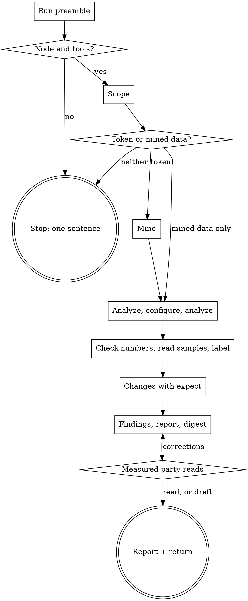

# process-review

Somebody asks whether the review loops are worth it, or whether last week's new rule helped. Opinions are cheap and everybody has one. This skill counts instead: it mines the merged pull requests, reviews and CI runs of a period, computes throughput, efficiency and quality, turns fixed rules into suggestions, compares the days before and after every dated process change, and renders one HTML report plus a short daily digest. It works for human teams, review bots and coding agents alike.

The scripts live in `tools/process-review/` of the plugin (Node 18 or newer, no dependencies, no `gh` needed). Everything is read-only against GitHub, and all output goes to a working directory outside the repository. What each metric can and cannot support: `references/metrics.md`. The rules behind the suggestions: `references/rules.md`. The configuration: `references/config.md`.

<HARD-GATE>
Do NOT report a number, write `findings.json` or render a report until `HAS_NODE` is `yes`, `TOOL_DIR` is not `unavailable`, and `analyze.mjs` has actually run on mined data. Do NOT mine while `HAS_TOKEN` is `no`. Never invent a number: a metric the scripts could not compute is reported as not available, never as 0.
This applies to EVERY repository regardless of how small it is or how obvious the answer looks.
</HARD-GATE>

## Anti-Pattern: "The numbers are in, the report is done"

A share without its denominator, a reviewer rule that silently matched nothing, a half-mined period used as a baseline: each produced a confident wrong finding before somebody recounted five pull requests by hand. And a count cannot say whether a reviewer's block was right; that needs reading the thread and the commit after it. So the numbers are checked before they are believed, a sample is read before quality is judged, and the people or agents who are measured read the report before a finding is called final. They know why a week looked the way it did.

## Checklist

You MUST create a TodoWrite task for each of these items and complete them in order:

1. **Run preamble** -- Node, token, tool directory, repository guess, working directory, earlier run
2. **HARD-GATE** -- stop without Node or the tool directory; no mining without a token
3. **Fix the scope** -- repository, period, the question, the working directory
4. **Mine** -- `mine.mjs` writes pull requests and CI runs per day (skipped when the data is already there and the user said so)
5. **First pass** -- `analyze.mjs` without configuration; read the `REVIEWERS` line
6. **Configure** -- `config.json` for what the defaults cannot know, then `analyze.mjs` again
7. **Read the rules and the previous run** -- `results`, `scores` and `previous` in `metrics.json`
8. **Mine the failures** (only if CI runs were mined and `HAS_TOKEN` is `yes`) -- `mine-failures.mjs`, then `analyze.mjs` again
9. **Check the numbers** -- recount one metric on five pull requests, compare the total, name every denominator
10. **Read samples by hand** -- blocking threads, disagreements, follow-up fixes, failed pushes; record each verdict in `labels.tsv`
11. **Make changes measurable** -- every dated process change into `changes`, with `expect` where somebody stated what it should do
12. **Write `findings.json`** -- three to seven findings, each a number with its denominator, its cost and one change
13. **Render the report and the digest** -- `report.mjs`, `daily.mjs`; open the report once
14. **Let the measured party read it** -- one question; corrections go into the findings before they are final
15. **Report + return** -- paths, the findings in two or three sentences, what was not verified

## Process Flow



## Preamble

```bash
# ytstack resolver (M016): checkout = where this shell runs, via the shared lib.
_LIB="${CLAUDE_SKILL_DIR}/../../hooks/lib/git-ctx.sh"
if [ -f "$_LIB" ]; then
  . "$_LIB"; yt_git_ctx "$PWD"; yt_resolve_yt_dir >/dev/null
  _PROJECT_DIR="$YT_TOPLEVEL"; _YT_DIR="$YT_DIR"; _YT_SCOPE="$YT_SCOPE"; _IS_GIT="$YT_IS_GIT"; _PROJECT_KEY="$YT_REPO_KEY"
else
  # Host did not substitute CLAUDE_SKILL_DIR (e.g. Codex adapter): project scope only.
  _IS_GIT=$([ "$(git rev-parse --is-inside-work-tree 2>/dev/null)" = true ] && echo yes || echo no)
  _PROJECT_DIR=$(git rev-parse --show-toplevel 2>/dev/null || pwd -P)
  _YT_DIR=""; _YT_SCOPE=none; _PROJECT_KEY=""
  [ -d "$_PROJECT_DIR/.ytstack" ] && { _YT_DIR="$_PROJECT_DIR/.ytstack"; _YT_SCOPE=project; }
fi
cd "$_PROJECT_DIR" 2>/dev/null || true
_PROJECT_SLUG=$(basename "$_PROJECT_DIR")   # display only
_HAS_YTSTACK=$([ -n "$_YT_DIR" ] && echo yes || echo no)
echo "BRANCH: $(git branch --show-current 2>/dev/null || echo unknown)"
echo "PROJECT_SLUG: $_PROJECT_SLUG"
echo "HAS_YTSTACK: $_HAS_YTSTACK"
echo "YTSTACK_SCOPE: $_YT_SCOPE"
echo "YT_DIR: $_YT_DIR"
# YTSTACK_NON_INTERACTIVE=ask restores the questions, also in a spawned session (docs/ux/askuserquestion-format.md).
_NI="${YTSTACK_NON_INTERACTIVE:-}"
if [ "$_NI" != ask ] && { [ -n "$_NI" ] || [ -n "${OPENCLAW_SESSION:-}" ] || [ -n "${CLAUDE_AGENT_TEAM_MEMBER:-}" ]; }; then
  echo "YTSTACK_NON_INTERACTIVE: true"
else
  echo "YTSTACK_NON_INTERACTIVE: false"
fi
_EXPLAIN_LEVEL=""
[ -f "$HOME/.ytstack/config" ] && _EXPLAIN_LEVEL=$(grep -E '^explain_level=' "$HOME/.ytstack/config" 2>/dev/null | cut -d= -f2)
echo "EXPLAIN_LEVEL: ${_EXPLAIN_LEVEL:-default}"
_state() { [ -f "$_YT_DIR/STATE.md" ] && sed -n "s/^$1: *//p" "$_YT_DIR/STATE.md" | head -1; }
_M=$(_state current_milestone); _S=$(_state active_slice)
echo "CURRENT_MILESTONE: ${_M:-none}"
echo "ACTIVE_SLICE: ${_S:-none}"
echo "SENTINELS: $([ -n "$_YT_DIR" ] && ls -a "$_YT_DIR" 2>/dev/null | grep -- '-prompted$' | paste -sd, -)"
# Node 18 or newer: the only runtime the scripts need (DECISIONS 2026-11-18).
_NODE_V=$(node -v 2>/dev/null | sed 's/^v//'); _NODE_MAJOR=${_NODE_V%%.*}
case "$_NODE_MAJOR" in ''|*[!0-9]*) _NODE_MAJOR=0 ;; esac
_HAS_NODE=no; [ "$_NODE_MAJOR" -ge 18 ] && _HAS_NODE=yes
echo "HAS_NODE: $_HAS_NODE"
echo "NODE_VERSION: ${_NODE_V:-none}"
# A GitHub token the scripts can resolve: GITHUB_TOKEN, GH_TOKEN, or a signed-in gh. Never printed.
_TOKEN_SOURCE=none
if [ -n "${GITHUB_TOKEN:-}" ]; then _TOKEN_SOURCE=GITHUB_TOKEN
elif [ -n "${GH_TOKEN:-}" ]; then _TOKEN_SOURCE=GH_TOKEN
elif command -v gh >/dev/null 2>&1 && [ -n "$(gh auth token 2>/dev/null)" ]; then _TOKEN_SOURCE=gh
fi
echo "HAS_TOKEN: $([ "$_TOKEN_SOURCE" = none ] && echo no || echo yes)"
echo "TOKEN_SOURCE: $_TOKEN_SOURCE"
_TOOLS="${CLAUDE_SKILL_DIR}/../../tools/process-review"
if [ -f "$_TOOLS/analyze.mjs" ]; then echo "TOOL_DIR: $_TOOLS"; else echo "TOOL_DIR: unavailable"; fi
# The repository to measure, guessed from origin; the user may name another one.
_REPO=$(git remote get-url origin 2>/dev/null | sed -E 's#^(git@|ssh://git@|https://)([^/:@]*@)?[^/:]+[:/]##; s#\.git$##; s#/$##')
case "$_REPO" in */*/*|'') _REPO=unknown ;; */*) : ;; *) _REPO=unknown ;; esac
echo "REPO_GUESS: $_REPO"
# One working directory per measured repository, outside every checkout, so the next run finds the last one.
_WBASE="${XDG_STATE_HOME:-$HOME/.local/state}/ytstack/process-review"
echo "WORKDIR_BASE: $_WBASE"
_WDIR="$_WBASE/$(printf '%s' "$_REPO" | tr '/' '_')"
if [ "$_REPO" != unknown ] && [ -f "$_WDIR/metrics.json" ]; then echo "PREVIOUS_RUN: $_WDIR/metrics.json"; else echo "PREVIOUS_RUN: none"; fi
echo "TODAY: $(date -u +%Y-%m-%d)"
if [ "$_HAS_NODE" = yes ]; then echo "SIX_WEEKS_AGO: $(node -e 'console.log(new Date(Date.now() - 42 * 864e5).toISOString().slice(0, 10))')"; fi
```

## Procedure

In the commands below, `TOOL_DIR` and the working directory stand for the values of this run. Write them out in each command: shell variables do not survive between code blocks.

**Step 2 -- HARD-GATE.** `HAS_NODE: no`: stop with one sentence, "process-review needs Node 18 or newer on this machine (found: `NODE_VERSION`); nothing was measured." `TOOL_DIR: unavailable`: stop, "the plugin's `tools/process-review/` directory was not found from this skill". `HAS_TOKEN: no`: mining is not possible. Continue only when the user points at a working directory that already holds mined `prs/` files and wants that data analysed; otherwise stop with one sentence: "no GitHub token: set `GITHUB_TOKEN` (read access to pull requests and Actions is enough) or sign in with `gh`". Never ask for a token in the conversation and never print one.

**Step 3 -- Fix the scope.** Three things, from the user's request first, defaults second:

- the repository: the one the user named, else `REPO_GUESS`;
- the period: the one the user named, else `SIX_WEEKS_AGO` to `TODAY`. For a before/after question, at least two weeks on each side of the date;
- the question: the one sentence the report has to answer ("are the later review rounds worth it?").

The working directory is `WORKDIR_BASE/<owner>_<repo>` unless the user names another one. Keep one per repository: `PREVIOUS_RUN` is the earlier `metrics.json` there, and the next analysis compares against it by itself. Do not choose a place inside a checkout yourself; when the user names one there, check that the repository ignores it and say so if it does not.

**Step 4 -- Mine.** Resumable; a finished day is never fetched twice, today always is.

```bash
node TOOL_DIR/mine.mjs <owner/repo> <since> <until> <workdir>             # pull requests and CI runs
node TOOL_DIR/mine.mjs <owner/repo> <since> <until> <workdir> --only prs  # pull requests only
```

CI runs are the slow part on a busy repository (100 runs per request). Run the two `--only` halves (`prs`, `ci`) as two commands in parallel, or limit CI to the last weeks. After an update of the plugin, add `--refresh` once: it fetches finished days again so that new fields are present. The script waits by itself when GitHub's rate limit (the cap on requests per hour) is reached. Skip this step when the user asked to analyse data that is already mined.

**Step 5 -- First pass.** `node TOOL_DIR/analyze.mjs <workdir> --since <since> --until <until>` prints the summary and writes `<workdir>/metrics.json`. Pass the period of Step 3 on every `analyze.mjs` call of this run: the working directory keeps the days of earlier runs, and without the bounds the analysis covers all of them. Read the `REVIEWERS` line: it shows which accounts reviewed, and the first line names the reviewer whose reviews were counted as rounds.

**Step 6 -- Configure.** Open three or four pull requests of the period on GitHub first and look at how reviews actually appear there. A wrong reviewer rule silently yields zero rounds. Then write what the defaults cannot know to `<workdir>/config.json` (schema and examples: `references/config.md`) and run Step 5 again. Typical needs:

- a reviewer that posts as a plain comment, or under the author's own account (agent sessions), needs a rule with a `bodyMatch`;
- a bot's "usage limit reached" comments are not reviews: `ignoreBody`;
- reviews that carry a machine-readable count of findings by severity: `findings` makes "blocking" and "clean" rounds exact. Without it the review state decides (changes requested, approved);
- `ciWorkflows` restricts the CI metrics to the workflows that gate a merge;
- `repo` puts the name and the pull request links into the report.

**Step 7 -- Read the rules and the previous run.** The same run evaluates the rules of `TOOL_DIR/rules.mjs` and prints nothing about them. They land in `metrics.json` as `results` and `scores` and become the report's suggestion cards. Each rule has a threshold and a minimum sample (`references/rules.md`); a rule that cannot be judged has the state `not-evaluated` with its reason and is never shown as passed. The rules judge the last 28 days (`ruleWindowDays`), so a suggestion describes the process as it runs now. Change a threshold to what the team agreed on, never to make a card disappear. With an earlier `metrics.json` in the working directory (or `--prev <file>`), `previous` holds the earlier headline values, and the report marks each suggestion as new or repeated and each earlier one that is now settled.

**Step 8 -- Mine the failures.** Only if CI runs were mined and `HAS_TOKEN` is `yes`:

```bash
node TOOL_DIR/mine-failures.mjs <owner/repo> <workdir> --since <since> --until <until> --days 7
node TOOL_DIR/analyze.mjs <workdir> --since <since> --until <until>
```

It adds two tables: the failed pushes to the default branch with job, step and the merged pull request behind each, and the jobs that failed and then passed on a re-run (flaky candidates: tests that pass on a second try without a change). One request per run, at most 150 runs each.

**Step 9 -- Check the numbers.** Each check takes minutes and has caught real errors:

- Recount one metric by hand on five pull requests from `outliers.mostRounds` in `metrics.json`.
- Compare `total.merged` with the number GitHub shows for `is:pr is:merged merged:<since>..<until>`.
- Give every share its denominator: "107 of 309", not "35 %".
- A comparison needs the same definition and complete data on both sides. A half-mined period is no baseline.

**Step 10 -- Read samples by hand.** The scripts give proxies. Decide these by reading, and say how many you read:

- **Were blocking findings right?** `reviewers.<name>.sample` in `metrics.json` is a fixed sample of threads per reviewer. Read each thread and the commit that followed: fixed as asked (`right`), rejected with a reason the reviewer accepted (`false alarm`), or `unclear`.
- **Disagreements.** With two reviewers on the same head (`compare`), read the pull requests where only one blocked: who was right?
- **Follow-up fixes.** Read ten entries of `followUps`: could the review have caught the defect, or was it new information?
- **Red default branch.** For each failed push in `failures.defaultBranch`: `merged defect`, `inherited`, `flaky test` or `infrastructure`.

Record every verdict as one line in `<workdir>/labels.tsv` (tab-separated, format in `references/config.md`, "labels.tsv"), then run `analyze.mjs` again, with the same `--since` and `--until`. The report then shows, per reviewer, how many of the decided blocks were right, and the failures by cause. A label names who gave it; an agent's label and a person's label are not the same evidence.

**Step 11 -- Make changes measurable.** Every process change that should be judged goes into `changes` in `config.json`: a new reviewer, a rule, a CI change, a new version of the agent tooling.

```json
{ "changes": [{ "at": "2026-01-15", "label": "second review only on request", "expect": { "metric": "rounds", "direction": "down" }, "decidedBy": "team", "approval": "pending" }] }
```

For each entry the analysis compares the days before with the days from it on, metric by metric. With `expect` (the metric keys are listed in `references/config.md`) the change gets its own verdict: `confirmed`, `refuted` or `too early`. Write `expect` when somebody stated what the change should do, in their words, not after seeing the result. Where the dates come from:

- the people who made the change, and the repository's decision records or changelog;
- `changeCandidates` in `metrics.json`: merged pull requests that touched workflows, review rules or agent instructions, and the first and last day each reviewer was seen;
- tool versions: `node TOOL_DIR/tool-versions.mjs plugin <name>` lists when each version of a Claude Code plugin arrived on this machine, `node TOOL_DIR/tool-versions.mjs file <repoPath> <file> '<regex>'` when a repository changed a pinned version. Group versions of the same day into one entry.

Read the result with three cautions, which the report prints too. Changes close together cannot be told apart (the card names the others inside its windows). A different mix of work before and after moves the numbers without any process change. The days after a recent change are incomplete. To test a change properly: change one thing, leave it for a full window, and write the date down on the day, not afterwards.

**Step 12 -- Write `findings.json`.** The suggestion cards come from the rules without you. What only you can add is what you read in Step 10. Write three to seven findings to `<workdir>/findings.json`:

```json
[{ "value": "416 of 461", "tone": "bad", "title": "Later review rounds that found nothing blocking", "recommendation": "Let a non-blocking review stand; a later round reads only the fix.", "evidence": "Readable later rounds of the last 28 days. 12 threads read by hand, 9 right. Not verified: rounds on force-pushed branches." }]
```

`value` is the one number that carries the finding, `tone` is `good`, `warn` or `bad`, `title` says in one line what the number is, `recommendation` is one sentence, `evidence` holds the denominators, the trend and what was not verified. Rank by cost. Read efficiency and quality together: fewer rounds with more follow-up fixes is no gain (`references/metrics.md`, "Reading the result"). The numbers describe the process, not people. Never rank individuals with them.

**Step 13 -- Render the report and the digest.**

```bash
node TOOL_DIR/report.mjs <workdir>/metrics.json <workdir>/report.html --findings <workdir>/findings.json
node TOOL_DIR/daily.mjs <workdir>/metrics.json --out <workdir>/digest.md
```

Open the report and look at every chart once: an empty chart means a configuration gap, back to Step 6. The digest compares the last complete day with the seven days before it (`--day YYYY-MM-DD` for another day) and is short enough for a chat message. It observes and recommends nothing; changes are decided on the report. For a recurring run, the same three commands (mine, analyze, daily) on a schedule are enough; the digest needs the day and at least three days before it.

**Step 14 -- Let the measured party read it.** The authors, reviewers or the owners of the agents whose work the report describes read it before a finding is final. `YTSTACK_NON_INTERACTIVE: true`: do not ask; add "Draft: not yet read by the measured party." to the `evidence` of every finding, render again, and say so in the report. Otherwise ONE AskUserQuestion:

> Process review of **{repository}** for {since} to {until} (run from `{PROJECT_SLUG}` on `{BRANCH}`): the report is at `{workdir}/report.html` with {k} findings, the strongest: {value} {title}.
>
> The report describes how people and agents worked. They know things the counts do not: a week of migration work, a reviewer that was switched off on purpose, a rule that changed on a day nobody wrote down. If they read it first, wrong findings are corrected before anybody acts on them.
>
> RECOMMENDATION: Choose A because a finding the measured party has not seen is a claim about them, not a result.
>
> A) They read it first -- you (or the people you forward it to) read the report and tell me what is wrong or missing; I correct the findings and render again
>    Completeness: 10/10, effort: human: ~15 min / CC: ~5 min, tier: task
> B) Deliver as a draft -- every finding is marked "not yet read by the measured party"
>    Completeness: 6/10, effort: human: 0 / CC: ~1 min, tier: task

With A: take each correction into the `evidence` of its finding in the reader's words (or remove the finding), add the missing dates to `changes`, run Steps 11 to 13 again, and note who read it. With B: mark the findings as in the non-interactive case and render again.

**Step 15 -- Report + return.**

> Process review of {repository}, {since} to {until}: {n} merged pull requests. Report: `{workdir}/report.html`. Digest: `{workdir}/digest.md`. Findings: {two or three sentences, each with its number and denominator}. Suggestions from the rules: {t} triggered, {e} not evaluated. Changes measured: {label: verdict, ...}. Read by: {who, or "nobody yet (draft)"}. Not verified: {what}.

## Limits

- Merged pull requests only: abandoned work, direct pushes and the time before a pull request opened are invisible.
- Per pull request the scripts read at most 100 commits, 40 reviews, 60 comments, 60 threads and 60 files; very large pull requests are undercounted.
- "Fixed again" is cut off at the end of the period: pull requests of the last days had less time to attract a fix.
- CI duration is the wall time of a run's last attempt, not billed minutes; runs are matched to pull requests by branch name.
- GitHub is the only host. The scripts have no test against GitHub Enterprise Server (`GITHUB_API_URL` is read, untested).

## Terminal State

The terminal state is one of:

- Returning control to the user with `report.html`, `digest.md`, `metrics.json` and `findings.json` in the working directory, nothing committed and nothing written into the repository
- Exiting without a number at the HARD-GATE (no Node, no tool directory, or no token and no mined data)

Do NOT invoke `ytstack:retro`, `ytstack:lane-retro`, `ytstack:lesson` or `ytstack:review-lessons` from here, do not change a workflow, a review rule or an instruction file, and do not add a `changes` entry for a change nobody made: this skill measures, people decide. There is no skill you may invoke after this one. If a finding should become work, name it and stop. To get the findings to the session that coordinates the work, the user runs `ytstack:coach-process` next.
