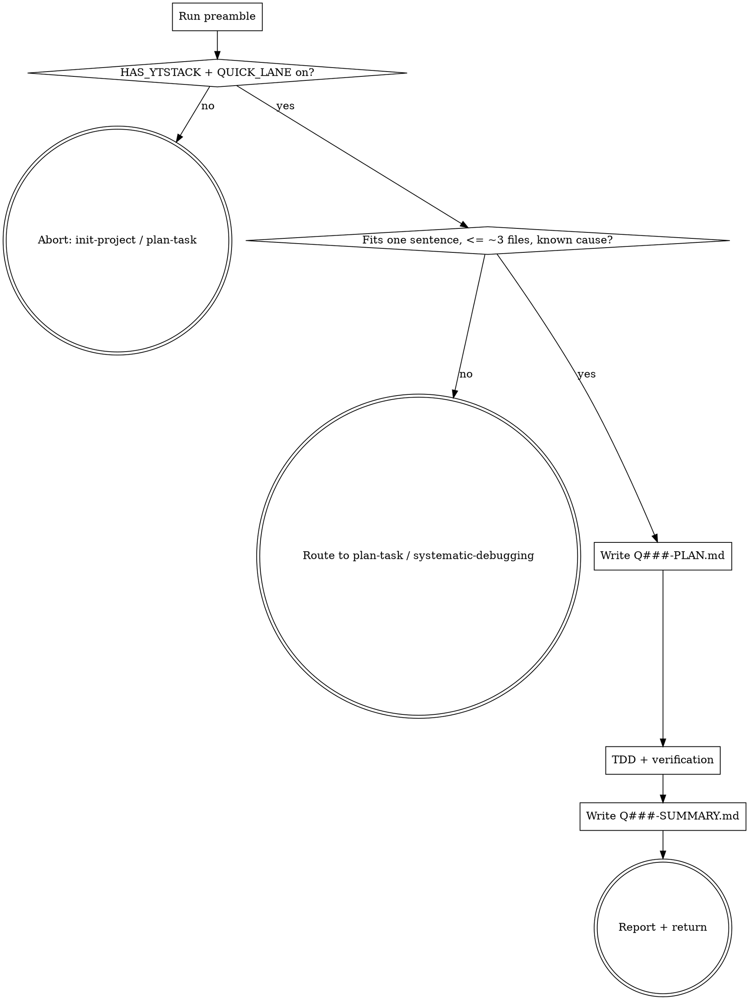

# quick-task

The quick lane. One sentence in, one verified change out, one `Q###` artifact pair as the record. No pitch, no CEO/eng review, no milestone/slice/task bookkeeping.

## Anti-Pattern: "It's small, I'll just do it without any artifact"

Small changes are where "what did we change and why" evaporates first. The quick lane costs two short files and a verification command; it buys a greppable record (`Q###:` commits, `.ytstack/quick/`) and the same evidence rule as every other ytstack change. If writing the one-sentence plan feels hard, the change is not small -- route to `plan-task`.

## Checklist

You MUST create a TodoWrite task for each of these items and complete them in order:

1. **Run preamble** -- resolver, ceremony dials, next free `Q###`
2. **HARD-GATE** -- `.ytstack` present, `quick_lane` on
3. **Fit check** -- one sentence, known cause, ~3 files max; otherwise route to `plan-task` / `systematic-debugging` and stop
4. **Write `Q###-PLAN.md`** -- sentence, files, verification command
5. **Execute** -- `ytstack:test-driven-development`, then `ytstack:verification-before-completion`; commits prefixed `Q###:`
6. **Write `Q###-SUMMARY.md`** -- outcome, verification output, commits
7. **Report + return** -- path + one line; no auto-chaining

## Process Flow



## Preamble

```bash
# ytstack resolver (M016): checkout = where this shell runs, via the shared lib.
_LIB="${CLAUDE_SKILL_DIR}/../../hooks/lib/git-ctx.sh"
if [ -f "$_LIB" ]; then
  . "$_LIB"; yt_git_ctx "$PWD"; yt_resolve_yt_dir >/dev/null
  _PROJECT_DIR="$YT_TOPLEVEL"; _YT_DIR="$YT_DIR"; _YT_SCOPE="$YT_SCOPE"; _IS_GIT="$YT_IS_GIT"; _PROJECT_KEY="$YT_REPO_KEY"
else
  # Host did not substitute CLAUDE_SKILL_DIR (e.g. Codex adapter): project scope only.
  _IS_GIT=$([ "$(git rev-parse --is-inside-work-tree 2>/dev/null)" = true ] && echo yes || echo no)
  _PROJECT_DIR=$(git rev-parse --show-toplevel 2>/dev/null || pwd -P)
  _YT_DIR=""; _YT_SCOPE=none; _PROJECT_KEY=""
  [ -d "$_PROJECT_DIR/.ytstack" ] && { _YT_DIR="$_PROJECT_DIR/.ytstack"; _YT_SCOPE=project; }
fi
cd "$_PROJECT_DIR" 2>/dev/null || true
_PROJECT_SLUG=$(basename "$_PROJECT_DIR")
_HAS_YTSTACK=$([ -n "$_YT_DIR" ] && echo yes || echo no)

# Ceremony dials (M018)
if command -v yt_prefs >/dev/null 2>&1; then yt_prefs "$_YT_DIR" >/dev/null; else YT_PREF_QUICK_LANE=on; YT_PREF_WARNINGS=""; fi

# Next free Q### under .ytstack/quick/
_NEXT_Q="Q001"
if [ -n "$_YT_DIR" ] && [ -d "$_YT_DIR/quick" ]; then
  _MAXQ=$(ls "$_YT_DIR"/quick/Q[0-9][0-9][0-9]-*.md 2>/dev/null | sed -E 's/.*Q([0-9]{3})-.*/\1/' | sort -u | tail -1)
  [ -n "$_MAXQ" ] && _NEXT_Q=$(printf "Q%03d" $((10#$_MAXQ + 1)))
fi
_BRANCH=$(git branch --show-current 2>/dev/null || echo unknown)

echo "HAS_YTSTACK: $_HAS_YTSTACK"
echo "QUICK_LANE: $YT_PREF_QUICK_LANE"
echo "PREF_WARNINGS: ${YT_PREF_WARNINGS:-none}"
echo "NEXT_Q: $_NEXT_Q"
echo "BRANCH: $_BRANCH"
echo "IS_GIT: $_IS_GIT"
```

## Procedure

### Step 2: HARD-GATE

- `HAS_YTSTACK=no`: "quick-task needs `.ytstack/`. Run `/ytstack:init-project` (greenfield) or `/ytstack:adopt-brownfield` (existing codebase) first." STOP.
- `QUICK_LANE=off`: "The quick lane is off in `PREFERENCES.md` (`quick_lane: off`). Use `/ytstack:plan-task` inside the current slice." STOP.

### Step 3: Fit check (no question)

Take the user's sentence as the plan. It fits when it names one change with a known cause and touches about three files or fewer. It does not fit when it introduces a new feature or user-facing capability, changes a schema or data migration, needs investigation of an unknown root cause, or spans more files. If it does not fit, say which criterion failed and route: feature/scope -> `ytstack:plan-task` (or `plan-milestone` when no milestone is active); unknown cause -> `ytstack:systematic-debugging`. STOP.

### Step 4: Write `Q###-PLAN.md`

Use Write. Path: `{YT_DIR}/quick/{NEXT_Q}-PLAN.md` (create `quick/` on first use).

```markdown
---
kind: quick
id: {NEXT_Q}
created: {ISO_TIMESTAMP}
status: in-progress
branch: {BRANCH}
---

# {NEXT_Q} -- {the user's sentence}

## Files

- {path} -- {what changes}

## Verification

```bash
{one or two real commands}
```
```

### Step 5: Execute

Invoke `ytstack:test-driven-development` with this plan as the task (RED on the verification command or a focused test, GREEN with the minimal change), then `ytstack:verification-before-completion`. Commit subjects start with `{NEXT_Q}: `.

**Spec (M022):** a quick change usually leaves the technical spec alone (a fix that restores the described behaviour, a rename, a bump). If it makes a statement in `.ytstack/spec/<area>.md` false, or in the source that file names, correct that statement in the same commits and name the file in the summary's Outcome. Nothing else of the spec is read or edited here.

### Step 6: Write `Q###-SUMMARY.md`

Use Write. Path: `{YT_DIR}/quick/{NEXT_Q}-SUMMARY.md`. Commits via the lib: `yt_task_commits "$_PROJECT_DIR" "^{NEXT_Q}:"` -> `YT_COMMITS`.

```markdown
---
kind: quick
id: {NEXT_Q}
closed: {ISO_TIMESTAMP}
verification: passed
---

# {NEXT_Q} -- Summary

## Commits

{YT_COMMITS}

## Outcome

{two sentences, past tense}

## Verification

Command: `{command}` -- passed. {one line of real output}
```

Then flip the PLAN's `status: in-progress` to `status: done` (Edit) and bump `last_updated` in `STATE.md` (no pointer change: the quick lane does not touch `current_milestone` / `active_slice` / `active_task`). If the frontmatter has a `progress:` block and this change completes an item the block counts, add 1 to `done` in the same edit (never above `total`) and run `yt_state_lint "$_YT_DIR"`; a quick task outside the counted plan leaves the block alone.

### Step 7: Report + return

> Quick task **{NEXT_Q}** done: {sentence}. Plan + summary under `{YT_DIR}/quick/`, commits `{NEXT_Q}:` on `{BRANCH}`.

## Terminal State

Return control after the report. Do NOT invoke `plan-task`, `summarize-task` or `reassess-roadmap`: the quick lane is complete in itself and leaves the milestone pointer untouched. Aborts (HARD-GATE, fit check) return with the routing message only.
