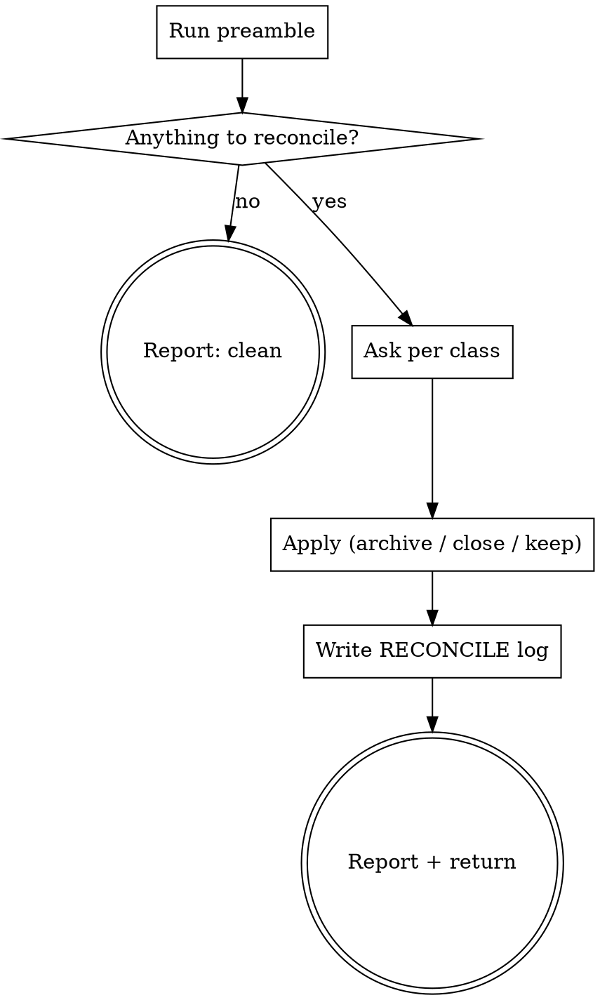

# reconcile

Leftovers accumulate in `.ytstack/` the moment a project runs for a while: an interrupted task leaves a draft stub, a hook drafts a summary nobody fills, a milestone gets planned and then overtaken, a worktree leaves untracked files. This skill finds them, shows them, and asks. It archives; it never deletes.

## Anti-Pattern: "These stubs are obviously ceremony, I'll just delete them"

An agent once deleted 13 draft summaries in a consumer repo because they looked like noise; the user had been using them as the only record of which tasks had started. `.ytstack/` artifacts are user-owned. The cost of asking is one question per class; the cost of guessing is lost history and a furious user. Archive, never delete; ask, never assume.

## Checklist

You MUST create a TodoWrite task for each of these items and complete them in order:

1. **Run preamble** -- counts and file lists per leftover class
2. **HARD-GATE** -- `.ytstack` present; nothing to do -> report and stop
3. **Per class: ask** -- close / archive / keep (one AskUserQuestion per non-empty class)
4. **Apply** -- moves inside `.ytstack/` only, status edits, gitignore block
5. **Write `RECONCILE-<date>.md`** -- what was found, what was chosen
6. **Report + return**

## Process Flow



## Preamble

```bash
# ytstack resolver (M016): checkout = where this shell runs, via the shared lib.
_LIB="${CLAUDE_SKILL_DIR}/../../hooks/lib/git-ctx.sh"
if [ -f "$_LIB" ]; then
  . "$_LIB"; yt_git_ctx "$PWD"; yt_resolve_yt_dir >/dev/null
  _PROJECT_DIR="$YT_TOPLEVEL"; _YT_DIR="$YT_DIR"; _YT_SCOPE="$YT_SCOPE"; _IS_GIT="$YT_IS_GIT"; _PROJECT_KEY="$YT_REPO_KEY"
else
  # Host did not substitute CLAUDE_SKILL_DIR (e.g. Codex adapter): project scope only.
  _IS_GIT=$([ "$(git rev-parse --is-inside-work-tree 2>/dev/null)" = true ] && echo yes || echo no)
  _PROJECT_DIR=$(git rev-parse --show-toplevel 2>/dev/null || pwd -P)
  _YT_DIR=""; _YT_SCOPE=none; _PROJECT_KEY=""
  [ -d "$_PROJECT_DIR/.ytstack" ] && { _YT_DIR="$_PROJECT_DIR/.ytstack"; _YT_SCOPE=project; }
fi
cd "$_PROJECT_DIR" 2>/dev/null || true
_PROJECT_SLUG=$(basename "$_PROJECT_DIR")
_HAS_YTSTACK=$([ -n "$_YT_DIR" ] && echo yes || echo no)

_DRAFT_STUBS=""; _UNFILLED=""; _NEVER_SLICED=""; _UNTRACKED=""; _LOCAL_DIR=no; _LOCAL_IGNORED=no
if [ -n "$_YT_DIR" ]; then
  _DRAFT_STUBS=$(grep -l '^closed: draft' "$_YT_DIR"/*-SUMMARY.md 2>/dev/null)
  for _f in $(grep -l '^source: post-tool-use-bash-draft' "$_YT_DIR"/*-SUMMARY.md 2>/dev/null); do
    grep -q 'Fill in when task is done' "$_f" 2>/dev/null && _UNFILLED="${_UNFILLED:+$_UNFILLED
}$_f"
  done
  for _rm in "$_YT_DIR"/M[0-9][0-9][0-9]-ROADMAP.md; do
    [ -f "$_rm" ] || continue
    _m=$(basename "$_rm" -ROADMAP.md)
    [ "$(sed -n 's/^status: *//p' "$_rm" | head -1)" = planned ] || continue
    [ -n "$(ls "$_YT_DIR"/$_m-S[0-9][0-9]-PLAN.md 2>/dev/null)" ] && continue
    _NEVER_SLICED="${_NEVER_SLICED:+$_NEVER_SLICED
}$_m"
  done
  if [ "$_IS_GIT" = yes ]; then
    _UNTRACKED=$(git -C "$_PROJECT_DIR" status --porcelain -- "${_YT_DIR#$_PROJECT_DIR/}" 2>/dev/null | grep '^??' | sed 's/^?? //')
  fi
  [ -d "$_YT_DIR/.local" ] && _LOCAL_DIR=yes
  git -C "$_PROJECT_DIR" check-ignore -q "${_YT_DIR#$_PROJECT_DIR/}/.local/x" 2>/dev/null && _LOCAL_IGNORED=yes
fi
_count() { local n; n=$(printf '%s' "${1}" | grep -c . 2>/dev/null); printf '%s' "${n:-0}"; }

# STATE.md as a pointer (M022-S03): what the STATE lint reports as W8 / W9.
_STATE_BYTES=0; _STATE_HIST=0; _STATE_MAX=${YT_STATE_MAX_BYTES:-12000}
if [ -n "$_YT_DIR" ] && [ -f "$_YT_DIR/STATE.md" ]; then
  _STATE_BYTES=$(wc -c < "$_YT_DIR/STATE.md" | tr -d ' ')
  _h=$(grep -c -E '^\*\*(Previous|Prior)[^*]*\*\*' "$_YT_DIR/STATE.md" 2>/dev/null); _h=${_h:-0}
  _s=$(grep -c -E '^\*\*Status[^*]*\*\*' "$_YT_DIR/STATE.md" 2>/dev/null); _s=${_s:-0}
  [ "$_s" -le 1 ] || _h=$((_h + _s - 1))
  _STATE_HIST=$_h
fi
_STATE_CLASS=no
{ [ "$_STATE_HIST" -gt 0 ] || [ "$_STATE_BYTES" -gt "$_STATE_MAX" ]; } && _STATE_CLASS=yes
# Closed milestones whose slice and task files still sit beside the open work.
# Offered only when a technical spec exists: it holds what still applies.
_CLOSED_MS=""
if [ -n "$_YT_DIR" ] && [ -f "$_YT_DIR/spec/SPEC.md" ]; then
  for _rm in "$_YT_DIR"/M[0-9][0-9][0-9]-ROADMAP.md; do
    [ -f "$_rm" ] || continue
    _m=$(basename "$_rm" -ROADMAP.md)
    [ "$(sed -n 's/^status: *//p' "$_rm" | head -1)" = done ] || continue
    _n=$(ls "$_YT_DIR"/"$_m"-S[0-9][0-9]-*.md 2>/dev/null | grep -c .); _n=${_n:-0}
    [ "$_n" -gt 0 ] && _CLOSED_MS="${_CLOSED_MS:+$_CLOSED_MS
}$_m ($_n slice and task files)"
  done
fi

echo "HAS_YTSTACK: $_HAS_YTSTACK"
echo "DRAFT_STUBS: $(_count "$_DRAFT_STUBS")"
echo "UNFILLED_DRAFTS: $(_count "$_UNFILLED")"
echo "PLANNED_NEVER_SLICED: $(_count "$_NEVER_SLICED")"
echo "UNTRACKED: $(_count "$_UNTRACKED")"
echo "LOCAL_DIR: $_LOCAL_DIR (gitignored: $_LOCAL_IGNORED)"
echo "STATE_HISTORY: $_STATE_CLASS ($_STATE_HIST earlier status paragraph(s), $_STATE_BYTES bytes, bound $_STATE_MAX)"
echo "CLOSED_MILESTONES: $(_count "$_CLOSED_MS")"
echo "LISTS_BEGIN"
[ -n "$_CLOSED_MS" ] && { echo "[closed milestones]"; printf '%s\n' "$_CLOSED_MS"; }
[ -n "$_DRAFT_STUBS" ] && { echo "[draft stubs]"; printf '%s\n' "$_DRAFT_STUBS" | head -20; }
[ -n "$_UNFILLED" ] && { echo "[unfilled auto-drafts]"; printf '%s\n' "$_UNFILLED" | head -20; }
[ -n "$_NEVER_SLICED" ] && { echo "[planned, never sliced]"; printf '%s\n' "$_NEVER_SLICED"; }
[ -n "$_UNTRACKED" ] && { echo "[untracked]"; printf '%s\n' "$_UNTRACKED" | head -20; }
echo "LISTS_END"
```

## Procedure

### Step 2: HARD-GATE

`HAS_YTSTACK=no`: "Nothing to reconcile: no `.ytstack/` here." STOP. All counts zero, `STATE_HISTORY: no` and `LOCAL_DIR: no` (or gitignored): "`.ytstack/` is clean." STOP.

### Step 3: Ask per non-empty class

Use AskUserQuestion once per class, in this order: draft stubs, unfilled auto-drafts, planned-never-sliced milestones, untracked files, `.local` dir. Template (fill the class name and the list from `LISTS_BEGIN..END`):

> **{class}** -- {N} item(s) in `.ytstack/`: {list}
>
> These are records of work that started, stalled or was overtaken. Closing writes the real end state; archiving keeps them out of the way without losing them; keeping leaves everything as is.
>
> RECOMMENDATION: B for anything older than the current milestone; A when the item belongs to the active task; C when you are unsure.
>
> A) close -- draft stubs of the active task: run `ytstack:summarize-task`; other stubs/drafts: set `closed: abandoned` + one-line note; planned-never-sliced milestones: `status: dropped` (via the same write `reassess-roadmap` uses). (Completeness: 10/10, tier: core)
> B) archive -- move to `.ytstack/archive/{YYYY-MM-DD}/` (tracked), append a line to `.ytstack/archive/INDEX.md`. (Completeness: 9/10, tier: core)
> C) keep -- no change. (Completeness: 5/10, tier: core)

Untracked files use `stage` (git add) / `archive` / `keep`. For the `.local` dir without gitignore the only action is `yt_ensure_gitignore "$_PROJECT_DIR"` (ask yes/no).

Two more classes, each with its own question, after the ones above:

**STATE.md history** (`STATE_HISTORY: yes`). `STATE.md` is the pointer: where the work stands and what is next. Earlier status paragraphs, and a ledger that grew inside it, make every session read history first and push the next action out of the SessionStart injection.

> **STATE.md** holds {N} earlier status paragraph(s) and is {BYTES} bytes (a pointer stays under {MAX}).
>
> A session should learn from this file where the work stands and what comes next. Everything older is history: it stays available, it just does not have to be read every time.
>
> RECOMMENDATION: A. Nothing is deleted or reworded; the text moves as it is.
>
> A) move the history out -- every paragraph that starts with `**Previous`, `**Prior` or a second `**Status`, and every section that is a log of finished work, goes verbatim to `.ytstack/archive/{YYYY-MM-DD}/STATE-history.md`. The frontmatter, the current status, "Next action" and "Open decisions" stay. `STATE.md` gets one line that links the archive file. (Completeness: 10/10, tier: core)
> B) keep -- no change; the lint keeps reporting it. (Completeness: 5/10, tier: core)

On A: write the archive file first, then remove from `STATE.md` exactly the text you wrote there, and check that the two files together contain every line the old `STATE.md` had. A table or ledger that makes the file large is not history: ask where it should live (its own file, linked from `STATE.md`) before moving it. Never touch the frontmatter.

**Closed milestones** (`CLOSED_MILESTONES` above zero; listed only when the project has a technical spec). What still applies from a finished milestone is in the area files; its slice and task files are history.

> **Closed milestones** -- {list from `[closed milestones]`}
>
> Their plans and summaries stay readable in the archive. The milestone's `CONTEXT` and `ROADMAP` files stay where they are: they hold the decisions and the outline.
>
> RECOMMENDATION: A for milestones older than the current one, after `ytstack:reassess-roadmap` folded them into the spec; B when you still look things up in them.
>
> A) archive -- move each milestone's `M###-S##-*.md` files to `.ytstack/archive/{YYYY-MM-DD}/M###/`, one `INDEX.md` line per milestone. (Completeness: 9/10, tier: core)
> B) keep -- no change. (Completeness: 6/10, tier: core)

### Step 4: Apply

Moves only inside `.ytstack/` (`git mv` when tracked, `mv` otherwise), edits only to frontmatter `status:`/`closed:` fields and the global `ROADMAP.md` rows. No `rm`. No edits to STATE.md pointer fields. The one edit to the body of `STATE.md` is the history move of the class above, and only after its answer A.

### Step 5: Write the log

`.ytstack/RECONCILE-{YYYY-MM-DD}.md`: per class the items found and the choice made, plus the archive path.

### Step 6: Report + return

> Reconciled `.ytstack/`: {N closed}, {N archived} (-> `archive/{date}/`), {N kept}. Log: `RECONCILE-{date}.md`.

## Terminal State

Return control after the report. Suggest `ytstack:reassess-roadmap` only when a milestone's status changed. Do NOT auto-invoke anything.
