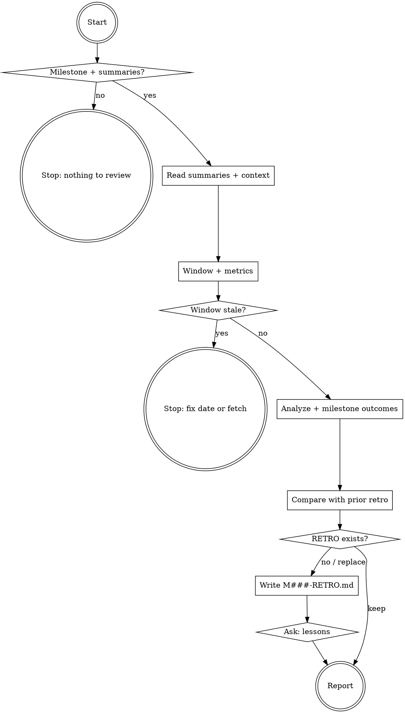

# ytstack:retro

Adapted from gstack's `retro` skill (MIT, Garry Tan), baseline in `metadata.upstream`; see NOTICE.

A milestone retrospective with two kinds of evidence: what the task summaries say happened (outcome, deviations, follow-ups, verification) and what git says happened (commits, sessions, hotspots, test share, shipping pace). The result is `M###-RETRO.md` next to the milestone, plus lessons copied into `KNOWLEDGE.md` and `DECISIONS.md` with the user's consent. Differs from upstream: scoped to a milestone instead of a calendar week, history lives in prior `M###-RETRO.md` files, no global cross-project mode.

<HARD-GATE>
Do NOT write `M###-RETRO.md`, append to `KNOWLEDGE.md` or `DECISIONS.md`, or report a single metric until `HAS_YTSTACK` is `yes`, `MILESTONE` is not `none`, `SUMMARIES` is above 0, and the metrics command below has actually run. Never invent a number: a metric you could not compute is written as `unavailable`, never as 0.
This applies to EVERY milestone regardless of how small or obvious it looks.
</HARD-GATE>

## Anti-Pattern: "The summaries already say what happened, skip the git data"

Summaries are written by the agent that did the work, right after it did it. They describe intent and outcome; they do not show that one file churned 14 times, that 60% of the commits were fixes, or that every session ran past midnight. Git is the second witness. A retro built from summaries alone repeats what everyone already believes. Run the metrics, then let the two sources argue with each other: a summary that says "clean" next to a fix chain on the same file is the finding.

## Checklist

You MUST create a task for each of these items and complete them in order:

1. **Run preamble** -- resolver, milestone, summary count, window anchors, base branch, prior retro
2. **HARD-GATE** -- stop without a milestone or without summaries
3. **Read the material** -- every `M###-S##-T##-SUMMARY.md`, `M###-CONTEXT.md`, `M###-ROADMAP.md`, the slice plans, `PRIOR_RETRO`
4. **Fix the window** -- milestone window by default, or the user's `<N>d|h|w` / `compare` argument
5. **Gather metrics** -- one bash command, then the freshness guard
6. **Shipping outcomes** -- merged PRs (only if `HAS_GH=yes`), CHANGELOG features, backlog (only if `TODOS=yes`)
7. **Analyze** -- time, sessions, commit types, hotspots, sizes, focus, ship of the milestone, people, streaks
8. **Milestone outcomes** -- exit criteria vs summaries, deviations, open follow-ups, plan completion; own reviewers vs bots (only if `OWN_REVIEWERS` is not `none`)
9. **Compare with the prior retro** (only if `PRIOR_RETRO` is not `none`, or in `compare` mode) -- trends + recommendation follow-through
10. **Ask before replacing** (only if `RETRO_EXISTS=yes`) -- replace or stop
11. **Write `M###-RETRO.md`** -- frontmatter + report + snapshot, and show the report in the conversation
12. **Propose lessons** -- KNOWLEDGE / DECISIONS entries, ask once, write what the user accepts
13. **Report + return** -- paths, entry counts, next-step suggestion, no auto-chaining

## Process Flow



## Preamble

Resolved when the skill loads:

```!
# ytstack resolver (M016): checkout = where this shell runs, via the shared lib.
_LIB="${CLAUDE_SKILL_DIR}/../../hooks/lib/git-ctx.sh"
if [ -f "$_LIB" ]; then
  . "$_LIB"; yt_git_ctx "$PWD"; yt_resolve_yt_dir >/dev/null
  _PROJECT_DIR="$YT_TOPLEVEL"; _YT_DIR="$YT_DIR"; _YT_SCOPE="$YT_SCOPE"; _IS_GIT="$YT_IS_GIT"; _PROJECT_KEY="$YT_REPO_KEY"
else
  # Host did not substitute CLAUDE_SKILL_DIR (e.g. Codex adapter): project scope only.
  _IS_GIT=$([ "$(git rev-parse --is-inside-work-tree 2>/dev/null)" = true ] && echo yes || echo no)
  _PROJECT_DIR=$(git rev-parse --show-toplevel 2>/dev/null || pwd -P)
  _YT_DIR=""; _YT_SCOPE=none; _PROJECT_KEY=""
  [ -d "$_PROJECT_DIR/.ytstack" ] && { _YT_DIR="$_PROJECT_DIR/.ytstack"; _YT_SCOPE=project; }
fi
cd "$_PROJECT_DIR" 2>/dev/null || true
_PROJECT_SLUG=$(basename "$_PROJECT_DIR")   # display only
_HAS_YTSTACK=$([ -n "$_YT_DIR" ] && echo yes || echo no)
echo "BRANCH: $(git branch --show-current 2>/dev/null || echo unknown)"
echo "PROJECT_SLUG: $_PROJECT_SLUG"
echo "HAS_YTSTACK: $_HAS_YTSTACK"
echo "YTSTACK_SCOPE: $_YT_SCOPE"
echo "YT_DIR: $_YT_DIR"
if [ -n "$YTSTACK_NON_INTERACTIVE" ] || [ -n "$OPENCLAW_SESSION" ] || [ -n "$CLAUDE_AGENT_TEAM_MEMBER" ]; then
  echo "YTSTACK_NON_INTERACTIVE: true"
else
  echo "YTSTACK_NON_INTERACTIVE: false"
fi
if [ -f "$_YT_DIR/STATE.md" ]; then
  echo "CURRENT_MILESTONE: $(sed -n 's/^current_milestone: *//p' "$_YT_DIR/STATE.md" | head -1)"
  echo "ACTIVE_SLICE: $(sed -n 's/^active_slice: *//p' "$_YT_DIR/STATE.md" | head -1)"
fi
# Milestone to review: the current one.
_M=none; _SUMMARIES=0; _RETRO_FILE=none; _PRIOR=none; _FIRST=none; _CREATED=none; _TASKS_DONE=0; _TASKS_ALL=0
if [ -n "$_YT_DIR" ] && [ -f "$_YT_DIR/STATE.md" ]; then
  _M=$(sed -n 's/^current_milestone: *//p' "$_YT_DIR/STATE.md" | head -1); _M=${_M:-none}
  if [ "$_M" != none ]; then
    _SUMMARIES=$(ls "$_YT_DIR"/$_M-S[0-9][0-9]-T[0-9][0-9]-SUMMARY.md 2>/dev/null | grep -c .)
    _RETRO_FILE="$_YT_DIR/$_M-RETRO.md"
    _PRIOR=$(ls "$_YT_DIR"/M[0-9][0-9][0-9]-RETRO.md 2>/dev/null | grep -v "/$_M-RETRO.md" | sort | tail -1); _PRIOR=${_PRIOR:-none}
    [ -f "$_YT_DIR/$_M-CONTEXT.md" ] && _CREATED=$(sed -n 's/^created: *//p' "$_YT_DIR/$_M-CONTEXT.md" | head -1 | cut -c1-10)
    _CREATED=${_CREATED:-none}
    if command -v yt_commit_ref_pattern >/dev/null 2>&1; then
      _PAT=$(yt_commit_ref_pattern "$_YT_DIR" "$_M" 'S[0-9][0-9]' 'T[0-9][0-9]')
    else
      _PAT="^$_M-S[0-9][0-9]-T[0-9][0-9]:"
    fi
    _FIRST=$(git log --no-merges -E --grep "$_PAT" --date=format-local:%Y-%m-%d --format=%ad 2>/dev/null | tail -1); _FIRST=${_FIRST:-none}
    _TASKS_DONE=$(cat "$_YT_DIR"/$_M-S[0-9][0-9]-PLAN.md 2>/dev/null | grep -cE '^- \[[xX]\] T[0-9][0-9]')
    _TASKS_ALL=$(cat "$_YT_DIR"/$_M-S[0-9][0-9]-PLAN.md 2>/dev/null | grep -cE '^- \[[ xX]\] T[0-9][0-9]')
  fi
fi
_BASE=$(git symbolic-ref --quiet refs/remotes/origin/HEAD 2>/dev/null | sed 's|^refs/remotes/origin/||')
for _C in main master; do [ -n "$_BASE" ] && break; git rev-parse --verify --quiet "$_C" >/dev/null 2>&1 && _BASE=$_C; done
echo "MILESTONE: $_M"
echo "SUMMARIES: $_SUMMARIES"
echo "RETRO_FILE: $_RETRO_FILE"
echo "RETRO_EXISTS: $([ -f "$_RETRO_FILE" ] && echo yes || echo no)"
echo "PRIOR_RETRO: $_PRIOR"
echo "FIRST_TASK_COMMIT: $_FIRST"
echo "CONTEXT_CREATED: $_CREATED"
echo "PLAN_TASKS: $_TASKS_DONE/$_TASKS_ALL done"
echo "BASE_BRANCH: ${_BASE:-$(git branch --show-current 2>/dev/null)}"
echo "USER_NAME: $(git config user.name 2>/dev/null || echo unknown)"
echo "HAS_GH: $(command -v gh >/dev/null 2>&1 && gh auth status >/dev/null 2>&1 && echo yes || echo no)"
echo "CHANGELOG: $([ -f "$_PROJECT_DIR/CHANGELOG.md" ] && echo yes || echo no)"
echo "TODOS: $([ -f "$_PROJECT_DIR/TODOS.md" ] && echo yes || echo no)"
# Own reviewers (M030): the roles of REVIEW.md and the escape records of the signals ledger.
_RISK="${CLAUDE_SKILL_DIR}/../../bin/ytstack-risk"; [ -f "$_RISK" ] || _RISK=$(command -v ytstack-risk 2>/dev/null)
_SIG="${CLAUDE_SKILL_DIR}/../../bin/ytstack-signals"; [ -f "$_SIG" ] || _SIG=$(command -v ytstack-signals 2>/dev/null)
_ROLES=""; [ -n "$_RISK" ] && _ROLES=$(bash "$_RISK" -C "$_PROJECT_DIR" reviewers 2>/dev/null | cut -f1 | tr '\n' ' ')
echo "OWN_REVIEWERS: ${_ROLES:-none}"
if [ -n "$_ROLES" ] && [ -n "$_SIG" ]; then
  echo "REVIEW_FINDINGS_BEGIN"
  bash "$_SIG" -C "$_PROJECT_DIR" list --state all 2>/dev/null | awk -F'\t' '$4 == "review"'
  echo "REVIEW_FINDINGS_END"
fi
```

## Procedure

**Today** is the date in the session context (`currentDate`), never the output of `date`: the system clock in a container can be hours off. If the session carries no date, ask the user for today's date in one short open question (re-ground: project, branch, "I need today's date to set the retro window") and wait. In `YTSTACK_NON_INTERACTIVE: true` mode, stop with "no reliable date; pass today's date in the brief" instead.

All times are the user's local timezone. Never set `TZ`.

### 1. Run preamble

The preamble above ran when the skill loaded. Read its flags; refer to them by name below.

### 2. HARD-GATE

1. If `HAS_YTSTACK` is `no` or `MILESTONE` is `none`: stop with "no milestone to review; run `ytstack:resume-session`".
2. If `SUMMARIES` is `0`: stop with "the milestone has no task summaries yet; retro runs after the last `ytstack:summarize-task`".
3. Otherwise continue. If `PLAN_TASKS` shows open tasks (done below total), say once that the retro covers a milestone with unfinished tasks and name them in the Milestone Outcomes section; do not stop.

### 3. Read the material

Read, with the Read tool, in this order: `<YT_DIR>/<MILESTONE>-CONTEXT.md` (goal, exit criteria, decisions locked during discuss), `<YT_DIR>/<MILESTONE>-ROADMAP.md`, every `<YT_DIR>/<MILESTONE>-S##-PLAN.md`, every `<YT_DIR>/<MILESTONE>-S##-T##-SUMMARY.md` (Commits, Outcome, Deviations, Follow-ups, Verification and the `verification:` frontmatter key), and `PRIOR_RETRO` when it is not `none` (its `## Snapshot` block holds the metrics and recommendations to compare against).

Do not read unrelated docs. `CHANGELOG.md` and `TODOS.md` are read in step 6, nothing else outside `.ytstack/`.

### 4. Fix the window

Default: the **milestone window**. Start = `FIRST_TASK_COMMIT`, else `CONTEXT_CREATED`, else 14 days before today. End = now. Align the start to local midnight: `--since "<start>T00:00:00"` (without the `T00:00:00` suffix git uses the current wall-clock time of that day).

The user may override with an argument:

- `<N>d` / `<N>w` -- the last N days (weeks x 7), midnight-aligned.
- `<N>h` -- `--since "<N> hours ago"`, no midnight alignment.
- `compare` or `compare <N>d` -- the window (milestone window by default) plus the immediately prior window of the same length. The prior window ends one second before the current start (`--until "<day before start>T23:59:59"`), because git includes the `--until` boundary and a commit must not count twice.

Any other argument: show this usage and stop.

```text
Usage: ytstack:retro [window | compare [window]]
  ytstack:retro            -- the milestone window (first task commit .. now)
  ytstack:retro 14d        -- last 14 days instead
  ytstack:retro 24h        -- last 24 hours
  ytstack:retro compare    -- milestone window vs the prior window of the same length
```

Say the window in one line before running the metrics: "Window: 2026-11-01 .. today (milestone M016, from the first task commit)".

### 5. Gather metrics

Run this once. Substitute `<since>` (for example `2026-11-01T00:00:00`), `<until>` (empty for the current window) and `<base>` (`BASE_BRANCH`). In `compare` mode run it a second time for the prior window with both `<since>` and `<until>` set, and keep the two outputs apart.

```bash
_SINCE="<since>"; _UNTIL="<until>"; _BASE="<base>"
# Freshness: refresh the base ref; offline or no remote is fine, the guard discloses it.
git fetch origin "$_BASE" --quiet 2>/dev/null && echo "RETRO_FETCH: ok" || echo "RETRO_FETCH: failed (offline or no remote)"
# Analyzed ref: always HEAD, so the milestone's own commits are counted even
# before the branch has merged the latest base. Divergence is only reported.
_REF=HEAD; _BEHIND=0
for _C in "origin/$_BASE" "$_BASE"; do
  git rev-parse --verify --quiet "$_C" >/dev/null 2>&1 || continue
  _BEHIND=$(git rev-list --count "HEAD..$_C" 2>/dev/null || echo 0)
  break
done
echo "RETRO_REF: $_REF"
echo "BASE_COMMITS_NOT_IN_HEAD: $_BEHIND"
echo "GUARD_REMOTE: $(git remote 2>/dev/null | grep -qx origin && echo origin || echo none)"
echo "GUARD_LATEST_COMMIT: $(git log -1 --date=format-local:%Y-%m-%d --format=%ad "$_REF" 2>/dev/null || echo unknown)"
echo "WINDOW: $_SINCE .. ${_UNTIL:-now}"
# One numstat walk over the window -> every per-commit metric.
git log "$_REF" --no-merges --since="$_SINCE" ${_UNTIL:+--until="$_UNTIL"} \
  --date=format-local:'%Y-%m-%d %H' --numstat \
  --format='C|%h|%aN|%at|%ad|%(trailers:key=Co-authored-by,valueonly,separator=;)|%s' 2>/dev/null | awk -F'\t' '
function gen(p) { return p ~ /(^|\/)(build|dist|out|target|vendor|node_modules|\.next|coverage|__pycache__)\// }
function prose(p) { return p ~ /\.(md|mdx|txt|rst|adoc)$/ || p ~ /(^|\/)docs?\// }
function istest(p) { return !prose(p) && (p ~ /(^|\/)(tests?|specs?|__tests__)\// || p ~ /(\.|_)(test|spec)\./ || p ~ /(^|\/)test_[^\/]*\.(py|rb)$/ || p ~ /\.bats$/) }
function endsess() { L = (last - first) / 60; tot += L; if (L >= 50) deep++; else if (L >= 20) med++; else mic++ }
function flush() {
  if (h == "") return
  loc = ci + cd; nc++; ins += ci; del += cd; tins += ti
  ai[a] += ci; ad[a] += cd; at[a] += ti
  if (loc < 100) b1++; else if (loc < 500) b2++; else if (loc < 1500) b3++; else b4++
  if (loc > bigloc) { bigloc = loc; big = h " " loc " LOC -- " s }
  if (loc > abig[a]) { abig[a] = loc; abs[a] = h " " loc " LOC -- " s }
  wc += (cf > 20 ? 20 : cf)
}
/^C\|/ {
  flush(); n = split($0, f, "|"); h = f[2]; a = f[3]; ep[++ne] = f[4]
  s = f[7]; for (i = 8; i <= n; i++) s = s "|" f[i]
  split(f[5], dh, " "); day[dh[1]] = 1; hr[dh[2] + 0]++
  ac[a]++; if (!(a in seen)) { seen[a] = 1; na++; an[na] = a }
  if (f[6] ~ /noreply@anthropic\.com|[Cc]laude|[Cc]opilot|[Cc]odex|[Cc]ursor/) aia++
  nco = split(f[6], co, ";"); for (i = 1; i <= nco; i++) if (co[i] != "" && co[i] !~ /noreply@anthropic\.com|[Cc]laude|[Cc]opilot|[Cc]odex|[Cc]ursor/) print "COAUTHOR: " h "|" co[i]
  t = "other"
  if (s ~ /^M[0-9][0-9][0-9]-S[0-9][0-9]-T[0-9][0-9]:/) t = "task"
  else if (match(s, /^[a-z]+(\([^)]*\))?!?:/)) { t = substr(s, 1, RLENGTH); sub(/[(!:].*/, "", t) }
  ty[t]++; if (!(t in tseen)) { tseen[t] = 1; nt++; tn[nt] = t }
  while (match(s, /#[0-9]+/)) { prs = prs " " substr(s, RSTART, RLENGTH); s = substr(s, RSTART + RLENGTH) }
  s = f[7]; for (i = 8; i <= n; i++) s = s "|" f[i]
  print "COMMIT: " h "|" a "|" f[5] ":00|" s
  ci = 0; cd = 0; ti = 0; cf = 0; next
}
NF >= 3 && $1 != "" {
  p = $3; if (gen(p)) next
  x = ($1 == "-" ? 0 : $1); y = ($2 == "-" ? 0 : $2)
  ci += x; cd += y; cf++; hot[p]++
  if (istest(p)) ti += x
  d = p; sub(/\/.*/, "/", d); if (d == p) d = "(root)"; dir[d]++; ndf++
}
END {
  flush()
  print "COMMITS: " nc + 0; print "CONTRIBUTORS: " na + 0
  print "INSERTIONS: " ins + 0; print "DELETIONS: " del + 0; print "NET_LOC: " ins - del
  print "TEST_INSERTIONS: " tins + 0; print "TEST_RATIO: " (ins ? int(100 * tins / ins) : 0) "%"
  print "WEIGHTED_COMMITS: " wc + 0
  nd = 0; for (k in day) nd++; print "ACTIVE_DAYS: " nd
  # Sessions: a gap of more than 45 minutes between commits starts a new one (log is newest first).
  ns = 0; deep = 0; med = 0; mic = 0; tot = 0
  for (i = ne; i >= 1; i--) {
    if (i < ne && ep[i] - ep[i + 1] > 2700) endsess()
    if (i == ne || ep[i] - ep[i + 1] > 2700) { ns++; first = ep[i] }
    last = ep[i]
  }
  if (ne) endsess()
  print "SESSIONS: " ns " (deep " deep + 0 ", medium " med + 0 ", micro " mic + 0 ")"
  print "TOTAL_ACTIVE_MINUTES: " int(tot); print "AVG_SESSION_MINUTES: " (ns ? int(tot / ns) : 0)
  print "LOC_PER_SESSION_HOUR: " (tot > 0 ? int(ins / (tot / 60) / 50 + 0.5) * 50 : "n/a")
  line = ""; for (i = 1; i <= nt; i++) line = line " " tn[i] "=" ty[tn[i]]; print "COMMIT_TYPES:" line
  print "FIX_RATIO: " (nc ? int(100 * ty["fix"] / nc) : 0) "%"
  print "COMMIT_SIZE_BUCKETS: small=" b1 + 0 " medium=" b2 + 0 " large=" b3 + 0 " xl=" b4 + 0
  line = ""; pk = -1; for (i = 0; i < 24; i++) if (hr[i]) { line = line " " i "=" hr[i]; if (pk < 0 || hr[i] > hr[pk]) pk = i }
  print "HOURS:" line; print "PEAK_HOUR: " (pk < 0 ? "n/a" : pk)
  bd = ""; bn = 0; for (k in dir) if (dir[k] > bn) { bn = dir[k]; bd = k }
  print "FOCUS_SCORE: " (ndf ? int(100 * bn / ndf) : 0) "% (" bd ")"
  print "BIGGEST_COMMIT: " big
  print "AI_ASSISTED_COMMITS: " aia + 0
  print "PR_REFS:" prs
  for (k in hot) print "HOTSPOT: " hot[k] " " k | "sort -k2,2nr | head -10"
  close("sort -k2,2nr | head -10")
  for (i = 1; i <= na; i++) { a = an[i]; print "AUTHOR: " a "|" ac[a] "|+" ai[a] "/-" ad[a] "|tests " (ai[a] ? int(100 * at[a] / ai[a]) : 0) "%|biggest " abs[a] }
}'
# Streaks: consecutive commit days ending at the newest commit (full history, never the clock).
for _W in team user; do
  _A=""; [ "$_W" = user ] && _A="--author=$(git config user.email 2>/dev/null || echo none)"
  git log "$_REF" ${_A:+"$_A"} --date=format-local:%Y-%m-%d --format=%ad 2>/dev/null | sort -ru | awk -v w="$_W" '
    function dn(s,  y, m, d) { y = substr(s, 1, 4) + 0; m = substr(s, 6, 2) + 0; d = substr(s, 9, 2) + 0; if (m < 3) { y--; m += 12 }; return 365 * y + int(y / 4) - int(y / 100) + int(y / 400) + int((153 * (m - 3) + 2) / 5) + d }
    NR == 1 { anchor = $0; prev = dn($0); n = 1; next }
    { if (prev - dn($0) == 1) { n++; prev = dn($0) } else exit }
    END { print toupper(w) "_STREAK: " n + 0 " days ending " (anchor ? anchor : "none") }'
done
```

**Line reference:**

| Line | Meaning |
| --- | --- |
| `COMMIT: hash\|author\|date hour\|subject` | One per commit, newest first: the raw material for anchoring every claim |
| `COMMITS` / `CONTRIBUTORS` | Non-merge commits and distinct authors in the window |
| `INSERTIONS` / `DELETIONS` / `NET_LOC` | Raw LOC, generated output (`build/`, `dist/`, `node_modules/`, ...) excluded |
| `TEST_INSERTIONS` / `TEST_RATIO` | Lines added in test files (test dirs, `.test.` / `_spec.` suffixes, `test_*.py`, `.bats`; prose never counts) |
| `WEIGHTED_COMMITS` | Commits x files touched, capped at 20 per commit |
| `ACTIVE_DAYS` | Distinct local dates with commits |
| `SESSIONS` | 45-minute-gap sessions: deep 50+ min, medium 20-50, micro under 20 (usually single-commit) |
| `TOTAL_ACTIVE_MINUTES` / `AVG_SESSION_MINUTES` / `LOC_PER_SESSION_HOUR` | Session time (LOC/hour rounded to the nearest 50) |
| `COMMIT_TYPES` / `FIX_RATIO` | Conventional-commit prefixes; ytstack task commits (`M###-S##-T##:`) count as `task` |
| `COMMIT_SIZE_BUCKETS` | small under 100 / medium 100-500 / large 500-1500 / xl 1500+ LOC per commit |
| `HOURS` / `PEAK_HOUR` | Hourly commit histogram, local time, nonzero hours only |
| `FOCUS_SCORE` | Share of file changes in the busiest top-level directory |
| `BIGGEST_COMMIT` | Highest-LOC commit (ship-of-the-milestone candidate) |
| `HOTSPOT: count file` | Ten most-changed files |
| `AUTHOR: name\|commits\|+ins/-del\|tests N%\|biggest ...` | Per-contributor rollup with their biggest commit |
| `COAUTHOR` / `AI_ASSISTED_COMMITS` | Human co-author credit; commits with an AI co-author trailer |
| `PR_REFS` | `#NNN` references in subjects (not verified merges) |
| `TEAM_STREAK` / `USER_STREAK` | Consecutive commit days, anchored at the newest commit date |

**Identity:** `USER_NAME` is "you", the person reading the retro. Every other author is a teammate.

**Freshness guard.** Evaluate in order:

1. If `GUARD_REMOTE: none` or `RETRO_FETCH` failed: proceed, and carry "offline run, window not freshness-verified" into the report.
2. If the fetch succeeded and `COMMITS: 0` and `GUARD_LATEST_COMMIT` is older than the window start: stop with "Retro window is stale. Latest commit on `<RETRO_REF>` is `<date>`, but the window covers `<since>` to today. Either today's date is wrong in this session or the base branch is behind. Check the date, run `git fetch origin <base>`, then run `ytstack:retro` again."
3. If `COMMITS: 0` otherwise: say so, suggest a wider window (`ytstack:retro 30d`), and continue with summaries only; every git-derived section then reads `no commits in window`.
4. If `BASE_COMMITS_NOT_IN_HEAD` is above 0, say once in the report that the branch has not merged the latest base (that many base commits are not counted); the metrics still describe `HEAD`, which carries the milestone's work.

### 6. Shipping outcomes

- **Merged PRs** (only if `HAS_GH=yes`): `gh pr list --state merged --base "<base>" --search "merged:>=<start-date>" --limit 1000 --json number,title,mergedAt`. Filter `mergedAt` to the exact window, upper bound included in `compare` mode. At the limit, label the count partial. Without `gh`, show **PRs referenced** from `PR_REFS` and say they are not verified merges.
- **Features shipped** (only if `CHANGELOG=yes`): `git log <RETRO_REF> --since "<since>" -p -- CHANGELOG.md` (add `--until` for the prior window). Combine new user-visible capabilities with verified merged PR titles; dedupe entries for the same capability; exclude fixes, chores and reverted work. Keep a short list with the source commit or PR beside each. With neither source: `unavailable`, not 0.
- **Backlog** (only if `TODOS=yes`): read `TODOS.md`; count open items (outside a `## Completed` section), P0/P1, P2, items completed in the window (dated Completed entries), items added in the window (`COMMIT:` lines that touched `TODOS.md`).

### 7. Analyze

Build each block from the metric lines; anchor every claim in `COMMIT:` lines or summaries.

- **Summary table.** Lead with what shipped, then volume. Raw LOC is context, not impact.

  | Metric | Value |
  | --- | --- |
  | Tasks closed (summaries) | N of PLAN_TASKS total |
  | Features shipped (CHANGELOG + merged PRs) | N |
  | Commits to `<RETRO_REF>` | N |
  | Weighted commits | N |
  | Contributors | N |
  | PRs merged (or referenced) | N |
  | Raw LOC: +ins / -del / net | N / N / N |
  | Test LOC ratio | N% |
  | Active days | N |
  | Sessions (deep / medium / micro) | N (a / b / c) |
  | LOC per session-hour | N |
  | AI-assisted commits | N of M |
  | Backlog (only if TODOS) | N open (X P0/P1, Y P2), Z completed |

  Below it, a per-author leaderboard from `AUTHOR:` lines, sorted by commits, with the current user first as "You (name)". Solo repo: one line, no team framing.
- **Time distribution.** Render `HOURS` as a histogram (`14:  50  ██████████`). Call out peak hours, dead zones, bimodal vs continuous, and late-night clusters (after 22:00).
- **Sessions.** Count and the deep / medium / micro split, total active time, average length, LOC per hour.
- **Commit types.** Render `COMMIT_TYPES` as a percentage bar. Flag `FIX_RATIO` above 50%: "ship fast, fix fast" often means review gaps. Look for fix chains (several fixes on the same subsystem in a row).
- **Hotspots.** Files changed 5+ times are churn; tests vs production files in the list; how often VERSION / CHANGELOG appear (release discipline). Cross-check: a churning file that no summary mentions under Deviations is a finding.
- **Commit sizes.** The four buckets and what they say about reviewability.
- **Focus + ship of the milestone.** `FOCUS_SCORE` with the directory ("Focus: 62% in `app/services/`"). `BIGGEST_COMMIT`: PR number if the subject carries one, LOC, and why it matters (from the subject, the files, and the summary that owns it). A vendored-import or generated commit is not a ship; pick the biggest authored one and say why.
- **People** (skip for a solo repo; the retro is personal then). For the current user: sessions, peak hours, focus, biggest ship. For each teammate: 2-3 sentences on what they worked on, 1-2 specific praise points anchored in commits, 1 growth suggestion tied to data. Credit `COAUTHOR:` humans next to the primary author. AI co-authors are the `AI_ASSISTED_COMMITS` metric, never a team member; state the share neutrally.
- **Week-over-week** (only if the window is 14 days or longer). Group `COMMIT:` lines by week (newest week first): commits per week, per author, and fix ratio per week. For LOC and test ratio per week, re-run the step 5 command with one `<since>` / `<until>` pair per week.
- **Streaks.** Interpret `TEAM_STREAK` / `USER_STREAK` against today: anchor today or yesterday = live streak; older = broken, report 0 days and the last commit day.

### 8. Milestone outcomes

This is the part a calendar retro cannot give. From the material read in step 3:

- **Exit criteria.** One line per criterion in `M###-CONTEXT.md`: `met` / `partly` / `not met`, each with the summary or commit that proves it.
- **Plan completion.** `PLAN_TASKS` done vs total, per slice; name any open task.
- **Verification.** Count summaries by `verification:` value (`passed`, `passed_with_caveats`, `failed`); list each caveat in one line.
- **Deviations.** Every non-empty Deviations section, grouped by cause (plan was wrong, scope grew, tool or environment surprise, upstream change). Repeated causes are the strongest lesson candidates.
- **Follow-ups.** Every follow-up from the summaries, marked `done` (a later commit or summary resolves it) or `open`. Open follow-ups are candidates for the next milestone, not for silent dropping.
- **Summaries vs git.** Where the two witnesses disagree (a "clean" task next to a fix chain, a task with no commits in the window, commits with no task), say so plainly.
- **Own reviewers vs bots** (only if `OWN_REVIEWERS` is not `none`). Read from the signals ledger, never from the host. The counts come from `.ytstack/signals/review-checks` (format: `docs/ux/signal-format.md`, "Review escapes"): one line per checked merged pull request, `<owner/name>#<n> <merge sha> <check time> [<tally>]`, the tally `<role>=<caught>/<escaped>` comma separated, or `none`. Take the lines whose check time lies in the window and sum caught and escaped per role; the escape rate of a role is escaped / (caught + escaped), `n/a` at 0. `-` collects escapes no role owns: show it as its own row, it is a gap in the roles. A line without a tally was written before tallies existed: list those pull requests as "not recorded" and leave them out of the sums, never count them as 0. The classes come from the findings between `REVIEW_FINDINGS_BEGIN` and `REVIEW_FINDINGS_END`: per role the keys and their state. One row per role of `OWN_REVIEWERS`, a role without findings included:

  | Role | Caught | Escaped | Escape rate | Classes (open / planned / fixed / dismissed) | Proposed (`ref` a question) |
  | --- | --- | --- | --- | --- | --- |

  Above the table: how many checked pull requests the window has, how many of them without a tally, and how many merged pull requests step 6 found, when it found any; a gap means pull requests had no escape check. A class whose count is 2 or more and that is still `open` without a question is a candidate for "3 Things to Improve". Put the table under `## Milestone Outcomes` and `"review_escapes": {"<role>": {"caught": <n>, "escaped": <n>}, ...}` into the snapshot.

### 9. Compare with the prior retro

Only if `PRIOR_RETRO` is not `none`, or in `compare` mode.

- **Trends.** From the prior retro's `## Snapshot` JSON (or, in `compare` mode, the prior-window metrics), show a **Trends** table: test ratio, sessions, deep sessions, LOC per hour, fix ratio, commits, tasks per active day. Ratio changes in percentage points; a zero prior value gives `n/a` for the percentage. Prior milestones differ in length, so say so when the windows differ by more than 2x and prefer per-day rates.
- **Recommendation follow-through.** Score each prior `recommendations` item as `addressed`, `partial` or `open` against this window's commits, changed files and summaries, citing the evidence. One headline ("2 of 3 prior recommendations addressed"), then one line per item. Skip silently when the snapshot has no `recommendations` key.
- No prior retro and no `compare`: append "First retro recorded; the next milestone's retro will show trends."

### 10. Ask before replacing

Only if `RETRO_EXISTS=yes`. Check `git status --short -- <RETRO_FILE>` first; an uncommitted file would be lost on replace, so say so in the question.

In `YTSTACK_NON_INTERACTIVE: true` mode, auto-pick A and log: "[ytstack:retro] auto-picked A (replace) because YTSTACK_NON_INTERACTIVE=true".

Otherwise use AskUserQuestion:

> I'm writing the retro for `<MILESTONE>` of `<PROJECT_SLUG>` on branch `<BRANCH>`, and `<RETRO_FILE>` already exists (<committed / has uncommitted changes>).
>
> A retro for this milestone was written before. Replacing it keeps the old version in git history if it was committed; if it has uncommitted edits, those are gone. Keeping it means this run ends without writing anything.
>
> RECOMMENDATION: Choose A because the new retro covers the milestone's final state and the old one stays recoverable in git.
>
> A) Replace the file with the new retro
>    Completeness: 10/10, effort: human: 0 / CC: ~1 min, tier: task
>
> B) Keep the existing file and stop
>    Completeness: 3/10, effort: human: 0 / CC: 0, tier: task

If B: show the report in the conversation only, skip steps 11 and 12, and report "kept existing `<RETRO_FILE>`".

### 11. Write `M###-RETRO.md`

Draft the one-line summary and the "3 Things to Improve" first; the snapshot reuses them verbatim. Write `RETRO_FILE` with the Write tool:

````markdown
---
milestone: <MILESTONE>
project: <PROJECT_SLUG>
created: <ISO-8601 UTC timestamp>
---

# <MILESTONE> -- Retro

<one-line summary: "M016 (Nov 1-7): 14 tasks, 132 commits, 26% tests, 3 PRs, peak 14:00, 1 deviation pattern">

## Summary
<summary table + leaderboard from step 7>

## Milestone Outcomes
<exit criteria, plan completion, verification, deviations, follow-ups, summaries vs git from step 8>

## Trends vs Last Retro
<step 9 table + recommendation follow-through; or the first-retro line; in compare mode "Current vs Prior Window">

## Time & Session Patterns
<histogram + narrative: when the productive hours are, session length, estimated active hours per day, whether people work in parallel or in shifts>

## Shipping Velocity
<commit types, size buckets, fix chains, release discipline>

## Code Quality Signals
<test ratio and trend, hotspots, churn without a matching deviation>

## Focus & Highlights
<focus score, ship of the milestone>

## Streaks
<team + personal, broken-streak disclosure>

## Your Milestone
<personal deep-dive for USER_NAME: commits, LOC, test ratio, sessions, peak hours, focus, biggest ship; **What you did well** (2-3, anchored in commits); **Where to level up** (1-2, actionable)>

## Team Breakdown
<per teammate, sorted by commits: what they shipped, praise, one growth opportunity; omit the section for a solo repo>

## Top 3 Wins
<what, who, why it matters for the product or architecture>

## 3 Things to Improve
<specific, actionable, each naming a concrete file, script or check, so the next retro can score it>

## 3 Habits for the Next Milestone
<each adoptable in under 5 minutes; at least one team-oriented when there is a team>

## Snapshot

```json
{ "milestone": "M016", "window": "2026-11-01..2026-11-07", "metrics": { "commits": 132, "contributors": 1, "prs_merged": null, "insertions": 33620, "deletions": 8431, "test_ratio": 0.26, "active_days": 1, "sessions": 1, "deep_sessions": 1, "loc_per_session_hour": 7400, "fix_pct": 0.01, "peak_hour": 14, "ai_assisted_commits": 7, "tasks_done": 14, "tasks_total": 14 }, "streak_days": 1, "summary": "<the one-line summary>", "recommendations": [ { "category": "testing", "text": "<item 1 verbatim>" } ] }
```
````

Rules for the file:

- Size every section to its evidence. A section with nothing to say is cut, not padded. Keep `## Summary`, `## Milestone Outcomes`, `## 3 Things to Improve` and `## Snapshot` always.
- `prs_merged` is `null` when hosting data was unavailable. `recommendations` is always present: one object per "3 Things to Improve" item with a one-word lowercase category and the item text verbatim; `[]` when there are none, never padded.
- Add `"backlog": {...}` only when `TODOS=yes`, and `"review_escapes": {...}` only when `OWN_REVIEWERS` is not `none`.
- After writing, show the report (everything above `## Snapshot`) in the conversation.

**Tone.** Encouraging but candid, no coddling. Specific and concrete, always anchored in commits or summaries. No generic praise ("great job"): say what was good and why. Praise sounds like something you would say in a 1:1. Growth suggestions sound like investment advice ("worth your time because..."), not "you failed at". Never compare teammates against each other negatively. Tables and code blocks for data, prose for narrative. If the test ratio is under 20%, flag it as a growth area.

### 12. Propose lessons

From the deviations, follow-ups, summaries-vs-git disagreements and the "3 Things to Improve", draft:

- **KNOWLEDGE entries**: patterns, pitfalls, gotchas that would save a future session 5+ minutes. One bullet each, in the style of the existing `KNOWLEDGE.md` sections (bold lead, one or two sentences, a concrete file or command).
- **DECISIONS entries**: only choices made during the milestone that outlive it and are not yet in `DECISIONS.md`. Use the file's own entry format (`## YYYY-MM-DD: <title>` with Context / Options considered / Chose / Reason).

Skip anything obvious, anything already in either file (grep first), and one-off transient errors. If nothing qualifies, say "No durable lessons this milestone" and skip the question.

Show the drafted entries as a numbered list. In `YTSTACK_NON_INTERACTIVE: true` mode, auto-pick A and log: "[ytstack:retro] auto-picked A (write all) because YTSTACK_NON_INTERACTIVE=true". Otherwise use AskUserQuestion:

> The `<MILESTONE>` retro for `<PROJECT_SLUG>` on branch `<BRANCH>` is written to `<RETRO_FILE>`. I drafted <K> KNOWLEDGE and <D> DECISIONS entries (listed above).
>
> These files are the project's long-term memory: every future session reads them, so a lesson written there stops the same mistake from happening twice. A lesson that stays only in the retro is read once and forgotten.
>
> RECOMMENDATION: Choose A because every entry is drafted from evidence in this milestone and none duplicates an existing one.
>
> A) Write all drafted entries
>    Completeness: 10/10, effort: human: 0 / CC: ~1 min, tier: task
>
> B) Let me pick entry by entry
>    Completeness: 8/10, effort: human: ~2 min / CC: ~1 min, tier: task
>
> C) Write none, keep the lessons in the retro only
>    Completeness: 4/10, effort: human: 0 / CC: 0, tier: task

- A: append every entry (KNOWLEDGE under the fitting section, DECISIONS at the end, never rewriting past entries).
- B: ask one yes/no question per entry, in order, each re-grounded with the entry text; write the yes entries.
- C: write nothing.

Then add a `## Lessons recorded` line to `RETRO_FILE` (before `## Snapshot`) naming what went where.

### 13. Report + return

Report per the Terminal State below.

## Terminal State

The terminal state is one of:

- Returning control to the user with `RETRO_FILE` written, the number of KNOWLEDGE and DECISIONS entries added, and a next-step suggestion: `ytstack:plan-milestone` for the next milestone, or `ytstack:ship` when the milestone is to be released.
- Returning control to the user with the existing `RETRO_FILE` kept (user chose B at the replace gate).
- Exiting without action (HARD-GATE: no milestone, no summaries, or a stale window).

Nothing is committed by this skill; the user commits the retro and the lesson entries.

Do NOT auto-invoke `ytstack:plan-milestone`, `ytstack:ship`, `ytstack:reassess-roadmap` or any other skill. The ONLY skills you may invoke after this one are: none (suggest, never chain). If something else seems needed, STOP and ask the user.
