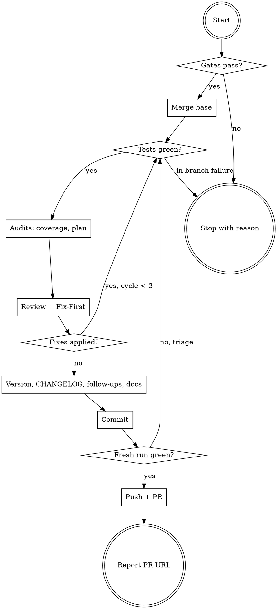

# ytstack:ship

Adapted from gstack's `ship` skill (MIT, Garry Tan), baseline in `metadata.upstream`; see NOTICE.

The release path for a feature branch: integrate the base, prove the change with the project's own tests, audit coverage and plan completion, review the diff, cut the version and CHANGELOG, sync the docs, commit, push and open (or update) the pull request. It runs with git, gh and the project's test command; nothing else is required. In a ytstack project it also refuses to ship a slice that is not closed on paper and puts the slice's outcomes into the PR body.

This skill differs from upstream gstack ship: no review log, receipts, merge queue, Greptile/Capy, outside-voice CLI, Apple release, budget handoff, measure loop or specialist review army; the review is one checklist pass plus one fresh-context adversarial subagent, and every helper binary is replaced by plain git/gh. Commit subjects and PR titles keep the `<type>:` / `M###-S##-T##:` prefix that ytstack projects use (upstream dropped it in v1.99).

<HARD-GATE>
Do NOT push, open a pull request, bump the version or write the CHANGELOG until the tests passed on the code merged with the base branch, and do NOT ship a ytstack slice while `OPEN_TASKS` is not `none`.
Do NOT merge the pull request, enable auto-merge or push to the base branch. A merge needs the user's explicit instruction; `ytstack:finish-branch` is the local-merge path.
Do NOT force-push, rebase a shared branch, or bypass hooks and commit signing (`--no-verify`, `--no-gpg-sign`).
</HARD-GATE>

## Anti-Pattern: "The tests passed earlier in this session, just push it"

Earlier runs tested a different tree. The base moved, review fixes landed, generated tests and doc edits changed content. A push is the moment a claim becomes public, so it rests on a run of the exact tree being pushed, merged with the current base. Rerun the suite (step 13); it costs minutes and saves a red main.

## Checklist

You MUST create a task for each of these items and complete them in order:

1. **Run preamble** -- resolver, branch, base branch, platform, slice paper state, version sources
2. **Preflight gates** -- not on the base branch, git checkout, no open tasks, list the uncommitted changes that ship
3. **Merge the base** -- `git fetch` + `git merge origin/<base>`; resolve or ask on conflicts
4. **Run tests** -- the project's full suite on the merged code; triage failures (`references/tests.md`)
5. **Coverage audit** -- fresh-context subagent traces changed paths, coverage gate (`references/test-coverage.md`)
6. **Plan completion** -- bind the plan (slice plan in ytstack), audit, run plan verification, scope drift (`references/plan-completion.md`)
7. **Pre-landing review** -- checklist pass plus adversarial subagent, Fix-First, at most 3 fix cycles (`references/review-checklist.md`)
8. **Version bump** -- detect state, pick the level, write every version source
9. **CHANGELOG** -- one user-facing entry covering every commit (only if a CHANGELOG exists)
10. **Follow-ups** -- TODOS.md deferrals and completions (only if `TODOS.md` exists)
11. **Documentation sync** -- doc-audit subagent, validate its edits (`references/documentation-sync.md`)
12. **Commit** -- bisectable commits staged by name, release metadata last
13. **Verification gate** -- fresh full test run (and build) of the exact tree to be pushed
14. **Push** -- secret scan, idempotency check, `git push -u origin <branch>`
15. **Pull request + report** -- title, body, create or update, PR URL and next-step suggestion (`references/pr-body.md`)

## Process Flow



## Preamble

Run this first, from the checkout you are shipping:

```bash
# ytstack resolver (M016): checkout = where this shell runs, via the shared lib.
_LIB="${CLAUDE_SKILL_DIR}/../../hooks/lib/git-ctx.sh"
if [ -f "$_LIB" ]; then
  . "$_LIB"; yt_git_ctx "$PWD"; yt_resolve_yt_dir >/dev/null
  _PROJECT_DIR="$YT_TOPLEVEL"; _YT_DIR="$YT_DIR"; _YT_SCOPE="$YT_SCOPE"; _IS_GIT="$YT_IS_GIT"; _PROJECT_KEY="$YT_REPO_KEY"
else
  # Host did not substitute CLAUDE_SKILL_DIR (e.g. Codex adapter): project scope only.
  _IS_GIT=$([ "$(git rev-parse --is-inside-work-tree 2>/dev/null)" = true ] && echo yes || echo no)
  _PROJECT_DIR=$(git rev-parse --show-toplevel 2>/dev/null || pwd -P)
  _YT_DIR=""; _YT_SCOPE=none; _PROJECT_KEY=""
  [ -d "$_PROJECT_DIR/.ytstack" ] && { _YT_DIR="$_PROJECT_DIR/.ytstack"; _YT_SCOPE=project; }
fi
cd "$_PROJECT_DIR" 2>/dev/null || true
_PROJECT_SLUG=$(basename "$_PROJECT_DIR")   # display only
_HAS_YTSTACK=$([ -n "$_YT_DIR" ] && echo yes || echo no)

_BRANCH=$(git branch --show-current 2>/dev/null); _BRANCH=${_BRANCH:-unknown}
echo "BRANCH: $_BRANCH"
echo "PROJECT_SLUG: $_PROJECT_SLUG"
echo "HAS_YTSTACK: $_HAS_YTSTACK"
echo "YTSTACK_SCOPE: $_YT_SCOPE"
echo "YT_DIR: $_YT_DIR"
echo "IS_GIT: $_IS_GIT"

# Non-interactive detection
if [ -n "$YTSTACK_NON_INTERACTIVE" ] || [ -n "$OPENCLAW_SESSION" ] || [ -n "$CLAUDE_AGENT_TEAM_MEMBER" ]; then
  echo "YTSTACK_NON_INTERACTIVE: true"
else
  echo "YTSTACK_NON_INTERACTIVE: false"
fi

# Active work + slice paper state: every task in the slice plan needs a non-draft summary.
_M=none; _S=none; _OPEN_TASKS=""; _SLICE_PLAN=none
if [ -n "$_YT_DIR" ] && [ -f "$_YT_DIR/STATE.md" ]; then
  _M=$(sed -n 's/^current_milestone: *//p' "$_YT_DIR/STATE.md" | head -1); _M=${_M:-none}
  _S=$(sed -n 's/^active_slice: *//p' "$_YT_DIR/STATE.md" | head -1); _S=${_S:-none}
  echo "CURRENT_MILESTONE: $_M"
  echo "ACTIVE_SLICE: $_S"
  if [ -f "$_YT_DIR/$_M-$_S-PLAN.md" ]; then
    _SLICE_PLAN="$_YT_DIR/$_M-$_S-PLAN.md"
    for t in $(grep -oE '^- \[.\] T[0-9][0-9] --' "$_SLICE_PLAN" | grep -oE 'T[0-9][0-9]'); do
      f="$_YT_DIR/$_M-$_S-$t-SUMMARY.md"
      { [ ! -f "$f" ] || grep -q '^closed: draft' "$f"; } && _OPEN_TASKS="$_OPEN_TASKS $t"
    done
  fi
fi
echo "SLICE_PLAN: $_SLICE_PLAN"
echo "OPEN_TASKS: ${_OPEN_TASKS:-none}"

# Hosting platform and base branch (PR target, else the repo default).
_REMOTE=$(git remote get-url origin 2>/dev/null || echo "")
_PLATFORM=unknown
case "$_REMOTE" in *github.com*) _PLATFORM=github ;; *gitlab*) _PLATFORM=gitlab ;; esac
_GH=no; command -v gh >/dev/null 2>&1 && gh auth status >/dev/null 2>&1 && _GH=yes
[ "$_PLATFORM" = unknown ] && [ -n "$_REMOTE" ] && [ "$_GH" = yes ] && _PLATFORM=github
_BASE=""
if [ "$_PLATFORM" = github ] && [ "$_GH" = yes ]; then
  _BASE=$(gh pr view --json baseRefName -q .baseRefName 2>/dev/null || true)
  [ -n "$_BASE" ] || _BASE=$(gh repo view --json defaultBranchRef -q .defaultBranchRef.name 2>/dev/null || true)
fi
[ -n "$_BASE" ] || _BASE=$(git symbolic-ref refs/remotes/origin/HEAD 2>/dev/null | sed 's|refs/remotes/origin/||')
[ -n "$_BASE" ] || { git rev-parse --verify -q origin/main >/dev/null 2>&1 && _BASE=main; }
[ -n "$_BASE" ] || { git rev-parse --verify -q origin/master >/dev/null 2>&1 && _BASE=master; }
_BASE=${_BASE:-main}
echo "REMOTE: ${_REMOTE:-none}"
echo "PLATFORM: $_PLATFORM"
echo "GH_AUTH: $_GH"
echo "BASE_BRANCH: $_BASE"
echo "ON_BASE: $([ "$_BRANCH" = "$_BASE" ] && echo yes || echo no)"
echo "DIRTY: $([ -n "$(git status --porcelain 2>/dev/null)" ] && echo yes || echo no)"

# Version sources: current tree vs the (last fetched) base.
_rd() { if [ -n "$_REF" ]; then git show "$_REF:$1" 2>/dev/null; else cat "$1" 2>/dev/null; fi; }
_ver() { _REF="$1"; _v=$(_rd VERSION | head -1 | tr -d '[:space:]')
  for _j in package.json .claude-plugin/plugin.json .codex-plugin/plugin.json; do
    [ -n "$_v" ] || _v=$(_rd "$_j" | grep -m1 '"version"' | sed -E 's/.*"version"[[:space:]]*:[[:space:]]*"([^"]+)".*/\1/')
  done
  for _t in pyproject.toml Cargo.toml; do
    [ -n "$_v" ] || _v=$(_rd "$_t" | grep -m1 -E '^version[[:space:]]*=' | sed -E 's/^version[[:space:]]*=[[:space:]]*"([^"]+)".*/\1/')
  done
  echo "$_v"; }
_VS=""
for f in VERSION package.json .claude-plugin/plugin.json .codex-plugin/plugin.json pyproject.toml Cargo.toml; do
  [ -f "$f" ] && _VS="$_VS $f"
done
echo "VERSION_SOURCES:${_VS:- none}"
_CUR=$(_ver ""); echo "CURRENT_VERSION: ${_CUR:-none}"
_BV=""; git rev-parse --verify -q "origin/$_BASE" >/dev/null 2>&1 && _BV=$(_ver "origin/$_BASE")
echo "BASE_VERSION: ${_BV:-none}"
echo "LAST_TAG: $(git describe --tags --abbrev=0 2>/dev/null || echo none)"
echo "CHANGELOG: $([ -f CHANGELOG.md ] && echo CHANGELOG.md || echo none)"
echo "TODOS: $([ -f TODOS.md ] && echo TODOS.md || echo none)"
echo "TEST_DOC: $(grep -lE '^## Testing' CLAUDE.md AGENTS.md TESTING.md 2>/dev/null | tr '\n' ' ')"
```

Flags read later: `OPEN_TASKS`, `SLICE_PLAN`, `BASE_BRANCH` (written `<base>` below), `PLATFORM`, `GH_AUTH`, `VERSION_SOURCES`, `CURRENT_VERSION`, `BASE_VERSION`, `CHANGELOG`, `TODOS`, `TEST_DOC`. Re-read `BASE_VERSION` after step 3's fetch when it said `none`.

**Spawned sessions.** When `YTSTACK_NON_INTERACTIVE` is `true`, never call AskUserQuestion: take the `RECOMMENDATION` option and log one line, `[ytstack:ship] auto-picked <X> (<label>) because YTSTACK_NON_INTERACTIVE=true`. Choices that need a human (a loosened test gate, an unverifiable plan item, accepting a documentation risk) are never auto-accepted: they stay open and the PR is opened as a draft, or the ship stops where the step says so.

**Routine work needs no confirmation:** including the branch's uncommitted changes, a PATCH or MICRO bump, the CHANGELOG draft, commit grouping, marking completed TODOs and AUTO-FIX review findings. Ask only where a step says so.

## Procedure

### 1. Run preamble

Run the bash block above and keep its output; later steps refer to the flags by name.

### 2. Preflight gates

1. `IS_GIT` is `no`: stop with "not a git checkout".
2. `ON_BASE` is `yes`: stop with "You're on the base branch `<base>`. Ship from a feature branch."
3. `OPEN_TASKS` is not `none`: stop and name each task that still needs `ytstack:summarize-task`. A `closed: draft` stub is not a summary.
4. `PLATFORM` is not `github` or `GH_AUTH` is `no`: continue, and say once that step 15 will print the PR command to run by hand (GitLab: `glab` when it is installed).
5. `DIRTY` is `yes`: list the uncommitted and untracked files (`git status --porcelain`). They ship with this branch; do not ask. Name the `.ytstack/` files among them (task summaries, `STATE.md`, `DECISIONS.md` and `KNOWLEDGE.md` entries); they are part of the change and get committed in step 12. A file that clearly belongs to unrelated work (another task's edits in a shared tree) stays unstaged and is named in the final report.

### 3. Merge the base branch (before tests)

```bash
git fetch origin "<base>" && git merge --no-edit "origin/<base>"; echo "MERGE_EXIT: $?"
git log --oneline "origin/<base>..HEAD" | wc -l | sed 's/^ */COMMITS_AHEAD: /'
git diff --stat "origin/<base>" | tail -1
```

A failed fetch: stop and report the error (no network, no access); nothing below runs on a stale base. Already up to date is fine. Never rebase.

Simple conflicts resolve without asking: `VERSION` and manifest versions (take the higher base version; step 8 bumps from there), CHANGELOG ordering (keep both entries, base entries below the branch's), lockfiles (regenerate with the package manager). Anything else:

> Merging `origin/{base}` into `{BRANCH}` ({PROJECT_SLUG}) conflicts in {N} files: {file: one-line nature of the conflict, each}.
>
> Simplify: the base branch changed the same lines this branch changed. Someone has to decide which version wins, line by line. I have a proposal for each file.
>
> RECOMMENDATION: Choose A because the proposals keep both changes where they are compatible, and you see each one before it is committed.
>
> A) Resolve as I propose: I show each file's resolution, then commit the merge
>    Completeness: 10/10, effort: human: ~2 min / CC: ~5 min, tier: task
> B) You resolve them yourself; I stop here and you re-run ship afterwards
>    Completeness: 10/10, effort: human: ~10 min / CC: 0, tier: task
> C) Abort the merge (`git merge --abort`) and stop
>    Completeness: 3/10, effort: human: 0 / CC: 0, tier: task

After a resolved merge, commit it (`git commit --no-edit`) and continue; the tests below run on the merged code.

### 4. Run tests on the merged code

1. Find the test command: `TEST_DOC` names the file with a `## Testing` section; read it. Not documented, or the project has no tests: read `${CLAUDE_SKILL_DIR}/references/tests.md` sections 1-2 and follow them (ask for the command, or decide about a missing suite).
2. Run the full suite. Run every applicable suite (unit, integration, shell tests), not just one. In a ytstack project also run each `## Verification` command of the active slice's task plans. Keep the output in a log file (`mktemp`), print the summary lines.
3. Read each result as pass, zero-run or count-unavailable (`references/tests.md` section 3). A zero-run is a failure.
4. Any failure: read `${CLAUDE_SKILL_DIR}/references/tests.md` section 4 and triage. In-branch failures stop the ship.
5. Prompt or eval files changed: `references/tests.md` section 5.
6. Print one line per suite: `Tests: <label> <N> passed` or `count unavailable`. Remember the commands; step 13 reruns exactly these.

### 5. Coverage audit

Read `${CLAUDE_SKILL_DIR}/references/test-coverage.md` and execute it: dispatch the audit subagent, process its result, apply the coverage gate. Keep the diagram, counts and gate result for the PR body. Tests it generates stay uncommitted until step 12.

### 6. Plan completion, plan verification, scope drift

Read `${CLAUDE_SKILL_DIR}/references/plan-completion.md` and execute it in order: bind the plan (in a ytstack project the slice plan `SLICE_PLAN` plus its task plans and summaries), dispatch the audit, apply the gates, run the plan's verification checks, write the scope check. Deferrals approved here go to step 10.

### 7. Pre-landing review

Read `${CLAUDE_SKILL_DIR}/references/review-checklist.md` and execute it: PR type, Pass 1 (CRITICAL) and Pass 2 (INFORMATIONAL) over the merge-base diff, the sideways sweep on every finding, the adversarial subagent for diffs of 200+ changed lines, then Fix-First. Gate-integrity hunks that step 5 flagged join Pass 1.

Fixes applied: commit them, rerun step 4, and review the new range again. At most 3 fix cycles; on the third, stop and name the remaining blockers to the user unfixed. A clean pass continues to step 8.

For a task-level two-stage review with the superpowers receiving discipline, `ytstack:code-review` exists; ship does not invoke it, its own review covers the whole branch diff.

### 8. Version bump

Skip the whole step when `VERSION_SOURCES` is `none`: print `Version bump: skipped (no version source)`; step 9 writes under `## [Unreleased]`, step 15 uses an unprefixed title. Never create a VERSION file.

The project's own release rules win: read `CLAUDE.md` / `AGENTS.md` / `CONTRIBUTING.md` for a release or versioning section (which files carry the version, 3 or 4 components, who bumps) and follow it over the defaults below.

1. **Classify.**
   - **ALREADY_BUMPED:** `CURRENT_VERSION` is higher than `BASE_VERSION`. Keep it; never bump twice. Derive the level from the first component that changed.
   - **FRESH:** `CURRENT_VERSION` equals `BASE_VERSION` (or the base has no version yet).
   - **DRIFT:** the version sources disagree with each other (`grep -n '"version"\|^version' <each source>`). When exactly one source still holds `BASE_VERSION` and the others agree on a higher one, set the stale one to match and continue as ALREADY_BUMPED. Any other disagreement: stop and show the values; the user reconciles them.
2. **Pick the level** from the diff (FRESH only):
   - **MICRO** (4-component versions only): under 50 changed lines, trivial tweak or config. With 3 components this is PATCH.
   - **PATCH:** 50+ lines, no feature signal.
   - **MINOR:** any feature signal (new command, route, page, skill, migration, module) or 500+ lines. Ask.
   - **MAJOR:** breaking change or a milestone release. Ask.

> Shipping `{BRANCH}` of `{PROJECT_SLUG}` (currently v{CURRENT_VERSION}). The diff {has a feature signal: {signal} | breaks {what}}, which suggests a {MINOR|MAJOR} bump to v{proposed}.
>
> Simplify: the version number tells users what to expect. A minor bump says "new things, nothing breaks"; a major bump says "you may have to change something"; a patch says "fixes only".
>
> RECOMMENDATION: Choose A because {the signal} is {a new capability users can use | a change existing users must adapt to}.
>
> A) {MINOR|MAJOR} bump to v{proposed}
>    Completeness: 10/10, effort: human: 0 / CC: ~1 min, tier: task
> B) One level smaller: v{smaller}
>    Completeness: 7/10, effort: human: 0 / CC: ~1 min, tier: task
> C) Cancel the ship before any release write
>    Completeness: 10/10, effort: human: 0 / CC: 0, tier: task

3. **Check for collisions** (FRESH and ALREADY_BUMPED): `git tag -l "v<NEW_VERSION>"` must be empty. With `GH_AUTH: yes`, `gh pr list --state open --json number,title,headRefName` and look for another branch whose title claims `v<NEW_VERSION>` or higher at the same level. A sibling holds it: advance past the highest claimed version and say so; for ALREADY_BUMPED, ask before changing an existing version.
4. **Write** (FRESH, or an approved re-bump) with Edit, one file at a time: `VERSION` (keep its component count), `package.json` `"version"`, `.claude-plugin/plugin.json` / `.codex-plugin/plugin.json` `"version"`, `pyproject.toml` `version =` under `[project]` or `[tool.poetry]`, `Cargo.toml` `version =` under `[package]`, and the root package version in `package-lock.json` (top-level `version` and `packages[""].version`). Then `grep -rn "<old version>"` over the manifests and README badges the project keeps in sync (its release rules name them) and update those. Do not create a git tag.
5. Print `Version: v<BASE_VERSION> -> v<NEW_VERSION> (<level>)`.

### 9. CHANGELOG

`CHANGELOG` is `none`: print `CHANGELOG: skipped (none at CHANGELOG.md)` and write nothing; the PR body carries the release notes. Never create the file.

1. Read the CHANGELOG header and the latest entry to learn its format (heading style, date format, sections).
2. List every commit on the branch: `git log origin/<base>..HEAD --oneline`. Count them; this is the checklist.
3. Read `git diff origin/<base>` to understand what each commit changed.
4. Group by theme before writing: features, performance, fixes, removals, infrastructure and tests, refactors.
5. Write one entry with Edit (never Write on CHANGELOG.md), after the header and before the first release entry, dated today: `## [<NEW_VERSION>] - YYYY-MM-DD` (or the file's own heading style), with `### Added` / `### Changed` / `### Fixed` / `### Removed` as applicable. Entries this branch already added for these commits are replaced by the one unified entry. Version kept or no version source: put the entry under `## [Unreleased]`, never under a released heading.
6. **Voice:** lead with what the user can now do that they could not before. Plain language, no implementation detail, nothing about internal tracking (TODOS, `.ytstack` bookkeeping): no tracker codes (issue keys, `M###-S##` refs) anywhere in the entry, and a bold lead that a user of the project understands without the repository's coined terms. Each bullet names a concrete change; cut any bullet that would fit every release.
7. **Cross-check** against the commit list from item 2: every user-facing change appears. Merges, version bumps and fixes to work introduced earlier on this same branch need no bullet.

Do not ask the user to describe the changes; infer them from the diff and the commits.

### 10. Follow-ups (TODOS.md)

`TODOS` is `none`: do not create the file. Approved deferrals (step 6 NOT DONE items, step 4 pre-existing failures recorded as follow-ups, review findings deferred in step 7) go into the PR body's `## Follow-ups`; in a ytstack project, also name them in the final report for `ytstack:reassess-roadmap`.

`TODOS` is `TODOS.md`:

1. Add each approved deferral as an item under its component heading, priority-sorted:
   ```markdown
   ### <Title>
   **What:** one line. **Why:** the concrete problem. **Context:** enough to start in three months.
   **Effort:** S / M / L / XL  **Priority:** P0-P4  **Depends on:** <or None>
   ```
   Plan deferrals are P1 with `Deferred from plan: <path>`; pre-existing test failures are P0 with the error output and the branch. Reuse a matching existing item instead of duplicating. Never invent unapproved follow-ups.
2. Detect completed items: compare titles, files and behaviour with `git diff origin/<base>` and `git log origin/<base>..HEAD --oneline`. Move proven completions to `## Completed` with `**Completed:** v<NEW_VERSION> (YYYY-MM-DD)`; leave uncertain ones open.
3. Report additions, completions and the remaining count. A failed write is a warning, not a blocker; carry the unsaved items into the PR body and never claim they were saved.

### 11. Documentation sync

Read `${CLAUDE_SKILL_DIR}/references/documentation-sync.md` and execute it on every ship: dispatch the doc-audit subagent, validate exactly what it changed, recover or ask when it is blocked. Keep `documentation_section` and the status line for the PR body.

### 12. Commit (bisectable chunks)

Already committed and nothing new: continue to step 13. Never create an empty commit. Check the branch first: `git branch --show-current` must print `BRANCH`.

1. Group changes into logical commits: each source change with its tests; config and routes with what uses them; migrations may stand alone; docs from step 11 with the change they describe or as one `docs:` commit. Under 50 lines across fewer than 4 files may be one commit.
2. Order dependencies first (infrastructure, then models and services, then controllers and views). Each commit must work on its own: no broken imports, no missing code.
3. Stage by name (`git add <paths>`), never `git add -A` or `git add .`. Message `<type>: <summary>` (`feat`, `fix`, `chore`, `refactor`, `docs`, `test`) with a short body, or the project's convention (in a ytstack project, code that belongs to a task keeps its `M###-S##-T##:` prefix). A fix for an issue the user named adds `Fixes #<n>`. Add the session's commit attribution trailer when the host defines one.
4. `.ytstack/` files that are part of the change (summaries, `STATE.md`, decision and knowledge entries) are committed, as `chore: update ytstack state for <M###-S##>` when they do not belong to a code commit.
5. Last: the release metadata in one commit: `VERSION`, manifests, lockfile version, `CHANGELOG.md`, `TODOS.md`, as `chore: release v<NEW_VERSION>` (or the project's release-commit convention).

Commit signing and hooks run as configured. A failed hook or signature is a blocker to report and fix at the cause, never to bypass.

### 13. Verification gate

**IRON LAW: no completion claim without fresh verification evidence.**

1. `git status --porcelain` must be empty except files you deliberately left out in step 2 (name them). Anything else: commit it per step 12 or stop.
2. Rerun every suite from step 4 (same commands) on the committed tree whenever anything changed since that run: review fixes, generated tests, merged base, doc edits, the version bump. Only when literally nothing changed since a green run may you cite that run (command, result, time).
3. Run the project's declared build when it has one (`build` script in package.json, `make build`, the build step in CI) and its lint or check command when CI runs it (for ytstack itself: `bin/ytstack-check`). A missing prerequisite or failed build stops the ship: report the command and the error; never substitute another command.
4. Any failure: back to step 4's triage; nothing is pushed red.
5. Paste the evidence: per suite the command, exit code and pass count (or `count unavailable`), and the build result. This is what the PR's `## Test plan` cites.

### 14. Push

1. **Secret scan** of the added lines:
   ```bash
   git diff "origin/<base>...HEAD" | grep -nE '^\+.*(AKIA[0-9A-Z]{16}|-----BEGIN [A-Z ]*PRIVATE KEY-----|gh[pousr]_[A-Za-z0-9]{36}|github_pat_[A-Za-z0-9_]{20,}|xox[abpors]-[A-Za-z0-9-]{10,}|sk-[A-Za-z0-9_-]{20,}|AIza[0-9A-Za-z_-]{35})' && echo "SECRET_HIT" || echo "SECRET_CLEAN"
   ```
   `SECRET_HIT`: STOP. Show the file and line (not the secret). Remove it from the code and the branch history before anything is pushed; a pushed credential must be rotated. Test fixtures with obviously fake values are fine once you have read them.
2. **Already pushed?**
   ```bash
   _L=$(git rev-parse HEAD); _R=$(git ls-remote --heads origin "refs/heads/<branch>" | cut -f1)
   [ "$_L" = "$_R" ] && echo "PUSH: ALREADY_PUSHED" || echo "PUSH: NEEDED (remote ${_R:-none})"
   ```
   A failed lookup: stop and report. `ALREADY_PUSHED`: go to step 15.
3. `git push -u origin "<branch>"`.
4. **Push fails:** stop, no PR claim. Non-fast-forward: `git fetch origin "<branch>"`, merge it (step 3's conflict rules), rerun steps 4 and 13, push again. Authentication, hook or network failure: report the error and fix the cause; never force-push, never `--no-verify`.

### 15. Pull request and report

Read `${CLAUDE_SKILL_DIR}/references/pr-body.md` and execute it: look up the open PR, prepare the title, compose the body (in a ytstack project with the `## Slice` section built from the slice goal and each task's Outcome paragraph), secret-check it, create or update the PR, print the URL. A draft PR when a loosened gate is left open or a plan item stays unverified.

Then report, in this shape:

```
SHIP: <PR URL | pushed, PR not created: <reason>>
Version: v<old> -> v<new> (<level>) | skipped
Tests: <label> <N> passed[, ...] | Build: <ok | none declared>
Coverage: <X>% value-weighted, gate <PASS | accepted risk | skipped>
Plan: <N/M done | not run> | Review: <summary line> | Docs: <updated | current | blocked>
Follow-ups: <count, where they are recorded>
```

## Terminal State

The terminal state is one of:

- Returning control to the user with the PR URL (or the pushed branch and the manual PR command when the PR could not be created), plus one next-step suggestion: `ytstack:reassess-roadmap` when the slice is complete, `ytstack:retro` when the milestone is complete, `ytstack:document-release` when a version is to be cut or the docs need a full post-ship pass.
- Exiting without a push (a gate stopped the ship: open tasks, on the base branch, in-branch test failures, a NOT DONE plan item the user chose to finish, a secret hit, a cancelled version bump, a blocked documentation audit). Name the gate and what clears it.

Do NOT auto-invoke any downstream skill, and do NOT merge the PR, enable auto-merge or delete the branch. The ONLY skills you may invoke after this one are the ones the user explicitly asks for; `ytstack:reassess-roadmap`, `ytstack:retro`, `ytstack:document-release`, `ytstack:systematic-debugging` and `ytstack:finish-branch` are suggestions to name, not to run.
