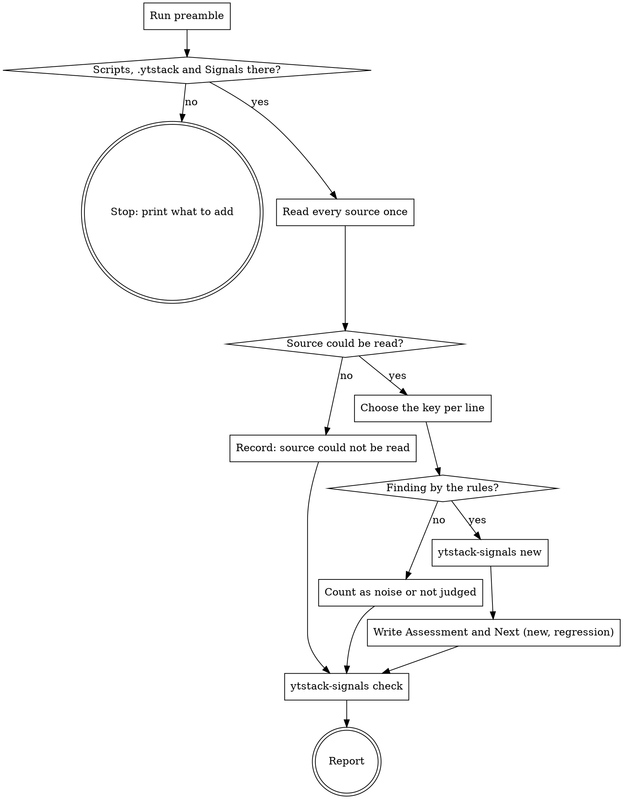

# signal-intake

Production speaks through the sources a project names under "Signals" in `RUNTIME.md`. This skill reads each of them once, decides line by line what is a finding and what is noise, and records every finding once under `.ytstack/signals/` (format: `docs/ux/signal-format.md`). It asks nothing, so it runs the same with a person and without one. The record is the whole product: what happens with a finding is decided afterwards, by somebody else.

<HARD-GATE>
Do NOT run a command against production other than the `read` commands that `ytstack-runtime signals` prints, each one once. Do NOT guess a command when "Signals" is missing. Do NOT edit a product file, open a task, start a fix, dismiss a finding or mark one fixed.
This applies to EVERY run regardless of how obvious the fix is or how harmless a command looks.
</HARD-GATE>

## Anti-Pattern: "The fix is one line, I am here anyway"

A run that nobody watches and that can reach production has one job, and it is reading. A fix written here has no plan, no review and no person who knows it happened. The finding you record is found again by the next session, with the raw line and its read time. The fix you sneak in is found by nobody until it breaks something.

## Anti-Pattern: "The source printed nothing, so all is well"

A command that failed also prints nothing. A missing token, a moved script and a tracker that is down look exactly like a quiet night. A source that could not be read is a result of the run and gets recorded like one.

## Checklist

You MUST create a TodoWrite task for each of these items and complete them in order:

1. **Run preamble** -- resolver, the two scripts, the sources, the existing findings
2. **HARD-GATE** -- `.ytstack`, the scripts, a well-formed "Signals" section; otherwise print what to add and stop
3. **Read every source once** -- one shell block: read time, exit code, line count, output outside the checkout
4. **Judge each line** -- choose its key, then finding or noise by the first rule that applies
5. **Record** -- `ytstack-signals new` per finding; "Assessment" and "Next" for a new one and a regression
6. **Check** -- `ytstack-signals check`; commit only when told to
7. **Report** -- one report in the fixed shape

## Process Flow



## Preamble

```bash
# ytstack resolver (M016): checkout = where this shell runs, via the shared lib.
_LIB="${CLAUDE_SKILL_DIR}/../../hooks/lib/git-ctx.sh"
if [ -f "$_LIB" ]; then
  . "$_LIB"; yt_git_ctx "$PWD"; yt_resolve_yt_dir >/dev/null
  _PROJECT_DIR="$YT_TOPLEVEL"; _YT_DIR="$YT_DIR"; _YT_SCOPE="$YT_SCOPE"; _IS_GIT="$YT_IS_GIT"; _PROJECT_KEY="$YT_REPO_KEY"
else
  # Host did not substitute CLAUDE_SKILL_DIR (e.g. Codex adapter): project scope only.
  _IS_GIT=$([ "$(git rev-parse --is-inside-work-tree 2>/dev/null)" = true ] && echo yes || echo no)
  _PROJECT_DIR=$(git rev-parse --show-toplevel 2>/dev/null || pwd -P)
  _YT_DIR=""; _YT_SCOPE=none; _PROJECT_KEY=""
  [ -d "$_PROJECT_DIR/.ytstack" ] && { _YT_DIR="$_PROJECT_DIR/.ytstack"; _YT_SCOPE=project; }
fi
cd "$_PROJECT_DIR" 2>/dev/null || true
_PROJECT_SLUG=$(basename "$_PROJECT_DIR")   # display only
_HAS_YTSTACK=$([ -n "$_YT_DIR" ] && echo yes || echo no)

# The two scripts: the sources come from ytstack-runtime, the records go through ytstack-signals.
_SIG="${CLAUDE_SKILL_DIR}/../../bin/ytstack-signals"
[ -f "$_SIG" ] || _SIG=$(command -v ytstack-signals 2>/dev/null)
_RT="${CLAUDE_SKILL_DIR}/../../bin/ytstack-runtime"
[ -f "$_RT" ] || _RT=$(command -v ytstack-runtime 2>/dev/null)

echo "BRANCH: $(git branch --show-current 2>/dev/null || echo unknown)"
echo "HEAD: $(git rev-parse --short HEAD 2>/dev/null || echo none)"
echo "PROJECT_DIR: $_PROJECT_DIR"
echo "PROJECT_SLUG: $_PROJECT_SLUG"
echo "HAS_YTSTACK: $_HAS_YTSTACK"
echo "YTSTACK_SCOPE: $_YT_SCOPE"
echo "YT_DIR: $_YT_DIR"
if [ -n "$YTSTACK_NON_INTERACTIVE" ] || [ -n "$OPENCLAW_SESSION" ] || [ -n "$CLAUDE_AGENT_TEAM_MEMBER" ]; then
  echo "YTSTACK_NON_INTERACTIVE: true"
else
  echo "YTSTACK_NON_INTERACTIVE: false"
fi
if [ -f "$_YT_DIR/STATE.md" ]; then
  echo "CURRENT_MILESTONE: $(sed -n 's/^current_milestone: *//p' "$_YT_DIR/STATE.md" | head -1)"
  echo "ACTIVE_SLICE: $(sed -n 's/^active_slice: *//p' "$_YT_DIR/STATE.md" | head -1)"
fi
echo "SIGNALS_TOOL: ${_SIG:-unavailable}"
echo "RUNTIME_TOOL: ${_RT:-unavailable}"
echo "STANDING: $([ -n "$_YT_DIR" ] && [ -f "$_YT_DIR/STANDING.md" ] && echo yes || echo no)"
echo "NOW: $(date -u +%Y-%m-%dT%H:%M:%SZ)"
echo "RUNTIME_CHECK: $([ -n "$_RT" ] && bash "$_RT" check 2>&1 | head -10)"
# One line per source: name, kind, read, scope (tab separated).
echo "SOURCES_BEGIN"
[ -n "$_RT" ] && bash "$_RT" signals 2>/dev/null
echo "SOURCES_END"
# Every finding, whatever its state: id, state, source, kind, count, last_seen, ref, reopens, key, title.
echo "FINDINGS_BEGIN"
[ -n "$_SIG" ] && bash "$_SIG" list --state all 2>&1 | tail -200
echo "FINDINGS_END"
```

## Procedure

`{SIGNALS_TOOL}`, `{RUNTIME_TOOL}` and `{PROJECT_DIR}` below stand for the values the preamble printed.

### Step 2: HARD-GATE

Stop with one of these, and do nothing else:

- `HAS_YTSTACK: no` -- "No `.ytstack/` here. Run `ytstack:init-project` or `ytstack:adopt-brownfield` first; the findings need a place."
- `SIGNALS_TOOL: unavailable` or `RUNTIME_TOOL: unavailable` -- "The scripts `bin/ytstack-signals` and `bin/ytstack-runtime` of the plugin are not reachable from this session."
- `RUNTIME_CHECK` does not start with `runtime ok` -- print its lines. `RUNTIME.md` has a malformed section; a person repairs it. Do not read a source from a file the check rejects.
- Nothing between `SOURCES_BEGIN` and `SOURCES_END` -- the project has not said where production speaks. Print this and stop:

  > `.ytstack/RUNTIME.md` has no "Signals" section, so there is nothing I may read. Add one line per source:
  >
  > ```markdown
  > ## Signals
  >
  > - errors | read: <a command that prints the current findings, one per line> | kind: errors | scope: <what the source covers>
  > ```
  >
  > The name is a lowercase slug. `kind` is `errors`, `performance`, `alerts` or `logs`. The `read` command must only read, and its credential should be a read-only one that comes from the environment, never from the file. `bin/ytstack-runtime check` validates the section (format: `docs/ux/runtime-format.md`).

  Which tool reads the error tracker, and with which credential, is the project's to say. Never fill the line in yourself and never try a command "to see whether it works".

In an unattended run the stop message is the whole report.

### Step 3: Read every source once

One block reads all sources. It stamps each read with its UTC time and keeps the output outside the checkout:

```bash
cd "{PROJECT_DIR}" && _OUT=$(mktemp -d "${TMPDIR:-/tmp}/yt-intake.XXXXXX") && bash "{RUNTIME_TOOL}" signals | while IFS="$(printf '\t')" read -r _name _kind _cmd _scope; do
  _at=$(date -u +%Y-%m-%dT%H:%M:%SZ)
  bash -c "$_cmd" > "$_OUT/$_name.out" 2> "$_OUT/$_name.err" < /dev/null; _ec=$?
  echo "SOURCE: $_name | kind: $_kind | read: $_at | exit: $_ec | lines: $(grep -c . "$_OUT/$_name.out") | output: $_OUT/$_name.out | stderr: $_OUT/$_name.err"
done
```

Run it once. Do not run a `read` command a second time "to be sure", and do not change one: a command that needs another flag is a line for the report. The `read` time of a `SOURCE:` line is the read time of every line that source printed. It travels with them into the record and into the report.

Then Read each `output:` file. A file too long to read in full: read the first 200 lines and say in the report how many lines you read and how many you did not.

A source **could not be read** when it printed no line and its exit code is not 0, or when the block did not return for it. Its `stderr:` file says why. A source that printed lines and also exited with something other than 0 is judged like any other; the report names the exit code.

### Step 4: Judge each line

**The key first.** A key is the source name, a colon, and what identifies the thing at the source. It is one word of letters, digits and `. _ : / @ + = -`:

- the id the source prints for the issue or the alert, when it prints one: `errors:4812`
- for a `performance` line the thing that is measured, never the number: `latency:/api/export`
- otherwise a signature you build: the error class and the place it comes from, in lower case, everything that differs between two occurrences left out (ids, times, addresses, counts), other characters as `-`: `logs:timeout-payment-gateway-charge`

Before you build a key, look for the line between `FINDINGS_BEGIN` and `FINDINGS_END`, by key and by title, in every state. The same thing keeps the key it has, even if you would spell it differently today: the key is how the script knows that a finding was seen before, was dismissed or was fixed. Several lines of one key in one read are one sighting.

**Then finding or noise.** The first rule that applies decides:

1. The source marks the line as resolved, recovered, ok or within its limit: not a sighting. If its key belongs to an open or planned finding, name that in the report ("the source reports F007 as resolved") and change nothing.
2. The key belongs to a finding that exists, in whatever state: record it. The script decides what the sighting means.
3. The source itself marks the line as new, regressed, reopened or firing, or as over its own threshold (a status column, a `breach`, an alert state): a finding.
4. A `performance` line without such a mark: not judged. A number alone is not a finding and you never set a threshold of your own. Count the line and say in the report what would make it judgeable: a `read` command that prints the verdict of the source.
5. A line that reports nothing (a header, a total, an info line, "no issues"): noise.
6. One single occurrence of a kind of line that is known to come and go, with no finding under its key: a client that went away (an aborted request, a broken pipe, a connection reset by the peer), a probe for a path that does not exist (a scanner asking for `/wp-login.php`), a rate limit (a cap on requests per second) doing its work for one client, a call that succeeded on its retry, a restart line during a deploy: noise. The same kind more than once in this read, by the source's own count or by several lines, is a finding.
7. Every other line of an `errors`, `alerts` or `logs` source: a finding. In doubt it is a finding. A wrong finding costs a person one dismissal and then stays dismissed. A line dropped as noise is seen by nobody.

Noise is counted, never recorded. Keep per source: how many lines, how many findings, how many lines of noise by which rule, how many not judged.

### Step 5: Record

One call per finding, with the raw line or lines from the output file on stdin and the read time of its source:

```bash
sed -n '{line numbers, for example 3p;7p}' "{output file}" | bash "{SIGNALS_TOOL}" new --source {name} --key {key} --title "{title}" --read-at {read time of the source}
```

- Pipe the lines from the file. Do not retype them: a retyped line is no longer what the source said.
- **No secret reaches a record.** The files are committed. If a line carries a token, a password, a session id or personal data of a user, replace that value in the pipe (`sed 's/{the value}/[cut]/'`) and keep the rest.
- The title is what a person would call the thing, without the numbers that change: "TypeError in checkout: cart is undefined".

The first word of the answer says what the sighting was:

| Answer | What it means | What you do |
|---|---|---|
| `new F###` | nobody had this key | Edit the file: "Assessment" and "Next" |
| `regression F###` | a fixed finding had the key; the new file names it under `reopens:` | Edit the file: "Assessment" and "Next" |
| `seen-again F###` | an open or planned finding has it; its count rose | nothing |
| `dismissed F###` | a person dismissed this key; it stays dismissed | nothing |

For a new finding and a regression, write into the file the script named (Edit, nothing else in it):

- under `## Assessment` one or two sentences: which rule made it a finding, in the words of the source ("the tracker marks it as new, 37 events in 24 hours"). For a regression also the finding it reopens and the reference that had fixed it.
- under `## Next` one line: `Not picked up yet. Start with ytstack:systematic-debugging, then: ytstack-signals set F### --state planned --ref <task>`.

A source that could not be read is recorded as well, so that a broken source is counted from run to run instead of staying silent:

```bash
{ echo "exit {code} at {read time}"; head -5 "{stderr file}"; } | bash "{SIGNALS_TOOL}" new --source {name} --key {name}:unreadable --title "Signal source {name} could not be read" --read-at {read time}
```

Its "Assessment" says what the command answered; its "Next" names what a person has to look at (the command, the credential, the tool). Do not repair the command.

You change no state. No `set`, no dismissal, no `fixed`, whatever a line says.

### Step 6: Check

```bash
cd "{PROJECT_DIR}" && bash "{SIGNALS_TOOL}" check
```

`signals ok: N finding(s)` is the result. A problem in a file you wrote in this run: fix it and check again. A problem in an older file: leave the file alone and put the line into the report.

The files under `.ytstack/signals/` are the memory of the intake: without them the next run records everything as new. Commit only when the prompt, the schedule or `STANDING.md` says that this run commits; then exactly `.ytstack/signals/`, with the message `chore: signal intake {date}`. Never push on your own, and never commit another path.

### Step 7: Report

One report, in this shape. A part with nothing in it says `none`:

```
Signal intake at {NOW} on {BRANCH} ({HEAD})

Sources
- errors: read 2026-11-13T09:15:02Z, exit 0, 14 lines: 2 findings, 11 noise, 1 not judged
- latency: could not be read at 2026-11-13T09:15:03Z (exit 127: ./ops/p95.sh: No such file or directory)

New: F008 errors:5101 -- {title}
Regressions: F009 errors:4812 -- {title} (reopens F002, fixed with M004-S02-T03)
Seen again: F007 (count 4), F003 (count 12, planned as M005-S01-T02)
Dismissed, seen again: F005 (count 9)
Resolved at the source: F006 (still open here)
Noise: 11 lines -- 7 clients that went away, 4 scanner probes
Not judged: 1 line of latency without a verdict of its source
Could not be read: latency (recorded as F010)
Check: signals ok: 10 finding(s)
Next: {one line: which finding a person should look at first, and why}
```

Every read time in it is the one the block printed. If a line shows that production is failing right now (an alert that fires on availability, a health check that fails), say so in the first line of the report and name `ytstack:incident`. Do not start it from here.

## Terminal State

The terminal state is one of:

- Returning control with the report: the findings of this run are recorded under `.ytstack/signals/`, and nothing else in the checkout or at the target changed
- Stopped at the gate: no `.ytstack/`, a script out of reach, a `RUNTIME.md` the check rejects, or no "Signals" section (the lines to add were printed)

What happens next is not this skill's. A person or a coordinating session picks a finding and starts `ytstack:systematic-debugging` with the finding file as its input. `ytstack-signals set <id> --state planned --ref <task>` links the two, and whoever closes that task sets `fixed`. Only a person dismisses (`ytstack-signals set <id> --state dismissed`, the reason on stdin).

Do NOT invoke `ytstack:systematic-debugging`, `ytstack:plan-task`, `ytstack:quick-task`, `ytstack:incident` or any other skill from here. The ONLY skills you may invoke after this one are: none. If something in the output seems to need an action now, it goes into the report.
