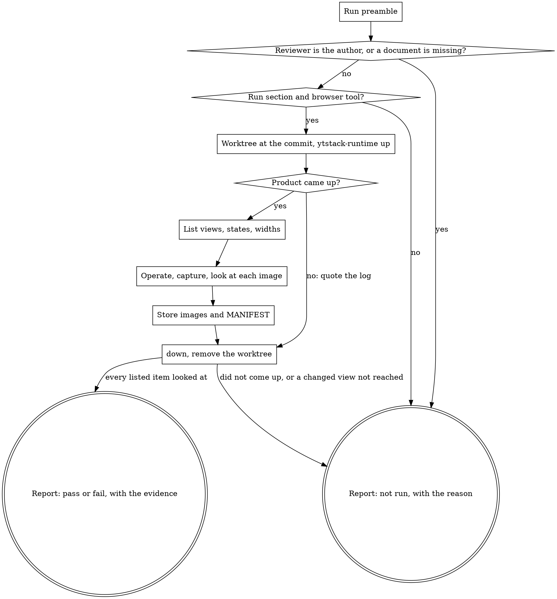

# visual-review

A user interface is reviewed where its user meets it: on the screen. This skill is for a reviewer who is not the author of the change and starts with a fresh context. It starts the product at the reviewed commit, operates it in a browser, takes its own screenshots and judges them against the documents the project names. It leaves one artifact, the evidence directory with its `MANIFEST`, and one line for the plan. Format: `docs/ux/review-policy-format.md`, "Lenses".

<HARD-GATE>
Do NOT record `pass` unless, in this run, you started the product yourself at the reviewed commit, operated it in a browser and looked at screenshots you took. Do NOT edit a product file, and do NOT fix what you find.
This applies to EVERY visual review regardless of how small the change looks.
</HARD-GATE>

## Anti-Pattern: "The diff looks fine, so the UI is fine"

A diff shows what was written, not what is rendered. A stylesheet cascades, a container clips its content, a long word pushes a button out of its row, the dark theme inherits a colour nobody set. None of that stands in the changed lines. All of it stands on the screen. Reading code or the DOM is a code review, and somebody else does that one. This review asks for eyes on the rendered result. If you cannot look, the verdict is `not run`, never a `pass` from reading.

## Anti-Pattern: "The author attached screenshots"

The author's images show what the author looked at: the state that worked, at the width of the author's window, at whichever commit was checked out then. They do not count, also when they look good. You take your own, at the reviewed commit, and you choose the states: the empty list, the failed request, the narrow screen the author did not open.

## Checklist

You MUST create a TodoWrite task for each of these items and complete them in order:

1. **Run preamble** -- the runtime script, whether "Run" exists, the evidence directory and its root, the commit, the visual lenses
2. **Establish the review** -- commit, lens, lane, your name; you are not the author; the documents of the lens exist at the commit and are read
3. **HARD-GATE: can the product be looked at?** -- a "Run" section and a browser tool, otherwise `not run`
4. **Start the product at the reviewed commit** -- a worktree of your own, `ytstack-runtime up`, `COMMIT:` is the reviewed commit; a product that does not come up is `not run`
5. **List what to look at** -- the views, states, widths and themes the change affects, written down before the browser opens
6. **Operate, capture, look** -- your own screenshots, each one opened and judged against the documents
7. **Store the evidence** -- images and `MANIFEST` in the evidence directory under the main checkout
8. **Stop the product, remove the worktree** -- `ytstack-runtime down`, `git worktree remove`
9. **Lens line + report** -- the line for the plan, the report to whoever asked

## Process Flow



## Preamble

```bash
# ytstack resolver (M016): checkout = where this shell runs, via the shared lib.
_LIB="${CLAUDE_SKILL_DIR}/../../hooks/lib/git-ctx.sh"
if [ -f "$_LIB" ]; then
  . "$_LIB"; yt_git_ctx "$PWD"; yt_resolve_yt_dir >/dev/null
  _PROJECT_DIR="$YT_TOPLEVEL"; _YT_DIR="$YT_DIR"; _YT_SCOPE="$YT_SCOPE"; _IS_GIT="$YT_IS_GIT"; _PROJECT_KEY="$YT_REPO_KEY"
else
  # Host did not substitute CLAUDE_SKILL_DIR (e.g. Codex adapter): project scope only.
  _IS_GIT=$([ "$(git rev-parse --is-inside-work-tree 2>/dev/null)" = true ] && echo yes || echo no)
  _PROJECT_DIR=$(git rev-parse --show-toplevel 2>/dev/null || pwd -P)
  _YT_DIR=""; _YT_SCOPE=none; _PROJECT_KEY=""
  [ -d "$_PROJECT_DIR/.ytstack" ] && { _YT_DIR="$_PROJECT_DIR/.ytstack"; _YT_SCOPE=project; }
fi
cd "$_PROJECT_DIR" 2>/dev/null || true
_PROJECT_SLUG=$(basename "$_PROJECT_DIR")   # display only
_HAS_YTSTACK=$([ -n "$_YT_DIR" ] && echo yes || echo no)

# The scripts, and whether RUNTIME.md says how the product is started.
_BIN="${CLAUDE_SKILL_DIR}/../../bin"; _RUNTIME=""; _RISK=""
[ -f "$_BIN/ytstack-runtime" ] && _RUNTIME="$(cd "$_BIN" 2>/dev/null && pwd -P)/ytstack-runtime"
[ -f "$_BIN/ytstack-risk" ] && _RISK="$(cd "$_BIN" 2>/dev/null && pwd -P)/ytstack-risk"
_RUN=no; _NEEDS=""
if [ -n "$_RUNTIME" ] && bash "$_RUNTIME" get run start >/dev/null 2>&1; then
  _RUN=yes; _NEEDS=$(bash "$_RUNTIME" get run needs 2>/dev/null)
fi

# Where the evidence goes: evidence_dir of PREFERENCES, read from the root of
# the main checkout of the repository, also when this shell runs in a worktree.
_EVIDENCE_DIR=.ytstack/evidence
if command -v yt_prefs >/dev/null 2>&1; then yt_prefs "$_YT_DIR" >/dev/null; _EVIDENCE_DIR="$YT_PREF_EVIDENCE_DIR"; fi
_EVIDENCE_ROOT="${YT_MAIN_TOPLEVEL:-$_PROJECT_DIR}"
[ -d "$_EVIDENCE_ROOT" ] || _EVIDENCE_ROOT="$_PROJECT_DIR"

echo "BRANCH: $(git branch --show-current 2>/dev/null || echo unknown)"
echo "PROJECT_SLUG: $_PROJECT_SLUG"
echo "HAS_YTSTACK: $_HAS_YTSTACK"
echo "YTSTACK_SCOPE: $_YT_SCOPE"
echo "YT_DIR: $_YT_DIR"
echo "IS_GIT: $_IS_GIT"
if [ -n "$YTSTACK_NON_INTERACTIVE" ] || [ -n "$OPENCLAW_SESSION" ] || [ -n "$CLAUDE_AGENT_TEAM_MEMBER" ]; then
  echo "YTSTACK_NON_INTERACTIVE: true"
else
  echo "YTSTACK_NON_INTERACTIVE: false"
fi
if [ -f "$_YT_DIR/STATE.md" ]; then
  echo "CURRENT_MILESTONE: $(sed -n 's/^current_milestone: *//p' "$_YT_DIR/STATE.md" | head -1)"
  echo "ACTIVE_SLICE: $(sed -n 's/^active_slice: *//p' "$_YT_DIR/STATE.md" | head -1)"
fi
echo "HEAD: $(git rev-parse HEAD 2>/dev/null || echo none)"
echo "RUNTIME_TOOL: ${_RUNTIME:-missing}"
echo "RISK_TOOL: ${_RISK:-missing}"
echo "RUN_SECTION: $_RUN"
echo "RUN_NEEDS: ${_NEEDS:-none}"
echo "EVIDENCE_DIR: $_EVIDENCE_DIR"
echo "EVIDENCE_ROOT: $_EVIDENCE_ROOT"
echo "VISUAL_LENSES_BEGIN"
if [ -n "$_YT_DIR" ] && [ -f "$_YT_DIR/spec/REVIEW.md" ]; then
  awk '/^## / { on = ($0 ~ /^## Lenses[ \t]*$/); next } on && /^[ \t]*-[ \t]/ && /evidence:[ \t]*visual/' "$_YT_DIR/spec/REVIEW.md" | head -20
fi
echo "VISUAL_LENSES_END"
exit 0
```

## Procedure

In the calls below `{SHA}` is the reviewed commit and `{SHA7}` its first seven characters, `{LENS}` the name of the lens, `{LANE}` the lane or task the change belongs to, `{BY}` your name as reviewer, `{WT}` the worktree this run adds, `{ROOT}` the value of `EVIDENCE_ROOT` and `{DIR}` the evidence directory `{EVIDENCE_DIR}/{LANE}/{SHA7}/{LENS}`.

A verdict is `pass`, `fail` or `not run`. Whenever a step says `not run`, go to Step 8 if a worktree or a product is still up, and then to Step 9. `not run` is an honest result. It is never upgraded.

### Step 2: Establish the review

**Dispatched with a lens brief.** The brief names everything: the commit under "Kind", the lens line and its documents under "Lens", the lane in its title, the evidence directory. `{BY}` is the name you were dispatched under.

**Asked by a person.** `{SHA}` is the commit they named, otherwise `HEAD` of the preamble. The lens is the line between `VISUAL_LENSES_BEGIN` and `VISUAL_LENSES_END`; with several, the one whose `applies` covers the files the commit changed. `{LANE}` is the lane or task they named, otherwise `{CURRENT_MILESTONE}-{ACTIVE_SLICE}` of the preamble, and `adhoc` when there is neither. `{BY}` is `visual-review`. No visual lens and no document named by the person: `not run`, "the project names no guidelines for a visual review: add a lens with `evidence: visual` to `.ytstack/spec/REVIEW.md`".

**You are not the author.** If this session wrote any of the commits under review, it is the author. This review is not yours then: the verdict is `not run`, `{BY}` is `self`, and the reason is "the reviewer is the author". A fresh session does it, or the reviewer that `ytstack:finish-lane` and `ytstack:code-review` dispatch.

**The documents.** A lens is defined by what it reads. Check each `reads` document at the commit and read it in full before you look at anything:

```bash
git cat-file -e {SHA}:{document} && git show {SHA}:{document}
```

A document that is not there means the lens cannot run: `not run`. You judge against sentences of these documents, so know them first.

### Step 3: HARD-GATE: can the product be looked at?

Two things have to exist before anything is started. Each missing one ends the review with `not run` and its reason:

- **A "Run" section.** `RUN_SECTION: no` (or `RUNTIME_TOOL: missing`): `RUNTIME.md` does not say how the product is started in a worktree (`docs/ux/runtime-format.md`, "Run"). Do not guess a start command from a manifest or a README.
- **A browser tool in this session.** It counts when it renders the page and returns a screenshot you can look at: a browser automation server or command line of the Playwright kind, the host's built-in browser tool, gstack's `browse` skill when it is installed. It does not count when it only fetches: `curl`, a web fetch tool, the DOM or the accessibility tree as text, the green result of a test runner. Name the tool you will use now. If you can name none, stop here.

The third way to `not run` is in Step 4: the product does not come up.

### Step 4: Start the product at the reviewed commit

The product runs in a worktree of your own, never in the checkout you were started in and never in the author's worktree: a checkout there would move somebody's files, and you would review their uncommitted state.

```bash
git worktree add --detach {WT} {SHA}
"{RUNTIME_TOOL}" -C {WT} up
```

`{WT}` is a new directory outside every checkout, for example `${TMPDIR:-/tmp}/visual-review-{SHA7}`. `RUN_NEEDS` names what has to exist before the start works: environment variable names, a local service and the command that brings it up. Provide what the line allows you to provide.

`up` prints `URL:`, `PORT:`, `PID:`, `LOG:` and `COMMIT:`. `COMMIT:` has to be `{SHA7}` without the note about uncommitted changes. Anything else is not the reviewed commit: stop the instance and correct the worktree.

`up` exits 1: the product did not come up. It prints the reason, the last output of the readiness check and the last lines of the log, and it leaves nothing running. The verdict is `not run`; quote those lines in the report. The same holds when `up` finds no "Run" section in the worktree: `RUNTIME.md` is not committed at `{SHA}`. Do not repair the product, its configuration or the start command.

### Step 5: List what to look at

Work out from the diff (`git diff --stat {SHA}^ {SHA}`, or the range of the brief) and from the documents which screens the change touches. Write the list down before the browser opens; each line becomes one screenshot. At least:

- each changed view in its default state
- one narrow and one wide viewport per view (390x844 and 1440x900, unless the guidelines name their own breakpoints)
- the states the diff adds or changes: empty, error, loading; hover and focus where the guidelines speak about them
- the light and the dark theme, when the project has both

A view the change affects and that you cannot reach (it needs data or a login you do not have) is named in the report. With such a view missing the verdict cannot be `pass`: a partial look is `not run`, and what you did see is stored all the same.

### Step 6: Operate, capture, look

Open `URL:` in the browser tool and use the product as its user would. Bring each state about yourself: submit the empty form, fail the request where the tool can, hover, move the focus with the keyboard.

Take one screenshot per line of the list, at the stated viewport, the full page where the view scrolls. Save them into the evidence directory (`mkdir -p "{ROOT}/{DIR}"`), with names that say what they show: `settings-empty-390.png`.

Then look at each one: open the image file with the Read tool. A file name is not a look, and neither is the tool's message that a screenshot was saved. Judge what you see against the documents: layout, spacing, type, colour, contrast, alignment, overflow and clipping, consistency with the neighbouring views, the wording rules of the project.

A finding names four things:

- the screenshot
- what is seen on it
- the sentence of the guideline it breaks, quoted with its document and heading
- what a fix would look like, described and not made

Its severity follows the project's policy, as in `ytstack:code-review` ("Whose severity counts"). What the policy rates non-blocking becomes a follow-up and does not turn the verdict. Something that looks wrong and that no document speaks about is a note marked "no guideline"; it does not turn the verdict either.

The verdict: `pass` when every line of the list was looked at and no finding blocks; `fail` with at least one blocking finding.

### Step 7: Store the evidence

```bash
"{RISK_TOOL}" manifest "{ROOT}/{DIR}"
```

It writes `{ROOT}/{DIR}/MANIFEST`: one line per image with its SHA-256 and its name. Fill in the rest of every line with Edit: `url:` the address the screenshot shows, `viewport:` as `<w>x<h>`, `shows:` the view and its state.

```
<sha256>  settings-empty-390.png | url: http://localhost:4107/settings | viewport: 390x844 | shows: settings, empty list, light theme
```

A line without the three does not count as evidence. After adding or replacing an image run `manifest` again: it keeps what the lines said. `RISK_TOOL: missing`: write the lines yourself, the hash from `sha256sum` or `shasum -a 256`, two spaces between hash and name.

`{ROOT}` is the main checkout of the repository, not the worktree of Step 4 and not a worktree you were started in. The route reads the directory there, and the lens line names it relative to that root: `{DIR}`. An absolute `EVIDENCE_DIR` is used as it is. Whether the project commits the directory is its choice; you commit nothing.

### Step 8: Stop the product, remove the worktree

```bash
"{RUNTIME_TOOL}" -C {WT} down
git worktree remove {WT}
```

Remove the worktree this run added and no other. If git refuses because files changed in it, look at `git -C {WT} status --short`: output the product wrote while it ran may be removed with `git worktree remove --force {WT}`. Anything else is reported, not removed.

### Step 9: Lens line + report

The line for the plan, in the form `bin/ytstack-risk route` reads:

```
- Lens {LENS}: {SHA7} -- {pass | fail | not run}; by: {BY}; evidence: {DIR} ({n} images)
```

`evidence: none` when no image was stored.

**Dispatched:** you write into no plan. The line goes into your report, and whoever dispatched you records it. The report has the labels of the brief and after `Next:` the two of a lens: `Lens: {LENS} -- {verdict}` and `Evidence: {DIR} ({n} images)` or `Evidence: none`. A `not run` is `Status: blocked` with the reason under `Blockers:`.

**Asked by a person:** append the line with Edit to the plan of the lane (`{LANE}-PLAN.md` in `YT_DIR`) under `## Review`, adding the heading when it is missing. For `adhoc`, or when there is no such plan, the line stands in your reply only. Then tell the person:

> Visual review of `{SHA7}`, lens `{LENS}`: **{verdict}**
> - looked at: {n} screenshots in `{DIR}` ({the views, widths and themes})
> - findings: {per finding: screenshot, what is seen, the guideline sentence, the fix described | none}
> - {for `not run`: the reason, and for a product that did not come up the lines `up` printed}
>
> Not checked: {views, states, widths or themes that were not looked at, and why}

`YTSTACK_NON_INTERACTIVE: true` changes nothing here: this skill asks no question. Where it lacks something, the verdict is `not run`.

## Terminal State

The terminal state is one of:

- Returning the report with the verdict `pass` or `fail`, the evidence directory and the lens line
- Returning the report with the verdict `not run` and its reason: the reviewer is the author, a document of the lens is missing, no "Run" section, no browser tool, the product did not come up, a changed view was not reached

Do NOT edit a product file, do NOT commit, and do NOT invoke `ytstack:code-review`, `ytstack:systematic-debugging`, `ytstack:finish-lane` or any other ytstack skill: the findings go back to whoever asked, and the fix is the author's. The ONLY thing you may load besides this skill is the browser tool of Step 3.
